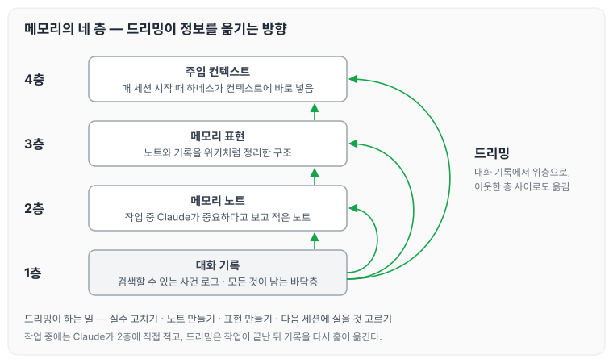
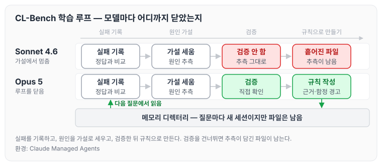
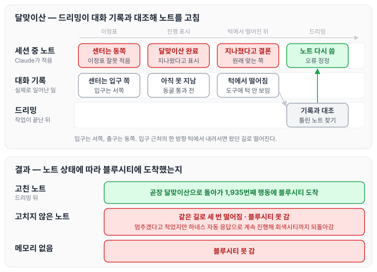
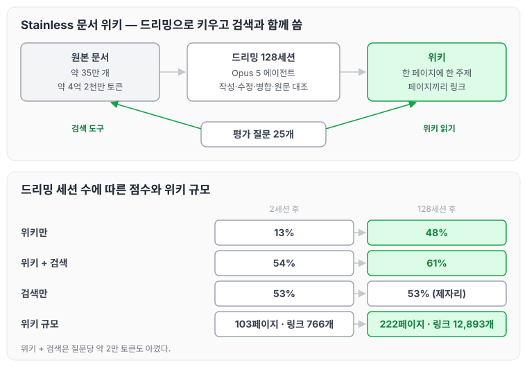
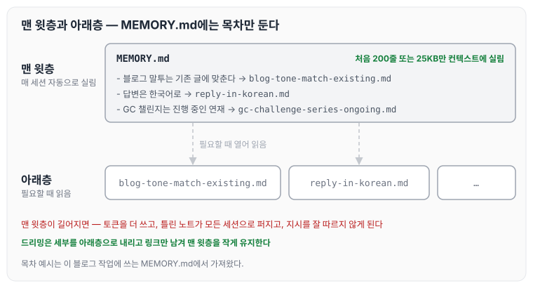
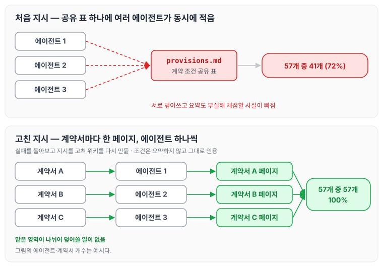
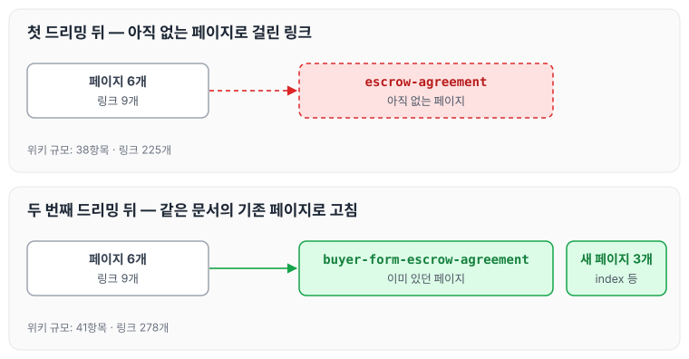

이전에 [Claude Code를 실제로 어떻게 사용했나](../claude-code-usage/)에서 세션이 끊겨도 맥락을 이어 가기 위해 `MEMORY/` 폴더에 결정 사항을 파일로 남긴 방법에 대해 작성하였습니다. 최근 Anthropic Engineering에 올라온 [The components of agent memory](https://www.anthropic.com/research/components-of-agent-memory)(Lance Martin, 2026-11-06)를 읽었는데, 이렇게 세션을 넘어 남기는 메모리를 네 개의 층으로 나누고, 작업이 끝난 뒤 기록을 다시 훑어 메모리를 고치고 정리하는 드리밍(dreaming)이라는 과정을 여러 실험과 함께 설명하고 있었습니다.

오늘은 이 글을 읽고 정리한 내용을 바탕으로 에이전트 메모리의 계층과 드리밍에 대해 정리하도록 하겠습니다. 원문을 옮긴 번역은 아니고, 읽으면서 이해한 내용을 제 말로 풀어 쓴 것입니다.

## 드리밍이라는 이름이 나온 배경

글은 사람의 기억이 만들어지는 방식에서 출발합니다. 뇌에서는 해마가 경험을 빠르게 기록하지만, 그중 일부만 장기 기억으로 굳습니다. 이렇게 굳히는 작업(consolidation)은 상당 부분 잠자거나 쉬는 동안 오프라인으로 일어나는데, 해마가 최근 경험을 되풀이(replay)하면서 일반 지식을 담는 신피질로 조금씩 옮긴다고 합니다.

글쓴이들은 에이전트에도 같은 분업을 적용할 수 있다고 제안합니다. 에이전트는 작업하면서 로그와 대화 기록(transcript)을 남기고, 작업이 끝난 뒤 이 기록을 다시 훑으면서 실수를 고치고 새 노트나 표현을 만들 수 있습니다. Letta와 UC Berkeley 연구진은 비슷한 아이디어를 "sleep-time compute"(쉬는 시간에 컨텍스트를 재정리하는 것)라고 불렀고, Anthropic은 이 과정을 드리밍이라고 부릅니다.

## 메모리의 네 층

글에서는 세션을 넘어 이어지는 메모리를 네 개의 층으로 나눕니다. 아래층부터 정리하면 아래와 같습니다.

1. 대화 기록(transcripts) — 검색할 수 있는 사건 로그입니다. 모든 것이 남는 바닥층입니다.
2. 메모리 노트(memory notes) — 작업 중에 Claude가 중요하다고 판단해 직접 적은 노트입니다.
3. 메모리 표현(representations) — 노트와 기록을 위키처럼 정리한 구조입니다.
4. 주입 컨텍스트(injected context) — 매 세션이 시작될 때 하네스가 컨텍스트에 바로 넣어 주는 맨 윗층입니다.

드리밍은 대화 기록에서 위의 각 층으로, 그리고 이웃한 층 사이로 정보를 옮깁니다. 네 층과 드리밍이 정보를 옮기는 방향을 그림으로 나타내면 아래와 같습니다.

그림에서 초록 화살표는 모두 드리밍이 정보를 옮기는 방향입니다. 드리밍이 하는 일은 실수 고치기, 노트 만들기, 표현 만들기, 다음 세션에 미리 실을 것 고르기의 네 가지이고, 뒤에서 하나씩 실험과 함께 살펴보겠습니다.

## 에이전트 메모리란

글에서 말하는 에이전트 메모리는 Claude가 경험(사용자와의 상호작용, 맡은 작업)에서 얻은 지식 중에서 세션을 넘어 남고, 나중에 읽을 수 있는 컨텍스트로 저장된 것을 말합니다.

반대로 아래 세 가지는 에이전트 메모리에 들지 않습니다.

- 모델 가중치 변화 — 학습할 때 정해짐
- 인컨텍스트 학습 — 한 대화 안에서만 유효함
- 컴팩션(compaction) — 오래된 대화를 요약으로 바꿔 새 컨텍스트 창에서 이어 가게 하는 것

뇌과학에서는 감정이나 화학 신호가 경험에 "중요함" 표시를 하고, 표시된 기억이 쉬는 동안 더 많이 재생되어 굳는다고 합니다. Claude도 세션 중에 중요한(salient) 사건에 표시를 하거나, 노트 폴더 같은 메모리 저장소에 적을 수 있습니다. 다만 다음에 어떤 일이 올지 모르는 상태에서 무엇이 중요한지를 어떻게 알 수 있는지가 문제로 남습니다.

## 메모리는 미래에 대한 예측이다

규칙이나 검증된 사실을 메모리에 적는다는 것은 "이 내용이 나중에 다시 쓸모 있을 것"이라고 예측하는 것과 같습니다. 예를 들어 다음 세션이 그 사실을 다시 확인하지 않고 믿고 써도 된다는 예측입니다.

글에서는 이를 CL-Bench 1.0(긴 작업에서 메모리를 얼마나 잘 활용하는지 보는 벤치마크)의 데이터베이스 과제로 실험하였습니다. 실험 방식은 아래와 같습니다.

- Claude가 DB를 질의해 질문에 답하고, 매번 정답을 들은 뒤 다음 질문을 위해 메모리를 적을 수 있습니다.
- 학습 루프는 실패 기록 → 원인 가설 → 검증 → 규칙으로 만들기 순서입니다.
- 환경은 Claude Managed Agents입니다. 질문마다 새 세션이지만 메모리 디렉터리의 파일은 세션을 넘어 남습니다.

모델마다 메모리를 쓰는 방식이 달랐습니다.

- Sonnet 4.6: 가설은 세우지만 검증하지 않아, 추측이 담긴 파일이 흩어져 남음
- Opus 4.7: 노트를 참고 문서 하나로 모으고, 어떤 사실이 검증됐는지 추적
- Sonnet 5: 채점 뒤 맞은 답을 "확인됨"으로 표시하고, 틀리면 정정을 적음
- Opus 5: 처음으로 루프를 완전히 닫음. 대부분의 항목에 규칙, 근거, 이전 질문의 답, 함정 경고가 있음
- Opus 5.5, Sonnet 5.5: 루프를 닫았고, 메모리를 쓸 때 점수는 Opus 5와 비슷하며, 메모리 없는 기준선은 조금 높음

학습 루프를 끝까지 닫지 못한 Sonnet 4.6과 루프를 닫은 Opus 5를 비교하면 아래와 같습니다.

두 모델 모두 실패를 기록하고 가설을 세우는 데까지는 같지만, 검증 단계에서 갈립니다. 검증을 거친 규칙만 다음 질문에서 믿고 쓸 수 있는 메모리가 됩니다.

모델별 평균 보상을 메모리 없이 풀었을 때와 메모리를 쓸 때로 나누어 보면 아래와 같습니다.

| 모델 | 메모리 없음 | 메모리 있음 |
|---|---|---|
| Opus 5.5 | 0.655 | 0.838 |
| Sonnet 5.5 | 0.644 | 0.833 |
| Opus 5 | 0.564 | 0.828 |
| Opus 4.7 | 0.383 | 0.700 |
| Sonnet 5 | 0.306 | 0.610 |
| Sonnet 4.6 | 0.330 | 0.364 |

강한 모델일수록 메모리로 얻는 이득이 크고, 가장 좋은 모델은 메모리를 검증된 재사용 규칙으로 만든다는 것을 알 수 있습니다.

## 무엇이 중요한지 고르기 — 포켓몬 레드

긴 작업에서 Claude가 무엇을 저장하는지 보기 위해 글에서는 포켓몬 레드를 플레이하게 하였습니다. 모델마다 메모리 파일 폴더를 하나씩 주고, 약 10,000 스텝 시점의 폴더를 비교하였습니다.

| 모델 | 폴더 | 파일 | 분량 | 배지 |
|---|---|---|---|---|
| Sonnet 3.7 | 225개 | 413개 | 약 97만 8천 자 | 1개 |
| Fable 5 | 2개 | 9개 + 최상위 `global.md` (총 10개) | 약 4만 3천 자 | 4개 |

Sonnet 3.7은 전투, 아이템, NPC마다 파일을 따로 만들 정도로 거의 모든 것을 저장하였습니다. 게임 상태는 계속 바뀌기 때문에 자세한 기록은 금방 낡았고, 게임보다 메모리를 관리하는 데 더 많은 시간을 썼습니다. 1만 스텝 무렵에는 네 번째 "master" 폴더를 새로 시작했고, 17스텝 동안 파일 6개를 만들고 9개를 지우면서 게임 행동은 하나도 하지 않았다고 합니다.

Fable 5는 화면에서 읽을 수 없는 것만 저장한다는 기준을 가지고 있었습니다. 돈이나 지도 위치는 매 턴 화면에 보이므로 저장할 필요가 없고, 전략이나 계획, 검증한 규칙처럼 Claude가 직접 알아내야만 존재하는 정보를 저장하였습니다. 폴더 구성은 아래와 같습니다.

- `global.md`: 현재 목표, 체육관 공략 계획, 메모리 사용 규칙을 담은 대시보드
- `locations` 폴더: 경로 계획
- `gameplay` 폴더: 배운 게임 규칙

예를 들어 잡기 쉬운 잉어킹에게 몬스터볼을 7번 던져 실패한 뒤, "메뉴 단계 사이에 대기 입력을 넣어 타이밍을 바꿔라"는 규칙을 적었고 다음 포획에서 성공하였습니다. Opus 5.5도 현재 목표와 다음 할 일만 담은 작은 폴더를 계속 고쳐 쓰면서 게임을 끝까지 깼다고 합니다.

## Claude에게 메모리를 쓰게 하는 방법

글에서는 메모리를 어떻게 쓰라고 정해 주기보다, 메모리가 무엇을 위한 것인지 알려 주는 편이 낫다고 설명합니다.

CL-Bench에서 Opus 4.7과 Opus 5는 "메모리 폴더가 있다"는 말만으로도 메모리를 잘 썼습니다. 반대로 쓰기 규칙을 하나씩 정해 시험해 보니, "실패만 기록하라"는 규칙은 강한 모델의 이득을 크게 깎았습니다. 모델별 메모리 이득 변화는 아래와 같습니다.

| 모델 | 메모리 이득 변화 |
|---|---|
| Opus 5 | -0.234 |
| Opus 4.7 | -0.150 |
| Sonnet 4.6 | -0.020 |

강한 모델은 고정된 규칙보다 무엇이 중요한지 판단을 맡길 때 더 잘하고, 고정 규칙은 오히려 해가 될 수 있다는 결과입니다.

다만 옛 모델에게는 안내가 효과가 컸습니다.

- Sonnet 4.6은 메모리 파일을 자주 읽지 않았고 가설도 검증하지 않았습니다.
- "답하기 전에 메모리를 읽고, 가설을 직접 검증하라"고 알려 주자 0.330(기준) / 0.364(메모리)에서 0.641(메모리+안내)로 거의 두 배가 되었습니다.
- Sonnet 5는 시키지 않아도 10번 중 9번은 답하기 전에 메모리를 읽었습니다(Sonnet 4.6은 절반 미만).

그래서 최신 모델에게 주는 안내는 단순합니다. 요청받았거나 분명히 기억할 가치가 있을 때 노트를 적고, 나머지는 Claude의 판단에 맡깁니다.

## 드리밍 1 — 틀린 메모리를 고친다

Claude는 그 순간에 무엇을 저장할지 정하기 때문에, 노트가 처음부터 틀렸거나 환경이 바뀌면서 낡을 수 있습니다. 문제는 다음 세션이 그 노트를 믿고 따른다는 점입니다. 드리밍은 노트를 원래 대화 기록과 맞대어 확인합니다.

글에서는 포켓몬의 달맞이산(Mt. Moon)을 예로 듭니다.

- 동굴 입구는 서쪽, 출구는 동쪽에 있습니다. 입구 근처에 한 방향으로만 내려갈 수 있는 턱(ledge)이 있어, 내려서면 왔던 길로 떨어집니다.
- Claude는 입구의 포켓몬센터를 이정표로 삼았는데, 노트에 "포켓몬센터가 동쪽에 있다"고 잘못 적었습니다.
- 그 뒤 "달맞이산은 지나왔다"며 완료로 표시했지만 사실이 아니었습니다.
- 턱에서 떨어졌을 때 내비게이션 도구가 턱을 보여 주지 않아서 "서쪽으로 지나쳤고, 원래 맞는 쪽이었다"고 결론을 냈습니다.

노트가 어떻게 틀렸고 드리밍이 이를 어떻게 고쳤는지, 그리고 노트 상태에 따라 결과가 어떻게 달라졌는지 그림으로 나타내면 아래와 같습니다.

결과를 비교하면 아래와 같습니다.

- 드리밍으로 고친 노트: 대화 기록과 비교해 오류를 찾아 다시 썼고, 곧장 달맞이산으로 돌아가 1,935번째 행동에 블루시티(Cerulean)에 도착하였습니다.
- 고치지 않은 노트: 같은 길로 세 번 떨어졌습니다. 세 번째에 "반복하지 말고 멈추겠다"고 적었지만 하네스의 자동 응답이 계속하라고 해서 회색시티(Pewter)까지 되돌아가 회복과 보급을 했고, 블루시티에는 끝내 가지 못했습니다.
- 메모리 없음: 블루시티에 가지 못했습니다.

틀린 노트 하나가 실행 전체를 망칠 수 있고, 대화 기록과 대조하는 드리밍이 이를 바로잡을 수 있다는 것을 보여 주는 예입니다.

## 드리밍 2 — 새 표현(위키)을 만든다

드리밍은 노트 말고도 메모리를 정리하는 구조를 만들 수 있습니다. 대표적인 것이 위키입니다. Claude가 직접 쓰고 관리하는 페이지 모음으로, 한 페이지에 한 주제를 담고 다른 페이지로 링크를 겁니다. 필요한 메모리를 링크를 따라 빠르게 찾을 수 있게 해 주는 지도 역할을 합니다.

글에서는 Anthropic이 5월에 인수한 소프트웨어 회사 Stainless의 내부 문서로 실험하였습니다.

- 문서 약 35만 개(약 4억 2천만 토큰), 평가 질문 25개, Claude에게는 검색 도구를 줌
- Opus 5 에이전트로 128세션 드리밍: 파일 탐색, 링크된 페이지 작성과 수정, 중복 병합, 원문 대조. 세션끼리는 공유 로그로 조율

위키를 만드는 구조와 세션 수에 따른 점수 변화를 그림으로 나타내면 아래와 같습니다.

세션이 2에서 128로 늘자 위키만으로 푼 점수는 13%에서 48%로, 위키와 검색을 함께 쓴 점수는 54%에서 61%로 올랐습니다. 검색만 쓴 경우는 53%로 제자리였습니다. 위키와 검색을 함께 쓰면 질문당 약 2만 토큰도 아낄 수 있었습니다. 위키 규모는 2세션 뒤 103페이지·링크 766개에서 128세션 뒤 222페이지·링크 12,893개로 늘었습니다. 글에서는 처음에는 위키만으로 답을 잘 못 하는 신입 같았다가, 드리밍이 쌓이면서 노련한 직원처럼 된다고 표현하였습니다.

위키는 한 번에 완성되지 않고 점진적으로 자랍니다. 처음 만든 뒤에 다음 드리밍이 내용을 더하고, 고치고, 쳐냅니다.

### 위키가 언제 도움이 되나 — Harvey LAB

Harvey LAB은 문서 묶음으로 법률 브리프를 쓰고 기준에 따라 채점하는 벤치마크입니다. 글에서는 인수합병 관련 문서 묶음을 사용하였습니다.

- 합병 질문 24개(절반 이상이 여러 문서를 엮어야 하고, 9개는 판단이나 계산이 필요): 위키 87%, 검색만 73%
- 반대로 57개 기준 대부분을 한 문서(주로 거래 개요 메모)에서 텍스트 검색으로 찾을 수 있는 과제에서는 위키의 이득이 뚜렷하지 않았습니다.
- 위키가 오히려 부푼 사례도 있었습니다. 문서 10개(115KB)로 만든 위키가 68페이지·링크 255개·203KB로 원본의 1.77배가 되었고, 링크가 없는 페이지도 있었습니다. 글에서는 이를 보르헤스의 "제국만 한 지도" 이야기에 빗대, 아무것도 추상화하지 못한 지도라고 설명합니다.

정리하면 위키는 여러 문서를 엮어야 할 때 효과가 있고, 검색으로 쉽게 찾을 수 있는 정보에는 보탬이 적으며 오히려 부풀 수 있습니다.

## 드리밍 3 — 노트를 맨 윗층으로 올린다

맨 윗층은 하네스가 매 세션 시작 때 컨텍스트에 넣어 줍니다. Claude가 찾을 필요도 없고, 찾아야 한다는 사실을 알 필요도 없습니다. 다만 아래와 같은 대가가 있습니다.

- 토큰을 씁니다.
- 틀린 노트가 모든 세션으로 퍼집니다.
- 실어 준다고 따른다는 보장은 없습니다. Claude Code 문서도 지시 파일이 길수록 잘 따르지 않는다고 경고합니다.

그래서 맨 윗층은 작게 유지해야 하고, 드리밍이 하는 일의 큰 부분은 세부 내용을 아래층으로 내리고 링크만 남겨 윗층을 작게 지키는 것입니다.

Claude Code의 auto memory가 이렇게 동작합니다. 세션 중에 Claude가 메모리를 관리하고, `MEMORY.md`의 처음 200줄 또는 25KB만 컨텍스트에 실립니다. 이 파일은 "Claude가 무엇을 알고 있고 그것을 어디에 두었는지" 보여 주는 목차 역할을 합니다.

이 블로그를 정리하는 작업에서도 같은 방식을 쓰고 있습니다. `MEMORY.md`에는 한 줄짜리 목차만 두고, 각 내용은 파일로 나눠 둡니다. 실제 목차 일부를 예로 맨 윗층과 아래층의 관계를 나타내면 아래와 같습니다.

맨 윗층에는 항목 이름과 파일 위치만 있고, 자세한 내용은 아래층 파일에 있습니다. 항상 실리는 층은 작은 목차로 두고, 나머지는 필요할 때 읽거나 검색하게 하는 구조입니다. [AI와 함께 개발하면서 겪은 문제들과 해결 방법](../ai-dev-problems/)에서 세션이 끊기면 맥락을 잃는 문제를 상태 파일로 보완했던 것도 같은 맥락이었던 것 같습니다.

## 드리밍 4 — 목표에 맞춰 메모리를 모은다

드리밍은 목적에 맞게 조정할 수 있습니다. 글에서는 Claude Duet(돕는 사람을 중심으로 메모리를 정리하면 좋은 비서)을 예로 들고, 드리밍을 이끄는 지시에 "이 작업에 어떤 정보가 중요한지"를 적어야 한다고 설명합니다.

LAB 과제 중 회사 인수와 계약서 묶음으로 브리프를 쓰고, 브리프가 계약 조건을 정확히 기술했는지 채점하는 과제가 있었습니다.

- 처음 위키를 만들 때의 지시는 위키가 어디에 쓰일지 말하지 않았습니다.
- 여러 에이전트가 동시에 계약 조건 공유 표(`provisions.md`) 하나에 적다가 서로 덮어썼고, 요약도 부실했습니다. 그 결과 채점할 사실 57개 중 41개(72%)만 남았습니다.
- Claude가 실패를 돌아보고, 지시 수정안을 내고, 위키를 다시 만드는 루프를 돌렸습니다. 이 과정에서 계약 조건이 가장 중요하다는 것이 드러나 지시를 고쳤습니다.
- 고친 위키는 계약서마다 한 페이지를 두고 에이전트 하나가 맡았으며, 조건은 요약하지 않고 그대로 인용하였습니다. 그 결과 57개 중 57개가 남아 기준 충족이 72%에서 100%가 되었습니다.

공유 표 하나에 동시에 적던 처음 방식과 계약서별 페이지로 나눈 방식을 비교하면 아래와 같습니다.

드리밍 지시에는 무엇이 중요한지 이름을 대야 하고, 동시에 쓰는 에이전트는 각자 맡은 영역을 나눠야 충돌이 생기지 않습니다.

## 드리밍 5 — 세션이 남긴 빈틈을 메운다

한 세션은 자기 컨텍스트만 볼 수 있습니다. 드리밍은 여러 세션을 가로질러 보기 때문에 공통 패턴이나 자주 하는 실수를 찾을 수 있습니다.

LAB 위키를 만들 때 Claude가 아직 없는 페이지로 링크를 거는 경우가 있었습니다. 두 번째 드리밍이 이를 고쳤는데, 6개 페이지에서 없는 `escrow-agreement` 페이지를 가리키던 링크 9개를 같은 문서의 기존 페이지 `buyer-form-escrow-agreement`로 바꾸고, 목차(index)를 포함한 새 페이지 3개를 추가하였습니다.

그 결과 위키는 38항목·링크 225개에서 41항목·링크 278개가 되었습니다.

## 남은 질문

글에서는 아직 정리되지 않은 질문 세 가지를 남깁니다.

1. 언제 쓸까 — 작업 중에 쓰면 중요도를 그 자리에서 잡고 바로 쓸 수 있지만 본 작업에서 주의를 뺏습니다. 드리밍은 뒤에서 하지만 결과가 바로 쓰이지 않을 수 있습니다.
2. 어떻게 최신으로 유지할까 — 틀린 예측이나 규칙이 남고 환경이 바뀌면 메모리가 어긋납니다. 드리밍으로 고칠 수 있지만 연산 비용이 들고, 모든 메모리를 계속 확인하기는 어렵습니다. 바뀌기 쉬운 정보에 드리밍을 집중하거나, 접근 빈도에 따라 주기를 조정하는 방법이 있습니다.
3. 대화 기록 검색을 바탕으로 — 대화 기록 검색 위에 쌓는 것이 합리적입니다. 위키 같은 표현과 검색을 함께 쓰는 조합이 잘 맞지만, 표현을 유지하고 오류나 환각이 쌓이지 않게 하려면 연산을 써야 합니다.

글은 Claude가 무엇이 중요한지 판단하는 능력은 좋아졌지만, 어떤 모델도 다음에 일어날 일을 알 수는 없다는 점으로 마무리합니다. 드리밍은 뒤를 돌아보며 연산을 들여 메모리를 정리하고, 실수를 고치고, 다음 세션이 쓰기 쉬운 표현을 유지하게 하는 과정입니다.

## 마무리

오늘은 Anthropic의 The components of agent memory를 읽고 에이전트 메모리의 네 층과, 작업이 끝난 뒤 기록을 다시 훑어 메모리를 고치고 정리하는 드리밍에 대해 정리하였습니다. 메모리를 많이 남기는 것보다 검증한 것을 남기고, 항상 실리는 층은 작은 목차로 유지하는 것이 중요하다는 점이 가장 기억에 남았습니다. 저도 이 블로그 작업에서 `MEMORY.md`를 목차로 두고 쓰고 있는데, 노트가 틀리거나 낡았을 때 어떻게 고칠지는 좀 더 고민해 보려고 합니다.

원문에는 드리밍을 시작하는 쿡북과 knowledge wiki 쿡북(claude-quickstarts 저장소의 managed-agents/knowledge-wiki) 링크도 있으니, 직접 해 보고 싶다면 원문에서 확인하시면 됩니다.

참조 : [The components of agent memory — Anthropic](https://www.anthropic.com/research/components-of-agent-memory)
