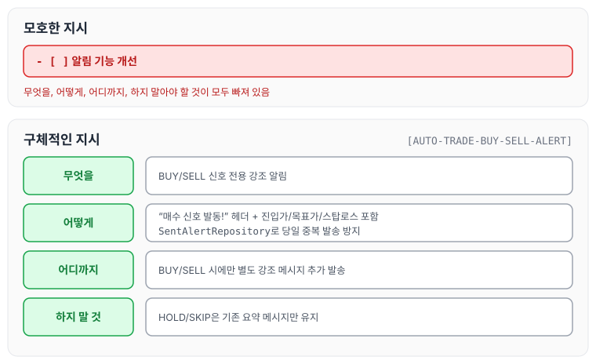
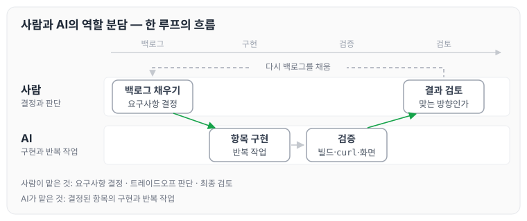

이전에 [AI와 함께 개발하면서 겪은 문제들과 해결 방법](../ai-dev-problems/)에 대해 작성하였습니다. 오늘은 Claude Code와 Ralph Loop([Ralph Loop 설계하기 — BACKLOG.md와 상태 파일 운영법](../ralph-loop-backlog/))를 활용해 1,208번의 루프를 돌리면서 배운 것들을 정리하도록 하겠습니다. 이번 글에서는 기술적인 내용보다 AI와 협업하는 방식 자체에 대한 교훈을 다루겠습니다.

## AI를 협업자로 대하기

처음에는 AI를 "빠른 코드 생성 도구"로 접근하였습니다. "이 기능 만들어줘"라고 요청하고 결과를 복사해 붙여 넣는 방식이었습니다.

이 방식은 금방 한계가 왔습니다. 결과물이 프로젝트의 맥락과 맞지 않았고, 매번 수정이 필요했습니다.

그래서 방식을 바꿔 AI를 새로 합류한 팀원처럼 대하였습니다. 프로젝트 구조를 설명하고, 코딩 규칙을 전달하고, 현재 상태를 공유하였습니다. 그러자 결과물의 품질이 달라졌습니다.

## 지시의 구체성과 결과 품질

백로그 항목을 어떻게 쓰느냐가 구현 품질을 결정하였습니다. 모호한 지시와 구체적인 지시를 비교하면 아래와 같습니다.

모호한 지시

```markdown
- [ ] 알림 기능 개선
```

구체적인 지시

```markdown
- [ ] [AUTO-TRADE-BUY-SELL-ALERT] BUY/SELL 신호 전용 강조 알림
  — BUY/SELL 시에만 별도 강조 메시지 추가 발송
  — "매수 신호 발동!" 헤더 + 진입가/목표가/스탑로스 포함
  — HOLD/SKIP은 기존 요약 메시지만 유지
  — SentAlertRepository로 당일 중복 발송 방지
```

구체적인 지시에는 무엇을, 어떻게, 어디까지, 하지 말아야 할 것이 포함됩니다. 이 네 가지가 명확할수록 AI는 의도에 맞게 구현합니다. 위 항목을 네 가지로 나누어 보면 아래와 같습니다.



모호한 지시에는 네 가지가 모두 빠져 있고, 구체적인 지시는 각 줄이 네 가지 중 하나에 해당합니다.

## 규칙의 파일화

구두로 "이렇게 해줘"라고 말한 규칙은 다음 루프에서 잊힙니다. 반면 파일에 기록한 규칙은 1,000번의 루프 후에도 지켜졌습니다.

그래서 `CLAUDE.md`에 규칙을 추가하는 것을 습관으로 만들었습니다. 같은 지적을 두 번 이상 하게 되면 그 내용을 파일에 적었습니다.

```markdown
# 반복되는 실수 → CLAUDE.md에 추가

set 대신 changeXxx()를 사용한다.       ← 루프 120에서 처음 지적
double 대신 BigDecimal을 사용한다.     ← 루프 230에서 처음 지적
요청하지 않은 기능을 추가하지 않는다.  ← 루프 310에서 처음 지적
```

규칙 파일이 쌓일수록 AI의 코드가 프로젝트 스타일에 가까워졌습니다.

## 검증 자동화

루프가 빠르게 돌아갈수록 검증을 생략하고 싶어집니다. 하지만 검증 없이 돌린 루프는 나중에 더 큰 수정 비용으로 돌아옵니다.

이 프로젝트에서는 매 루프마다 세 단계 검증을 유지하였습니다.

1. `./gradlew build` — 컴파일 에러 확인
2. `curl` 응답 확인 — API 정상 동작 확인
3. 브라우저 스크린샷 + `JS errors=0` — 화면 렌더링 확인

이 세 단계가 자동으로 돌아가는 구조를 만들어 두면, 사람은 결과만 확인하면 됩니다.

## 작은 단위로 쪼개기

항목을 크게 잡으면 한 번에 많은 것이 완성될 것 같지만, 실제로는 수정이 많아지고 검증이 어려워졌습니다.

"예상 0.5루프" 또는 "예상 1루프" 단위로 쪼개는 것이 결국 더 빨랐습니다.

```markdown
# 큰 항목 하나보다
- [ ] 자동매매 리스크 관리 전체 구현   ← 수정 발생 시 전체가 흔들림

# 작은 항목 여럿이 낫다
- [ ] [TRAILING-STOP] 트레일링 스탑 스케줄러 — 예상 0.5루프
- [ ] [BREAK-EVEN-STOP] 손익분기 스탑 — 예상 0.5루프
- [ ] [DRAWDOWN-ALERT] 포지션 하락 경보 — 예상 0.5루프
```

## AI가 할 수 없는 것

1,200번의 루프를 돌리면서 AI가 하지 못하는 일도 분명해졌습니다.

- 요구사항 결정: "이 기능이 필요한가", "우선순위가 맞는가"는 AI가 판단할 수 없습니다. 백로그를 채우는 것은 사람의 역할이었습니다.
- 트레이드오프 판단: "속도와 정확도 중 무엇을 택할 것인가", "이 기능을 지금 만들어야 하는가"는 AI가 결정하지 않았습니다.
- 최종 검토: 빌드가 되고 화면이 렌더링되더라도 "이게 맞는 방향인가"를 판단하는 것은 사람이었습니다.

AI는 결정된 것을 구현하는 속도를 높여 주었지만, 무엇을 만들지는 여전히 사람이 결정하였습니다. 이 프로젝트에서 사람과 AI가 나눠 맡은 일을 한 루프의 흐름으로 그리면 아래와 같습니다.



사람은 백로그를 채우고 결과를 검토하며, 그 사이의 구현과 검증은 AI가 맡습니다.

## 이 방식이 유효한 이유

혼자서 이 규모의 프로젝트를 만들려면 수개월이 걸립니다. 도메인 클래스 200개, 템플릿 20개, 외부 API 50개를 순수하게 손으로 만드는 것은 현실적으로 어렵습니다.

AI와 협업한 결과 약 3주 만에 완성할 수 있었습니다. 이 차이는 AI가 구현 속도를 높여 주었기 때문이 아니라, 반복 작업을 AI에게 위임하고 사람은 설계와 판단에 집중할 수 있었기 때문이라고 생각합니다.

앞으로도 이 방식을 유지하려고 합니다. 백로그를 채우고, 루프를 돌리고, 결과를 검토하고, 다시 백로그를 채우는 방식입니다.

## 마무리

오늘은 1,208번의 루프를 돌리며 배운 AI 협업 방식에 대해 정리하였습니다. 지시를 구체적으로 쓰고, 규칙을 파일로 남기고, 검증을 자동화하고, 작업을 작게 쪼개는 것이 핵심이었고, 무엇을 만들지는 사람이 결정해야 한다는 점도 알 수 있었습니다. 비슷한 방식으로 AI와 협업하려는 분들께 작은 참고가 되었으면 좋겠습니다.

## 연재 목차

| 편 | 제목 |
| --- | --- |
| 1편 | [Claude Code로 만든 암호화폐 투자 대시보드](../claude-code-crypto-dashboard/) |
| 2편 | [Ralph Loop 설계하기 — BACKLOG.md와 상태 파일 운영법](../ralph-loop-backlog/) |
| 3편 | [Claude Code를 실제로 어떻게 사용했나](../claude-code-usage/) |
| 4편 | [AI와 함께 자동매매 시스템을 설계한 과정](../ai-trading-system/) |
| 5편 | [AI와 함께 개발하면서 겪은 문제들과 해결 방법](../ai-dev-problems/) |
| 6편 | AI 협업 개발 |
