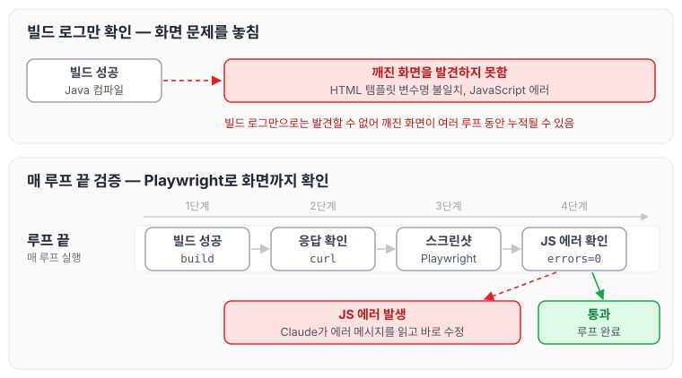
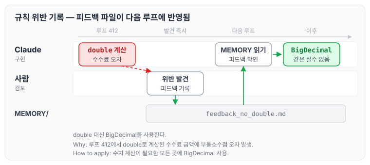
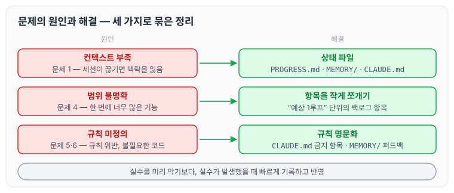

이전에 [AI와 함께 자동매매 시스템을 설계한 과정](../ai-trading-system/)에 대해 작성하였습니다. 오늘은 Claude Code를 1,200번 이상 반복 사용하면서 실제로 겪은 문제들과 해결 방법을 정리하도록 하겠습니다. AI로 모든 것을 해결할 수는 없었기 때문에, 그 한계를 어떻게 보완했는지를 겪은 그대로 적어 보겠습니다.

## 문제 1 — 세션이 끊기면 맥락을 잃는다

가장 자주 발생한 문제입니다. Claude Code는 대화 세션이 끊기면 이전 결정을 기억하지 못합니다. 새 세션에서 시작하면 "이 프로젝트가 무엇인지", "어디까지 구현됐는지"를 처음부터 다시 파악해야 합니다.

### 해결 방법

중요한 결정은 모두 파일에 기록하였습니다.

- 완료된 작업은 `PROGRESS.md`에 기록
- 잊으면 안 되는 피드백은 `MEMORY/` 폴더에 저장
- 코딩 규칙은 `CLAUDE.md`에 명문화

새 세션이 시작되면 Claude는 이 파일들을 읽고 컨텍스트를 복원합니다. 그래서 처음부터 다시 설명할 필요가 없었습니다. 상태 파일을 구성한 방법은 [Ralph Loop 설계하기 — BACKLOG.md와 상태 파일 운영법](../ralph-loop-backlog/)에 정리하였습니다.

## 문제 2 — 이미 있는 기능을 다시 구현한다

루프가 300번을 넘어가면서 기능이 많아졌고, 이때부터 Claude가 이미 구현된 기능을 새로 만드는 경우가 생겼습니다. 메서드 이름만 다르거나 유사한 로직이 두 곳에 생기기도 하였습니다.

### 해결 방법

백로그 항목에 `SKIP` 태그를 적고, 중복일 때 어떤 기존 구현을 재사용할지 안내하였습니다.

```markdown
- [x] [CLEANUP-KELLY-CRITERION-DUPLICATE] 켈리 중복 메서드/호출/패널 정리 — 루프 801
- [x] [BATCH-ANALYSIS-SCORE-TREND-CONSISTENCY](SKIP 이미구현) → 다음 배치 준비
```

그리고 구현을 요청할 때 "기존 메서드를 확인하고 재사용할 것"이라는 지침을 `CLAUDE.md`에 추가하였습니다.

## 문제 3 — 빌드는 되는데 화면이 깨진다

빌드에 성공했다고 해서 완성된 것은 아니었습니다. Java 코드는 컴파일됐지만 HTML 템플릿의 변수명이 맞지 않거나, JavaScript 에러가 발생하는 경우가 있었습니다. 이런 문제는 빌드 로그만으로는 발견할 수 없습니다.

### 해결 방법

매 루프 끝에 Playwright로 브라우저 스크린샷을 찍고 JS 에러를 확인하는 단계를 루프에 포함하였습니다.

```text
빌드 성공 → curl 응답 확인 → 브라우저 스크린샷 → JS errors=0 확인
```

JS 에러가 발생하면 Claude가 에러 메시지를 읽고 바로 수정하였습니다. 검증 단계와 실패했을 때의 흐름을 그리면 아래와 같습니다.



이 검증 단계가 없었다면 조용히 깨진 화면이 수십 개 루프 동안 누적됐을 것입니다.

## 문제 4 — 너무 많은 기능을 한 번에 구현하려 한다

초반에는 백로그 항목을 크게 잡는 경우가 있었습니다. "포트폴리오 페이지 전체 구현"처럼 작성하면 Claude가 한 루프에 너무 많은 변경을 가져와 충돌이 발생하거나 일부가 누락되었습니다.

### 해결 방법

항목을 작게 쪼갰습니다. "예상 1루프" 단위가 적당하였습니다.

```markdown
# 좋지 않은 예시
- [ ] 포트폴리오 페이지 전체 구현

# 좋은 예시
- [ ] [PORTFOLIO-PNL-CARD] 포트폴리오 손익 카드 — 예상 0.5루프
- [ ] [PORTFOLIO-CHART] 포트폴리오 평가액 시계열 차트 — 예상 1루프
- [ ] [PORTFOLIO-BENCHMARK] BTC Buy&Hold 대비 수익률 비교 — 예상 1루프
```

항목이 작을수록 Claude가 한 가지에 집중해서 구현하였고, 검증도 쉬워졌습니다.

## 문제 5 — 규칙을 어긴 코드가 섞인다

수백 번의 루프를 거치면서 간혹 규칙에 맞지 않는 코드가 들어왔습니다. `double` 사용, setter 사용, 중첩 if 등이 드물게 등장하였습니다.

### 해결 방법

발견하는 즉시 `MEMORY/` 폴더에 피드백 파일을 추가하였습니다.

```markdown
# feedback_no_double.md
double 대신 BigDecimal을 사용한다.
Why: 루프 412에서 double로 계산된 수수료 금액에 부동소수점 오차 발생.
How to apply: 수치 계산이 필요한 모든 곳에 BigDecimal 사용.
```

다음 루프부터 Claude는 이 파일을 읽고 같은 실수를 반복하지 않았습니다. 피드백이 다음 루프에 반영되는 흐름은 아래와 같습니다.



이후로는 규칙 위반이 발생할 때마다 MEMORY에 기록하는 것이 습관이 되었습니다.

## 문제 6 — AI가 불필요한 코드를 추가한다

Claude는 종종 요청하지 않은 코드를 추가하였습니다. 에러 처리, 로깅, 주석, 유틸리티 메서드 등이 과도하게 붙는 경우가 있었고, 구현 범위가 커지면 리뷰가 어려워집니다.

### 해결 방법

`CLAUDE.md`에 금지 항목을 명시적으로 추가하였습니다.

```markdown
## 하지 말 것

- 요청하지 않은 기능 추가 금지
- 요청하지 않은 리팩터링 금지
- 추측성 에러 처리 추가 금지
- 사용하지 않는 헬퍼 메서드 생성 금지
```

이 규칙을 추가한 뒤로 불필요한 코드가 눈에 띄게 줄었습니다.

## 마무리

오늘은 Claude Code로 개발하면서 겪은 여섯 가지 문제와 해결 방법에 대해 정리하였습니다. 돌아보면 문제들은 대부분 컨텍스트 부족, 범위 불명확, 규칙 미정의에서 비롯되었습니다. 세 가지 원인과 해결 방법을 함께 정리하면 아래와 같습니다.



상태 파일로 컨텍스트를 유지하고, 항목을 작게 쪼개고, 규칙을 명문화하면 대부분의 문제를 예방할 수 있었습니다. 또한 AI의 실수를 미리 막으려 하기보다, 실수가 발생했을 때 빠르게 기록하고 반영하는 편이 더 효과적이었습니다. AI가 모든 것을 해 주지는 않지만, 잘 정의된 환경 안에서는 일관되게 일한다는 것을 느낄 수 있었습니다. 다음 글에서는 [AI 협업 개발](../ai-collab-dev/)에 대해 정리하도록 하겠습니다.
