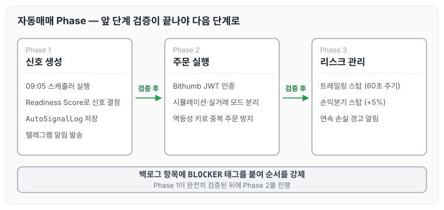
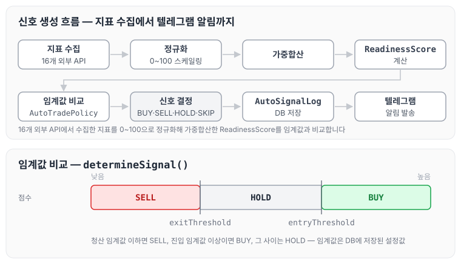
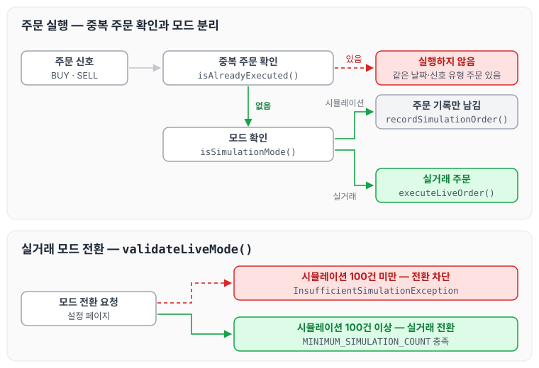

이전에 [Claude Code를 실제로 어떻게 사용했나](../claude-code-usage/)에 대해 작성하였습니다. 오늘은 자동매매 시스템을 AI와 함께 설계하고 구현한 과정을 정리하도록 하겠습니다. 요구사항을 어떻게 정의했는지, AI에게 어떤 방식으로 지시했는지, 그리고 실거래 전 안전장치를 어떻게 설계했는지를 순서대로 다루겠습니다.

## 자동매매 시스템의 요구사항 정의

AI에게 "자동매매 만들어줘"라고만 요청하면 의도와 다른 결과가 나옵니다. 그래서 요구사항을 먼저 구체적으로 백로그에 정의하였습니다. 백로그를 운영한 방식은 [Ralph Loop 설계하기 — BACKLOG.md와 상태 파일 운영법](../ralph-loop-backlog/)에 정리하였습니다.

이 프로젝트에서 정의한 자동매매 시스템의 핵심 요구사항은 아래와 같습니다.

```markdown
## 자동매매 Phase 1 — 신호 생성
- [ ] 매일 오전 09:05 스케줄러 실행
- [ ] Readiness Score 기반 BUY/SELL/HOLD/SKIP 신호 결정
- [ ] 신호 로그 DB 저장 (AutoSignalLog)
- [ ] 텔레그램 알림 발송

## 자동매매 Phase 2 — 주문 실행
- [ ] Bithumb JWT 인증 구현
- [ ] 시뮬레이션 모드 / 실거래 모드 분리
- [ ] 멱등성 키로 중복 주문 방지

## 자동매매 Phase 3 — 리스크 관리
- [ ] 트레일링 스탑 (60초 주기)
- [ ] 손익분기 스탑 (+5% 도달 시 스탑 이동)
- [ ] 연속 손실 경고 알림
```

이때 Phase 순서를 지키는 것이 중요했습니다. Phase 1이 완전히 검증된 뒤에 Phase 2를 진행하였습니다. 세 Phase의 진행 순서를 그림으로 나타내면 아래와 같습니다.



각 Phase 사이에는 검증 단계가 있고, 앞 Phase의 검증이 끝나야 다음 Phase의 항목을 시작합니다.

## 신호 생성 흐름

AI가 구현한 신호 생성 흐름은 아래와 같습니다.

```text
지표 수집 (16개 외부 API)
  → 정규화 (0~100 스케일링)
  → 가중합산
  → ReadinessScore 계산
  → 임계값 비교
  → BUY / SELL / HOLD / SKIP 결정
  → AutoSignalLog 저장
  → 텔레그램 알림
```

신호 결정 로직의 핵심 부분은 다음과 같습니다.

```java
public SignalLabel determineSignal(ReadinessScore score, AutoTradePolicy policy) {
    if (score.getValue().compareTo(policy.entryThreshold()) >= 0) {
        return SignalLabel.BUY;
    }
    if (score.getValue().compareTo(policy.exitThreshold()) <= 0) {
        return SignalLabel.SELL;
    }
    return SignalLabel.HOLD;
}
```

`AutoTradePolicy`는 DB에 저장된 설정값입니다. 임계값을 코드에 하드코딩하지 않았기 때문에 설정 페이지에서 변경할 수 있습니다. 흐름과 임계값 비교를 함께 그리면 아래와 같습니다.



점수가 진입 임계값 이상이면 BUY, 청산 임계값 이하이면 SELL, 그 사이이면 HOLD가 됩니다.

## 멱등성 키로 중복 주문 방지

자동매매에서 가장 위험한 상황은 같은 신호가 두 번 실행되는 것입니다. 네트워크 재시도, 앱 재시작, 수동 재실행 등 여러 이유로 발생할 수 있습니다.

이 문제는 **멱등성 키**로 해결하였습니다.

```java
// 멱등성 키 = 날짜 + 신호 유형 + UUID
String idempotencyKey = LocalDate.now() + "_" + signalType + "_" + UUID.randomUUID();
```

같은 날짜와 신호 유형으로 이미 주문이 존재하면 실행하지 않습니다.

```java
public boolean isAlreadyExecuted(LocalDate date, SignalLabel signalType) {
    return autoTradeOrderRepository.existsByDateAndSignalType(date, signalType);
}
```

백로그에 이 항목을 작성할 때는 "중복 방지"라는 말 대신 구체적인 동작을 적었습니다.

```markdown
- [ ] [BLOCKER-1] 멱등성 키 UUID+timestamp 재설계
  — forceExecute() 추가, FORCE_MODE ThreadLocal
  — deleteByDate() 포트/JPA/Fake 구현
  — 강제 재실행 시 date+UUID+BUY/SELL 키 사용
```

Claude는 이 설명을 보고 관련 클래스 전체(포트 인터페이스, JPA 구현체, Fake 구현체, 서비스)를 한 번에 구현하였습니다.

## 시뮬레이션 모드와 실거래 모드 분리

실거래 전에는 충분한 시뮬레이션이 필요합니다. 그래서 두 모드를 완전히 분리하고, 시뮬레이션 모드일 때는 실제 API를 호출할 수 없도록 설계하였습니다.

```java
public void executeOrder(AutoTradePolicy policy, SignalLabel signal) {
    if (policy.isSimulationMode()) {
        log.info("Simulation order: signal={}, score={}", signal, currentScore);
        recordSimulationOrder(signal);
        return;
    }
    executeLiveOrder(signal);
}
```

설정 페이지에서 모드를 변경할 수 있지만, 시뮬레이션 이력이 100건 미만이면 실거래 모드로의 전환이 차단됩니다.

```java
public void validateLiveMode(List<AutoTradeOrder> simulationHistory) {
    if (simulationHistory.size() < MINIMUM_SIMULATION_COUNT) {
        throw new InsufficientSimulationException(
            "실거래 전환을 위해 최소 " + MINIMUM_SIMULATION_COUNT + "건의 시뮬레이션이 필요합니다."
        );
    }
}
```

이 안전장치는 백로그에 `BLOCKER` 태그로 정의하였고, Claude는 이 항목이 완료되기 전까지 실거래 관련 코드를 활성화하지 않았습니다. 앞에서 본 중복 주문 확인과 모드 분리를 주문 한 건의 흐름으로 정리하면 아래와 같습니다.



같은 날짜·신호 유형의 주문이 이미 있으면 실행하지 않고, 시뮬레이션 모드에서는 주문을 기록만 합니다. 실거래 전환은 시뮬레이션 이력이 100건 이상일 때만 허용됩니다.

## 텔레그램 알림 설계

단순히 "신호가 발생했다"는 알림보다 더 많은 정보가 필요했습니다. 그래서 BUY 신호일 때는 진입가, 포지션 크기, 현재 점수를 포함한 강조 알림을 별도로 발송하도록 하였습니다.

```markdown
## BUY 신호 발동 백로그 항목

- [ ] [AUTO-TRADE-BUY-SELL-ALERT] BUY/SELL 신호 전용 강조 알림
  — BUY/SELL 신호 시에만 별도 강조 메시지 추가 발송
  — "매수 신호 발동!" 헤더 + HTML bold + 진입가/청산가 포함
  — HOLD/SKIP은 기존 요약만 유지
```

Claude는 이 항목을 구현할 때 기존 `NotificationService`를 수정하지 않고 BUY/SELL 전용 메서드를 추가하였습니다. 덕분에 기존 기능에는 영향을 주지 않았습니다.

## 리스크 관리 스케줄러

포지션 진입 후의 리스크 관리는 별도 스케줄러로 처리하였습니다.

- 트레일링 스탑: 60초마다 최고가 대비 하락률을 확인하고, 임계값에 도달하면 자동 매도
- 손익분기 스탑: +5%에 도달하면 스탑 기준가를 진입가로 이동
- 드로다운 알림: -5% / -10%에 도달하면 텔레그램 경고

각 스케줄러는 독립적으로 동작하고, 서로 중복 매도가 발생하지 않도록 `SentAlertRepository`로 상태를 공유하였습니다.

백로그 항목을 작성할 때도 이 의존관계를 적어 두었습니다.

```markdown
- [ ] [AUTO-TRAILING-STOP-MONITOR] 트레일링 스탑 모니터링
  — StopLossMonitorScheduler와 교차 이중매도 방지
  — _TRAILING_STOP / _STOPLOSS 키 분리
  — peakPrice AtomicReference로 최고가 추적
```

Claude는 이 설명을 보고 두 스케줄러가 충돌하지 않도록 설계하였습니다.

## 마무리

오늘은 자동매매 시스템을 AI와 함께 설계하면서 요구사항을 Phase로 나누고, 멱등성 키와 시뮬레이션 모드 같은 안전장치를 만든 과정을 정리하였습니다. 신호 생성 → 주문 실행 → 리스크 관리 순서로 단계를 나누고, 각 단계가 완전히 검증된 뒤에 다음 단계로 넘어갔습니다. 백로그 항목에 `BLOCKER` 태그를 붙여 순서를 강제하였고, Claude는 이 순서를 지키며 구현하였습니다.

실거래를 다루는 시스템에서는 기능보다 안전장치를 먼저 만들어 두는 것이 좋은 것 같습니다. 다음 글에서는 [AI와 함께 개발하면서 겪은 문제들과 해결 방법](../ai-dev-problems/)에 대해 정리하도록 하겠습니다.
