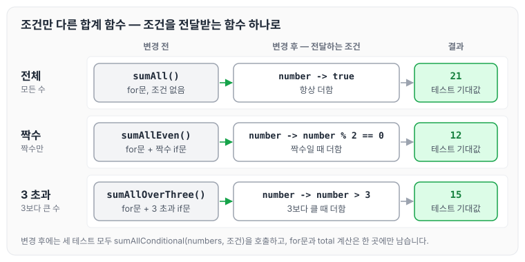
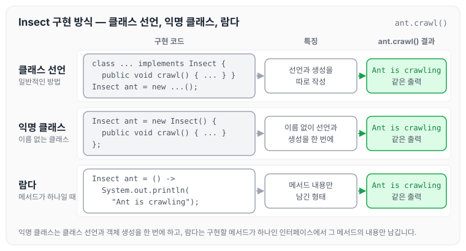

오늘은 자바의 익명 클래스에 대해 정리하도록 하겠습니다. 익명 클래스가 무엇인지 먼저 살펴보고, 조건만 다른 합계 함수의 중복을 줄이는 예제, 인터페이스를 객체로 바로 구현하는 방법, 익명 클래스를 사용할 때의 이점 순서로 정리하겠습니다.

## 익명 클래스

자바에서 익명 클래스(anonymous class)는 이름이 없는 클래스로, 한 번만 사용할 때 씁니다.

익명 클래스는 클래스를 정의하면서 동시에 객체를 생성할 수 있습니다. 주로 인터페이스나 추상 클래스를 상속받아 구현하는 경우가 많습니다.

아래 예시로 살펴보겠습니다.

## 숫자 더하기 함수

숫자 목록을 받아 더하는 함수 세 개가 있습니다.

1. 모든 수를 더하는 함수
2. 짝수만 더하는 함수
3. 3보다 큰 수를 더하는 함수

세 함수는 공통으로 사용하는 부분이 많고, 다르게 작성된 부분은 if문의 조건뿐입니다.

```java
public static int sumAll(List<Integer> numbers) {
        int total = 0;
        for (int number : numbers) {
            total += number;
        }
        return total;
    }

public static int sumAllEven(List<Integer> numbers) {
    int total = 0;
    for (int number : numbers) {
        if (number % 2 == 0) {
            total += number;
        }
    }
    return total;
}

public static int sumAllOverThree(List<Integer> numbers) {
    int total = 0;
    for (int number : numbers) {
        if (number > 3) {
            total += number;
        }
    }
    return total;
}
```

### 코드 수정

공통 부분은 `sumAllConditional` 하나로 합치고, 더할지 말지 판단하는 조건만 `Conditional`로 전달받도록 수정하였습니다. 테스트에서는 조건만 바꿔 전체 합, 짝수 합, 3보다 큰 수의 합을 구합니다.

```java
@Test
    public void sumAll() throws Exception {
        int sum = Lambda.sumAllConditional(numbers, number -> true);
        assertThat(sum).isEqualTo(21);
    }

    @Test
    public void sumAllEven() throws Exception {
        int sum = Lambda.sumAllConditional(numbers, number -> number % 2 == 0);
        assertThat(sum).isEqualTo(12);
    }

    @Test
    public void sumAllOverThree() throws Exception {
        int sum = Lambda.sumAllConditional(numbers, number -> number > 3);
        assertThat(sum).isEqualTo(15);
    }
```

조건을 받아 합계를 구하는 `sumAllConditional`은 아래와 같습니다.

```java
public static int sumAllConditional(List<Integer> numbers, Conditional conditional) {
        int total = 0;
        for (int number : numbers) {
            if (conditional.data(number)) {
                total += number;
            }
        }
        return total;
    }
```

조건을 표현하는 `Conditional` 인터페이스는 아래와 같습니다.

```java
public interface Conditional {
    boolean data(Integer number);
}
```

수정 전후를 그림으로 나타내면 아래와 같습니다.



위와 같이 공통 부분은 하나의 함수로 작성하고, if문의 분기 조건은 `Conditional`의 구현으로 전달해 가독성을 높일 수 있습니다. `Conditional`은 구현할 메서드가 `data()` 하나뿐이라, 테스트에서는 익명 클래스 대신 `number -> true` 같은 람다로 조건을 짧게 전달하였습니다. 같은 예제를 [스트림, 람다, Optional — 1단계](../ccj-01-stream-lambda-optional/)에서도 람다로 중복을 없애는 실습으로 정리하였습니다.

## 객체로 사용하는 방법

예를 들어 `Insect` 인터페이스를 구현하려면, 일반적인 방법으로는 클래스를 만들고 `Insect`를 구현하도록 선언해야 합니다. 익명 클래스를 사용하면 별도의 클래스를 선언하지 않고 객체를 생성하는 자리에서 바로 구현할 수 있습니다.

`Insect`처럼 구현할 메서드가 하나뿐인 인터페이스는 익명 클래스를 람다로 더 짧게 쓸 수 있습니다. 아래는 `Insect`를 람다로 구현한 예시입니다.

```java
interface Insect {
    void crawl();
}

public class Conditional {
    public static void main(String[] args) {
        Insect ant = () -> System.out.println("Ant is crawling");
        ant.crawl();
    }
}
```

클래스를 따로 만드는 방법, 익명 클래스, 람다로 `Insect`를 구현하는 방식을 비교하면 아래와 같습니다.



세 방식 모두 `ant.crawl()`을 호출하면 같은 결과가 출력됩니다. 익명 클래스는 클래스 이름 없이 선언과 생성을 한 번에 하고, 람다는 그중 구현할 메서드의 내용만 남긴 형태입니다.

## 이점

1. 코드 가독성 향상: 익명 클래스를 사용하면 코드가 간결해지고, 클래스의 정의와 객체의 생성을 한눈에 볼 수 있습니다.
2. 코드 재사용성 향상: 익명 클래스는 한 번만 사용되기 때문에 다른 곳에서 재사용할 필요가 없습니다. 따라서 코드의 재사용성을 떨어뜨리는 요소를 제거할 수 있습니다.
3. 코드 작성 편의성 향상: 익명 클래스를 사용하면 클래스를 정의하고 객체를 생성하는 과정을 하나로 합칠 수 있어 코드 작성이 간편해집니다.
4. 코드 오버헤드 감소: 한 번만 쓰는 구현을 위해 별도의 클래스를 선언하지 않아도 됩니다. 다만 익명 클래스도 컴파일하면 `바깥클래스$1.class`처럼 이름이 자동으로 붙은 클래스 파일이 생성됩니다.
5. 코드 유연성 향상: 익명 클래스를 사용하면 클래스의 구현을 런타임 시에 변경할 수 있어 코드의 유연성이 높아집니다.
6. 코드 가시성 향상: 익명 클래스는 클래스의 이름이 없기 때문에 코드의 가시성이 향상됩니다. 클래스 이름에 대한 고민도 덜 수 있습니다.

## 마무리

오늘은 자바의 익명 클래스가 무엇인지, 조건만 다른 함수의 중복을 조건 전달로 줄이는 방법, 인터페이스를 이름 없이 구현하는 방법과 사용할 때의 이점에 대해 정리하였습니다. 구현할 메서드가 하나뿐인 인터페이스라면 익명 클래스보다 람다로 쓰는 편이 더 간결한 것 같습니다.
