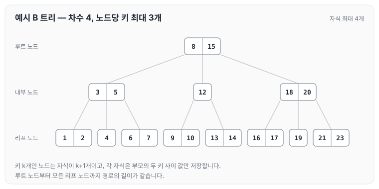
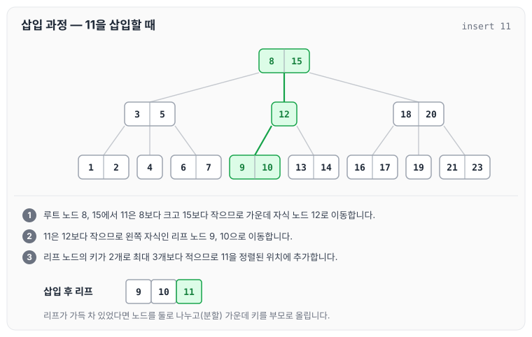
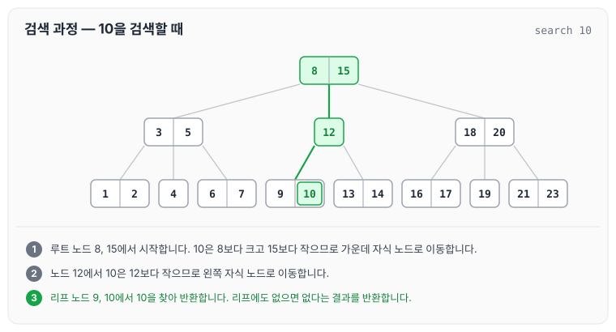
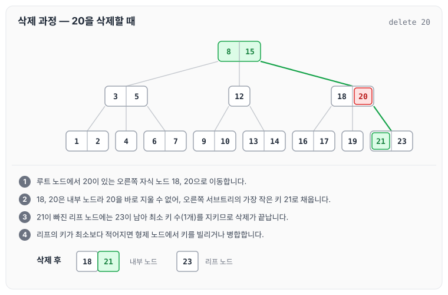

데이터베이스 인덱스는 대부분 B 트리를 기반으로 동작합니다. 오늘은 인덱스의 바탕이 되는 B 트리의 특징과 예시 트리에서의 삽입, 검색, 삭제 과정에 대해 정리하도록 하겠습니다.

B 트리는 바이너리 서치 트리와 달리 다수의 자식 노드를 가지는 다진 트리입니다. 이 때문에 대량의 데이터를 효율적으로 관리할 수 있습니다.

## B-Tree의 특징

B 트리는 아래와 같은 특징을 가집니다.

- 노드들은 정렬된 순서로 저장됩니다.
- 노드마다 허용된 최대 자식 수가 있습니다.
- 루트 노드부터 리프 노드까지 모든 경로의 길이가 동일하게 유지됩니다.
- 데이터가 노드에 삽입되거나 삭제될 때, 트리의 균형을 유지하기 위한 재조정이 일어납니다.

B 트리는 대량의 데이터를 효율적으로 저장하고 검색하기 위해 사용됩니다. 트리의 균형을 유지하기 때문에 검색, 삽입, 삭제 연산의 시간 복잡도가 최악의 경우에도 O(log n)입니다.

## B-Tree의 예시

예시로 사용할 B 트리는 차수(한 노드가 가질 수 있는 최대 자식 수)가 4인 트리입니다. 노드 하나에는 키를 최대 3개까지 저장할 수 있고, 루트를 제외한 노드는 키를 최소 1개 가집니다.

```text
                       8, 15
           /             |              \
        3, 5            12             18, 20
      /   |   \        /    \         /    |    \
   1, 2   4   6, 7  9, 10  13, 14  16, 17  19  21, 23
```

위 트리를 노드 단위로 그리면 다음과 같습니다.



노드별로 살펴보면 아래와 같습니다.

1. 루트 노드 `8, 15`
    - 두 개의 키를 가지고 있으며, 세 개의 자식 노드를 가집니다. 키가 k개인 노드는 자식을 k+1개 가집니다.
    - 왼쪽 자식 `3, 5`는 `8`보다 작은 값, 가운데 자식 `12`는 `8`과 `15` 사이의 값, 오른쪽 자식 `18, 20`은 `15`보다 큰 값을 저장합니다.
2. 첫 번째 자식 노드 `3, 5`
    - `1, 2`, `4`, `6, 7`이라는 세 개의 자식 노드를 가집니다.
    - 자식 노드의 키들은 다음과 같은 규칙을 따릅니다.
        - `1, 2`는 `3`보다 작습니다.
        - `4`는 `3`과 `5` 사이에 위치합니다.
        - `6, 7`은 `5`보다 크고 루트의 `8`보다 작습니다.
3. 두 번째 자식 노드 `12`
    - `9, 10`과 `13, 14`라는 두 개의 자식 노드를 가집니다.
    - `9, 10`은 `12`보다 작고, `13, 14`는 `12`보다 큽니다. 모두 루트의 `8`과 `15` 사이에 있습니다.
4. 세 번째 자식 노드 `18, 20`
    - `16, 17`, `19`, `21, 23`이라는 세 개의 자식 노드를 가집니다.
    - 자식 노드의 키들은 다음과 같은 규칙을 따릅니다.
        - `16, 17`은 `18`보다 작습니다.
        - `19`는 `18`과 `20` 사이에 위치합니다.
        - `21, 23`은 `20`보다 큽니다.

모든 리프 노드가 같은 깊이에 있으므로, 어떤 값을 찾든 루트에서 리프까지 같은 수의 노드를 거칩니다.

## B-Tree의 작동 방식

위 예시 트리를 기준으로 삽입, 검색, 삭제가 어떻게 진행되는지 정리하겠습니다.

### 1. 삽입 과정

11을 삽입하는 경우입니다.

1. 루트 노드 `8, 15`를 탐색합니다. `11`은 `8`보다 크고 `15`보다 작으므로, 가운데 자식 노드 `12`로 이동합니다.
2. `11`은 `12`보다 작으므로 왼쪽 자식인 리프 노드 `9, 10`으로 이동합니다. B 트리에서 새 키는 항상 리프 노드에 삽입됩니다.
3. 이 리프 노드는 키가 2개로 최대 3개보다 적어 가득 차지 않았으므로 `11`을 추가할 수 있습니다.
4. `11`이 삽입된 후 리프 노드는 `9, 10, 11`이 됩니다.



초록색으로 표시한 경로를 따라 리프까지 내려간 뒤, 리프에 자리가 있으면 그대로 키를 추가합니다. 리프가 가득 차 있었다면 노드를 둘로 나누고(분할) 가운데 키를 부모 노드로 올려 균형을 유지합니다.

### 2. 검색 과정

10을 검색하는 경우입니다.

1. 루트 노드 `8, 15`에서 시작합니다. `10`은 `8`보다 크고 `15`보다 작으므로 가운데 자식 노드로 이동합니다.
2. 노드 `12`에서 `10`은 `12`보다 작으므로 왼쪽 자식 노드로 이동합니다.
3. 리프 노드 `9, 10`에서 `10`을 찾아 반환합니다. 리프 노드에도 찾는 값이 없으면 `10`이 없다는 결과를 반환합니다.



각 노드에서는 정렬된 키와 비교해 내려갈 자식을 하나만 고르기 때문에, 트리의 높이만큼만 노드를 확인합니다.

### 3. 삭제 과정

`20`을 삭제하는 경우입니다.

1. 루트 노드에서 `20`이 있는 오른쪽 자식 노드 `18, 20`으로 이동합니다.
2. `18, 20`은 자식을 가진 내부 노드이므로 `20`을 그냥 지우면 자식과의 관계가 깨집니다. 이 경우 `20`의 오른쪽 서브트리에서 가장 작은 키(후임자)인 `21`을 가져와 `20` 자리를 채웁니다.
3. `21`이 빠진 리프 노드에는 `23`이 남아 최소 키 수(1개)를 지키므로, 추가 재조정 없이 삭제가 끝납니다. 노드는 `18, 21`과 `23`이 됩니다.
4. 삭제 후 노드의 키가 최소 키 수보다 적어질 경우, 형제 노드에서 키를 빌리거나 형제 노드와 병합하는 과정을 거칩니다.



리프 노드에 있는 키를 지울 때는 2번 없이 바로 지우고, 3·4번처럼 남은 키 수만 확인합니다.

## 마무리

정리한 내용을 요약하자면 아래와 같습니다.

- B-트리는 한 노드에 여러 개의 키를 포함하고, 검색, 삽입, 삭제 성능을 최적화하여 디스크 기반 시스템에 효율적입니다.
- 예시의 B-트리 구조는 여러 키와 자식 노드를 사용하여 균형을 유지하며, 각 노드는 키에 따라 정렬된 값들을 포함합니다.
- B-트리는 데이터베이스와 파일 시스템에서 대량의 데이터를 효율적으로 처리하는 데 사용됩니다.

오늘은 B 트리의 특징과 삽입, 검색, 삭제 과정에 대해 정리하였습니다.
