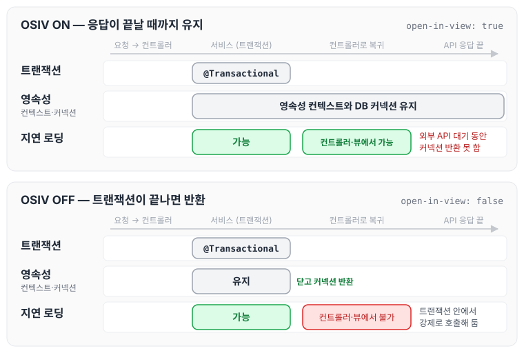
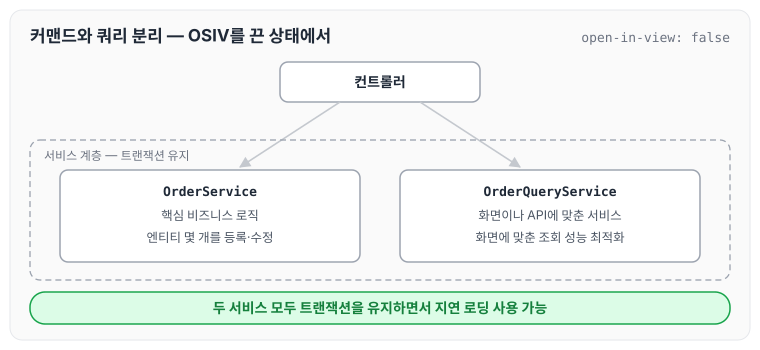

이전에 [컬렉션 조회 최적화](../boot-jpa-collection-query/)에 대해 작성하였습니다. 지금까지의 예제에서 컨트롤러가 지연 로딩을 사용할 수 있었던 것은 OSIV가 켜져 있었기 때문입니다. 이번에는 OSIV를 켰을 때와 껐을 때의 차이와, OSIV를 끈 상태에서 Command와 Query를 분리해 복잡성을 관리하는 방법에 대해 정리하도록 하겠습니다.

## OSIV와 성능 최적화

OSIV는 하이버네이트와 JPA에서 부르는 이름이 다릅니다.

- Open Session In View: 하이버네이트
- Open EntityManager In View: JPA

### OSIV ON

`spring.jpa.open-in-view: true`가 기본값입니다.

기본값이지만 애플리케이션 시작 시점에 warn 로그를 남기는데, 여기에는 이유가 있습니다.

OSIV 전략은 트랜잭션 시작처럼 최초 데이터베이스 커넥션 시작 시점부터 API 응답이 끝날 때까지 영속성 컨텍스트와 데이터베이스 커넥션을 유지합니다. 그래서 지금까지 뷰 템플릿이나 API 컨트롤러에서 지연 로딩이 가능했던 것입니다.

지연 로딩은 영속성 컨텍스트가 살아 있어야 가능하고, 영속성 컨텍스트는 기본적으로 데이터베이스 커넥션을 유지합니다. 이것 자체가 큰 장점입니다.

다만 이 전략은 너무 오랜 시간 동안 데이터베이스 커넥션 리소스를 사용하기 때문에, 실시간 트래픽이 중요한 애플리케이션에서는 커넥션이 모자랄 수 있습니다. 이것은 결국 장애로 이어집니다.

예를 들어 컨트롤러에서 외부 API를 호출하면 외부 API 대기 시간만큼 커넥션 리소스를 반환하지 못하고 유지해야 합니다.

### OSIV OFF

`spring.jpa.open-in-view: false`로 설정하면 OSIV가 꺼집니다.

OSIV를 끄면 트랜잭션을 종료할 때 영속성 컨텍스트를 닫고, 데이터베이스 커넥션도 반환합니다. 따라서 커넥션 리소스를 낭비하지 않습니다.

대신 OSIV를 끄면 모든 지연 로딩을 트랜잭션 안에서 처리해야 합니다. 따라서 지금까지 작성한 많은 지연 로딩 코드를 트랜잭션 안으로 넣어야 하는 단점이 있습니다. 그리고 뷰 템플릿에서 지연 로딩이 동작하지 않습니다. 결론적으로 트랜잭션이 끝나기 전에 지연 로딩을 강제로 호출해 두어야 합니다.

OSIV를 켰을 때와 껐을 때 영속성 컨텍스트와 데이터베이스 커넥션이 유지되는 범위를 비교하면 아래와 같습니다.

OSIV를 켜면 커넥션을 쥐고 있는 구간이 응답이 끝날 때까지 이어지고, 끄면 트랜잭션 구간으로 줄어듭니다. 그 대신 OSIV를 끄면 트랜잭션 밖인 컨트롤러와 뷰에서는 지연 로딩을 사용할 수 없습니다.

### 커맨드와 쿼리 분리

실무에서 OSIV를 끈 상태로 복잡성을 관리하는 좋은 방법으로 Command와 Query를 분리하는 방법이 있습니다.

보통 비즈니스 로직은 특정 엔티티 몇 개를 등록하거나 수정하는 것이므로 성능이 크게 문제가 되지 않습니다. 반면 복잡한 화면을 출력하기 위한 쿼리는 화면에 맞추어 성능을 최적화하는 것이 중요합니다. 하지만 그 복잡성에 비해 핵심 비즈니스에 큰 영향을 주지는 않습니다.

그래서 크고 복잡한 애플리케이션을 개발한다면, 이 둘의 관심사를 명확하게 분리하는 선택은 유지보수 관점에서 충분히 의미가 있습니다.

단순하게 설명하면 다음처럼 분리하는 것입니다.

- OrderService
    - OrderService: 핵심 비즈니스 로직
    - OrderQueryService: 화면이나 API에 맞춘 서비스

보통 서비스 계층에서 트랜잭션을 유지합니다. 두 서비스 모두 트랜잭션을 유지하면서 지연 로딩을 사용할 수 있습니다.

분리한 구조를 그리면 아래와 같습니다.

> 참고: 고객 서비스의 실시간 API는 OSIV를 끄고, ADMIN처럼 커넥션을 많이 사용하지 않는 곳에서는 OSIV를 켭니다.

## 마무리

오늘은 OSIV를 켰을 때와 껐을 때 영속성 컨텍스트와 데이터베이스 커넥션이 유지되는 범위, 그리고 OSIV를 끈 상태에서 Command와 Query를 분리해 복잡성을 관리하는 방법에 대해 정리하였습니다. 기본값이 켜져 있는 설정이라도 커넥션을 얼마나 오래 쥐고 있는지 확인하고, 서비스 성격에 따라 OSIV 사용 여부를 정하는 것이 좋을 것 같습니다.

> 이 글은 인프런 김영한 님의 [실전! 스프링 부트와 JPA 활용](https://www.inflearn.com/course/스프링부트-JPA-활용-1)을 들으며 정리한 노트입니다.
