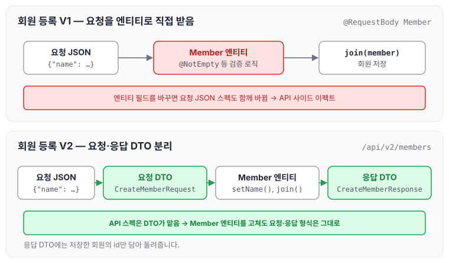
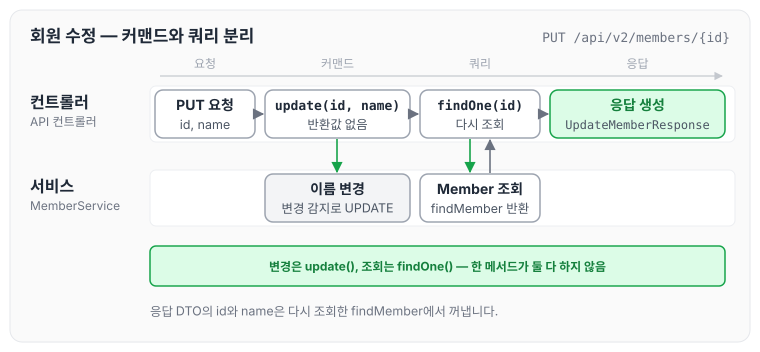
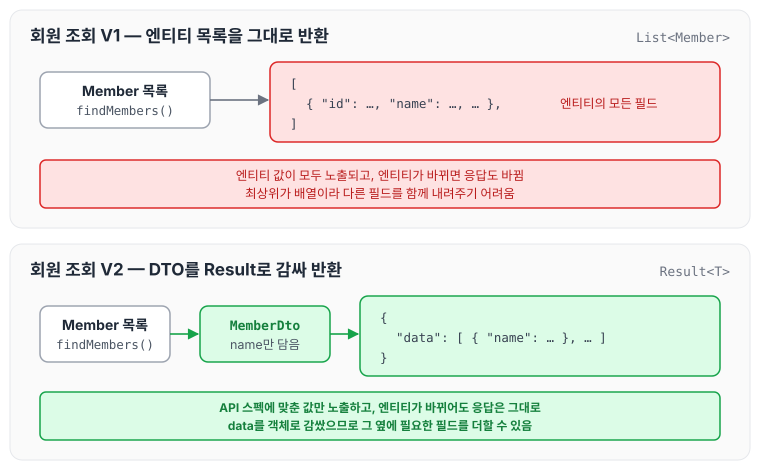

오늘은 스프링 부트와 JPA로 회원 등록, 수정, 조회 API를 만들면서 엔티티 대신 DTO를 사용해 API 스펙과 엔티티를 분리하는 방법에 대해 정리하도록 하겠습니다.

## API 패키지 구성

화면에 구성되는 정보와 API로 제공되는 정보는 서로 다르기 때문에, 화면용 코드와 API용 코드의 패키지를 두 개로 나누는 경우가 많습니다.

## 회원 등록 API

### V1: 엔티티를 Request Body에 직접 매핑

첫 번째 방법은 요청 값을 Member 엔티티로 바로 받는 것입니다. 이 방법에는 아래와 같은 문제가 있습니다.

- 엔티티에 프레젠테이션 계층을 위한 로직이 추가됩니다.
- 엔티티에 API 검증을 위한 로직이 들어갑니다(`@NotEmpty` 등).
- 실무에서는 회원 엔티티를 위한 API가 다양하게 만들어지는데, 한 엔티티에 각각의 API를 위한 모든 요청 요구사항을 담기는 어렵습니다.
- 엔티티가 변경되면 API 스펙이 변합니다. 엔티티를 손대는 순간 API 스펙이 함께 바뀌면서 사이드 이펙트가 발생합니다.

이 문제는 API 요청 스펙에 맞춘 별도의 DTO를 파라미터로 받아서 해결합니다.

### V2: 엔티티 대신 DTO를 Request Body에 매핑

```java
@PostMapping("/api/v2/members")
public CreateMemberResponse saveMemberV2(@RequestBody @Valid CreateMemberRequest request) {
	Member member = new Member();
	member.setName(request.getName());
	Long id = memberService.join(member);
	return new CreateMemberResponse(id);
}

@Data
    static class CreateMemberRequest {
        private String name;
    }

@Data
@AllArgsConstructor
static class CreateMemberResponse {
    private Long id;
}
```

- `CreateMemberRequest`를 Member 엔티티 대신 Request Body와 매핑합니다.
- 엔티티와 프레젠테이션 계층을 위한 로직을 분리할 수 있습니다.
- 엔티티와 API 스펙을 명확하게 분리할 수 있습니다.
- 엔티티가 변해도 API 스펙이 변하지 않습니다.

V1과 V2에서 요청 JSON이 어디에 매핑되는지 비교하면 아래와 같습니다.



V2에서는 API 스펙이 `CreateMemberRequest`, `CreateMemberResponse`에 묶여 있으므로, Member 엔티티를 고쳐도 요청·응답 형식은 그대로 유지됩니다.

## 회원 수정 API

```java
package jpabook.jpashop.api;

import jpabook.jpashop.domain.Member;
import jpabook.jpashop.service.MemberService;
import lombok.AllArgsConstructor;
import lombok.Data;
import lombok.RequiredArgsConstructor;
import org.springframework.web.bind.annotation.*;

import javax.validation.Valid;
import java.util.List;
import java.util.stream.Collectors;

@RestController
@RequiredArgsConstructor
public class MemberApiController {

    private final MemberService memberService;

    @PutMapping("/api/v2/members/{id}")
    public UpdateMemberResponse updateMemberV2(@PathVariable("id") Long id,
                                               @RequestBody @Valid UpdateMemberRequest request) {

        memberService.update(id, request.getName());
        Member findMember =  memberService.findOne(id);
        return  new UpdateMemberResponse(findMember.getId(), findMember.getName());
    }

    @Data
    static class UpdateMemberRequest {
        private String name;
    }

    @Data
    @AllArgsConstructor
    static class UpdateMemberResponse {
        private Long id;
        private String name;
    }
}
```

회원 수정도 등록과 마찬가지로 DTO(`UpdateMemberRequest`)를 요청 파라미터에 매핑합니다.

```java
public class MemberService {
	private final MemberRepository memberRepository;
	
	@Transactional
	public void update(Long id, String name) {
		Member member = memberRepository.findOne(id);
		member.setName(name);
	}
}
```

업데이트는 가급적 변경 감지를 사용합니다. 트랜잭션 안에서 조회한 엔티티의 값을 바꾸면 커밋 시점에 UPDATE가 실행됩니다. 변경 감지의 동작은 [영속성 컨텍스트](../jpa-persistence-context/)에서 정리하였습니다.

업데이트한 뒤 Member를 반환하도록 만들어도 되지만, 그러면 변경하는 메서드가 조회까지 맡게 되어 역할이 애매해집니다. 커맨드(변경성 업데이트)와 쿼리(조회)는 철저하게 분리하는 것이 좋습니다.

- `MemberService.update()`는 값을 반환하지 않고 업데이트만 합니다.
- 컨트롤러에서 `Member findMember = memberService.findOne(id);`로 다시 조회합니다.

컨트롤러에서 두 메서드를 호출하는 순서를 따라가면 아래와 같습니다.



변경은 `update()`, 조회는 `findOne()`이 각각 맡고, 응답 DTO는 다시 조회한 Member로 만듭니다.

## 회원 조회 API

회원 조회 API의 전체 코드는 아래와 같습니다.

```java
package jpabook.jpashop.api;

import jpabook.jpashop.domain.Member;
import jpabook.jpashop.service.MemberService;
import lombok.AllArgsConstructor;
import lombok.Data;
import lombok.RequiredArgsConstructor;
import org.springframework.web.bind.annotation.*;

import javax.validation.Valid;
import java.util.List;
import java.util.stream.Collectors;

@RestController
@RequiredArgsConstructor
public class MemberApiController {

    private final MemberService memberService;

    @GetMapping("/api/v1/members")
    public List<Member> membersV1() {
        return memberService.findMembers();
    }

    @GetMapping("/api/v2/members")
    public Result memberV2() {
        List<Member> findMembers = memberService.findMembers();
        List<MemberDto> memberDtos = findMembers.stream()
                .map(m -> new MemberDto(m.getName()))
                .collect(Collectors.toList());

        return new Result(memberDtos);
    }

    @Data
    @AllArgsConstructor
    static class MemberDto {
        private String name;
    }

    @Data
    @AllArgsConstructor
    static class Result<T> {
        private T data;
    }   
}
```

### V1: 응답 값으로 엔티티를 직접 노출

```java
@GetMapping("/api/v1/members")
public List<Member> membersV1() {
    return memberService.findMembers();
}
```

조회 V1은 응답 값으로 엔티티를 직접 외부에 노출합니다. 이 방법에는 아래와 같은 문제가 있습니다.

- 엔티티에 프레젠테이션 계층을 위한 로직이 추가됩니다.
- 기본적으로 엔티티의 모든 값이 노출됩니다.
- 응답 스펙을 맞추기 위해 로직이 추가됩니다(`@JsonIgnore`, 별도의 뷰 로직 등).
- 실무에서는 같은 엔티티에 대해 API가 용도에 따라 다양하게 만들어지는데, 한 엔티티에 각각의 API를 위한 프레젠테이션 응답 로직을 담기는 어렵습니다.
- 엔티티가 변경되면 API 스펙이 변합니다.
- 컬렉션을 직접 반환하면 향후 API 스펙을 변경하기 어렵습니다(별도의 Result 클래스를 만들어 해결합니다).

따라서 API 응답 스펙에 맞춘 별도의 DTO를 반환해야 하고, 엔티티는 외부에 노출하지 않습니다.

> 실무에서는 member 엔티티의 데이터가 필요한 API가 계속 증가하게 됩니다. 어떤 API는 name 필드가 필요하지만, 어떤 API는 name 필드가 필요 없을 수 있습니다. 결론적으로 엔티티 대신에 API 스펙에 맞는 별도의 DTO를 노출해야 합니다.

### V2: 응답 값으로 별도의 DTO 사용

```java
@GetMapping("/api/v2/members")
public Result memberV2() {
    List<Member> findMembers = memberService.findMembers();
    List<MemberDto> memberDtos = findMembers.stream()
            .map(m -> new MemberDto(m.getName()))
            .collect(Collectors.toList());

    return new Result(memberDtos);
}
```

조회 V2는 응답 값으로 엔티티가 아닌 별도의 DTO를 사용합니다.

- 엔티티를 DTO로 변환해서 반환합니다.
- 엔티티가 변해도 API 스펙이 변경되지 않습니다.
- Result 클래스로 컬렉션을 감싸기 때문에 향후 필요한 필드를 추가할 수 있습니다.

두 버전의 응답 모양을 비교하면 아래와 같습니다.



V1은 최상위가 JSON 배열이라 다른 값을 함께 내려줄 자리가 없고, V2는 `data`를 감싼 객체이므로 같은 위치에 필드를 더할 수 있습니다.

## 마무리

오늘은 회원 등록, 수정, 조회 API를 만들면서 요청과 응답에 엔티티 대신 DTO를 사용하는 방법과, 수정 API에서 커맨드와 쿼리를 분리하는 방법에 대해 정리하였습니다. 엔티티를 그대로 받거나 내려주면 처음에는 코드가 짧지만, 엔티티를 고칠 때마다 API 스펙까지 신경 써야 하므로 처음부터 DTO로 나눠 두는 편이 좋을 것 같습니다.

다음 글에서는 [지연 로딩과 조회 성능 최적화](../boot-jpa-lazy-loading/)에 대해 정리하도록 하겠습니다.

> 이 글은 인프런 김영한 님의 [실전! 스프링 부트와 JPA 활용2 — API 개발과 성능 최적화](https://www.inflearn.com/course/스프링부트-JPA-API개발-성능최적화)를 들으며 정리한 노트입니다.
