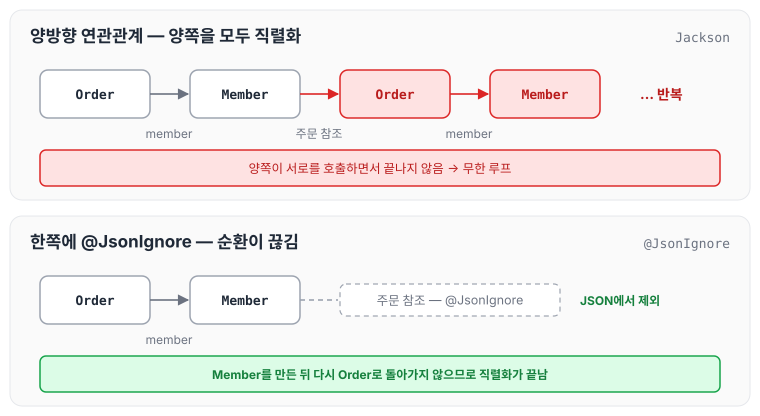
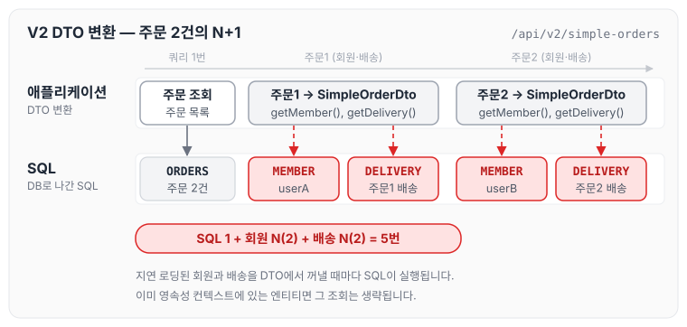
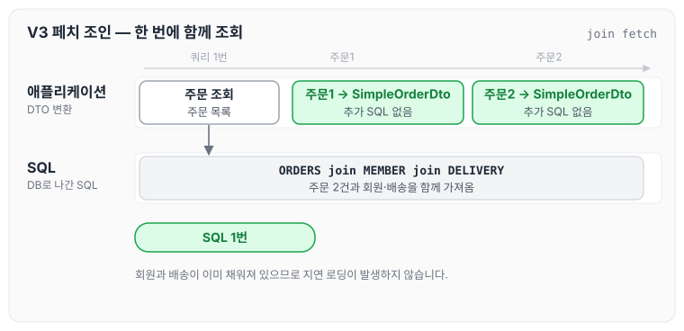
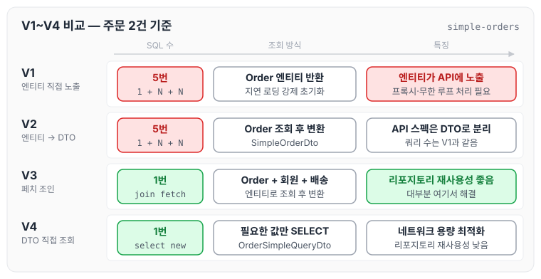
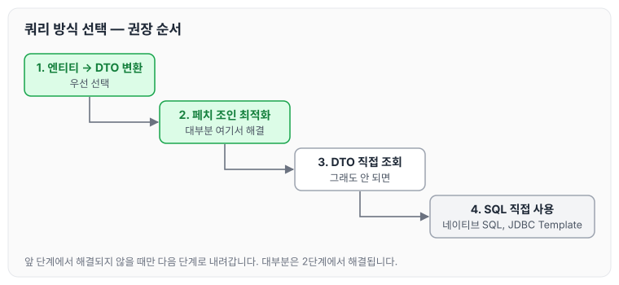

이전에 [스프링 부트와 JPA로 만드는 API 기본](../boot-jpa-api-basics/)에 대해 작성하였습니다. 이번 글에서는 주문(Order)을 조회하면서 회원(Member)과 배송(Delivery)을 함께 가져오는 xToOne 관계의 API를 만들고, 지연 로딩 때문에 생기는 성능 문제를 엔티티 직접 노출, DTO 변환, 페치 조인, DTO 직접 조회 순서로 최적화하는 방법에 대해 정리하도록 하겠습니다. 이 부분은 실무에서 많이 실수하고 어려워하는 부분이므로 꼭 익혀 두어야 합니다.

## 샘플 데이터 준비

애플리케이션이 시작될 때 샘플 데이터를 미리 넣어 주는 InitDb 코드는 아래와 같습니다.

```java
package jpabook.jpashop.api;

import jpabook.jpashop.domain.*;
import jpabook.jpashop.domain.item.Book;
import lombok.RequiredArgsConstructor;
import org.springframework.stereotype.Component;
import org.springframework.transaction.annotation.Transactional;

import javax.annotation.PostConstruct;
import javax.persistence.EntityManager;

@Component
@RequiredArgsConstructor
public class InitDb {

    private final InitService initService;

    @PostConstruct
    public void init() {
        initService.dbInit1();
        initService.dbInit2();
    }

    @Component
    @Transactional
    @RequiredArgsConstructor
    static class InitService{

        private final EntityManager em;
        public void dbInit1() {
            Member member = createMember("userA", "서울", "1", "11111");
            em.persist(member);

            Book book1 = createBook("Spring BOOK1", 20000, 100);
            em.persist(book1);

            Book book2 = createBook("spring BOOK2", 40000, 100);
            em.persist(book2);

            OrderItem orderItem1 = OrderItem.createOrderItem(book1, 10000, 1);
            OrderItem orderItem2 = OrderItem.createOrderItem(book1, 10000, 1);

            Delivery delivery = createDelivery(member);
            Order order = Order.createOrder(member, delivery, orderItem1, orderItem2);
            em.persist(order);
        }

        public void dbInit2() {
            Member member = createMember("userB", "진주", "2", "2222");
            em.persist(member);

            Book book1 = createBook("JPA BOOK1", 10000, 100);
            em.persist(book1);

            Book book2 = createBook("JPA BOOK2", 20000, 100);
            em.persist(book2);

            OrderItem orderItem1 = OrderItem.createOrderItem(book1, 10000, 1);
            OrderItem orderItem2 = OrderItem.createOrderItem(book1, 10000, 1);

            Delivery delivery = createDelivery(member);
            Order order = Order.createOrder(member, delivery, orderItem1, orderItem2);
            em.persist(order);
        }

    }

    private static Delivery createDelivery(Member member) {
        Delivery delivery = new Delivery();
        delivery.setAddress(member.getAddress());
        return delivery;
    }

    private static Book createBook(String JPA_BOOK1, int price, int stockQuantity) {
        Book book1 = new Book();
        book1.setName(JPA_BOOK1);
        book1.setPrice(price);
        book1.setStockQuantity(stockQuantity);
        return book1;
    }

    private static Member createMember(String name, String city, String street, String zipcode) {
        Member member = new Member();
        member.setName(name);
        member.setAddress(new Address(city, street, zipcode));
        return member;
    }
}
```

`userA`, `userB` 두 회원이 각각 주문을 하나씩 가지고 있으므로, 이후 예제에서 주문을 조회하면 주문 2건이 조회됩니다.

## 간단한 주문 조회 V1: 엔티티를 직접 노출

```java
package jpabook.jpashop.api;

import jpabook.jpashop.domain.*;
import jpabook.jpashop.repository.*;

import lombok.AllArgsConstructor;
import lombok.Data;
import lombok.RequiredArgsConstructor;
import org.springframework.web.bind.annotation.GetMapping;
import org.springframework.web.bind.annotation.RestController;

import java.time.LocalDateTime;
import java.util.List;

import java.util.stream.Collectors;

/**
 * xToOne
 * order
 * Order -< Member
 * Order -> Delivery
 */
@RestController
@RequiredArgsConstructor
public class OrderSimpleApiController {

    private final OrderRepository orderRepository;
    private final OrderSimpleQueryRepository orderSimpleQueryRepository;

    @GetMapping("/api/v1/simple-orders")
    public List<Order> ordersV1() {
        List<Order> all = orderRepository.findAllByString(new OrderSearch());
        for (Order order : all) {
            order.getMember().getName();
            order.getDelivery().getAddress();
        }
        return all;
    }
}
```

V1은 조회한 Order 엔티티 목록을 그대로 반환합니다. 반복문에서 `getMember().getName()`, `getDelivery().getAddress()`를 호출해 지연 로딩된 회원과 배송을 강제로 초기화한 뒤 응답합니다.

- 엔티티를 직접 노출하는 것은 좋지 않습니다.
- order → member와 order → delivery는 지연 로딩입니다. 따라서 조회 시점에는 실제 엔티티 대신 프록시가 들어 있습니다. 프록시는 [프록시의 동작 원리](../jpa-proxy/), 지연 로딩은 [즉시 로딩과 지연 로딩](../jpa-lazy-eager-loading/)에서 정리하였습니다.
- Jackson 라이브러리는 기본적으로 이 프록시 객체를 JSON으로 어떻게 생성해야 하는지 몰라서 예외가 발생합니다.
- Hibernate5Module을 스프링 빈으로 등록하면 해결할 수 있습니다. 하지만 이 방법은 결국 엔티티를 노출하게 되므로, DTO를 만들어서 해결하는 것이 가장 좋습니다.

엔티티를 직접 노출할 때는 양방향 연관관계가 걸린 곳 중 반드시 한쪽에 `@JsonIgnore`를 붙여야 합니다. 그렇지 않으면 Jackson이 양쪽을 서로 호출하면서 무한 루프에 빠집니다.



`@JsonIgnore`를 붙인 쪽은 JSON에서 빠지므로 순환이 끊깁니다. 다만 이렇게 응답 형식을 맞추기 위한 처리가 엔티티에 계속 쌓이게 됩니다.

정말 간단한 애플리케이션이 아니라면 엔티티를 API 응답으로 외부에 노출하는 것은 좋지 않습니다. 따라서 Hibernate5Module을 사용하기보다는 DTO로 변환하는 것이 더 좋은 방법입니다.

또한 항상 지연 로딩을 기본으로 하고, 성능 최적화가 필요한 경우에는 페치 조인을 사용합니다.

## 간단한 주문 조회 V2: 엔티티를 DTO로 변환

```java
@GetMapping("/api/v2/simple-orders")
public Result ordersV2() {
    // ODER 2개
    // N + 1 -> 1 + 회원 N(2) + 배송 N
    List<Order> orders = orderRepository.findAllByString(new OrderSearch());

    List<SimpleOrderDto> collect = orders.stream()
            .map(o -> new SimpleOrderDto(o))
            .collect(Collectors.toList());

    return new Result(collect);
}

@Data
public class SimpleOrderDto {
    private Long orderId;
    private String name;
    private LocalDateTime orderDate;
    private OrderStatus orderStatus;
    private Address address;

    public SimpleOrderDto(Order order) {
        orderId = order.getId();
        name = order.getMember().getName();
        orderDate = order.getOrderDate();
        orderStatus = order.getStatus();
        address = order.getDelivery().getAddress();
    }
}
```

- 엔티티를 DTO로 변환하는 일반적인 방법입니다.
- 쿼리가 총 1 + N + N번 실행됩니다(V1과 쿼리 수 결과는 같습니다).
    - order 조회 1번(order 조회 결과 수가 N이 됩니다)
    - order → member 지연 로딩 조회 N번
    - order → delivery 지연 로딩 조회 N번
    - 예를 들어 order의 결과가 4개면 최악의 경우 1 + 4 + 4번 실행됩니다.
    - 지연 로딩은 영속성 컨텍스트에서 먼저 찾기 때문에, 이미 조회된 엔티티라면 쿼리를 생략합니다.

샘플 데이터의 주문 2건으로 V2를 호출하면 SQL이 아래 순서로 실행됩니다.



두 주문의 회원이 `userA`, `userB`로 서로 다르기 때문에 영속성 컨텍스트에서 재사용되는 엔티티가 없고, 1 + 2 + 2 = 5번이 모두 실행됩니다.

## 간단한 주문 조회 V3: 엔티티를 DTO로 변환 - 페치 조인 최적화

```java
/**
 * 유연하고
 * 성능 차이는 많이 나지 않는다.
 * @return
 */
@GetMapping("/api/v3/simple-orders")
public Result ordersV3() {
    List<Order> orders = orderRepository.findAllWithMemberDelivery();

    List<SimpleOrderDto> collect = orders.stream()
            .map(o -> new SimpleOrderDto(o))
            .collect(Collectors.toList());

    return new Result(collect);
}
```

```java
public List<Order> findAllWithMemberDelivery() {
    return em.createQuery(
            "select o from Order o " +
                    " join fetch o.member m " +
                    " join fetch o.delivery d" , Order.class
    ).getResultList();
}
```

- 엔티티를 페치 조인(fetch join)을 사용해서 쿼리 1번에 조회합니다.
- 페치 조인으로 order → member, order → delivery는 이미 조회된 상태이므로 지연 로딩이 발생하지 않습니다.

페치 조인의 동작과 일반 조인과의 차이는 [JPQL 경로 표현식과 페치 조인](../jpa-jpql-advanced/)에서 정리하였습니다. V2와 같은 주문 2건을 V3로 조회하면 아래와 같습니다.



DTO로 변환하는 코드는 V2와 같지만, 회원과 배송이 이미 채워져 있으므로 SQL은 1번만 실행됩니다.

## 간단한 주문 조회 V4: JPA에서 DTO로 바로 조회

OrderSimpleApiController에 다음 코드를 추가합니다.

```java
private final OrderSimpleQueryRepository orderSimpleQueryRepository; //의존관계 주입

@GetMapping("/api/v4/simple-orders")
public List<OrderSimpleQueryDto> ordersV4() {
	return orderSimpleQueryRepository.findOrderDtos();
}
```

조회 전용 리포지토리인 OrderSimpleQueryRepository는 다음과 같습니다.

```java
package jpabook.jpashop.repository.order.simplequery;
import lombok.RequiredArgsConstructor;
import org.springframework.stereotype.Repository;
import javax.persistence.EntityManager;
import java.util.List;

@Repository
@RequiredArgsConstructor
public class OrderSimpleQueryRepository {

	private final EntityManager em;

	public List<OrderSimpleQueryDto> findOrderDtos() {
		return em.createQuery(
						"select new jpabook.jpashop.repository.order.simplequery.OrderSimpleQueryDto(o.id, m.name, o.orderDate, o.status, d.address)" +
						" from Order o" +
						" join o.member m" +
						" join o.delivery d", OrderSimpleQueryDto.class)
					.getResultList();
		}
}
```

리포지토리에서 DTO를 직접 조회하는 OrderSimpleQueryDto는 다음과 같습니다.

```java
package jpabook.jpashop.repository.order.simplequery;

import jpabook.jpashop.domain.Address;
import jpabook.jpashop.domain.OrderStatus;
import lombok.Data;

import java.time.LocalDateTime;

@Data
public class OrderSimpleQueryDto {
    private Long orderId;
    private String name;
    private LocalDateTime orderDate;
    private OrderStatus orderStatus;
    private Address address;

    public OrderSimpleQueryDto(Long orderId, String name, LocalDateTime orderDate, OrderStatus orderStatus, Address address) {
        this.orderId = orderId;
        this.name = name;
        this.orderDate = orderDate;
        this.orderStatus = orderStatus;
        this.address = address;
    }
}
```

- 일반적인 SQL을 사용할 때처럼 원하는 값을 선택해서 조회합니다.
- new 명령어를 사용해서 JPQL의 결과를 DTO로 즉시 변환합니다.
- SELECT 절에서 원하는 데이터를 직접 선택하므로 DB에서 애플리케이션으로 전달되는 네트워크 용량을 최적화합니다.
- 리포지토리 재사용성이 떨어지고, API 스펙에 맞춘 코드가 리포지토리에 들어간다는 단점이 있습니다.

V1부터 V4까지 실행되는 쿼리 수와 특징을 비교하면 아래와 같습니다.



V3와 V4는 쿼리 수가 같고, SELECT 절에서 가져오는 컬럼 수와 리포지토리 재사용성에서 차이가 납니다.

## 쿼리 방식 선택 권장 순서

엔티티를 DTO로 변환하는 방법과 DTO로 바로 조회하는 방법은 각각 장단점이 있으므로, 상황에 따라 더 나은 방법을 선택하면 됩니다. 엔티티로 조회하면 리포지토리 재사용성이 좋고 개발도 단순해집니다. 따라서 권장하는 순서는 아래와 같습니다.

1. 우선 엔티티를 DTO로 변환하는 방법을 선택합니다.
2. 필요하면 페치 조인으로 성능을 최적화합니다. 대부분의 성능 이슈가 이 단계에서 해결됩니다.
3. 그래도 안 되면 DTO로 직접 조회하는 방법을 사용합니다.
4. 최후의 방법은 JPA가 제공하는 네이티브 SQL이나 스프링 JDBC Template을 사용해서 SQL을 직접 사용하는 것입니다.



## 마무리

오늘은 xToOne 관계의 주문 조회 API를 엔티티 직접 노출, DTO 변환, 페치 조인, DTO 직접 조회 순서로 바꿔 가며 지연 로딩이 만드는 N+1 문제와 쿼리 수의 변화에 대해 정리하였습니다. 대부분은 엔티티를 DTO로 변환하고 페치 조인을 적용하는 단계에서 해결되므로, DTO 직접 조회는 그다음에 고려하는 것이 좋을 것 같습니다.

다음 글에서는 일대다 관계를 포함한 [컬렉션 조회 최적화](../boot-jpa-collection-query/)에 대해 정리하도록 하겠습니다.

> 이 글은 인프런 김영한 님의 [실전! 스프링 부트와 JPA 활용2 — API 개발과 성능 최적화](https://www.inflearn.com/course/스프링부트-JPA-API개발-성능최적화)를 들으며 정리한 노트입니다.
