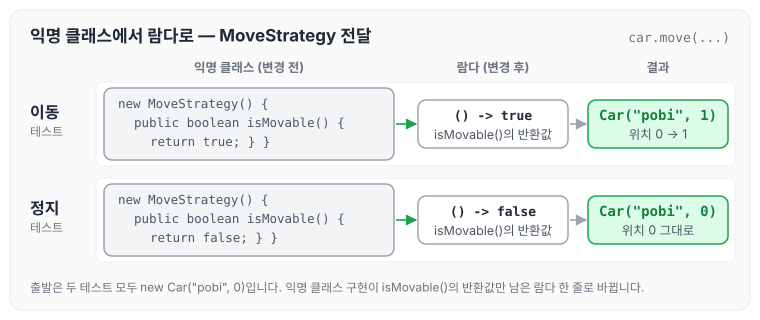
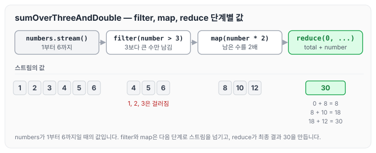
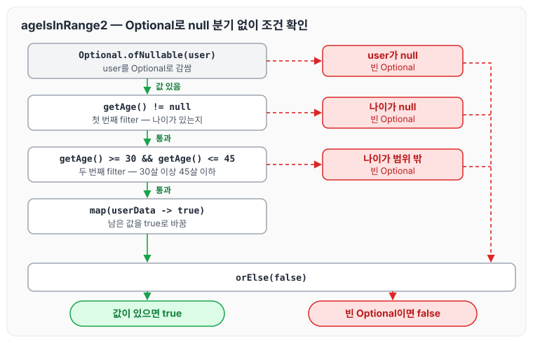

이전에 [레거시 코드 리팩터링 — 1단계](../ccj-legacy-refactor/)에 대해 작성하였습니다. 오늘은 람다, 스트림, Optional 미션 1단계로, 익명 클래스를 람다로 바꾸고 스트림의 map, filter, reduce와 Optional을 활용해 기존 코드를 리팩터링한 내용을 정리하도록 하겠습니다.

## 람다 실습 1 - 익명 클래스를 람다로 전환

nextstep.fp.CarTest의 이동, 정지 테스트는 MoveStrategy를 익명 클래스로 구현해 전달하고 있습니다.

```java
// nextstep.fp.CarTest의 이동, 정지 method
public class CarTest {
    @Test
    public void 이동() {
        Car car = new Car("pobi", 0);
        Car actual = car.move(new MoveStrategy() {
            @Override
            public boolean isMovable() {
                return true;
            }
        });
        assertEquals(new Car("pobi", 1), actual);
    }

    @Test
    public void 정지() {
        Car car = new Car("pobi", 0);
        Car actual = car.move(new MoveStrategy() {
            @Override
            public boolean isMovable() {
                return false;
            }
        });
        assertEquals(new Car("pobi", 0), actual);
    }
}
```

이를 람다로 다음과 같이 변경합니다.

```java
@Test
    public void 이동() {
        Car car = new Car("pobi", 0);
        Car actual = car.move(() -> true);
        assertThat(actual).isEqualTo(new Car("pobi", 1));
    }

    @Test
    public void 정지() {
        Car car = new Car("pobi", 0);
        Car actual = car.move(() -> false);
        assertThat(actual).isEqualTo(new Car("pobi", 0));
    }	
```

두 코드를 나란히 놓으면 아래와 같습니다.



MoveStrategy는 isMovable() 하나만 구현하면 되므로, 익명 클래스 대신 `() -> true`처럼 isMovable()의 반환값만 람다로 전달할 수 있습니다. 동작은 그대로이고, 이동이면 pobi의 위치가 1, 정지면 0인 것을 확인할 수 있습니다.

## 람다 실습 2 - 람다를 활용해 중복 제거

nextstep.fp.Lambda의 sumAll과 sumAllEven은 숫자를 더하는 조건만 다르고 나머지 코드가 같습니다.

```java
// nextstep.fp.Lambda의 sumAll method
List<Integer> numbers = Arrays.asList(1, 2, 3, 4, 5, 6);

public int sumAll(List<Integer> numbers) {
    int total = 0;
    for (int number : numbers) {
        total += number;
    }
    return total;
}

List<Integer> numbers = Arrays.asList(1, 2, 3, 4, 5, 6);
public int sumAllEven(List<Integer> numbers) {
    int total = 0;
    for (int number : numbers) {
        if (number % 2 == 0) {
            total += number;
        }
    }
    return total;
}
```

더하는 조건을 람다로 전달받도록 다음과 같이 변경합니다. 테스트에서는 조건만 바꿔 전체 합, 짝수 합, 3보다 큰 수의 합을 구합니다.

```java
@Test
    public void sumAll() throws Exception {
        int sum = Lambda.sumAllConditional(numbers, number -> true);
        assertThat(sum).isEqualTo(21);
    }

    @Test
    public void sumAllEven() throws Exception {
        int sum = Lambda.sumAllConditional(numbers, number -> number % 2 == 0);
        assertThat(sum).isEqualTo(12);
    }

    @Test
    public void sumAllOverThree() throws Exception {
        int sum = Lambda.sumAllConditional(numbers, number -> number > 3);
        assertThat(sum).isEqualTo(15);
    }
```

조건을 받아 합계를 구하는 sumAllConditional은 아래와 같습니다.

```java
public static int sumAllConditional(List<Integer> numbers, Conditional conditional) {
        int total = 0;
        for (int number : numbers) {
            if (conditional.data(number)) {
                total += number;
            }
        }
        return total;
    }
```

조건으로 전달하는 Conditional 인터페이스는 다음과 같습니다.

```java
public interface Conditional {
    boolean data(Integer number);
}
```

## 스트림(stream)

Collection에 담긴 데이터를 처리하려면 Collection을 순회하면서 각 Element를 처리하는 것이 일반적입니다. 스트림을 사용하면 순회하는 코드는 신경 쓰지 않고, Element를 어떻게 처리할지에만 집중할 수 있습니다. 스트림을 만들고 중간 연산과 최종 연산으로 결과를 만드는 순서는 [Stream을 활용한 예제 모음](../java-stream-examples/)에서도 정리하였습니다.

### filter

요구사항은 파일 문자 중 길이가 12보다 큰 문자의 수를 구하는 것입니다. for문으로 구현하면 아래와 같습니다.

```java
String contents = new String(Files.readAllBytes(
  Paths.get("../ war-and-peace.txt")), StandardCharsets.UTF_8);
List<String> words = Arrays.asList(contents.split("[\\P{L}]+"));

long count = 0;
for (String w : words) {
  if (w.length() > 12) count++;  
}
```

### filter 활용해 구현

같은 요구사항을 filter로 구현하면 다음과 같습니다.

```java
String contents = new String(Files.readAllBytes(
  Paths.get("../alice.txt")), StandardCharsets.UTF_8);
List<String> words = Arrays.asList(contents.split("[\\P{L}]+"));

long count =
  words.stream().filter(w -> w.length() > 12).count();

```

### map

List에 담긴 모든 숫자 값을 2배한 결과 List를 생성합니다.

```java
// nextstep.fp.StreamStudy 클래스의 doubleNumbers method 참고
List<Integer> numbers = Arrays.asList(1, 2, 3, 4, 5, 6);
List<Integer> dobuleNumbers =
  numbers.stream().map(x -> 2 * x).collect(Collectors.toList());

```

### reduce

List에 담긴 모든 숫자의 합을 구합니다.

```java
// nextstep.fp.StreamStudy 클래스의 sumAll method 참고

List<Integer> numbers = Arrays.asList(1, 2, 3, 4, 5, 6);

public int sumAll(List<Integer> numbers) {
    return numbers.stream().reduce(0, (x, y) -> x + y);
}
```

reduce를 잘 설명한 블로그가 있어서 참조합니다.

[Java - Stream.reduce() 사용 방법 및 예제](https://codechacha.com/ko/java8-stream-reduction/#4-병렬-처리에서-reduce는-순차적으로-처리)

### map, reduce, filter 실습 1

List에 담긴 모든 숫자 중 3보다 큰 숫자를 2배 한 후 모든 값의 합을 구합니다. 지금까지 학습한 map, reduce, filter를 활용해 구현해야 합니다.

```java
public static long sumOverThreeAndDouble(List<Integer> numbers) {
    return numbers.stream()
            .filter(number -> number > 3)
            .map(number -> number * 2)
            .reduce(0, (total, number) -> total + number);
}
```

앞의 예제와 같이 numbers가 1부터 6까지일 때, 단계마다 값이 바뀌는 모습은 아래와 같습니다.



filter와 map은 요소를 거르거나 바꾼 스트림을 넘기고, 마지막 reduce가 초기값 0에서 시작해 값을 하나씩 더해 결과 30을 만듭니다.

### map, reduce, filter 실습 2

nextstep.fp.StreamStudy 클래스의 printLongestWordTop100() 메서드를 구현합니다. 요구사항은 다음과 같습니다.

- 단어의 길이가 12자를 초과하는 단어를 추출합니다.
- 12자가 넘는 단어 중 길이가 긴 순서로 100개의 단어를 추출합니다.
- 단어 중복을 허용하지 않습니다. 즉, 서로 다른 단어 100개를 추출해야 합니다.
- 추출한 100개의 단어를 출력합니다. 모든 단어는 소문자로 출력해야 합니다.

```java
public static void printLongestWordTop100() throws IOException {
    String contents = new String(Files.readAllBytes(Paths
            .get("src/main/resources/fp/war-and-peace.txt")), StandardCharsets.UTF_8);
    List<String> words = Arrays.asList(contents.split("[\\P{L}]+"));
    words.stream()
            .filter(word -> word.length() > 12)
            .sorted(Comparator.comparing(String::length))
            .distinct()
            .reduce("", (total, word) -> total + word + ", ").toLowerCase();
}
```

## Optional

Optional을 활용하는 요구사항은 세 가지입니다. 조건에 따라 값을 반환하는 경우, Optional에서 값을 꺼내는 경우, 값이 없을 때 예외를 던지는 경우를 차례로 구현합니다. null 컬렉션을 Optional.ofNullable로 처리하는 예제는 [NPE를 막는 자바 방어 코드 모음](../java-null-safe-functions/)에도 정리해 두었습니다.

### 요구사항 1 - Optional을 활용해 조건에 따른 반환

nextstep.optional.User의 ageIsInRange1() 메소드는 30살 이상, 45살 이하에 해당하는 User가 존재하는 경우 true를 반환하는 메소드입니다.

같은 기능을 Optional을 활용해 ageIsInRange2() 메소드에 구현합니다. 메소드 인자로 받은 User를 Optional로 생성하면 stream의 map, filter와 같은 메소드를 사용하는 것이 가능합니다.

nextstep.optional.UserTest의 테스트가 모두 pass해야 합니다.

```java
public static boolean ageIsInRange2(User user) {
    return Optional.ofNullable(user)
            .filter(userData -> userData.getAge() != null)
            .filter(userData -> userData.getAge() >= 30 && userData.getAge() <= 45)
            .map(userData -> true)
            .orElse(false);
}
```

user가 null인 경우, 나이가 null인 경우, 나이가 범위를 벗어난 경우를 if문 없이 처리하는 흐름은 아래와 같습니다.



어느 단계에서든 조건을 만족하지 못하면 빈 Optional이 되고, 이후 filter와 map은 실행되지 않은 채 orElse(false)로 false를 반환합니다. 세 경우마다 null 체크 if문을 따로 두지 않아도 되는 것을 확인할 수 있습니다.

### 요구사항 2 - Optional에서 값을 반환

> nextstep.optional.Users의 getUser() 메소드를 자바 8의 stream과 Optional을 활용해 구현합니다.
> 자바 8의 stream과 Optional을 사용하도록 리팩토링한 후 UsersTest의 단위 테스트가 통과해야 합니다.

```java
User getUser(String name) {
    return users.stream()
            .filter(user -> user.matchName(name))
            .findFirst()
            .orElse(DEFAULT_USER);
}
```

findFirst()는 Optional을 반환하므로, matchName(name)을 만족하는 User가 없으면 orElse로 DEFAULT_USER를 반환합니다.

### 요구사항 3 - Optional에서 exception 처리

> nextstep.optional.ExpressionTest의 테스트가 통과하도록 Expression의 of 메소드를 구현합니다.
> 단, of 메소드를 구현할 때 자바 8의 stream을 기반으로 구현합니다.

```java
static Expression of(String expression) {

    return Arrays.stream(values())
            .filter(expressionData -> matchExpression(expressionData, expression))
            .findFirst()
            .orElseThrow(() -> new IllegalArgumentException(String.format("%s는 사칙연산에 해당하지 않는 표현식입니다.", expression)));
}
```

일치하는 표현식이 없으면 orElseThrow로 IllegalArgumentException을 던집니다.

## 마무리

오늘은 익명 클래스를 람다로 바꾸고, 람다로 조건만 다른 합계 로직의 중복을 없애고, 스트림의 map, filter, reduce와 Optional로 조건 반환·기본값 반환·예외 처리를 구현한 내용을 정리하였습니다. 작성한 코드는 아래 PR에서 확인할 수 있습니다.

관련 PR: [https://github.com/next-step/java-ladder/pull/1696/files](https://github.com/next-step/java-ladder/pull/1696/files)

다음 글에서는 [Set 컬렉션으로 배우는 학습 테스트 — 1단계](../ccj-02-learning-test/)에 대해 정리하도록 하겠습니다.

> 이 글은 넥스트스텝의 [TDD, 클린 코드 with Java](https://edu.nextstep.camp/c/O0pDe1b) 과정을 들으며 정리한 노트입니다.
