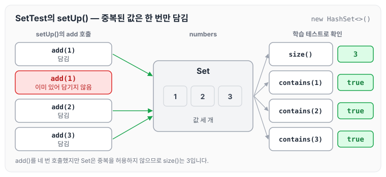
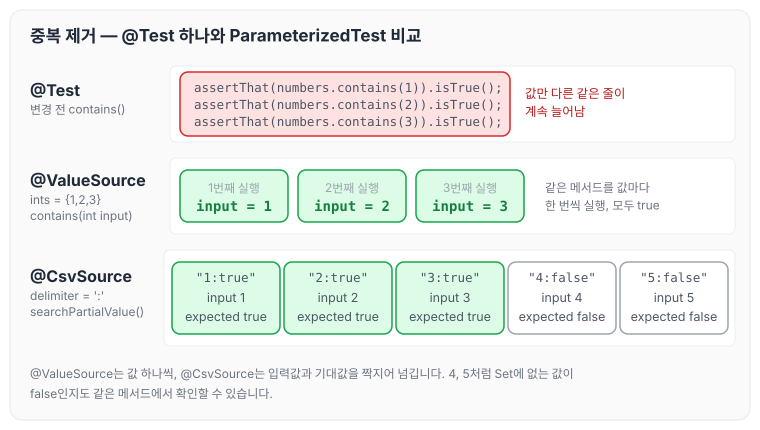

이전에 [스트림, 람다, Optional — 1단계](../ccj-01-stream-lambda-optional/)에 대해 작성하였습니다. 오늘은 Set 컬렉션을 대상으로 학습 테스트를 작성하고, JUnit의 ParameterizedTest로 중복 코드를 제거한 내용과 리뷰 피드백을 정리하도록 하겠습니다.

## Set Collection에 대한 학습 테스트

다음과 같은 Set 데이터가 주어졌을 때 요구사항을 만족해야 합니다.

```java
public class SetTest {
    private Set<Integer> numbers;

    @BeforeEach
    void setUp() {
        numbers = new HashSet<>();
        numbers.add(1);
        numbers.add(1);
        numbers.add(2);
        numbers.add(3);
    }

    // Test Case 구현
}
```

setUp()에서 1을 두 번 넣었지만 Set은 중복을 허용하지 않으므로, numbers에는 1, 2, 3 세 개의 값이 담깁니다.



요구사항 1과 2는 이 numbers를 대상으로 size()와 contains()의 결과를 테스트로 확인하는 것입니다.

### 요구사항 1

- Set의 size() 메소드를 활용해 Set의 크기를 확인하는 학습 테스트를 구현합니다.

### 요구사항 2

- Set의 contains() 메소드를 활용해 1, 2, 3의 값이 존재하는지를 확인하는 학습 테스트를 구현하려 합니다.
- 구현하고 보니 다음과 같이 중복 코드가 계속해서 발생합니다.
- JUnit의 ParameterizedTest를 활용해 중복 코드를 제거해 봅니다.

```java
    @Test
    void contains() {
        assertThat(numbers.contains(1)).isTrue();
        assertThat(numbers.contains(2)).isTrue();
        assertThat(numbers.contains(3)).isTrue();
    }
```

## 코드 구성

작성한 코드는 다음과 같습니다.

```java
package study;

import org.junit.jupiter.api.BeforeEach;
import org.junit.jupiter.api.DisplayName;
import org.junit.jupiter.api.Test;
import org.junit.jupiter.params.ParameterizedTest;
import org.junit.jupiter.params.provider.CsvSource;
import org.junit.jupiter.params.provider.ValueSource;

import java.util.HashSet;
import java.util.Set;

import static org.assertj.core.api.Assertions.assertThat;

public class SetTest {
    private Set<Integer> numbers;

    @BeforeEach
    void setUp() {
        numbers = new HashSet<>();
        numbers.add(1);
        numbers.add(1);
        numbers.add(2);
        numbers.add(3);
    }

    
    @Test
    @DisplayName("Set의 size() 메소드를 활용해 set의 크기 확인")
    public void compareSetSize() throws Exception {
        //given
        //when
        int size = numbers.size();
        //then
        assertThat(size).isEqualTo(3);
    }

    @ParameterizedTest
    @DisplayName("Set의 contains() 메소드를 활용해 1, 2, 3의 값이 존재하는지를 확인")
    @ValueSource(ints = {1,2,3} )
    public void contains(int input) throws Exception {
        //given
        //when
        //then
        assertThat(numbers.contains(input)).isTrue();
    }

    @DisplayName("부분적으로 값이 다른 것도 체크")
    @ParameterizedTest
    @CsvSource(value = {"1:true", "2:true", "3:true", "4:false","5:false" }, delimiter = ':')
    public void searchPartialValue(String input, String expected) throws Exception {
        //given
        int number = Integer.parseInt(input);
        boolean result = Boolean.parseBoolean(expected);
        //when
        boolean contains = numbers.contains(number);
        //then
        assertThat(contains).isEqualTo(result);
    }

}
```

요구사항 2의 contains 테스트는 `@ValueSource`로 1, 2, 3을 하나씩 넘겨 같은 메서드를 세 번 실행하고, searchPartialValue는 `@CsvSource`로 입력값과 기대값을 짝지어 다섯 번 실행합니다. 두 방식을 비교하면 아래와 같습니다.



`@CsvSource`를 사용하면 4, 5처럼 Set에 없는 값이 false인지도 같은 테스트 메서드 안에서 확인할 수 있습니다.

## 피드백

### 다양한 API 활용

```java
assertThat(size).isEqualTo(3); 
```

리뷰를 받고 AssertJ의 hasSize()를 사용하도록 아래와 같이 변경하였습니다.

```java
assertThat(numbers).hasSize(3);
```

### Boolean 타입으로 직접 전달받기

```java
@DisplayName("부분적으로 값이 다른 것도 체크")
    @ParameterizedTest
    @CsvSource(value = {"1:true", "2:true", "3:true", "4:false","5:false" }, delimiter = ':')
    public void searchPartialValue(String input, String expected) throws Exception {
```

변경한 부분은 다음과 같습니다.

```diff
- public void searchPartialValue(String input, String expected) throws Exception {
+ public void searchPartialValue(String input, boolean expected) throws Exception {
```

expected를 boolean 타입으로 받으면 JUnit이 CSV의 true, false 문자열을 boolean으로 변환해 전달하므로, Boolean.parseBoolean()으로 직접 바꾸지 않아도 됩니다.

## 마무리

오늘은 Set 컬렉션의 size()와 contains()를 학습 테스트로 확인하고, ParameterizedTest로 중복 코드를 제거한 내용과 리뷰 피드백을 정리하였습니다. 이번에는 간단하게 테스트를 어떻게 진행하는지와 깃을 어떻게 사용하는지에 대한 설명을 들었습니다. TDD 함수를 위와 같은 형태로 조금씩 사용해 보았는데, 다양한 함수를 사용해 보지 않아서 그런지 아직은 어색한 부분이 있었습니다. 이를 인지하면서 사용하지 않았던 함수도 계속 사용해 보고, 습관이 되도록 적극적으로 활용해 보려고 합니다.

깃허브 링크: [https://github.com/next-step/java-racingcar/pull/4092](https://github.com/next-step/java-racingcar/pull/4092)

다음 글에서는 [문자열 계산기 — 1단계](../ccj-string-calculator-step1/)에 대해 정리하도록 하겠습니다.

> 이 글은 넥스트스텝의 [TDD, 클린 코드 with Java](https://edu.nextstep.camp/c/O0pDe1b) 과정을 들으며 정리한 노트입니다.
