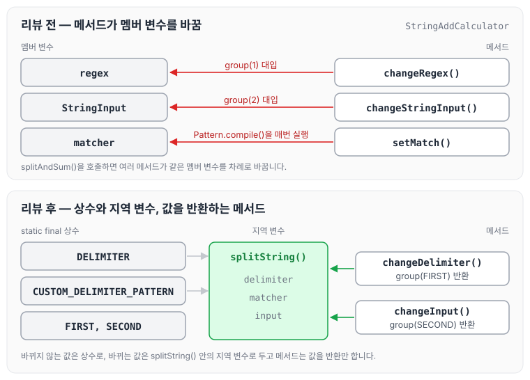
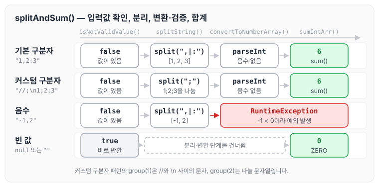

이전에 [문자열 계산기 — 1단계](../ccj-string-calculator-step1/)에 대해 작성하였습니다. 이번에는 문자열 덧셈 계산기를 TDD로 구현한 코드와 리뷰에서 받은 피드백, 그리고 피드백을 반영해 리팩터링한 코드에 대해 정리하도록 하겠습니다.

## 요구사항

### 기능 요구사항

- 쉼표(,) 또는 콜론(:)을 구분자로 가지는 문자열을 전달하면 구분자를 기준으로 분리한 각 숫자의 합을 반환합니다(예: `""` => 0, `"1,2"` => 3, `"1,2,3"` => 6, `"1,2:3"` => 6).
- 기본 구분자(쉼표, 콜론) 외에 커스텀 구분자를 지정할 수 있습니다. 문자열 앞부분의 `"//"`와 `"\n"` 사이에 위치하는 문자를 커스텀 구분자로 사용합니다. 예를 들어 `"//;\n1;2;3"`을 입력하면 커스텀 구분자는 세미콜론(;)이며, 결과 값으로 6이 반환되어야 합니다.
- 문자열 계산기에 숫자 이외의 값 또는 음수를 전달하면 RuntimeException 예외를 throw합니다.

### 프로그래밍 요구사항

- 메서드가 너무 많은 일을 하지 않도록 분리하기 위해 노력해 봅니다.

## 코드 구성

처음 작성한 코드는 다음과 같습니다.

```java
package study;

import java.util.Arrays;
import java.util.Objects;
import java.util.regex.Matcher;
import java.util.regex.Pattern;

public class StringAddCalculator {
    private String regex = ",|:";
    private String StringInput;
    private Matcher matcher;

    public int splitAndSum(String input) {
        StringInput = input;
        setMatch(StringInput);

        if (isPatternMatch(matcher)) {
            changeRegex(matcher);
            changeStringInput(matcher);
        }

        String[] strings = splitSentences(StringInput);
        int[] arr = changeStringArrToIntArr(strings);
        return sumIntArr(arr);
    }

    // Match 셋팅
    private void setMatch(String input) {
        if (Objects.isNull(input)) {
            return;
        }
        matcher = Pattern.compile("//(.)\n(.*)").matcher(input);
    }

    // 패턴 맞는지 확인하기
    private boolean isPatternMatch(Matcher matcher) {
        if (Objects.isNull(matcher)) {
            return false;
        }
        return matcher.find() == true ? true : false;
    }

    // 패턴값 변경하기.
    private void changeRegex(Matcher matcher) {
        regex = matcher.group(1);
    }

    // 입력값 변경하기
    private void changeStringInput(Matcher matcher) {
        StringInput = matcher.group(2);
    }

    // 문장 나누기 하기
    private String[] splitSentences(String input) {
        if (!Objects.isNull(input)) {
            return new String[0];
        }
        return input.split(regex);
    }

    // 문장배열 숫자 배열로 변경하기.
    private int[] changeStringArrToIntArr(String[] strings) {
        int [] arr = new int[strings.length];
        for (int i = 0; i < strings.length; i++) {
            arr[i] = Integer.parseInt(strings[i]);
            if (arr[i] < 0) {
                throw new RuntimeException("음수가 입력되었습니다. 입력숫자를 확인해주세요.");
            }
        }
        return arr;
    }

    // 숫자배열 합치기.
    private int sumIntArr(int[] arr) {
        return Arrays.stream(arr).sum();
    }

}
```

## 피드백

리뷰에서 받은 피드백과 피드백에 따라 변경한 코드는 아래와 같습니다.

### 상수 선언과 구분 문자 이름

`static final` 키워드를 붙여서 상수로 선언하라는 피드백과, 숫자를 구분하는 ‘구분 문자’라는 것을 좀 더 명확하게 하라는 피드백을 받았습니다. 네이밍 관련 링크는 아래와 같습니다.

- [https://tecoble.techcourse.co.kr/post/2020-04-24-variable_naming/](https://tecoble.techcourse.co.kr/post/2020-04-24-variable_naming/)
- [https://edu.nextstep.camp/s/wLaV8qhA/ls/OfAcbLUS](https://edu.nextstep.camp/s/wLaV8qhA/ls/OfAcbLUS)

이름을 짓는 방법은 클린 코드의 [2장 의미있는 이름](../clean-code-ch2-names/)에서도 정리하였습니다.

```java
import java.util.regex.Pattern;

public class StringAddCalculator {
    private String regex = ",|:";
```

`regex`를 `DELIMITER` 상수로 바꾸고, 커스텀 구분자 정규식도 `CUSTOM_DELIMITER` 상수로 선언하도록 다음과 같이 변경하였습니다.

```java
public class StringAddCalculator {
    private static final String DELIMITER = ",|:";
    private static final String CUSTOM_DELIMITER = "//(.)\n(.*)";
```

### Pattern 인스턴스 재사용

매번 계산할 때마다 Pattern 인스턴스를 생성하는 대신, 미리 하나의 인스턴스를 생성해 놓고 이를 재사용하라는 피드백을 받았습니다. 처음 코드는 `setMatch()`가 호출될 때마다 `Pattern.compile()`을 실행하고 있었습니다.

```java
if (Objects.isNull(input)) {
    return;
}
matcher = Pattern.compile("//(.)\n(.*)").matcher(input);
```

컴파일한 Pattern을 `CUSTOM_DELIMITER_PATTERN` 상수에 담아 두고, `splitString()`에서 이 인스턴스로 Matcher를 만들도록 다음과 같이 변경하였습니다.

```java
public class StringAddCalculator {
    private static final String DELIMITER = ",|:";
    private static final String CUSTOM_DELIMITER = "//(.)\n(.*)";
    private static final Pattern CUSTOM_DELIMITER_PATTERN = Pattern.compile(CUSTOM_DELIMITER);
		
		private String[] splitString(String input) {
	        String delimiter = DELIMITER;
	        Matcher matcher = CUSTOM_DELIMITER_PATTERN.matcher(input);
	
	        if (isPatternMatch(matcher)) {
	            delimiter = changeDelimiter(matcher);
	            input = changeInput(matcher);
	        }
	
	        return input.split(delimiter);
	    }
```

### 매직 넘버 상수화와 지역 변수 전환

아래 두 가지 피드백을 받았습니다.

- 숫자 `1`과 `2`는 상수로 선언해서 의미를 부여해 봅니다.
- 멤버 변수를 지역 변수로 변경합니다.

처음 코드는 아래와 같이 Matcher의 그룹 번호를 숫자로 적고, 결과를 멤버 변수 `regex`, `StringInput`에 담고 있었습니다.

```java
private void changeRegex(Matcher matcher) {
        regex = matcher.group(1);
}

// 입력값 변경하기
private void changeStringInput(Matcher matcher) {
    StringInput = matcher.group(2);
}
```

그룹 번호를 `FIRST`, `SECOND` 상수로 표현하고, 멤버 변수를 바꾸는 대신 값을 반환하도록 다음과 같이 변경하였습니다.

```java
public class StringAddCalculator {
		private static final int ZERO = 0;
		private static final int FIRST = 1;
		private static final int SECOND = 2;
		
		private String changeDelimiter(Matcher matcher) {
		    return matcher.group(FIRST);
		}
		
		// 입력값 변경하기
		private String changeInput(Matcher matcher) {
		    return matcher.group(SECOND);
		}
```

리뷰 전후로 구분자와 입력값을 다루는 방식을 비교하면 아래와 같습니다.



리뷰 전에는 `splitAndSum()`을 호출하면 여러 메서드가 같은 멤버 변수를 차례로 바꿉니다. 리뷰 후에는 바뀌지 않는 값은 상수로, 바뀌는 값은 `splitString()` 안의 지역 변수로 두고 메서드는 값을 반환만 합니다.

### 한 메서드에 한 단계 들여쓰기

객체지향 생활 체조 원칙의 `규칙 1: 한 메서드에 오직 한 단계의 들여쓰기만 한다.`에 대한 피드백을 받았습니다. 아래 코드는 for문 안에 if문이 있어 들여쓰기가 두 단계입니다.

```java
for (int i = 0; i < strings.length; i++) {
    arr[i] = Integer.parseInt(strings[i]);
    if (arr[i] < 0) {
        throw new RuntimeException("음수가 입력되었습니다. 입력숫자를 확인해주세요.");
    }
}
```

음수 확인을 `throwExceptionIfNegative()`로 분리해 들여쓰기를 한 단계로 줄이도록 다음과 같이 변경하였습니다.

```java
private int[] convertToNumberArray(String[] strings) {
    int [] arr = new int[strings.length];
    for (int i = 0; i < strings.length; i++) {
        arr[i] = Integer.parseInt(strings[i]);
        throwExceptionIfNegative(arr[i]);
    }
    return arr;
}

private void throwExceptionIfNegative(int input) {
    if (input < 0) {
        throw new RuntimeException("음수가 입력되었습니다. 입력숫자를 확인해주세요.");
    }
}
```

### @NullAndEmptySource 활용

`null` 또는 빈 문자열을 테스트할 경우 `@NullAndEmptySource` 어노테이션을 활용해 보는 것을 추천받았습니다. `@ParameterizedTest`는 [Set 컬렉션으로 배우는 학습 테스트 — 1단계](../ccj-02-learning-test/)에서도 사용하였습니다.

- 관련 링크: [https://gmlwjd9405.github.io/2019/11/27/junit5-guide-parameterized-test.html](https://gmlwjd9405.github.io/2019/11/27/junit5-guide-parameterized-test.html)

```java
@Test
    @DisplayName("null 또는 빈 문자열 입력시 splitAndSum 체크")
    public void splitAndSum_null_또는_빈문자() {
				int result = stringAddCalculator.splitAndSum(null);
        assertThat(result).isEqualTo(0);

        result = stringAddCalculator.splitAndSum("");
        assertThat(result).isEqualTo(0);
    }
```

null과 빈 문자열을 파라미터로 받아 하나의 검증 코드로 확인하도록 다음과 같이 변경하였습니다.

```java
@ParameterizedTest
    @DisplayName("null 또는 빈 문자열 입력시 splitAndSum 체크")
    @NullAndEmptySource
    public void splitAndSum_null_또는_빈문자(String text) {
        int result = stringAddCalculator.splitAndSum(text);
        assertThat(result).isEqualTo(0);
    }
```

### 파일 끝 개행

파일 끝에는 개행을 해야 한다는 피드백도 받았습니다.

- 관련 링크: [https://velog.io/@doondoony/posix-eol](https://velog.io/@doondoony/posix-eol)

### 조건식 결과 바로 반환

아래 코드는 더 줄일 수 있다는 피드백을 받았습니다.

```java
if (Objects.isNull(input) || "".equals(input)) {
    return true;
}
return false;
```

조건식의 결과를 바로 반환하도록 다음과 같이 변경하였습니다.

```java
private boolean isNotValidValue(String input) {
    return Objects.isNull(input) || "".equals(input);
}
```

## 피드백 이후 소스 코드

피드백을 모두 반영한 코드는 다음과 같습니다.

```java
package study;

import java.util.Arrays;
import java.util.Objects;
import java.util.regex.Matcher;
import java.util.regex.Pattern;

public class StringAddCalculator {
    private static final String DELIMITER = ",|:";
    private static final String CUSTOM_DELIMITER = "//(.)\n(.*)";
    private static final Pattern CUSTOM_DELIMITER_PATTERN = Pattern.compile(CUSTOM_DELIMITER);
    private static final int ZERO = 0;
    private static final int FIRST = 1;
    private static final int SECOND = 2;

    public int splitAndSum(String input) {
        if (isNotValidValue(input)) {
            return ZERO;
        }
        return sumIntArr(convertToNumberArray(splitString(input)));
    }

    private boolean isNotValidValue(String input) {
        return Objects.isNull(input) || "".equals(input);
    }

    // 문장 나누기 하기
    private String[] splitString(String input) {
        String delimiter = DELIMITER;
        Matcher matcher = CUSTOM_DELIMITER_PATTERN.matcher(input);

        if (isPatternMatch(matcher)) {
            delimiter = changeDelimiter(matcher);
            input = changeInput(matcher);
        }

        return input.split(delimiter);
    }

    // 패턴 맞는지 확인하기
    private boolean isPatternMatch(Matcher matcher) {
        return matcher.find();
    }

    // 패턴값 변경하기.
    private String changeDelimiter(Matcher matcher) {
        return matcher.group(FIRST);
    }

    // 입력값 변경하기
    private String changeInput(Matcher matcher) {
        return matcher.group(SECOND);
    }

    // 문장배열 숫자 배열로 변경하기
    private int[] convertToNumberArray(String[] strings) {
        int [] arr = new int[strings.length];
        for (int i = 0; i < strings.length; i++) {
            arr[i] = Integer.parseInt(strings[i]);
            throwExceptionIfNegative(arr[i]);
        }
        return arr;
    }

    // 음수값이면 예외 발생
    private void throwExceptionIfNegative(int input) {
        if (input < 0) {
            throw new RuntimeException("음수가 입력되었습니다. 입력숫자를 확인해주세요.");
        }
    }

    // 숫자배열 합치기.
    private int sumIntArr(int[] arr) {
        return Arrays.stream(arr).sum();
    }
}
```

이 코드에서 입력 문자열이 처리되는 순서를 그림으로 나타내면 아래와 같습니다.



`null`이나 빈 문자열이면 바로 0을 반환하고, 커스텀 구분자 패턴과 맞으면 `//`와 `\n` 사이의 문자로 나눕니다. 숫자로 바꾸는 중에 음수가 나오면 RuntimeException을 던집니다.

## 마무리

오늘은 문자열 덧셈 계산기를 TDD로 구현하면서 받은 리뷰 피드백과, 이를 반영해 상수 선언, 지역 변수 전환, 메서드 분리, 테스트 개선을 적용한 과정에 대해 정리하였습니다.

기존 소스 코드의 습관은 고치기 힘든 것 같습니다. 습관을 고치려면 항상 인지하고, 이해하고, 고치려고 노력해야 하는 것 같습니다. 이번에 정리한 예시를 항상 기억하고 고쳐 나가려고 합니다.

깃허브 링크는 [https://github.com/next-step/java-racingcar/pull/4211](https://github.com/next-step/java-racingcar/pull/4211)입니다. 다음 글에서는 [로또 자동 — 2단계](../ccj-04-lotto-auto/)에 대해 정리하도록 하겠습니다.

> 이 글은 넥스트스텝의 [TDD, 클린 코드 with Java](https://edu.nextstep.camp/c/O0pDe1b) 과정을 들으며 정리한 노트입니다.
