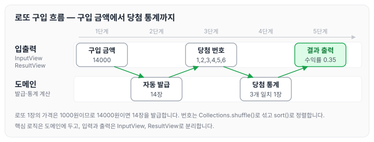
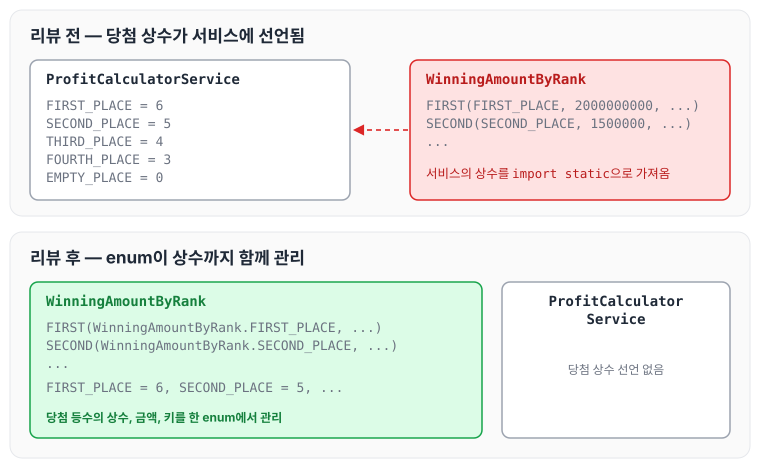

이전에 [문자열 덧셈 계산기로 배우는 TDD — 2단계](../ccj-03-string-calculator/)에 대해 작성하였습니다. 이번에는 로또 미션의 2단계인 로또(자동) 구매 기능을 구현하면서 받은 리뷰 피드백과 반영한 내용을 정리하도록 하겠습니다.

## 로또(자동) 요구사항

### 기능 요구사항

- 로또 구입 금액을 입력하면 구입 금액에 해당하는 로또를 발급해야 합니다.
- 로또 1장의 가격은 1000원입니다.

실행 결과는 아래와 같습니다.

```text
구입금액을 입력해 주세요.
14000
14개를 구매했습니다.
[8, 21, 23, 41, 42, 43]
[3, 5, 11, 16, 32, 38]
[7, 11, 16, 35, 36, 44]
[1, 8, 11, 31, 41, 42]
[13, 14, 16, 38, 42, 45]
[7, 11, 30, 40, 42, 43]
[2, 13, 22, 32, 38, 45]
[23, 25, 33, 36, 39, 41]
[1, 3, 5, 14, 22, 45]
[5, 9, 38, 41, 43, 44]
[2, 8, 9, 18, 19, 21]
[13, 14, 18, 21, 23, 35]
[17, 21, 29, 37, 42, 45]
[3, 8, 27, 30, 35, 44]

지난 주 당첨 번호를 입력해 주세요.
1, 2, 3, 4, 5, 6

당첨 통계
---------
3개 일치 (5000원)- 1개
4개 일치 (50000원)- 0개
5개 일치 (1500000원)- 0개
6개 일치 (2000000000원)- 0개
총 수익률은 0.35입니다.(기준이 1이기 때문에 결과적으로 손해라는 의미임)
```

구입 금액을 입력받아 당첨 통계를 출력하기까지의 흐름을 그림으로 나타내면 아래와 같습니다.



입력과 출력은 InputView, ResultView가 맡고, 로또 발급과 당첨 통계 계산은 도메인 로직에서 처리하도록 나누었습니다.

### 힌트

- 로또 자동 생성은 Collections.shuffle() 메소드를 활용합니다.
- Collections.sort() 메소드를 활용해 정렬할 수 있습니다.
- ArrayList의 contains() 메소드를 활용하면 어떤 값이 존재하는지 유무를 판단할 수 있습니다.

### 프로그래밍 요구사항

- 모든 기능을 TDD로 구현해 단위 테스트가 존재해야 합니다. 단, UI(System.out, System.in) 로직은 제외합니다.
    - 핵심 로직을 구현하는 코드와 UI를 담당하는 로직을 구분합니다.
    - UI 로직을 InputView, ResultView와 같은 클래스를 추가해 분리합니다.
- indent(인덴트, 들여쓰기) depth를 2를 넘지 않도록 구현합니다. 1까지만 허용합니다.
    - 예를 들어 while문 안에 if문이 있으면 들여쓰기는 2입니다.
    - 힌트: indent(인덴트, 들여쓰기) depth를 줄이는 좋은 방법은 함수(또는 메소드)를 분리하는 것입니다.
- 함수(또는 메소드)의 길이가 15라인을 넘어가지 않도록 구현합니다.
    - 함수(또는 메소드)가 한 가지 일만 잘 하도록 구현합니다.
- 모든 로직에 단위 테스트를 구현합니다. 단, UI(System.out, System.in) 로직은 제외합니다.
    - 핵심 로직을 구현하는 코드와 UI를 담당하는 로직을 구분합니다.
    - UI 로직을 InputView, ResultView와 같은 클래스를 추가해 분리합니다.
- 자바 코드 컨벤션을 지키면서 프로그래밍합니다.
    - 참고문서: [https://google.github.io/styleguide/javaguide.html](https://google.github.io/styleguide/javaguide.html) 또는 [https://myeonguni.tistory.com/1596](https://myeonguni.tistory.com/1596)
- else 예약어를 쓰지 않습니다.
    - 힌트: if 조건절에서 값을 return하는 방식으로 구현하면 else를 사용하지 않아도 됩니다.
    - else를 쓰지 말라고 하니 switch/case로 구현하는 경우가 있는데 switch/case도 허용하지 않습니다.

### 기능 목록 및 commit 로그 요구사항

- 기능을 구현하기 전에 README.md 파일에 구현할 기능 목록을 정리해 추가합니다.
- git의 commit 단위는 앞 단계에서 README.md 파일에 정리한 기능 목록 단위로 추가합니다.

## 리뷰 피드백

리뷰어에게 받은 피드백과 반영한 내용은 아래와 같습니다.

### 당첨 상수의 위치

당첨 등수를 나타내는 상수에 대해 리뷰어가 남긴 의견은 다음과 같습니다.

> 당첨에 대한 정보를 여기서 책임 갖고 관리한다는 측면에서는, `FIRST_PLACE`... 와 같은 스태틱 변수들을 다른 곳에 두기보단 여기에 두고 계속 사용하는 것이 좋을 것 같습니다.

처음에는 서비스 레이어에서 enum까지 구현하려고 했는데, 상수를 enum으로 옮기지 못하였습니다. 이런 디테일에 좀 더 신경 쓰도록 하겠습니다.

기존에는 당첨 상수를 `ProfitCalculatorService`에 선언하였습니다.

```java
public class ProfitCalculatorService {
    public static final int FIRST_PLACE = 6;
    public static final int SECOND_PLACE = 5;
    public static final int THIRD_PLACE = 4;
    public static final int FOURTH_PLACE = 3;
    public static final int EMPTY_PLACE = 0;

    private Lottos lottos;
    private int purchaseAmount;
    private Map<String, Integer> winningCount = new HashMap<>();

    public ProfitCalculatorService(Lottos lottos, int purchaseAmount) {
        this.lottos = lottos;
        this.purchaseAmount = purchaseAmount;
    }
```

이 상수를 사용하는 enum은 다음과 같습니다. `import static`으로 서비스의 상수를 가져와 사용하고 있습니다.

```java
package step2.domain.model;

import java.util.Arrays;

import static step2.domain.ProfitCalculatorService.*;

public enum WinningAmountByRank {
    FIRST(FIRST_PLACE, 2000000000, "FIRST_PLACE"),
    SECOND(SECOND_PLACE, 1500000, "SECOND_PLACE"),
    THIRD(THIRD_PLACE, 50000, "THIRD_PLACE"),
    FOURTH(FOURTH_PLACE, 5000, "FOURTH_PLACE"),
    EMPTY(EMPTY_PLACE, 0, "EMPTY_PLACE");

    private final int rank;
    private final int amount;
    private final String key;

    WinningAmountByRank(int rank, int amount, String key) {
        this.rank = rank;
        this.amount = amount;
        this.key = key;
    }

    public static WinningAmountByRank from(int rank) {
        return Arrays.stream(values())
                .filter(value -> rank == value.rank)
                .findFirst()
                .orElse(WinningAmountByRank.EMPTY);
    }

    public int getAmount() {
        return amount;
    }

    public int getRank() {
        return rank;
    }

    public String getKey() {
        return key;
    }
    
}
```

상수를 enum 안으로 옮겨 다음과 같이 변경하였습니다.

```java
package step2.domain.model;

import java.util.Arrays;

public enum WinningAmountByRank {
    FIRST(WinningAmountByRank.FIRST_PLACE, 2000000000, "FIRST_PLACE"),
    SECOND(WinningAmountByRank.SECOND_PLACE, 1500000, "SECOND_PLACE"),
    THIRD(WinningAmountByRank.THIRD_PLACE, 50000, "THIRD_PLACE"),
    FOURTH(WinningAmountByRank.FOURTH_PLACE, 5000, "FOURTH_PLACE"),
    EMPTY(WinningAmountByRank.EMPTY_PLACE, 0, "EMPTY_PLACE");
    
    public static final int FIRST_PLACE = 6;
    public static final int SECOND_PLACE = 5;
    public static final int THIRD_PLACE = 4;
    public static final int FOURTH_PLACE = 3;
    public static final int EMPTY_PLACE = 0;

    private final int rank;
    private final int amount;
    private final String key;
    WinningAmountByRank(int rank, int amount, String key) {
        this.rank = rank;
        this.amount = amount;
        this.key = key;
    }

    public static WinningAmountByRank from(int rank) {
        return Arrays.stream(values())
                .filter(value -> rank == value.rank)
                .findFirst()
                .orElse(WinningAmountByRank.EMPTY);
    }

    public int getAmount() {
        return amount;
    }

    public int getRank() {
        return rank;
    }

    public String getKey() {
        return key;
    }
}
```

변경 전후의 구조를 비교하면 아래와 같습니다.



변경 후에는 당첨 등수의 상수와 금액, 키를 `WinningAmountByRank` 한 곳에서 관리하고, `ProfitCalculatorService`에는 당첨 상수를 선언하지 않습니다.

### 전략 인터페이스의 이름

전략 인터페이스의 이름에 대해서는 다음과 같은 의견을 받았습니다.

> 무엇에 대한 전략인지 네이밍이 더 구체적이었으면 합니다.

어떤 전략인지 이름에서 드러나도록 좀 더 명확하게 작성하기로 하였습니다. 전략 패턴에 대해서는 [전략 패턴](../strategy-pattern/)에서 정리하였습니다. 기존 인터페이스는 다음과 같습니다.

```java
package step2.domain.strategy.price;

public interface Strategy {
```

이름을 다음과 같이 `PriceStrategy`로 변경하였습니다.

```java
package step2.domain.strategy.price;

public interface PriceStrategy {
    int buyLotto(int purchaseAmount);
}
```

작성한 코드는 아래 PR에서 확인할 수 있습니다.

깃허브 링크: [https://github.com/next-step/java-lotto/pull/2999](https://github.com/next-step/java-lotto/pull/2999)

## 마무리

오늘은 로또 미션 2단계인 로또(자동)를 구현하고 받은 리뷰 피드백에 대해 정리하였습니다. 이번에는 이전 단계보다 리뷰가 많이 줄어든 느낌이 들어, 조금씩 발전하고 있는 것이 아닐까 싶습니다. 앞으로도 리뷰해 주신 내용을 신경 써서 적용하고, 의식적으로 습관을 바꾸어 나가도록 노력하겠습니다.

다음 글에서는 [로또 게임 2등 — 3단계](../ccj-05-lotto-second-prize/)에 대해 정리하도록 하겠습니다.

> 이 글은 넥스트스텝의 [TDD, 클린 코드 with Java](https://edu.nextstep.camp/c/O0pDe1b) 과정을 들으며 정리한 노트입니다.
