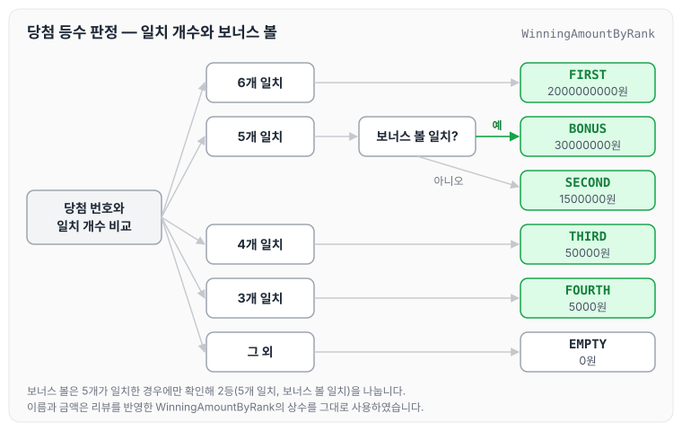
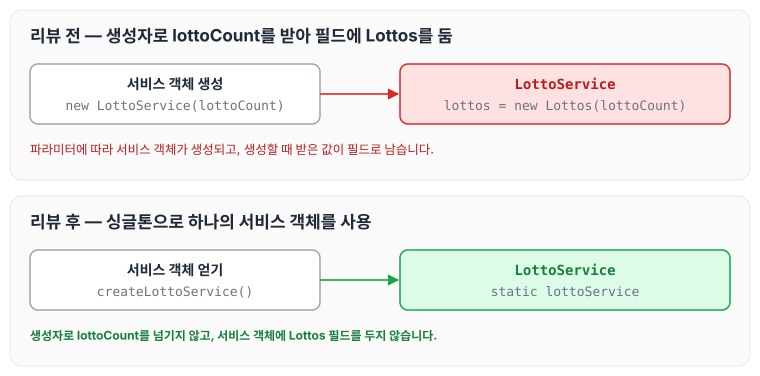
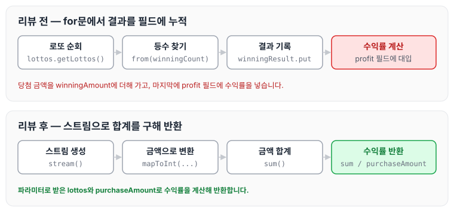

이전에 [로또 자동 — 2단계](../ccj-04-lotto-auto/)에 대해 작성하였습니다. 이번에는 로또 미션 3단계인 로또 게임(2등)을 구현하면서 받은 리뷰 피드백과 반영한 내용을 정리하도록 하겠습니다.

## 로또 게임(2등) 요구사항

### 기능 요구사항

- 2등을 위해 추가 번호를 하나 더 추첨합니다.
- 당첨 통계에 2등도 추가해야 합니다.

실행 결과는 아래와 같습니다. 앞부분은 생략하였습니다.

```text
[... 생략 ...]

지난 주 당첨 번호를 입력해 주세요.
1, 2, 3, 4, 5, 6
보너스 볼을 입력해 주세요.
7

당첨 통계
---------
3개 일치 (5000원)- 1개
4개 일치 (50000원)- 0개
5개 일치 (1500000원)- 0개
5개 일치, 보너스 볼 일치(30000000원) - 0개
6개 일치 (2000000000원)- 0개
총 수익률은 0.35입니다.(기준이 1이기 때문에 결과적으로 손해라는 의미임)
```

2등이 추가되면서 당첨 등수는 일치한 개수와 보너스 볼 일치 여부로 정해집니다. 이를 그림으로 나타내면 아래와 같습니다. 그림의 이름과 금액은 아래 리뷰 피드백에서 변경한 `WinningAmountByRank`의 상수입니다.



### 프로그래밍 요구사항

- 모든 기능을 TDD로 구현해 단위 테스트가 존재해야 합니다. 단, UI(System.out, System.in) 로직은 제외합니다.
- **java enum을 적용해 프로그래밍을 구현합니다.**
- **규칙 8: 일급 콜렉션을 씁니다.**
- indent(인덴트, 들여쓰기) depth를 2를 넘지 않도록 구현합니다. 1까지만 허용합니다.
- 함수(또는 메소드)의 길이가 15라인을 넘어가지 않도록 구현합니다.
- 자바 코드 컨벤션을 지키면서 프로그래밍합니다.
- else 예약어를 쓰지 않습니다.

### 힌트

- 일급 콜렉션을 씁니다.
    - 6개의 숫자 값을 가지는 java collection을 감싸는 객체를 추가해 구현해 봅니다.
- 하드 코딩을 하지 않기 위해 상수 값을 사용하면 많은 상수 값이 발생합니다. 자바의 enum을 활용해 상수 값을 제거합니다. 즉, enum을 활용해 일치하는 수를 로또 등수로 변경해 봅니다.

일급 컬렉션에 대해서는 [일급컬렉션](../first-class-collection/)에서 정리하였습니다.

### 기능 목록 및 commit 로그 요구사항

- 기능을 구현하기 전에 README.md 파일에 구현할 기능 목록을 정리해 추가합니다.
- git의 commit 단위는 앞 단계에서 README.md 파일에 정리한 기능 목록 단위로 추가합니다.

## 리뷰 피드백

리뷰어에게 받은 피드백과 반영한 내용은 아래와 같습니다.

### enum의 상수 필드 제거

enum 안의 상수에 대해 리뷰어가 남긴 의견은 다음과 같습니다.

> 이 enum에서만 관리하면 되므로, enum에서 해당 필드를 public하게 노출시키고 여기 이 추출들은 제거하는 것이 조금 더 자연스러운 구현인 듯합니다.

enum에서 이미 등수를 표현하고 있으므로, 내부에서 굳이 `WinningAmountByRank`의 상수 필드로 값을 줄 필요는 없다고 생각하였습니다. 기존 코드는 다음과 같습니다.

```java
public enum WinningAmountByRank {
    FIRST(WinningAmountByRank.FIRST_PLACE, 2000000000, "FIRST_PLACE"),
    SECOND(WinningAmountByRank.SECOND_PLACE, 1500000, "SECOND_PLACE"),
    THIRD(WinningAmountByRank.THIRD_PLACE, 50000, "THIRD_PLACE"),
    FOURTH(WinningAmountByRank.FOURTH_PLACE, 5000, "FOURTH_PLACE"),
    EMPTY(WinningAmountByRank.EMPTY_PLACE, 0, "EMPTY_PLACE");

    public static final int FIRST_PLACE = 6;
    public static final int SECOND_PLACE = 5;
    public static final int THIRD_PLACE = 4;
    public static final int FOURTH_PLACE = 3;
    public static final int EMPTY_PLACE = 0;
```

상수 필드를 제거하고 값을 직접 넣어 다음과 같이 변경하였습니다. 2등을 위한 `BONUS`도 이때 추가하였습니다.

```java
public enum WinningAmountByRank {
    FIRST(6, 2000000000, "FIRST_PLACE"),
    BONUS(37, 30000000, "BONUS_PLACE"),
    SECOND(5, 1500000, "SECOND_PLACE"),
    THIRD(4, 50000, "THIRD_PLACE"),
    FOURTH(3, 5000, "FOURTH_PLACE"),
    EMPTY(0, 0, "EMPTY_PLACE");

    private final int rank;
    private final int amount;
    private final String key;
```

### 서비스 객체의 생성 방식

서비스 객체를 생성하는 방식에 대해서는 다음과 같은 의견을 받았습니다.

> `LottoService`에서 또 의견을 드리겠지만, 서비스 객체가 파라메터에 따라 생성되는 것이 조금 신기하고 어색하게 느껴집니다. 생성자로 `lottoCount`가 넘어가야 할 이유가 있으려나요?

서비스 객체에 생성자로 값을 넘겨 필드로 남길 필요는 없었습니다. 또한 싱글톤 패턴으로 사용한다고 생각했을 때, 필드에 값을 두는 것은 thread safe하지 않을 것 같았습니다. 싱글톤 객체에 상태를 두었을 때 생기는 문제는 [싱글톤 방식의 주의점](../spring-core-singleton-caution/)에서도 정리하였습니다. 기존 코드는 다음과 같습니다.

```java
public class LottoService {
    private Lottos lottos;

    public LottoService(int lottoCount) {
        this.lottos = new Lottos(lottoCount);
    }
```

다음과 같이 싱글톤을 적용해 변경하였습니다.

```java
public class LottoService {
    // singleton 적용
    private static LottoService lottoService = null;

    public static LottoService createLottoService() {
        if (Objects.isNull(lottoService)) {
            return new LottoService();
        }
        return lottoService;
    }
```

변경 전후에 의도한 생성 방식을 비교하면 아래와 같습니다.



다만 위 `createLottoService()`는 실제로는 싱글톤으로 동작하지 않습니다. `lottoService`가 null일 때 새 객체를 만들어 반환만 하고 필드에 담지 않으므로 `createLottoService()`를 부를 때마다 다른 객체가 반환되며(두 번 호출해 `==`로 비교하면 false), 만든 객체를 `lottoService`에 대입한 뒤 반환해야 합니다.

### 스트림으로 수익률 계산

수익률을 계산하는 부분에 대해서는 다음과 같은 의견을 받았습니다.

> 스트림 기반으로 개선해 보시면 좋겠네요!

이전에 스트림 안에 너무 많은 기능을 넣은 소스 코드를 본 적이 있는데, 복잡해서 스트림에 거부감이 있었습니다. 하지만 하나의 기능에 집중하는 스트림이라면 가독성 면에서도 충분히 좋다고 생각합니다. 기존 코드는 다음과 같습니다.

```java
public void calculatorProfit() {
        double winningAmount = 0;
        for (Lotto lotto : lottos.getLottos()) {
            int winningCount = getWinningResult(lotto);
            WinningAmountByRank from = WinningAmountByRank.from(winningCount);
            winningResult.put(from.getKey(), winningResult.getOrDefault(from.getKey(), 0) + 1);
            winningAmount += from.getAmount();
        }
        profit = winningAmount / purchaseAmount;
    }
```

다음과 같이 변경하였습니다.

```java
public double calculatorProfit(Lottos lottos, int purchaseAmount) {
        double sum = lottos.getLottos()
                .stream()
                .mapToInt(lotto -> WinningAmountByRank.from(getWinningResult(lotto)).getAmount()).sum();

        return sum / purchaseAmount;
    }
```

변경 전후의 흐름을 비교하면 아래와 같습니다.



변경 후에는 필드에 값을 누적하지 않고, 파라미터로 받은 `lottos`와 `purchaseAmount`로 수익률을 계산해 반환합니다.

작성한 코드는 아래 PR에서 확인할 수 있습니다.

깃허브 링크: [https://github.com/next-step/java-lotto/pull/3055](https://github.com/next-step/java-lotto/pull/3055)

## 마무리

오늘은 로또 미션 3단계인 로또 게임(2등)을 구현하고 받은 리뷰 피드백에 대해 정리하였습니다. 서비스 객체에 필드 값을 지정해 준다면 과연 thread safe한지 다시 한번 생각해 볼 수 있는 기회였습니다. 앞으로는 객체를 완성할 때마다 테스트 코드도 함께 작성할 수 있도록 해 보겠습니다.

다음 글에서는 [로또 수동 — 4단계](../ccj-06-lotto-manual/)에 대해 정리하도록 하겠습니다.

> 이 글은 넥스트스텝의 [TDD, 클린 코드 with Java](https://edu.nextstep.camp/c/O0pDe1b) 과정을 들으며 정리한 노트입니다.
