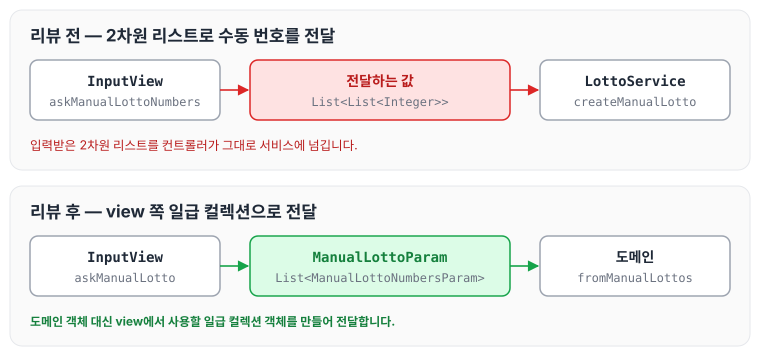
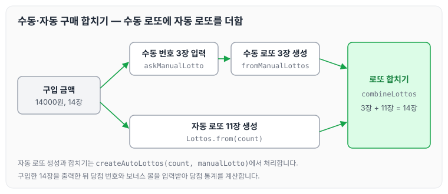

이전에 [로또 게임 2등 — 3단계](../ccj-05-lotto-second-prize/)에 대해 작성하였습니다. 이번에는 로또 미션 4단계인 로또(수동) 구매 기능을 구현하면서 받은 리뷰 피드백과 반영한 내용을 정리하도록 하겠습니다.

## 로또(수동) 요구사항

### 기능 요구사항

- 현재 로또 생성기는 자동 생성 기능만 제공합니다. 사용자가 수동으로 추첨 번호를 입력할 수 있도록 해야 합니다.
- 입력한 금액, 자동 생성 숫자, 수동 생성 번호를 입력하도록 해야 합니다.

실행 결과는 아래와 같습니다.

```text
구입금액을 입력해 주세요.
14000

수동으로 구매할 로또 수를 입력해 주세요.
3

수동으로 구매할 번호를 입력해 주세요.
8, 21, 23, 41, 42, 43
3, 5, 11, 16, 32, 38
7, 11, 16, 35, 36, 44

수동으로 3장, 자동으로 11개를 구매했습니다.
[8, 21, 23, 41, 42, 43]
[3, 5, 11, 16, 32, 38]
[7, 11, 16, 35, 36, 44]
[1, 8, 11, 31, 41, 42]
[13, 14, 16, 38, 42, 45]
[7, 11, 30, 40, 42, 43]
[2, 13, 22, 32, 38, 45]
[23, 25, 33, 36, 39, 41]
[1, 3, 5, 14, 22, 45]
[5, 9, 38, 41, 43, 44]
[2, 8, 9, 18, 19, 21]
[13, 14, 18, 21, 23, 35]
[17, 21, 29, 37, 42, 45]
[3, 8, 27, 30, 35, 44]

지난 주 당첨 번호를 입력해 주세요.
1, 2, 3, 4, 5, 6
보너스 볼을 입력해 주세요.
7

당첨 통계
---------
3개 일치 (5000원)- 1개
4개 일치 (50000원)- 0개
5개 일치 (1500000원)- 0개
5개 일치, 보너스 볼 일치(30000000원) - 0개
6개 일치 (2000000000원)- 0개
총 수익률은 0.35입니다.(기준이 1이기 때문에 결과적으로 손해라는 의미임)
```

### 프로그래밍 요구사항

- **규칙 3: 모든 원시값과 문자열을 포장합니다.**
- **규칙 5: 줄여 쓰지 않습니다(축약 금지).**
- **예외 처리를 통해 에러가 발생하지 않도록 합니다.**
- 모든 기능을 TDD로 구현해 단위 테스트가 존재해야 합니다. 단, UI(System.out, System.in) 로직은 제외합니다.
- java enum을 적용해 프로그래밍을 구현합니다.
- 규칙 8: 일급 콜렉션을 씁니다.
- indent(인덴트, 들여쓰기) depth를 2를 넘지 않도록 구현합니다. 1까지만 허용합니다.
- 함수(또는 메소드)의 길이가 15라인을 넘어가지 않도록 구현합니다.
- 자바 코드 컨벤션을 지키면서 프로그래밍합니다.
- else 예약어를 쓰지 않습니다.

### 힌트

- 규칙 3: 모든 원시값과 문자열을 포장합니다.
    - 로또 숫자 하나는 int 타입입니다. 이 숫자 하나를 추상화한 LottoNo 객체를 추가해 구현합니다.
- 예외 처리를 통해 에러가 발생하지 않도록 합니다.
    - 사용자가 잘못된 값을 입력했을 때 java exception으로 에러 처리를 합니다.
    - java8에 추가된 Optional을 적용해 NullPointerException이 발생하지 않도록 합니다.

### 기능 목록 및 commit 로그 요구사항

- 기능을 구현하기 전에 README.md 파일에 구현할 기능 목록을 정리해 추가합니다.
- git의 commit 단위는 앞 단계에서 README.md 파일에 정리한 기능 목록 단위로 추가합니다.

## 리뷰 피드백

리뷰어에게 받은 피드백과 반영한 내용은 아래와 같습니다.

### 수동 입력 값의 일급 컬렉션

수동으로 입력받는 로또 번호에 대해 리뷰어가 남긴 의견은 다음과 같습니다.

> 입력되는 로또 번호에 대해 일급 콜렉션 객체를 설계해서, 2차원 배열 형태의 리스트 사용을 없애 보시면 좋겠습니다.

입력받은 값은 잠시 저장해 두었다가 결국 일급 컬렉션으로 변경해서 서비스로 진행되는데, 이 부분도 변경하는 것이 좋을지 고민이 되었습니다. 고민이 된 이유는 아래와 같습니다.

- 일급 컬렉션을 만들게 되면 파라미터 객체가 만들어진다고 생각되는데, 전부 변경해야 하는 것인지 궁금했습니다. (지금까지 입력받은 값들은 일반 컬렉션과 일반 변수로 입력받아서 컨트롤러에서 변경되는 구조입니다.)
- input 객체에서 도메인 객체를 사용하는 것은 좋지 않다고 생각했습니다.

당시에는 다음과 같이 입력받은 `List<List<Integer>>`를 서비스로 넘기고 있었습니다.

```java
List<List<Integer>> lists = InputView.askManualLottoNumbers(manualLottoCount);
Lottos manualLotto = lottoService.createManualLotto(lists);
OutputView.outPutLottos(manualLotto);
```

이에 대해 리뷰어는 다음과 같이 답변해 주었습니다.

> - 모두 변경하시면 됩니다.
> - 도메인 객체를 사용하는 게 당연히 좋진 않은데요, 그렇다면 view에서도 이런 구조를 갖는 일급 콜렉션 객체를 따로 만드시면 해결된다고 생각하기는 합니다.

리뷰를 반영해 view에서 사용할 일급 컬렉션 객체를 따로 만들었습니다. 기존 입력 코드는 다음과 같습니다.

```java
public static List<List<Integer>> askManualLottoNumbers(int manualLottoCount) {
        System.out.println("수동으로 구매할 번호를 입력해 주세요.");
        newLineRemove();
        List<List<Integer>> manualLottos = new ArrayList<>();
        for (int i = 0 ; i <manualLottoCount; i++) {
            manualLottos.add(createManualLotto());
        }
        return manualLottos;
    }
```

다음과 같이 `ManualLottoParam`을 반환하도록 변경하였습니다.

```java
public static ManualLottoParam askManualLotto(int manualLottoCount) {
        System.out.println("수동으로 구매할 번호를 입력해 주세요.");
        newLineRemove();
        List<ManualLottoNumbersParam> manualLotto = new ArrayList<>();
        for (int i = 0 ; i <manualLottoCount; i++) {
            manualLotto.add(createManualLottoNumbers());
        }
        return ManualLottoParam.from(manualLotto);
    }
```

변경 전후에 전달하는 값을 비교하면 아래와 같습니다.



view에서 도메인 객체를 사용하지 않고, `List<List<Integer>>` 대신 `ManualLottoParam`으로 수동 번호를 전달합니다.

### 수동·자동 로또를 합치는 메소드

수동 로또와 자동 로또를 합치는 메소드에 대해서는 다음과 같은 의견을 받았습니다.

> 이 메소드보단 (구입해야 할 총 장수, 입력받은 매뉴얼 로또 입력 값 리스트) 파라메터를 갖는 메소드가 나오면 조금 더 좋을 것 같습니다.

처음에는 두 개의 메소드로 분리해서 구현한 다음 합치면 관리하는 측면에서 수정하기 좀 더 용이하다고 생각했습니다. 하지만 수동 로또를 구현하고 이어서 자동 로또를 구현하면서 합치는 것이 좀 더 자연스러운 것 같았습니다. 기존 코드는 다음과 같습니다.

```java
public Lottos combineLotto(Lottos autoLottos, Lottos manualLottos) {
        autoLottos.combineLottos(manualLottos);
        return autoLottos;
    }
```

다음과 같이 변경하였습니다.

```java
public Lottos createAutoLottos(int count, Lottos manualLotto) {
        Lottos from = Lottos.from(count);
        manualLotto.combineLottos(from);
        return manualLotto;
}
```

### for문을 스트림으로 변경

수동 로또를 만드는 반복문에 대해서는 다음과 같은 의견을 받았습니다.

> 스트림 API를 사용하면 굉장히 클린하게 개선이 가능한 로직인 것 같기는 합니다! 다른 곳에서는 스트림을 사용하셨길래 의견 드립니다.

여러 가지 언어를 다뤄 봐서 stream보다는 for문이 익숙한 경향이 없지 않아 있습니다. 앞으로 for문을 작성할 때 최대한 stream으로 변경해 보도록 하겠습니다. [로또 게임 2등 — 3단계](../ccj-05-lotto-second-prize/)에서도 수익률 계산을 스트림으로 바꾼 적이 있습니다. 기존 코드는 다음과 같습니다.

```java
List<Lotto> lottos = new ArrayList<>();
        for (int i = 0; i < manualLottos.size(); i++) {
            lottos.add(Lotto.fromManualLotto(new LottoPolicyStrategy(), manualLottos.get(i)));
        }
        return new Lottos(lottos);
```

다음과 같이 변경하였습니다.

```java
public static Lottos fromManualLottos(ManualLottoParam manualLotto) {
        List<Lotto> lottos = manualLotto.getManualLottos()
                .stream()
                .map(numbers -> Lotto.fromManualLotto(new LottoPolicyStrategy(), numbers.getLottoNumbers()))
                .collect(Collectors.toList());

        return new Lottos(lottos);
    }
```

### 리뷰를 반영한 구매 흐름

리뷰를 모두 반영한 뒤 수동 로또와 자동 로또를 만들어 합치는 흐름을 그림으로 나타내면 아래와 같습니다.



수동으로 입력받은 번호로 수동 로또를 먼저 만들고, `createAutoLottos`에서 자동 로또를 만들어 수동 로또에 합칩니다.

작성한 코드는 아래 PR에서 확인할 수 있습니다.

깃허브 링크: [https://github.com/next-step/java-lotto/pull/3104](https://github.com/next-step/java-lotto/pull/3104)

## 마무리

오늘은 로또 미션 4단계인 로또(수동)를 구현하고 받은 리뷰 피드백에 대해 정리하였습니다. 4단계도 머지가 완료되었습니다. 1단계에서도 느꼈지만, 챕터별로 진행되다 보니 많은 개발자와 리뷰를 주고받을 수 있는 것은 좋았지만 충분히 소통하지 못했다는 아쉬움도 큰 것 같습니다. 한 사람과 계속 함께하면 더 많은 이야기를 나눌 수 있을 것 같아, 다음 챕터에서는 좀 더 적극적으로 이야기를 전달해 볼 생각입니다.

다음 글에서는 [사다리 생성 — 2단계](../ccj-07-ladder-create/)에 대해 정리하도록 하겠습니다.

> 이 글은 넥스트스텝의 [TDD, 클린 코드 with Java](https://edu.nextstep.camp/c/O0pDe1b) 과정을 들으며 정리한 노트입니다.
