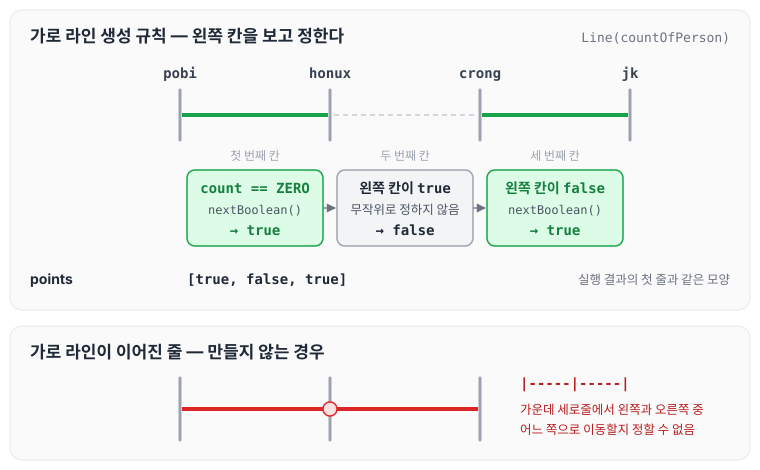
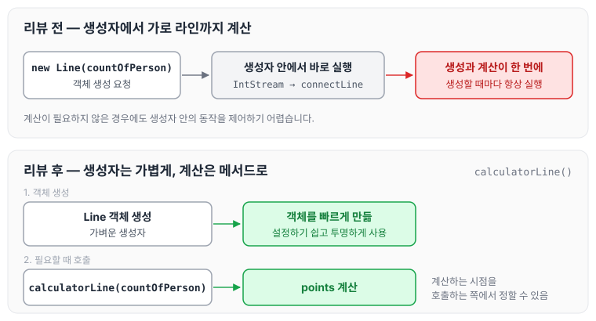
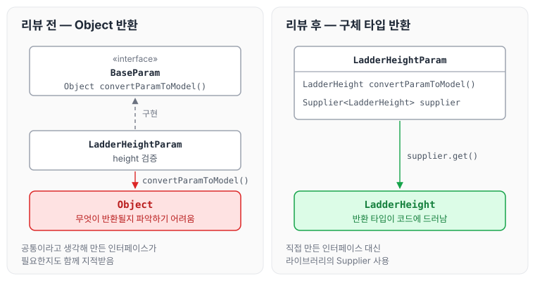

이전에 [로또 수동 — 4단계](../ccj-06-lotto-manual/)에 대해 작성하였습니다. 사다리 미션은 1단계 [스트림, 람다, Optional — 1단계](../ccj-01-stream-lambda-optional/)에서 학습을 진행하였고, 이번에는 2단계인 사다리 생성의 요구사항과 리뷰어에게 받은 피드백을 정리하도록 하겠습니다.

## 기능 요구사항

- 사다리 게임에 참여하는 사람에게 이름을 최대 5글자까지 부여할 수 있습니다. 사다리를 출력할 때 사람 이름도 같이 출력합니다.
- 사람 이름은 쉼표(,)를 기준으로 구분합니다.
- 사람 이름을 5자 기준으로 출력하기 때문에 사다리 폭도 넓어져야 합니다.
- 사다리 타기가 정상적으로 동작하려면 라인이 겹치지 않도록 해야 합니다.
    - `|-----|-----|` 모양과 같이 가로 라인이 겹치는 경우 어느 방향으로 이동할지 결정할 수 없습니다.

## 프로그래밍 요구사항

- 자바 8의 스트림과 람다를 적용해 프로그래밍합니다.
- 규칙 6: 모든 엔티티를 작게 유지합니다.

## 실행 결과

위 요구사항에 따라 4명의 사람을 위한 5개 높이 사다리를 만들 경우, 프로그램을 실행한 결과는 다음과 같습니다.

```text
참여할 사람 이름을 입력하세요. (이름은 쉼표(,)로 구분하세요)
pobi,honux,crong,jk

최대 사다리 높이는 몇 개인가요?
5

실행결과

pobi  honux crong   jk
    |-----|     |-----|
    |     |-----|     |
    |-----|     |     |
    |     |-----|     |
    |-----|     |-----|
```

## 피드백

### 생성자에 코드를 넣지 않기

리뷰어에게 생성자에서 많은 역할을 하고 있는 것은 아닌지 고민해 보면 좋겠다는 의견을 받았습니다. 생성자의 실행 코드는 객체를 생성하면서 즉시 실행되기 때문에, 코드가 많아질수록 절차 지향에 가까워진다는 것이었습니다. 참고 자료로 [[엘레강트 오브젝트] 1. 출생 - (3) 생성자에 코드를 넣지 마세요](https://jackjeong.tistory.com/149)를 공유받았습니다.

지적받은 코드는 아래와 같습니다.

```java
public Line(int countOfPerson) {
        int rangeEnd = countOfPerson - 1;

        IntStream.range(RANGE_START, rangeEnd)
                .forEach(count -> {
                    if (count == ZERO || !points.get(count - 1)) {
                        connectLine(() -> RANDOM.nextBoolean());
                        return;
                    }
                    connectLine(() -> false);
                });
    }
```

`Line`은 사다리의 가로 한 줄이고, 참여자 사이의 칸마다 가로 라인이 놓였는지를 `points`에 `true`/`false`로 담습니다. 첫 번째 칸이거나 왼쪽 칸에 가로 라인이 없으면 `RANDOM.nextBoolean()`으로 놓을지 정하고, 왼쪽 칸에 이미 가로 라인이 있으면 `false`로 둡니다. 이 규칙 때문에 기능 요구사항의 `|-----|-----|`처럼 가로 라인이 이어지는 경우가 생기지 않습니다. 실행 결과의 첫 줄로 보면 아래와 같습니다.



두 번째 칸은 왼쪽에 가로 라인이 있어서 무작위로 정하지 않고 `false`가 됩니다. 이렇게 한 칸씩 왼쪽을 보고 정하기 때문에 이웃한 두 칸이 동시에 `true`가 되지 않습니다.

생성자에 대한 피드백으로 돌아가면, 공유받은 글은 좋은 글이라고 생각했습니다. 글에서 소개한 `엘레강트 오브젝트`라는 책도 읽어 봐야겠습니다. 글의 내용을 정리하면 다음과 같습니다.

- 생성자에서 너무 많은 일을 하게 되면 생성할 때마다 매번 생성자에 있는 동작을 진행해야 하고, CPU 시간을 소모하게 됩니다.
- 생성자 안에 있는 동작이 필요하지 않을 경우 제어하기가 힘듭니다. 함수로 해당 동작을 따로 두면 필요할 때 사용하고 언제든지 바운더리 안에서 변경할 수 있습니다.

가벼운 생성자는 설정하기 쉽고 투명하게 사용할 수 있기 때문에 객체를 더 빠르게 만들 수 있습니다. 그래서 가로 라인을 만드는 동작을 생성자에서 꺼내 아래와 같이 메서드로 분리하였습니다.

```java
void calculatorLine(int countOfPerson) {
    int rangeEnd = countOfPerson - 1;

    IntStream.range(RANGE_START, rangeEnd)
            .forEach(count -> {
                if (count == ZERO || !points.get(count - 1)) {
                    connectLine(() -> RANDOM.nextBoolean());
                    return;
                }
                connectLine(() -> false);
            });
}
```



리뷰 전에는 객체를 만드는 것과 가로 라인을 계산하는 것이 한 번에 일어났고, 리뷰 후에는 계산을 원하는 시점에 따로 호출할 수 있습니다.

### Object 대신 제네릭, 직접 만든 인터페이스 대신 Supplier

리뷰어에게 `Object`를 활용하는 것보다 제네릭을 활용하는 방향은 어떻게 생각하는지 질문받았습니다. `Object`를 반환하면 이후 구현이 어떻게 될지 파악하기 어려워질 수 있다는 이유였고, 참고 자료로 [이펙티브 자바, 쉽게 정리하기 - item 26. 로 타입은 사용하지 말라](https://jake-seo-dev.tistory.com/46)를 공유받았습니다.

또한 이 부분이 인터페이스로 따로 필요한지도 고민해 보면 좋겠다는 의견을 받았습니다. 오버 엔지니어링이 된 것은 아닌지, 그게 아니라면 라이브러리에 있는 `Supplier`를 이용해도 좋을 것 같다는 의견이었고, 참고 자료로 [[이펙티브 자바] Item59 - 라이브러리를 익히고 사용하라](https://jjingho.tistory.com/108)를 공유받았습니다.

```java
package ladder.domain.model.Param;

public interface BaseParam {
    Object convertParamToModel();
}

public class LadderHeightParam implements BaseParam {
    private static int MINIMUM_HEIGHT = 1;

    private int height;

    public LadderHeightParam(int height) {
        if (isHeightNegative(height)) {
            throw new LadderHeightArgumentException("비어 있거나 잘못된 값을 입력하였습니다.");
        }
        this.height = height;
    }

    private boolean isHeightNegative(int height) {
        return height < MINIMUM_HEIGHT;
    }
}
```

돌아보면 굳이 `interface`를 쓰면서까지 구현할 필요는 없었는데, 공통이라고 생각하다 보니 사용하게 되었습니다. `Object`를 사용한 것은 전달받은 객체마다 여러 가지를 리턴받아 사용하기 위해서였는데, 제네릭을 사용해서 푸는 것이 더 안전하고 깔끔하다는 것을 알게 되었습니다. 수정한 코드는 아래와 같습니다.

```java
package ladder.domain.model.Param;

import ladder.domain.model.LadderHeight;
import ladder.exception.LadderHeightArgumentException;

import java.util.function.Supplier;

public class LadderHeightParam {
    private static int MINIMUM_HEIGHT = 1;

    private int height;

    public LadderHeightParam(int height) {
        if (isHeightNegative(height)) {
            throw new LadderHeightArgumentException("비어 있거나 잘못된 값을 입력하였습니다.");
        }
        this.height = height;
    }

    private boolean isHeightNegative(int height) {
        return height < MINIMUM_HEIGHT;
    }

    public LadderHeight convertParamToModel() {
        Supplier<LadderHeight> supplier = () -> new LadderHeight(height);
        return supplier.get();
    }
}
```



수정 후에는 `BaseParam` 인터페이스가 없어지고, `convertParamToModel()`이 `Object` 대신 `LadderHeight`를 반환하므로 호출하는 쪽에서 무엇을 받는지 바로 알 수 있습니다.

### Param 객체의 역할과 오버엔지니어링 기준

리뷰어에게 `Param`이라는 객체가 뷰에서 `dto`처럼 사용되고 있는데, 모델을 만들기 위해 과도하게 비즈니스 로직이 실행되고 있는 것은 아닌지 고민해 보면 좋겠다는 의견을 받았습니다.

```java
package ladder.domain.model.Param;

import ladder.Utils;
import ladder.domain.model.PlayerName;
import ladder.domain.model.PlayerNames;
import ladder.exception.PlayerCountArgumentException;
import ladder.exception.PlayerNameArgumentException;

import java.util.Arrays;
import java.util.List;
import java.util.stream.Collectors;

public class PlayerNamesParam {
    private static final String DELIMITER = ",";
    private static final String TRIM = " ";
    private static final int MINIMUM_NUMBER_OF_PEOPLE = 2;
    private static final int MAX_NAME_SIZE = 5;

    private String playersName;

    public PlayerNamesParam(String playersName) {
        if (playersName.isEmpty()) {
            throw new PlayerNameArgumentException("비어 있는 값을 입력하였습니다.");
        }
        this.playersName = playersName;
    }

    public PlayerNames convertParamToModel() {
        List<String> playersNames = Arrays.stream(playersName.replaceAll(TRIM, "")
                .split(DELIMITER)).collect(Collectors.toList());

        if (isSmallerThanMinimum(playersNames.size())) {
            throw new PlayerCountArgumentException("최소인원 보다 작습니다.");
        }
        playersNames = Utils.fillOrRightAlign(playersNames);

        List<String> finalPlayersNames = playersNames;

        return new PlayerNames(finalPlayersNames.stream()
                .map(name -> new PlayerName(name))
                .collect(Collectors.toList()));

    }

    boolean isSmallerThanMinimum(int count) {
        return count < MINIMUM_NUMBER_OF_PEOPLE;
    }

    List<String> fillOrRightAlign(List<String> playersNames) {
        return playersNames.stream()
                .map(name -> name.length() < MAX_NAME_SIZE ? String.format("%5s", name) : name)
                .collect(Collectors.toList());
    }
}
```

이 부분은 전달받은 값을 객체로 변경하는 코드인데, 너무 많은 기능을 넣은 것인지, 어느 부분이 과도한 스펙인지 궁금하여 리뷰어에게 다시 질문을 드렸습니다.

리뷰어에게서는 오버엔지니어링의 기준은 리뷰어도 고민되는 부분이라면서, 다음과 같은 기준으로 체크한다는 답변을 받았습니다.

1. 특별한 검증 없이 한 가지 데이터를 담기 위해 클래스가 자료구조처럼 사용되고 있는지
2. 특정 객체의 메서드를 호출만 하는 메서드가 분리되어 있는지
3. 같은 역할의 객체가 여러 번 생성되지는 않았는지
4. 과한 추상화로 인해 사용되지 않는 인자나 상태가 존재하는지
5. 도메인 역할이 아닌 뷰나 컨트롤러 영역까지 추상화가 고려되고 있는 것은 아닌지

개인 편차가 클 수 있으니 참고만 해 달라는 당부도 함께 받았습니다. 위 기준을 토대로 다시 고민하고 구현해 보려고 합니다.

## 마무리

오늘은 사다리 미션 2단계에서 참여자 이름과 함께 사다리를 출력하는 기능을 구현하며 받은 생성자 책임 분리, `Object` 대신 제네릭과 `Supplier` 활용, 오버엔지니어링 기준에 대한 피드백을 정리하였습니다. 공통이라고 생각해서 만든 인터페이스가 오히려 과한 추상화가 될 수 있다는 점을 알게 되었고, 앞으로는 리뷰어가 알려 준 기준으로 한 번 더 점검해 보면 좋을 것 같습니다.

제출한 코드는 아래 PR 목록에서 확인할 수 있습니다.

깃허브 링크: [https://github.com/next-step/java-ladder/pulls?q=is%3Apr+author%3A%40me+is%3Aclosed](https://github.com/next-step/java-ladder/pulls?q=is%3Apr+author%3A%40me+is%3Aclosed)

다음 글에서는 [사다리 게임 실행 — 3단계](../ccj-08-ladder-run/)에 대해 정리하도록 하겠습니다.

> 이 글은 넥스트스텝의 [TDD, 클린 코드 with Java](https://edu.nextstep.camp/c/O0pDe1b) 과정을 들으며 정리한 노트입니다.
