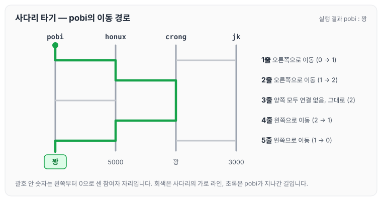
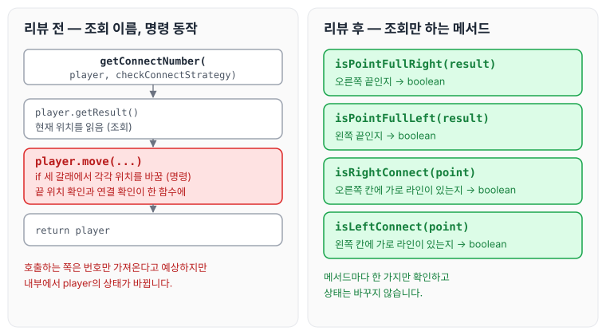

이전에 [사다리 생성 — 2단계](../ccj-07-ladder-create/)에 대해 작성하였습니다. 이번에는 사다리 미션 3단계인 사다리 게임 실행의 요구사항과 리뷰어에게 받은 피드백을 정리하도록 하겠습니다.

## 기능 요구사항

- 사다리 실행 결과를 출력해야 합니다.
- 개인별 이름을 입력하면 개인별 결과를 출력하고, "all"을 입력하면 전체 참여자의 실행 결과를 출력합니다.

## 프로그래밍 요구사항

- 자바 8의 스트림과 람다를 적용해 프로그래밍합니다.
- 규칙 6: 모든 엔티티를 작게 유지합니다.
- 규칙 7: 3개 이상의 인스턴스 변수를 가진 클래스를 쓰지 않습니다.

## 실행 결과

위 요구사항에 따라 4명의 사람을 위한 5개 높이 사다리를 만들 경우, 프로그램을 실행한 결과는 다음과 같습니다.

```text
참여할 사람 이름을 입력하세요. (이름은 쉼표(,)로 구분하세요)
pobi,honux,crong,jk

실행 결과를 입력하세요. (결과는 쉼표(,)로 구분하세요)
꽝,5000,꽝,3000

최대 사다리 높이는 몇 개인가요?
5

사다리 결과

pobi  honux crong   jk
    |-----|     |-----|
    |     |-----|     |
    |-----|     |     |
    |     |-----|     |
    |-----|     |-----|
꽝    5000  꽝    3000

결과를 보고 싶은 사람은?
pobi

실행 결과
꽝

결과를 보고 싶은 사람은?
all

실행 결과
pobi : 꽝
honux : 3000
crong : 꽝
jk : 5000

```

참여자는 사다리를 한 줄씩 내려가면서, 현재 위치의 오른쪽 칸에 가로 라인이 있으면 오른쪽으로, 왼쪽 칸에 있으면 왼쪽으로 이동하고, 둘 다 없으면 그대로 내려갑니다. 위 실행 결과에서 pobi가 사다리를 타는 과정을 따라가면 아래와 같습니다.



pobi는 처음 자리에서 출발해 다시 첫 번째 자리로 돌아오므로, 실행 결과처럼 `꽝`이 출력됩니다.

## 피드백

### Utils 이름을 역할에 맞게

리뷰어에게 어떠한 역할의 `Utils`인지 명시해 주면 좋겠다는 의견을 받았습니다. 이름이 모호해서 실제로는 많은 역할의 메서드가 추가될 것 같다는 이유였습니다.

```java
public class Utils {
    private static final int MAX_NAME_SIZE = 5;
```

`Utils`로 크게 묶는 것보다 클래스에서 사용되는 유틸을 따로 분리하는 것이 좋겠다고 생각하여, 이름을 사용하는 쪽에 맞춰 `NameUtils`로 바꾸었습니다.

```java
public class NameUtils {
    private static final int MAX_NAME_SIZE = 5;
```

### 논리적 의존성은 물리적으로 드러내기

리뷰어에게 메서드 역할만 보면 해당 메서드가 `names`에 대해 논리적으로 의존할 필요가 있는지 질문받았습니다. 논리적으로 의존이 필요하다면 `PlayerName`에 직접적으로 의존된다는 의미 같다는 의견이었고, 참고 자료로 [[개발 도서] Clean Code :: 17장 - 냄새와 휴리스틱](https://velog.io/@hellojihyoung/개발-도서-Clean-Code-17장-냄새와-휴리스틱#-g22-논리적-의존성은-물리적으로-드러내라)을 공유받았습니다.

```java
public static List<String> fillOrRightAlign(List<String> playersNames) {
        return playersNames.stream()
                .map(name -> name.length() < MAX_NAME_SIZE ? String.format("%5s", name) : name)
                .collect(Collectors.toList());
    }
```

이 부분은 List의 값을 5글자로 만들어 주는 기능입니다. 공유받은 글을 읽으며, `HourlyReporter`가 알 필요가 없는 `PAGE_SIZE` 변수를 클래스에 선언해 `HourlyReportFormatter` 클래스의 값과 비교하는 것이 두 클래스를 논리적으로 연결시킨다고 이해했습니다. 그 결과 `HourlyReportFormatter`가 페이지 크기를 모른다면 문제가 발생합니다.

해결 방법으로는 `HourlyReportFormatter`에 `getMaxSize`를 만들고 호출하여 사용함으로써, `PAGE_SIZE` 변수를 물리적으로(`HourlyReportFormatter.getMaxSize()`) 나눈다고 이해했습니다.

제가 작성한 코드는 Util 클래스에서 `MAX_NAME_SIZE`를 선언하고 그 안에서 도출되는 값을 전달하는 방식인데, 이 예제에 비추어 보니 논리적으로 연결되는 부분이 맞는지 계속 고민이 되었습니다.

### 명령과 조회 분리

리뷰어에게 외부에서 메서드를 호출할 때는 번호만 가져올 것이라 예상되는데, 내부에서는 상태를 변경하고 있어 오해가 생길 수 있다는 의견을 받았습니다. 명령과 조회의 책임을 분리하면 좋겠다는 제안이었습니다. 명령과 조회 분리는 [3장 함수](../clean-code-ch3-functions/)에서도 정리한 내용입니다.

```java
public Player getConnectNumber(Player player, CheckConnectStrategy checkConnectStrategy) {
        int result = player.getResult();

        if (isResultPullRight(result)) {
            player.move(result + checkConnectStrategy.getLeftConnectResult(player, points));
            return player;
        }

        if (isResultPullLeft(result)) {
            player.move(result + checkConnectStrategy.getRightConnectResult(player, points));
            return player;
        }

        player.move(result + checkConnectStrategy.getConnectResult(player, points));
        return player;
    }
```

돌아보면 하나의 함수에 여러 기능을 넣어서 if로 처리했습니다. 함수는 단 하나의 기능만 잘하면 되므로, 기능에 맞게 함수를 나누어 아래와 같이 수정하였습니다.

```java
public boolean isPointFullRight(int result) {
    return result >= points.getPoints().size();
}

public boolean isPointFullLeft(int result) {
    return result <= 0;
}

public boolean isRightConnect(int point) {
    return getLine().get(point);
}

public boolean isLeftConnect(int point) {
    return getLine().get(point - 1);
}
```



리뷰 전의 `getConnectNumber`는 이름은 조회처럼 보이지만 안에서 `player.move(...)`로 상태를 바꿉니다. 수정한 메서드들은 위치가 끝인지, 칸이 연결되어 있는지만 `boolean`으로 돌려주고 상태는 바꾸지 않습니다.

### enum의 패키지 위치

리뷰어에게 뷰에서 어떤 값을 입력하느냐에 따라 보여지는 결과가 달라지는데, 이 enum은 모델의 역할이 아니라 뷰의 입력값을 구분하기 위해 사용되는 것 같다는 의견을 받았습니다. 그렇기 때문에 패키지 위치가 어색하다는 지적이었습니다.

```java
public enum SearchType {
    ALL("ALL");

    private final String searchType;

    SearchType(String searchType) {
        this.searchType = searchType;
    }
```

기존에는 모델 패키지 아래에 모델 클래스와 함께 작성했습니다. 어디서 작동하는 enum인지에 따라 구분하고, 해당 패키지 밑에 구성하는 것을 생각해 보려고 합니다.

### 같은 역할의 메서드는 하나로

리뷰어에게 동일한 역할의 메서드가 `!`로 나뉘는 것 같은데, 한쪽 메서드에서 다른 메서드를 호출해 응집도를 조금 더 높여 보는 방향은 어떤지 질문받았습니다.

```java
public boolean equals(String searchType) {
        return this.searchType.equals(searchType);
    }

    public boolean notEquals(String searchType) {
        return !this.searchType.equals(searchType);
    }
```

함수 이름으로 어떤 기능인지 좀 더 명확하게 작성하고 싶었지만, 관리하는 측면에서는 변경될 때 두 개를 다 변경해야 하므로 좋지 않아 보였습니다. 응집도를 높이기 위해 하나의 함수에서 동작하도록 변경하였습니다.

```java
if (SearchType.ALL.equalsSearchType(playerNameParam.getPlayerName())) {
    OutPutView.outPutWinResults(players, winResults);
}

if (!SearchType.ALL.equalsSearchType(playerNameParam.getPlayerName())) {
    Player player = playerService.searchPlayerResult(players, playerNameParam);
    OutPutView.outPutWinResult(player, winResults);
}
```

`all`을 입력했을 때와 이름을 입력했을 때 모두 `equalsSearchType` 하나로 판단하고, 이름을 입력한 경우에는 `!`로 결과를 뒤집어 사용합니다.

## 마무리

오늘은 사다리 미션 3단계에서 실행 결과를 출력하는 기능을 구현하며 받은 `Utils` 이름, 논리적 의존성, 명령과 조회 분리, enum 패키지 위치, 메서드 응집도에 대한 피드백을 정리하였습니다. 논리적 의존성은 예제를 읽고도 제 코드에 어떻게 적용해야 할지 아직 고민이 남아 있어, 다음 단계를 진행하면서 한 번 더 생각해 보려고 합니다.

제출한 코드는 아래 PR에서 확인할 수 있습니다.

깃허브 링크: [https://github.com/next-step/java-ladder/pull/1812](https://github.com/next-step/java-ladder/pull/1812)

다음 글에서는 [사다리 리팩터링 — 4단계](../ccj-09-ladder-refactor/)에 대해 정리하도록 하겠습니다.

> 이 글은 넥스트스텝의 [TDD, 클린 코드 with Java](https://edu.nextstep.camp/c/O0pDe1b) 과정을 들으며 정리한 노트입니다.
