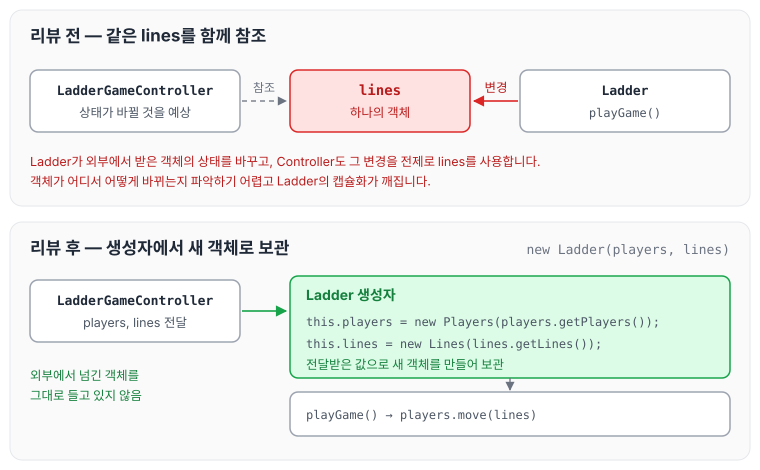
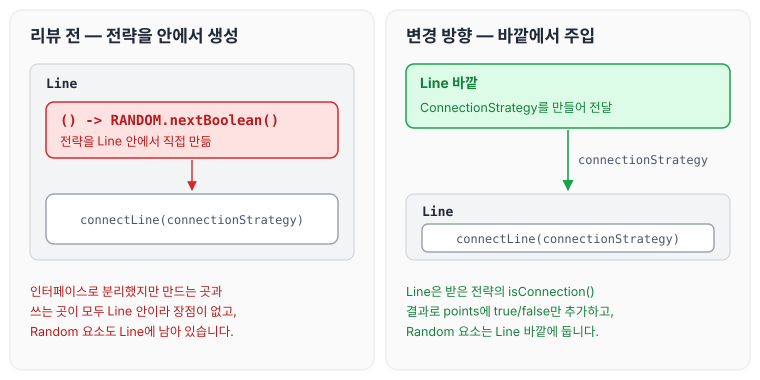

이전에 [사다리 게임 실행 — 3단계](../ccj-08-ladder-run/)에 대해 작성하였습니다. 이번에는 사다리 미션 4단계인 리팩터링을 진행하며 리뷰어에게 받은 피드백을 정리하도록 하겠습니다.

## 기능 요구사항

기능 요구사항은 [사다리 게임 실행 — 3단계](../ccj-08-ladder-run/)와 같습니다.

## 실행 결과

위 요구사항에 따라 4명의 사람을 위한 5개 높이 사다리를 만들 경우, 프로그램을 실행한 결과는 다음과 같습니다.

```text
참여할 사람 이름을 입력하세요. (이름은 쉼표(,)로 구분하세요)
pobi,honux,crong,jk

실행 결과를 입력하세요. (결과는 쉼표(,)로 구분하세요)
꽝,5000,꽝,3000

최대 사다리 높이는 몇 개인가요?
5

사다리 결과

pobi  honux crong   jk
    |-----|     |-----|
    |     |-----|     |
    |-----|     |     |
    |     |-----|     |
    |-----|     |-----|
꽝    5000  꽝    3000

결과를 보고 싶은 사람은?
pobi

실행 결과
꽝

결과를 보고 싶은 사람은?
all

실행 결과
pobi : 꽝
honux : 3000
crong : 꽝
jk : 5000
```

## 피드백

### 방어적 복사로 캡슐화 지키기

리뷰어에게 이 모델의 역할은 `lines` 상태를 변경하는 것 같다는 의견을 받았습니다. 객체 참조를 통해 외부에서 받아온 객체의 상태를 변경하다 보면 해당 객체가 어떻게 변경되는지 파악하기 어려워집니다. 또한 `LadderGameController`에서도 내부 상태가 변경될 것을 예상하고 `lines`를 활용하고 있어서, 결국 `Ladder`의 캡슐화가 깨진 것이 아닌지 지적받았습니다. 내부 데이터를 보호하고 참조값 공유를 끊기 위해 방어적 복사를 이용하는 방향을 제안받았고, 참고 자료로 [[얕은복사 / 깊은복사] 방어적 복사란 ?](https://velog.io/@miot2j/얕은복사-깊은복사-방어적-복사란)를 공유받았습니다.

```java
public void playGame() {
        IntStream.range(0, players.getPlayerCount())
                .forEach(index -> lines.getConnectNumber(players.getPlayers().get(index)));
                .forEach(index -> lines.move(players.getPlayers().get(index)));
    }
```

방어적 복사를 사용하는 이유는 객체의 취약점을 보완하기 위해서입니다. 내부 데이터를 보호하고 참조값 공유를 끊기 위해 사용합니다.

주소값으로 연결되어 있다는 것은 알고 있었지만, 방어적 복사를 통해 데이터를 보호한다는 것은 처음 알게 되었습니다. 알아 두면 보호 목적으로 잘 사용할 수 있을 것 같습니다. 수정한 코드는 아래와 같습니다.

```java
public Ladder(Players players, Lines lines) {
        this.players = new Players(players.getPlayers());
        this.lines = new Lines(lines.getLines());
    }

    public void playGame() {
        players.move(lines);
    }
```



리뷰 전에는 `LadderGameController`가 넘긴 `lines`를 `Ladder`가 그대로 들고 상태를 바꾸었습니다. 리뷰 후에는 생성자에서 전달받은 값으로 새 `Players`, `Lines` 객체를 만들어 보관하므로, 외부에서 넘긴 객체를 그대로 들고 있지 않습니다.

### 메서드 이름과 역할 맞추기

리뷰어에게 메서드의 역할에 비해 메서드명이 어색하다는 의견을 받았습니다. 내부에는 특별한 조건이 있지만, 클라이언트 입장에서는 그냥 왼쪽으로 옮겨 갈 것이라고 생각될 수 있다는 이유였습니다.

```java
public void moveLeft(List<Boolean> points) {
        if (points.get(point - 1)) {
            point += Direction.LEFT.value;
        }
    }
```

왼쪽으로 움직이는 행위만 작동시키면 되는데, if까지 엮이면서 오해의 소지가 생겼다고 생각합니다. 그래서 `moveLeft`는 왼쪽으로 이동하는 일만 하도록 바꾸었습니다.

```java
public void moveLeft() {
        point += LEFT;
    }	
```

### 내부에서만 쓰는 enum

리뷰어에게 `public enum`으로 분리한 이유를 질문받았습니다. 내부에서만 사용되고 있고, 결국 `value`만 바로 꺼내 사용하고 있어서 장점이 없어 보인다는 의견이었습니다.

```java
public enum Direction {
        LEFT(-1),
        RIGHT(1);

        private final int value;

        Direction(int value) {
            this.value = value;
        }

    }
```

아무런 동작을 하지 않는다면 정적 변수로 선언해서 사용해도 되는데, 굳이 enum으로 바꾼 이유를 물어본 것 같습니다. enum의 함수에서 동작을 처리하도록 하거나 정적 변수를 사용하는 방법 중에서, 아래와 같이 정적 변수를 사용하도록 작성하였습니다.

```java
public class Player {
    private static final int LEFT = -1;
    private static final int RIGHT = 1;
```

### 전략 인터페이스는 외부에서 주입하기

리뷰어에게 내부에서 `ConnectionStrategy`를 직접 생성하고 사용하고 있어서 인터페이스로 분리한 장점이 없어 보인다는 의견을 받았습니다. 이 객체에서 `Random` 요소를 분리하기 위해 외부에서 주입받는 방법을 제안받았습니다.

```java
IntStream.range(RANGE_START, rangeEnd)
                .forEach(count -> {
                    if (count == ZERO || !points.get(count - 1)) {
                        connectLine(() -> RANDOM.nextBoolean());
                        return;
                    }
                    connectLine(() -> false);
                });
    }

    public void connectLine(ConnectionStrategy connectionStrategy) {
        if (connectionStrategy.isConnection()) {
            points.add(true);
            return;
        }
        points.add(false);
    }
```

익명 클래스를 사용해서 외부에서 주입받는 형식으로 코드를 작성했는데, 정작 사용하는 곳이 내부이니 장점이 나오지 않는 것 같습니다. 외부에서 전달해 주는 방식으로 변경하고, 유연하게 대처할 수 있게 구현하려고 합니다.

```java
public void connectLine(ConnectionStrategy connectionStrategy) {
      if (connectionStrategy.isConnection()) {
          points.add(true);
          return;
      }
      points.add(false);
  }
```



`connectLine`은 리뷰 전부터 `ConnectionStrategy`를 파라미터로 받고 있었지만, 그 전략을 `Line` 안에서 만들고 있었습니다. 전략을 만드는 위치를 바깥으로 옮겨야 `Random` 요소가 `Line`에서 분리됩니다.

## 마무리

오늘은 사다리 미션 4단계에서 리팩터링을 진행하며 받은 방어적 복사, 메서드 이름과 역할, 내부에서만 쓰는 enum, 전략 인터페이스 주입에 대한 피드백을 정리하였습니다. 참조로 연결된 객체의 상태가 바뀌는 문제는 알고 있으면서도 코드에서는 놓치기 쉬웠던 것 같고, 앞으로는 외부에서 받은 객체를 어떻게 보관할지도 함께 고민해 보려고 합니다.

다음 글에서는 [자동차 경주 — 3단계](../ccj-10-racing-car/)에 대해 정리하도록 하겠습니다.

> 이 글은 넥스트스텝의 [TDD, 클린 코드 with Java](https://edu.nextstep.camp/c/O0pDe1b) 과정을 들으며 정리한 노트입니다.
