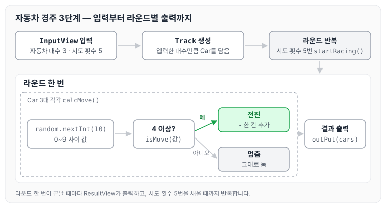
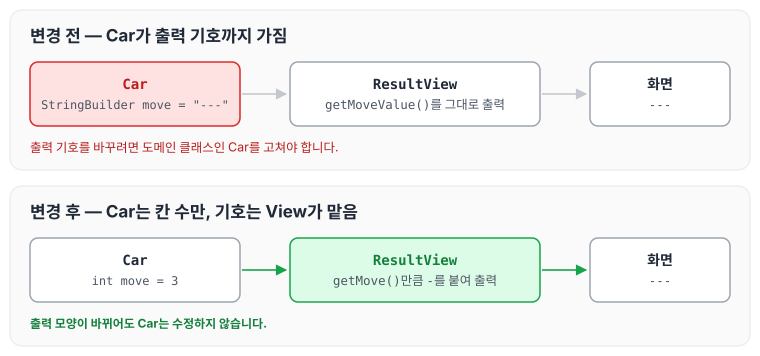
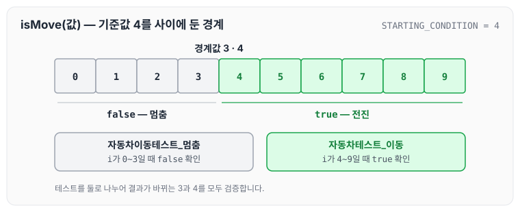

이전에 [사다리 리팩터링 — 4단계](../ccj-09-ladder-refactor/)에 대해 작성하였습니다. 이번에는 자동차 경주 미션 3단계로, 초간단 자동차 경주 게임을 구현한 코드와 리뷰에서 받은 피드백을 정리하도록 하겠습니다.

## 기능 요구사항

- 초간단 자동차 경주 게임을 구현합니다.
- 주어진 횟수 동안 n대의 자동차는 전진 또는 멈출 수 있습니다.
- 사용자는 몇 대의 자동차로 몇 번의 이동을 할 것인지를 입력할 수 있어야 합니다.
- 전진하는 조건은 0에서 9 사이에서 random 값을 구한 후 random 값이 4 이상일 경우입니다.
- 자동차의 상태를 화면에 출력합니다. 어느 시점에 출력할 것인지에 대한 제약은 없습니다.

요구사항의 실행 예시는 3대의 자동차가 5번 움직이는 경우입니다.

## 코드 구성

처음 구현한 코드는 자동차(`Car`), 트랙(`Track`), 입력 화면(`InputView`), 출력 화면(`ResultView`) 네 클래스로 나뉩니다. 입력한 자동차 대수만큼 `Car`를 만들고, 시도 횟수만큼 라운드를 돌면서 라운드마다 각 자동차가 0~9 사이의 무작위 값을 받아 4 이상이면 한 칸 전진합니다. 라운드가 끝날 때마다 결과를 출력합니다.



그림처럼 전진 여부는 `Car`가 무작위 값으로 정하고, `Track`은 라운드를 반복하며, 화면 출력은 `ResultView`가 맡습니다.

자동차를 구현한 `Car.java`입니다.

```java
package study.step3;

import java.util.Random;

public class Car {
    private StringBuilder move;
    private static final Random random  = new Random();
    private static final int STARTING_CONDITION = 4;
    private static final int RANDOM_RANGE = 10;
    private static final String MOVE = "-";

    Car() {
        move = new StringBuilder();
    }

    public void calcMove() {
        moveCar(isMove(random.nextInt(RANDOM_RANGE)));
    }

    public Boolean isMove(int input) {
        if (input >= STARTING_CONDITION) {
            return true;
        }
        return false;
    }

    public void moveCar(boolean moveResult) {
        if (moveResult) {
            move.append(MOVE);
        }
    }

    public String getMoveValue() {
        return move.toString();
    }
}
```

트랙을 구현한 `Track.java`입니다.

```java
package study.step3;

import java.util.ArrayList;
import java.util.List;

public class Track {
    private List<Car> cars = new ArrayList<>();
    private int attemptCount;
    private ResultView resultView;

    Track( int attemptCount, ResultView resultView) {
        this.attemptCount = attemptCount;
        this.resultView = resultView;
    }

    public void setCar(int count) {
        for (int i = 0; i < count; i++) {
            cars.add(new Car());
        }
    };

    public void startRacing() {
        for (int i = 0; i < attemptCount; i++) {
            startCar(cars);
            resultView.outPut(cars);
        }
    }

    public void startCar(List<Car> cars) {
        for(int i = 0; i < cars.size(); i++) {
            cars.get(i).calcMove();
            cars.get(i).getMoveValue();
        }
    }

    public int getCarsCount() {
        return cars.size();
    }

    public int getAttemptCount() {
        return attemptCount;
    }

}
```

입력 화면을 구현한 `InputView.java`입니다.

```java
package study.step3;

import java.util.Scanner;

public class InputView {
    private static final Scanner scanner = new Scanner(System.in);
    private int carCount;
    private int attemptCount;

    public void inputNumberOfCars() {
        System.out.println("자동차 대수는 몇 대 인가요?\n");
        carCount = scanner.nextInt();
    }

    public void inputNumberOfAttempts() {
        System.out.println("시도할 회수는 몇 회 인가요?\n");
        attemptCount = scanner.nextInt();
    }

    public int getCarCount() {
        return carCount;
    }

    public int getAttemptCount() {
        return attemptCount;
    }
}
```

출력 화면을 구현한 `ResultView.java`입니다.

```java
package study.step3;

import java.util.List;

public class ResultView {
    public void outPut(List<Car> cars) {
        System.out.println("START============");
        for (Car car : cars) {
            System.out.println(car.getMoveValue());
        }
        System.out.println("END============");
    }
}
```

## 피드백

### 출력 기호는 View에서 처리

리뷰에서 자동차의 위치를 `-` 같은 기호로 바꿔 출력하는 일은 View 클래스가 처리하는 것이 좋다는 의견을 받았습니다.

화면이 바뀌어도 도메인 클래스의 로직은 바뀌지 않도록 뷰를 철저하게 분리하는 것이 좋겠다고 생각했습니다. 기존에는 `Car`가 `StringBuilder`에 `-`를 쌓고 있었습니다.

```java
import java.util.Random;

public class Car {
    private StringBuilder move;
```

다음과 같이 `Car`는 이동한 칸 수만 숫자로 가지도록 변경하였습니다.

```java
package study.step3;

import java.util.Random;

public class Car {
    private int move = 0;
    private static final Random random = new Random();
    private static final int STARTING_CONDITION = 4;
    private static final int RANDOM_RANGE = 10;
    private int attemptCount = 0;
```

화면에 보이는 `-`는 뷰로 분리하였습니다.

```java
package study.step3;

import java.util.List;

public class ResultView {
    public static void outPut(Track track) {
        StringBuilder stringBuilder = new StringBuilder();
        List<Car> cars = track.getCars();
        for (Car car : cars) {
            changeCarMoveToString(stringBuilder, car);
            stringBuilder.append("\n");
        }
        System.out.println(stringBuilder);
    }

    private static void changeCarMoveToString(StringBuilder stringBuilder, Car car) {
        for (int i = 0; i < car.getMove(); i++) {
            stringBuilder.append("-");
        }
    }
}
```

변경 전후에 `Car`와 `ResultView`가 무엇을 가지는지 비교하면 아래와 같습니다.



변경 후에는 `Car`가 숫자 `3`만 가지고, 이를 `---`로 바꾸는 일은 `ResultView`가 맡습니다. 출력 모양을 바꾸더라도 `Car`는 수정하지 않아도 됩니다.

### 축약어 대신 완전한 이름

리뷰에서 객체지향 생활 체조 원칙 중 "줄여 쓰지 않는다(축약 금지)"를 언급하며, `calc` 같은 축약어보다는 완전한 단어를 쓰는 것이 좋다는 의견을 받았습니다.

실무에서는 계산하는 메서드에 `calc`라는 표현을 많이 써 왔던 것 같습니다. 다만 이동하는 메서드라면 `calcMove`보다는 자동차 입장에서 `move`라는 행위로 보는 것이 좋다는 의견이었고, 맞는 말이라고 생각합니다. 앞으로는 행위의 주체가 누구인지를 고려하며 이름을 지어 보려고 합니다.

```java
	move = new StringBuilder();
}

public void calcMove() {
```

다음과 같이 변경하였습니다.

```java
public void move() {
	if (isMove(random.nextInt(RANDOM_RANGE))) {
	    move++;
	}
  attemptCount++;
}
```

### 경계값 테스트

리뷰에서 단위 테스트를 작성할 때 경계 조건을 테스트하면 좋겠다는 의견을 받았습니다. 자동차의 이동 여부를 정하는 기준값이 `4`이므로, `4`를 전달했을 때 이동하는지, `3`을 전달했을 때 멈추는지를 검증하는 것입니다.



그림처럼 `0`~`3`은 멈춤, `4`~`9`는 전진이므로 결과가 바뀌는 `3`과 `4`가 경계값입니다.

TDD로 진행하지 않다 보니 어떤 경계를 테스트해야 하는지는 아직 부족한 것 같습니다. 객체 입장에서 값을 결정하는 부분을 테스트하려고 노력하겠습니다. 기존 테스트는 전진하는 경우만 확인하고 있었습니다.

```java
for (int i = 0; i < 10; i++) {
            if (i >= 4) {
                //when
                move = car.isMove(i);
                //then
                assertThat(move).isEqualTo(true);
            }
        }
```

다음과 같이 전진과 멈춤을 나누어 테스트하도록 변경하였습니다.

```java
@Test
public void 자동차테스트_이동() {
    //given
    Boolean move;

    for (int i = 0; i < 10; i++) {
        if (i >= 4) {
            //when
            move = car.isMove(i);
            //then
            assertThat(move).isEqualTo(true);
        }
    }
}

@Test
public void 자동차이동테스트_멈춤() {
    //given
    Boolean move;

    for (int i = 0; i < 4; i++) {
        if (i < 4) {
            //when
            move = car.isMove(i);
            //then
            assertThat(move).isEqualTo(false);
        }
    }
}
```

### 생성자에서 자동차 생성

리뷰에서 `Track` 인스턴스를 생성할 때 자동차를 대수만큼 만들어 전달하는 방법을 제안받았습니다. 누군가 실수로 `setCar()`를 호출하지 않으면 의도하지 않은 결과가 나올 수 있다는 이유였습니다.

트랙 입장에서 자동차를 설정한다는 의미로 `set`을 사용했는데, 좋은 방식은 아니지만 의미상으로는 나쁘지 않다고 생각해 그대로 작성했었습니다. 처음에는 생성자로 구현했었는데, 역시 `set`은 의도하지 않은 결과를 만들 여지가 충분하므로 생성자를 사용하기로 하였습니다.

```java
public void setCar(int count) {
    for (int i = 0; i < count; i++) {
        cars.add(new Car());
    }
};
```

다음과 같이 변경하였습니다.

```java
Track(int carCount, int finish) {
        this.finish = finish;
        for (int i = 0; i < carCount; i++) {
            cars.add(new Car());
        }
    }
```

### 유틸리티 클래스의 private 생성자

리뷰에서 정적 메서드만 가지는 유틸리티 클래스이니 `private` 생성자를 추가하는 것을 제안받았습니다. 참고 자료로 [이펙티브 자바 아이템 4. 인스턴스화를 막으려거든 private 생성자를 사용하라](https://velog.io/@lychee/이펙티브-자바-아이템-4-인스턴스화를-막으려거든-private-생성자를-사용하라)를 공유받았습니다.

정적 메서드는 인스턴스를 만들지 않아도 바로 사용할 수 있어서, 정적 메서드만 있는 클래스의 생성자를 막아야겠다고는 한 번도 생각해 본 적이 없었습니다. 이번에 생성자도 막는 것이 더 안전하다는 것을 알게 되었습니다.

생성자를 명시하지 않으면 컴파일러가 매개변수 없는 public 기본 생성자를 만들어 주기 때문에, 누구나 인스턴스를 만들 수 있고 상속해서 인스턴스화할 수도 있습니다. 이를 막기 위해 `private` 생성자를 만듭니다.

```java
package study.step3;

import java.util.List;

public class ResultView {
    public static void outPut(Track track) {
        StringBuilder stringBuilder = new StringBuilder();
        List<Car> cars = track.getCars();
        for (Car car : cars) {
            changeCarMoveToString(stringBuilder, car);
            stringBuilder.append("\n");
        }
        System.out.println(stringBuilder);
    }

    private static void changeCarMoveToString(StringBuilder stringBuilder, Car car) {
        for (int i = 0; i < car.getMove(); i++) {
            stringBuilder.append("-");
        }
    }
}
```

다음과 같이 변경하였습니다.

```java
public class InputView {

    private InputView() {
        // 생성자 내부 호출 -> 명시적 Exception
        throw new AssertionError();
    }
```

## 피드백 이후 소스코드

피드백을 반영한 뒤의 코드입니다. 자동차를 구현한 `Car.java`입니다.

```java
package study.step3;

import java.util.Random;

public class Car {
    private int move = 0;
    private static final Random random = new Random();
    private static final int STARTING_CONDITION = 4;
    private static final int RANDOM_RANGE = 10;
    private int attemptCount = 0;
    private int finish;

    Car(int finish) {
        this.finish = finish;
    }

    public void move() {
        moveCar(isMove(random.nextInt(RANDOM_RANGE)));
        attemptCount++;
    }

    public Boolean isMove(int input) {
        return input >= STARTING_CONDITION;
    }

    public void moveCar(boolean moveResult) {
        if (moveResult) {
            move++;
        }
    }

    public Boolean isFinish() {
        return finish == attemptCount;
    }

    public int getMove() {
        return move;
    }

    public int getAttemptCount() {
        return attemptCount;
    }

}
```

트랙을 구현한 `Track.java`입니다.

```java
package study.step3;

import java.util.ArrayList;
import java.util.List;

public class Track {
    private List<Car> cars = new ArrayList<>();

    Track(int carCount, int finish) {
        for (int i = 0; i < carCount; i++) {
            cars.add(new Car(finish));
        }
    }

    public void startRacing() {
        for (Car car : cars) {
            car.move();
        }
    }

    public Boolean isRaceEnd() {
        int lastCarNumber = cars.size() - 1;
        return cars.get(lastCarNumber).isFinish();
    }

    public List<Car> getCars() {
        return cars;
    }

}
```

입력 화면을 구현한 `InputView.java`입니다.

```java
package study.step3;

import java.util.Scanner;

public class InputView {

    public static Scanner createScanner() {
        return new Scanner(System.in);
    }

    public static void askCarCount() {
        System.out.println("자동차 대수는 몇 대 인가요?\n");
    }

    public static void aksFinishCount() {
        System.out.println("마지막 바퀴는 몇바퀴 인가요?\n");
    }
}
```

출력 화면을 구현한 `ResultView.java`입니다.

```java
package study.step3;

import java.util.List;

public class ResultView {
    public static void outPut(Track track) {
        StringBuilder stringBuilder = new StringBuilder();
        List<Car> cars = track.getCars();
        for (Car car : cars) {
            changeCarMoveToString(stringBuilder, car);
            stringBuilder.append("\n");
        }
        System.out.println(stringBuilder);
    }

    private static void changeCarMoveToString(StringBuilder stringBuilder, Car car) {
        for (int i = 0; i < car.getMove(); i++) {
            stringBuilder.append("-");
        }
    }
}
```

## 마무리

오늘은 자동차 경주 3단계를 구현하며 받은 View 분리, 축약어, 경계값 테스트, 생성자에서 자동차 생성, 유틸리티 클래스의 private 생성자에 대한 피드백을 정리하였습니다. 혼자 고민하는 것보다 누군가와 함께 코드를 보는 것이 큰 도움이 된다는 것을 다시 한번 느꼈습니다. 동작하는 코드에서 그치지 않고, 처음 보는 사람도 읽고 수정할 수 있도록 안전하게 만드는 것이 쉽지 않은 일이라는 것도 알게 되었습니다. 많이 물어보고 배워서 유지보수하기 쉬운 코드를 작성하려고 합니다. 다음 글에서는 [자동차 경주 우승자 — 4단계](../ccj-11-racing-winner/)에 대해 정리하도록 하겠습니다.

깃허브 링크 : [https://github.com/next-step/java-racingcar/pull/4367](https://github.com/next-step/java-racingcar/pull/4367)

> 이 글은 넥스트스텝의 [TDD, 클린 코드 with Java](https://edu.nextstep.camp/c/O0pDe1b) 과정을 들으며 정리한 노트입니다.
