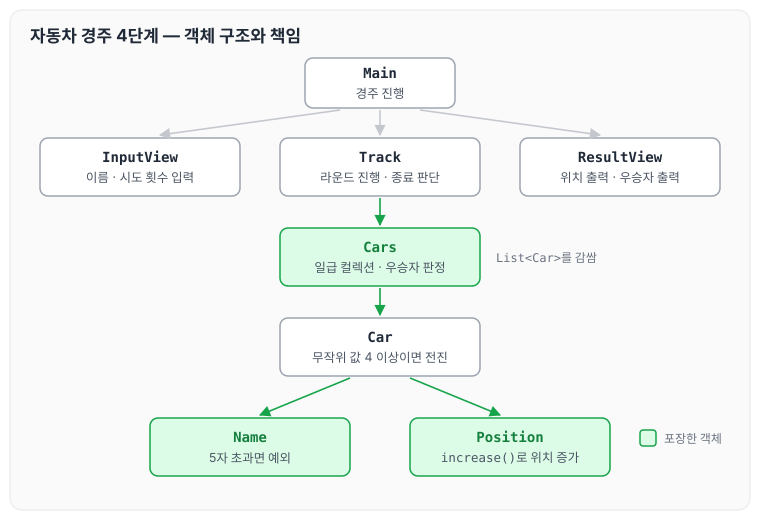
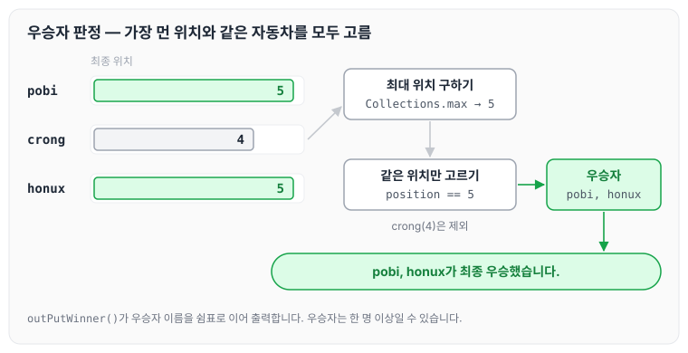

이전에 [자동차 경주 — 3단계](../ccj-10-racing-car/)에 대해 작성하였습니다. 이번에는 자동차 경주 미션 4단계로, 자동차에 이름을 붙이고 경주가 끝난 뒤 우승자를 알려 주는 기능을 추가하며 받은 피드백과 구현 코드를 정리하도록 하겠습니다.

## 기능 요구사항

- 각 자동차에 이름을 부여할 수 있습니다. 자동차 이름은 5자를 초과할 수 없습니다.
- 전진하는 자동차를 출력할 때 자동차 이름을 같이 출력합니다.
- 자동차 이름은 쉼표(,)를 기준으로 구분합니다.
- 자동차 경주 게임을 완료한 후 누가 우승했는지 알려줍니다. 우승자는 한 명 이상일 수 있습니다.

### 실행 결과

위 요구사항에 따라 3대의 자동차가 5번 움직였을 경우 프로그램을 실행한 결과는 다음과 같습니다.

```text
경주할 자동차 이름을 입력하세요(이름은 쉼표(,)를 기준으로 구분).
pobi,crong,honux
시도할 회수는 몇회인가요?
5

실행 결과
pobi : -
crong : -
honux : -

pobi : --
crong : -
honux : --

pobi : ---
crong : --
honux : ---

pobi : ----
crong : ---
honux : ----

pobi : -----
crong : ----
honux : -----

pobi : -----
crong : ----
honux : -----

pobi, honux가 최종 우승했습니다.
```

## 피드백

### 클래스 변수 작성 순서

리뷰에서 클래스 파일을 작성할 때 [클래스 파일 변수 작성 순서](https://www.oracle.com/java/technologies/javase/codeconventions-fileorganization.html)에서 제안하는 순서대로 작성해 보면 좋겠다는 의견을 받았습니다.

지금까지 클래스 변수를 작성하는 순서는 회사 방식에 맞추려고만 했고, 정해진 순서가 있다는 것은 이번에 처음 알았습니다. 앞으로는 이 순서를 인지하고 작성하려고 합니다. 기존에는 인스턴스 변수와 상수가 섞여 있었습니다.

```java
private int position = 0;
private static final Random random = new Random();
private static final int STARTING_CONDITION = 4;
private static final int RANDOM_RANGE = 10;
private static final int NAME_MAX_LENGTH = 5;
private int attemptCount = 0;
private String name;
```

다음과 같이 상수를 먼저 두고 인스턴스 변수를 뒤에 두도록 변경하였습니다.

```java
private static final Random RANDOM = new Random();
private static final int STARTING_CONDITION = 4;
private static final int RANDOM_RANGE = 10;
private static final int NAME_MAX_LENGTH = 5;

private int position = 0;
private int attemptCount = 0;
private String name;
```

### 자동차 이름의 원시값 포장

리뷰에서 자동차 이름인 문자열 `name`을 클래스로 포장해 보는 것을 제안받았습니다. 원시값 포장은 [원시값 포장](../primitive-wrapping/) 글에서 따로 정리한 적이 있습니다.

모든 값을 원시값 포장하면 클래스가 많이 늘어나서 관리하기 더 힘들지 않을까 하는 생각도 들었습니다. 그래도 로직을 확실히 구분해 두면 코드를 분석할 때 도움이 많이 될 것 같습니다. 이름 길이 검증을 `Name` 클래스로 옮겼습니다.

```java
package study.step4;

public class Name {
    private static final int NAME_MAX_LENGTH = 5;

    String name;

    public Name(String name) {
        checkName(name);
        this.name = name;
    }

    private void checkName(String name) {
        if (name.length() >NAME_MAX_LENGTH) {
            throw new IllegalArgumentException("이름이 다섯자 이상입니다.");
        }
    }

    public String getName() {
        return name;
    }

}

```

### String.format으로 출력 문자열 만들기

리뷰에서 `String.format()`을 활용하면 어떤 문자열이 만들어질지 대략 알 수 있어 가독성을 높일 수 있다는 의견을 받았습니다. 기존에는 이름과 이동 기호를 `StringBuilder`에 하나씩 붙이고 있었습니다.

```java
public class ResultView {

    private ResultView() {
        // 생성자 내부 호출 -> 명시적 Exception
        throw new AssertionError();
    }
    public static void outPut(Track track) {
        StringBuilder stringBuilder = new StringBuilder();
        List<Car> cars = track.getCars();
        for (Car car : cars) {
            addCarName(stringBuilder, car);
            changeCarMoveToString(stringBuilder, car);
            stringBuilder.append("\n");
       }
		}
```

다음과 같이 변경하였습니다.

```java

public static void outPut(Track track) {
        StringBuilder stringBuilder = new StringBuilder();
        List<Car> cars = track.getCars();
        for (Car car : cars) {
            stringBuilder.append(String.format("%s : %s%n", car.getCarName(), POSITION_CHARTER.repeat(car.getPosition())));
        }
		}

```

### 우승자 출력을 stream으로

리뷰에서 우승자 출력 함수를 stream으로 처리해 보면 좋겠다는 의견을 받았습니다.

```java
public static void outPut(Track track) {
        StringBuilder stringBuilder = new StringBuilder();
        List<Car> cars = track.getCars();
        for (Car car : cars) {
            addCarName(stringBuilder, car);
            changeCarMoveToString(stringBuilder, car);
            stringBuilder.append("\n");
        }
        System.out.println(stringBuilder);
    }
```

다음과 같이 변경하였습니다.

```java
public static void outPutWinner(Track track) {
        StringBuilder stringBuilder = new StringBuilder();
        List<Car> winners = track.getWinnerCars();

        String victoryMessage = winners.stream().map(n -> String.valueOf(n.getName()))
                .collect(Collectors.joining(", "));
        stringBuilder.append(victoryMessage).append("가 최종 우승했습니다.");

        System.out.println(stringBuilder);
    }
```

## 코드 구성

피드백을 반영한 코드는 `Main`이 입력 화면에서 자동차 이름과 시도 횟수를 받아 `Track`을 만들고, 경주가 끝날 때까지 라운드를 반복한 뒤 우승자를 출력하는 구조입니다. `Track`은 자동차들을 일급 컬렉션 `Cars`로 가지고, 각 `Car`는 이름(`Name`)과 위치(`Position`)를 포장한 객체로 가집니다.



그림처럼 이름 길이 검증은 `Name`, 위치 증가는 `Position`, 우승자 판정은 `Cars`가 맡고, 출력은 `ResultView`가 따로 맡습니다.

자동차를 구현한 `Car.java`입니다.

```java
package study.step4;

import java.util.Random;

public class Car implements Comparable<Car> {
    private static final int STARTING_CONDITION = 4;
    private static final int RANDOM_RANGE = 10;
    private static final Random RANDOM = new Random();

    private int attemptCount = 0;
    private Position position;
    private Name name;

    public Car(String name) {
        this.name = new Name(name);
        this.position = new Position();
    }

    public void move() {
        moveCar(isMove(RANDOM.nextInt(RANDOM_RANGE)));
        attemptCount++;
    }

    public Boolean isMove(int input) {
        return input >= STARTING_CONDITION;
    }

    private void moveCar(boolean moveResult) {
        if (moveResult) {
            position.increase();
        }
    }

    public int getPosition() {
        return position.getPosition();
    }

    public int getAttemptCount() {
        return attemptCount;
    }

    public String getName() {
        return name.getName();
    }

    @Override
    public int compareTo(Car car) {
        return (this.position.getPosition() > car.position.getPosition()) ? 1 : -1;
    }
}
```

자동차들을 일급 컬렉션으로 구현한 `Cars.java`입니다. 일급 컬렉션은 이후에 좀 더 활용하며 작성하려고 합니다.

```java
package study.step4;

import java.util.Collections;
import java.util.List;
import java.util.stream.Collectors;

public class Cars {
    private List<Car> cars;

    public Cars(List<Car> cars) {
        this.cars = cars;
    }

    public void startRacing() {
        for (Car car : cars) {
            car.move();
        }
    }

    public int getWinnerPosition() {
        return Collections.max(cars).getPosition();
    }

    public List<Car> getWinners() {
        int winnerPosition = getWinnerPosition();
        List<Car> winners = cars.stream().filter(car -> isWinner(car, winnerPosition)).collect(Collectors.toList());

        return winners;
    }

    private Boolean isWinner(Car car, int winnerPosition) {
        return car.getPosition() == winnerPosition;
    }

    public List<Car> getCars() {
        return cars;
    }
}
```

`getWinners()`는 가장 멀리 간 위치를 먼저 구하고, 그 위치에 있는 자동차를 모두 고릅니다. 실행 결과의 마지막 위치로 따라가 보면 아래와 같습니다.



`pobi`와 `honux`가 같은 위치 `5`에 있으므로 둘 다 우승자가 되고, 요구사항대로 우승자가 한 명 이상일 수 있습니다.

트랙을 구현한 `Track.java`입니다.

```java
package study.step4;

import java.util.ArrayList;
import java.util.List;

public class Track {
    private static final String DELIMITER = ",|:";

    private int attemptCount;
    private Cars cars;

    public Track(String carNames, int finish) {
        this.attemptCount = finish;
        createCars(carNames);
    }

    private void createCars(String carNames) {
        List<Car> cars = new ArrayList<>();
        for (String carName : carNames.split(DELIMITER)) {
            cars.add(new Car(carName));
        }
        this.cars = new Cars(cars);
    }

    public void startRacing() {
        cars.startRacing();
        attemptCount--;
    }

    public Boolean isRaceEnd() {
        return attemptCount == 0;
    }

    public List<Car> getCars() {
        return cars.getCars();
    }

    public List<Car> getWinnerCars() {
        return cars.getWinners();
    }

    public int winnerPosition() {
        return cars.getWinnerPosition();
    }
}
```

입력 화면을 구현한 `InputView.java`입니다.

```java
package study.step4;

import java.util.Scanner;

public class InputView {
    public static final Scanner scanner = new Scanner(System.in);

    private InputView() {
        // 생성자 내부 호출 -> 명시적 Exception
        throw new AssertionError();
    }

    public static String askCarName() {
        System.out.println("경주할 자동차 이름을 입력하세요(이름은 쉼표(,)를 기준으로 구분).");
        return scanner.next();
    }

    public static int aksFinishCount() {
        System.out.println("시도할 회수는 몇회인가요?");
        return scanner.nextInt();
    }
}
```

출력 화면을 구현한 `ResultView.java`입니다.

```java
package study.step4;

import java.util.List;
import java.util.stream.Collectors;

public class ResultView {
    public static final String POSITION_CHARTER = "-";

    private ResultView() {
        // 생성자 내부 호출 -> 명시적 Exception
        throw new AssertionError();
    }

    public static void outPut(Track track) {
        StringBuilder stringBuilder = new StringBuilder();
        List<Car> cars = track.getCars();
        for (Car car : cars) {
            stringBuilder.append(String.format("%s : %s%n", car.getName(), changeCarMoveToString(car)));
        }
        System.out.println(stringBuilder);
    }

    public static void outPutWinner(Track track) {
        StringBuilder stringBuilder = new StringBuilder();
        List<Car> winners = track.getWinnerCars();

        String victoryMessage = winners.stream().map(n -> String.valueOf(n.getName()))
                .collect(Collectors.joining(", "));
        stringBuilder.append(victoryMessage).append("가 최종 우승했습니다.");

        System.out.println(stringBuilder);
    }

    private static StringBuilder changeCarMoveToString(Car car) {
        StringBuilder move = new StringBuilder();
        for (int i = 0; i < car.getPosition(); i++) {
            move.append(POSITION_CHARTER);
        }
        return move;
    }
}
```

메인을 구현한 `Main.java`입니다.

```java
package study.step4;

public class Main {

    public static void main(String[] args) {
        // 입력 화면
        String carNames = InputView.askCarName();
        int finish = InputView.aksFinishCount();

        //레이싱 경기장
        Track track = new Track(carNames, finish);
        while (!track.isRaceEnd()) {
            track.startRacing();
            ResultView.outPut(track);
        }

        //레이싱 우승자 출력
        ResultView.outPutWinner(track);
    }
}
```

이름을 구현한 `Name.java`입니다.

```java
package study.step4;

public class Name {
    private static final int NAME_MAX_LENGTH = 5;

    String name;

    public Name(String name) {
        checkName(name);
        this.name = name;
    }

    private void checkName(String name) {
        if (name.length() > NAME_MAX_LENGTH) {
            throw new IllegalArgumentException("이름이 다섯자 이상입니다.");
        }
    }

    public String getName() {
        return name;
    }

}
```

위치를 구현한 `Position.java`입니다.

```java
package study.step4;

public class Position {
    private int position = 0;

    public int getPosition() {
        return position;
    }

    public void increase() {
        position++;
    }
}
```

## 마무리

오늘은 자동차 경주 우승자 4단계를 진행하며 받은 클래스 변수 작성 순서, 원시값 포장, `String.format()`, stream 활용에 대한 피드백과 일급 컬렉션으로 정리한 코드를 정리하였습니다. 일급 컬렉션과 원시값 포장을 사용하면 테스트 코드를 작성하기도 좋고, 관리하는 측면에서도 도움이 많이 될 것 같습니다. 잘 활용할 수 있도록 의식하며 작성해 보려고 합니다. 다음 글에서는 [자동차 경주 리팩터링 — 5단계](../ccj-12-racing-refactor/)에 대해 정리하도록 하겠습니다.

깃허브 링크 : [https://github.com/next-step/java-racingcar/pull/4467](https://github.com/next-step/java-racingcar/pull/4467)

> 이 글은 넥스트스텝의 [TDD, 클린 코드 with Java](https://edu.nextstep.camp/c/O0pDe1b) 과정을 들으며 정리한 노트입니다.
