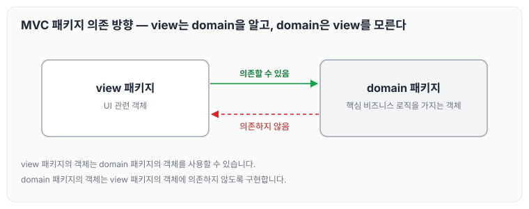
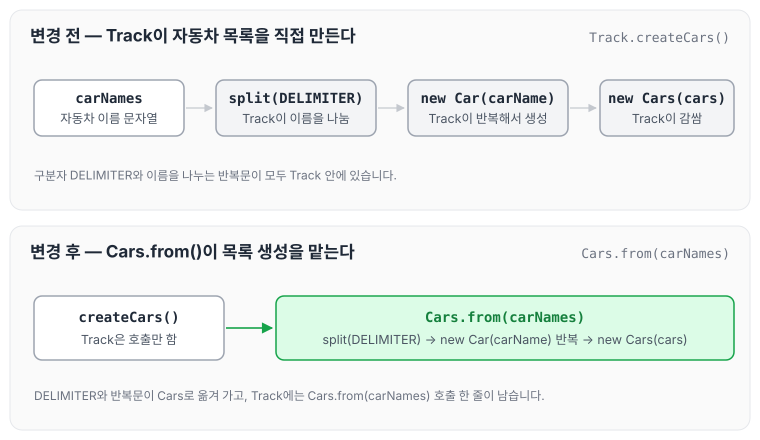
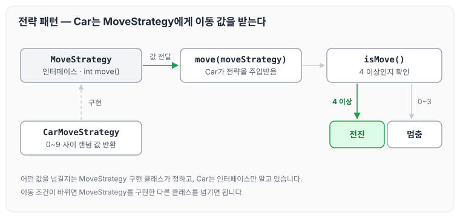

이전에 [자동차 경주 우승자 — 4단계](../ccj-11-racing-winner/)에 대해 작성하였습니다. 이번에는 자동차 경주 5단계로, 지금까지 작성한 코드를 MVC 패턴으로 리팩터링하면서 받은 리뷰 피드백을 정리하도록 하겠습니다.

## 리팩터링 요구사항

- 핵심 비즈니스 로직을 가지는 객체는 domain 패키지에, UI 관련 객체는 view 패키지에 구현합니다.
- MVC 패턴 기반으로 리팩터링해, view 패키지의 객체가 domain 패키지 객체에 의존할 수 있지만 domain 패키지의 객체는 view 패키지 객체에 의존하지 않도록 구현합니다.

패키지 사이의 의존 방향을 그림으로 나타내면 아래와 같습니다.



view는 domain을 알고 있어도 되지만, domain은 view를 몰라야 합니다.

## 피드백

### 사용자 정의 예외

리뷰어님께서 사용자 정의 예외를 `enum`이 아니라 `RuntimeException`을 상속받는 클래스로 정의해 보면 어떨지 제안해 주셨습니다.

저는 `enum`도 좋은 방법이라고 생각했는데, 리뷰어님은 `RuntimeException`을 상속받아서 출력하는 방식을 원하셨던 것 같습니다. 기존 코드는 아래와 같습니다.

```java
public enum CustomException {
    NAME_MAX_LENGTH(5,  "이름이 다섯자 이상입니다.");
    private final int length;
    private final String message;

    CustomException(int length, String message) {
        this.length = length;
        this.message = message;
    }

    public int getLength() {
        return length;
    }

    public String getMessage() {
        return message;
    }
}
```

다음과 같이 변경하였습니다.

```java
package study.step5.exception;

public class NameMaxLengthException extends RuntimeException {

	  public NameMaxLengthException(String message) {
        super(message);
    }
}
```

### 실패하는 테스트

요구사항에 따르면 자동차는 4 이상의 숫자를 전달받은 경우에만 이동할 수 있는데, 0부터 3까지의 숫자가 전달되면 자동차의 위치 값이 0으로 유지되어야 하지 않는지 질문을 받았습니다.

저는 파라미터로 전달하면 이동했는지 멈췄는지 한눈에 볼 수 있어서 그렇게 작성했는데, 성공하는 경우만 작성해야 하는 것인지 다시 여쭈어 보았습니다. 다른 사람이 봤을 때는 왜 실패했는지 확인하려 할 것 같아, 통과하는 테스트 코드만 작성하기로 하였습니다.

리뷰어님께서는 모든 테스트는 통과되도록 작성해야 한다고 답해 주셨습니다. 0부터 3이라는 숫자가 전달됐을 때 기대한 대로 자동차가 움직이지 않는 것을 검증하는 것이 맞다는 지적이었습니다. 실패하는 테스트 코드가 남아 있으면 다른 개발자가 봤을 때 해당 기능이 정상적으로 동작한다고 생각하기 어렵다는 이유였습니다.

### 정적 팩토리 메서드

`Cars`에 정적 팩토리 메서드를 추가해 보는 것을 제안받았습니다(예: `Cars cars = Cars.from(carNames)`). 의미가 한눈에 들어와서 좋았습니다. 정적 팩토리 메서드는 [정적 팩토리 메소드 패턴](../static-factory-method/)에 따로 정리해 두었습니다.

기존에는 `Track`이 자동차 이름을 직접 나누어 `Car` 목록을 만들고 있었습니다.

```java
public class Track {
    private static final String DELIMITER = ",|:";

    private int attemptCount;
    private Cars cars;

    public Track(final String carNames, final int attemptCount) {
        this.attemptCount = attemptCount;
        createCars(carNames);
    }

    private void createCars(final String carNames) {
        List<Car> cars = new ArrayList<>();
        for (String carName : carNames.split(DELIMITER)) {
            cars.add(new Car(carName));
        }
        this.cars = new Cars(cars);
    }
```

다음과 같이 변경하였습니다.

```java
public class Track {
    private int attemptCount;
    private Cars cars;

    public Track(final String carNames, final int attemptCount) {
        this.attemptCount = attemptCount;
        createCars(carNames);
    }

    private void createCars(final String carNames) {
        this.cars = Cars.from(carNames);
    }
```

```java
public class Cars {
    private static final String DELIMITER = ",|:";

    private List<Car> cars;

    public Cars(List<Car> cars) {
        this.cars = cars;
    }

    public static Cars from(final String carNames) {
        List<Car> cars = new ArrayList<>();
        for (String carName : carNames.split(DELIMITER)) {
            cars.add(new Car(carName));
        }
        return new Cars(cars);
    }
```

변경 전후에 자동차 목록을 만드는 책임이 어디로 옮겨 갔는지 그림으로 나타내면 아래와 같습니다.



구분자 `DELIMITER`와 이름을 나누는 반복문이 `Track`에서 `Cars.from()`으로 옮겨 갔고, `Track`은 `Cars.from(carNames)`를 호출하기만 합니다.

### 한 줄에 점 하나

객체지향 생활 체조 원칙의 `규칙 4: 한 줄에 점을 하나만 찍는다`를 참고해 보라는 의견을 받았습니다. 또한 지역 변수 선언 없이 곧바로 반환해도 충분하고, 메서드 이름을 잘 지었기 때문에 `isWinner()`처럼 따로 메서드를 분리할 필요가 없다는 의견도 함께 받았습니다.

설명해 주신 대로 변경하니 한눈에 보기 편해졌습니다. 기존 코드는 아래와 같습니다.

```java
public List<Car> getWinners() {
        int winnerPosition = getWinnerPosition();
        List<Car> winners = cars.stream().filter(car -> isWinner(car, winnerPosition))
                .collect(Collectors.toList());

        return winners;
```

다음과 같이 변경하였습니다.

```java
public List<Car> getWinners() {
    int winnerPosition = getWinnerPosition();

		return cars.stream()
            .filter(car -> car.isWinner(winnerPosition))
            .collect(Collectors.toList());
}
```

### 전략 패턴

추후 자동차 이동 조건에 대한 요구사항이 변경되더라도 자동차가 유연하게 움직일 수 있도록, 교육 자료의 자동차 경주 피드백을 참고해 전략 패턴을 적용해 보는 것을 제안받았습니다. 전략 패턴은 [전략 패턴](../strategy-pattern/)에 따로 정리해 두었습니다. 기존 코드는 아래와 같습니다.

```java
public class Car implements Comparable<Car> {
    private static final int STARTING_CONDITION = 4;
    private Position position;
    private Name name;

    public Car(final String name) {
        this.name = new Name(name);
        this.position = new Position();
    }

    public void move(int randomInt) {
        moveCar(isMove(randomInt));
    }
```

다음과 같이 변경하였습니다. 자동차에서는 이동 값을 인터페이스로 정의해 DI로 의존성을 주입받도록 만들고, 외부에서 해당 인터페이스를 구현해 move의 값을 넘깁니다. 이렇게 하면 언제든지 인터페이스를 구현한 클래스를 만들어 유연하게 바꿀 수 있습니다.

```java
package study.step5.domain.strategy;

public interface MoveStrategy {

    int move();
}
```

```java
package study.step5.domain.strategy;

import java.util.Random;

public class CarMoveStrategy implements MoveStrategy {
    private static final int RANDOM_RANGE = 10;
    private static final Random RANDOM = new Random();

    @Override
    public int move() {
        return RANDOM.nextInt(RANDOM_RANGE);
    }
}
```

```java
public class Car implements Comparable<Car> {
    private static final int STARTING_CONDITION = 4;

    private Position position;
    private Name name;

    public Car(final String name) {
        this.name = new Name(name);
        this.position = new Position();
    }

    public void move(MoveStrategy moveStrategy) {
        moveCar(isMove(moveStrategy.move()));
    }
```

`Car`가 `MoveStrategy`에서 값을 받아 이동하는 흐름은 아래와 같습니다.



`Car`는 `MoveStrategy` 인터페이스만 알고 있고, 실제로 어떤 값을 넘길지는 `CarMoveStrategy` 같은 구현 클래스가 정합니다. 이동 조건이 바뀌면 구현 클래스만 바꾸어 넘기면 됩니다.

## 마무리

오늘은 자동차 경주 코드를 MVC 패턴으로 리팩터링하면서 사용자 정의 예외, 실패하는 테스트, 정적 팩토리 메서드, 전략 패턴에 대한 리뷰 피드백을 정리하였습니다. 패턴을 이용해 소스코드를 좀 더 간결하고 유연하게 바꿀 수 있다는 것을 알게 되었고, 언제든지 바뀔 것 같은 기능에는 전략 패턴을 사용해 보는 것이 좋겠다고 생각했습니다. 다음 글에서는 [수강신청 도메인 모델 — 2단계](../ccj-enrollment-domain/)에 대해 정리하도록 하겠습니다.

깃허브 링크 : [https://github.com/next-step/java-racingcar/pull/4564](https://github.com/next-step/java-racingcar/pull/4564)

> 이 글은 넥스트스텝의 [TDD, 클린 코드 with Java](https://edu.nextstep.camp/c/O0pDe1b) 과정을 들으며 정리한 노트입니다.
