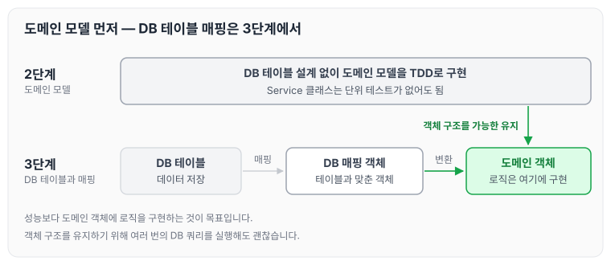
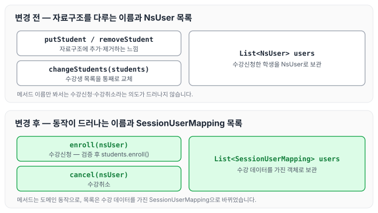

이전에 [수강신청 도메인 모델 — 2단계](../ccj-enrollment-domain/)에 대해 작성하였습니다. 이번에는 수강신청 미션 3단계로, 2단계에서 만든 도메인 모델을 DB 테이블과 매핑하면서 받은 리뷰 피드백을 정리하도록 하겠습니다.

## 핵심 학습 목표

- 2단계에서 구현한 객체 구조(도메인 구조)를 가능한 유지하면서 DB 테이블과 매핑합니다.
- 성능보다 도메인 객체에 로직을 구현하는 것을 목표로 연습합니다.
    - 객체 구조를 유지하기 위해 여러 번의 DB 쿼리를 실행해도 괜찮습니다.

## 수강신청 기능 요구사항 — 2단계와 동일

- 과정(Course)은 기수 단위로 여러 개의 강의(Session)를 가질 수 있습니다.
- 강의는 시작일과 종료일을 가집니다.
- 강의는 강의 커버 이미지 정보를 가집니다.
- 강의는 무료 강의와 유료 강의로 나뉩니다.
- 강의 상태는 준비중, 모집중, 종료 3가지 상태를 가집니다.
- 강의 수강신청은 강의 상태가 모집중일 때만 가능합니다.
- 강의는 강의 최대 수강 인원을 초과할 수 없습니다.

## 프로그래밍 요구사항

- 앞 단계에서 구현한 도메인 모델을 DB 테이블과 매핑하고, 데이터를 저장합니다.

2단계와 3단계의 진행 순서를 그림으로 나타내면 아래와 같습니다.



2단계에서는 DB 테이블 없이 도메인 모델을 TDD로 구현했고, 3단계에서는 그 구조를 가능한 유지한 채 DB 테이블과 매핑합니다. 이 과정에서 DB 매핑 객체를 도메인 객체로 변환하는 부분이 생기고, 객체 구조를 유지하기 위해 DB 쿼리를 여러 번 실행해도 괜찮습니다.

## 피드백

리뷰어님께서 남겨 주신 총평은 아래와 같습니다.

> 도메인 객체와 DB를 매핑하느라 노력한 흔적이 보이네요. 👍
>
> DB 매핑 객체를 도메인 객체로 변환하는 부분도 보이네요.
>
> 도메인 객체와 DB 매핑 객체 관련해 피드백을 남겨봤어요.

### 도메인 의도가 드러나는 메서드 이름

메서드 이름에 대해 아래와 같은 제안을 받았습니다.

> 메서드 이름을 putStudent, removeStudent로 정하면 자료구조에 데이터를 추가하고 제거하는 느낌이 듭니다. 이보다는 도메인 의도가 드러나도록 enroll(수강신청), cancel(수강취소)와 같은 이름으로 구현하면 어떨까요?

기존 코드는 아래와 같습니다.

```java

public void changeStudents(Students students) {
    this.students = students;
}

public void removeStudent(NsUser nsUser) {
```

자료구조에 데이터를 추가하고 제거한다는 느낌보다는, 동작에 초점을 맞춰 메서드 이름을 짓도록 해야겠다고 생각했습니다. 다음과 같이 변경하였습니다.

```java
public void enroll(NsUser nsUser) {
        checkValidation();
        students.enroll(nsUser);
    }

    public void cancel(NsUser nsUser) {
        students.removeEntity(nsUser);
    }
```

### 수강생 목록과 SessionUserMapping

수강생 목록에 대해서는 아래와 같은 제안을 받았습니다.

> 수강신청한 학생의 목록은 SessionUserMapping을 가지는 것은 어떨까요?

기존에는 아래와 같이 `NsUser` 목록을 가지고 있었습니다.

```java
private List<NsUser> users = new ArrayList<>();
```

어차피 수강에 대한 데이터는 SessionUserMapping이 갖고 있으니, 해당하는 객체로 옮기는 것이 맞다고 생각했습니다. 다음과 같이 변경하였습니다.

```java
private List<SessionUserMapping> users = new ArrayList<>();
```

두 피드백을 반영하기 전과 후를 그림으로 비교하면 아래와 같습니다.



메서드 이름은 자료구조 조작에서 수강신청·수강취소라는 동작으로, 수강생 목록은 `NsUser`에서 수강 데이터를 가진 `SessionUserMapping`으로 바뀌었습니다.

## 마무리

오늘은 수강신청 미션 3단계에서 2단계의 도메인 구조를 유지하며 DB 테이블과 매핑하고, 메서드 이름과 수강생 목록에 대해 받은 피드백을 정리하였습니다. 자료구조를 다루는 이름보다 도메인의 동작이 드러나는 이름을 짓는 연습을 계속해 나가야 할 것 같습니다.

관련 PR : [https://github.com/next-step/java-lms/pull/201](https://github.com/next-step/java-lms/pull/201)

> 이 글은 넥스트스텝의 [TDD, 클린 코드 with Java](https://edu.nextstep.camp/c/O0pDe1b) 과정을 들으며 정리한 노트입니다.
