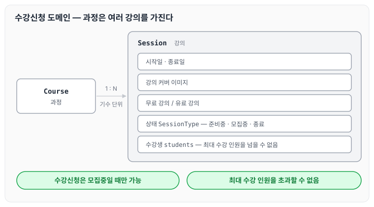
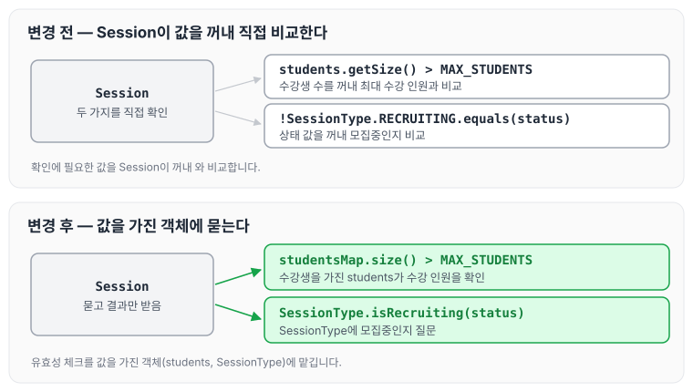

이전에 [자동차 경주 리팩터링 — 5단계](../ccj-12-racing-refactor/)에 대해 작성하였습니다. 이번에는 넥스트스텝의 학습 관리 시스템(LMS)에 수강신청 기능을 구현하는 미션의 2단계로, DB 테이블 설계 없이 도메인 모델부터 TDD로 구현하면서 받은 리뷰 피드백을 정리하도록 하겠습니다.

## 학습 관리 시스템(LMS)

넥스트스텝은 재직자를 대상으로 소프트웨어 교육을 진행하는 교육 기관으로, 2018년 교육 사업을 시작했습니다.

교육 사업을 시작하며 자체적으로 학습 관리 시스템을 개발해 수강생을 모집하고, 콘텐츠를 관리하고 있습니다.

## 수강신청 기능 요구사항

- 과정(Course)은 기수 단위로 여러 개의 강의(Session)를 가질 수 있습니다.
- 강의는 시작일과 종료일을 가집니다.
- 강의는 강의 커버 이미지 정보를 가집니다.
- 강의는 무료 강의와 유료 강의로 나뉩니다.
- 강의 상태는 준비중, 모집중, 종료 3가지 상태를 가집니다.
- 강의 수강신청은 강의 상태가 모집중일 때만 가능합니다.
- 강의는 강의 최대 수강 인원을 초과할 수 없습니다.

요구사항에 나온 과정과 강의, 강의가 가지는 정보를 그림으로 나타내면 아래와 같습니다.



과정 하나는 여러 강의를 가지고, 수강신청 규칙(모집중일 때만, 최대 수강 인원 이내)은 강의 단위로 확인합니다.

## 프로그래밍 요구사항

- DB 테이블 설계 없이 도메인 모델부터 구현합니다.
- 도메인 모델은 TDD로 구현합니다.
    - 단, Service 클래스는 단위 테스트가 없어도 됩니다.
- 다음 영상을 참고해 DB 테이블보다 도메인 모델을 먼저 설계하고 구현합니다.

[https://youtu.be/VjbBGjVRxfk](https://youtu.be/VjbBGjVRxfk)

## 피드백

리뷰어님께서 남겨 주신 총평은 아래와 같습니다.

> 도메인 객체를 작은 단위로 분리하고, 지금까지 연습한 부분을 잘 적용해 구현했네요. 💯 요구사항을 잘못 이해한 부분이 있어 컨벤션 관련한 피드백을 남깁니다.

### 수강 인원 검증 위치

기존에는 `Session`에서 수강생 수를 꺼내 최대 수강 인원을 넘는지 확인하고 있었습니다.

```java
if (students.getSize() > MAX_STUDENTS) {
      throw new IllegalArgumentException(MAX_STUDENT_EXCEPTION);
  }
```

`Session.java` 객체에서 진행하던 이 확인은 수강생을 가지고 있는 `students`에서 유효성 체크를 하는 것이 맞다고 생각해, 다음과 같이 옮겼습니다.

```java
if (studentsMap.size() > MAX_STUDENTS) {
            throw new IllegalArgumentException(MAX_STUDENT_EXCEPTION);
        }
```

### enum에 메시지 보내기

리뷰어님께서 남겨 주신 제안은 아래와 같습니다.

> enum에도 메시지를 보내는 방식으로 구현하면 어떨까요?

기존에는 아래와 같이 강의 상태를 직접 비교하고 있었습니다.

```java
if (!SessionType.RECRUITING.equals(status)) {
```

객체에서 상태 값을 비교해 분기 처리하기보다, enum에 질문하는 방식으로 유효성 체크를 하는 것이 좀 더 깔끔하게 정리하는 방법이라고 생각했습니다. 다음과 같이 변경하였습니다.

```java
package nextstep.courses.domain;

public enum SessionType {
    READY, RECRUITING, END;

    public static boolean isRecruiting(SessionType sessionType) {
        return sessionType == RECRUITING;
    }
}
```

두 피드백을 반영한 뒤 수강신청 검증을 누가 맡는지 그림으로 나타내면 아래와 같습니다.



수강 인원은 수강생을 가진 `students`가, 모집중인지는 `SessionType`이 답하도록 바뀌었습니다.

## 마무리

오늘은 수강신청 미션 2단계에서 DB 테이블 설계 없이 도메인 모델부터 TDD로 구현하면서 받은 수강 인원 검증 위치와 enum에 메시지를 보내는 방식에 대한 피드백을 정리하였습니다. 유효성 체크도 그 값을 가진 객체에 맡기는 것이 좀 더 깔끔한 것 같습니다. 다음 글에서는 [수강신청 DB 적용 — 3단계](../ccj-enrollment-db/)에 대해 정리하도록 하겠습니다.

관련 PR : [https://github.com/next-step/java-lms/pull/190/files/113e1396c736f333bf58ead544fcb4cec13316d7](https://github.com/next-step/java-lms/pull/190/files/113e1396c736f333bf58ead544fcb4cec13316d7)

> 이 글은 넥스트스텝의 [TDD, 클린 코드 with Java](https://edu.nextstep.camp/c/O0pDe1b) 과정을 들으며 정리한 노트입니다.
