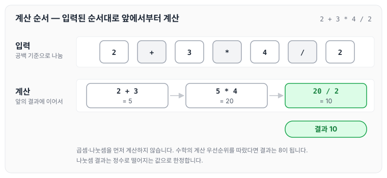
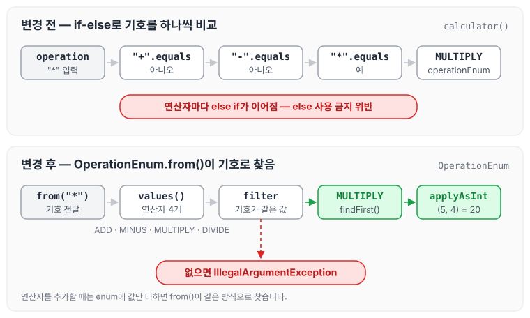

이전에 [Set 컬렉션으로 배우는 학습 테스트 — 1단계](../ccj-02-learning-test/)에 대해 작성하였습니다. 이번에는 문자열 사칙연산 계산기를 구현한 과제의 요구사항과 리뷰에서 받은 피드백, 그리고 피드백을 반영해 연산자를 enum으로 바꾼 코드에 대해 정리하도록 하겠습니다.

## 요구사항

### 기능 요구사항

- 사용자가 입력한 문자열 값에 따라 사칙연산을 수행하는 계산기를 구현합니다.
- 입력 문자열의 숫자와 사칙 연산 기호 사이에는 반드시 빈 공백 문자열이 있다고 가정합니다.
- 나눗셈의 결과 값은 정수로 떨어지는 값으로 한정합니다.
- 문자열 계산기는 사칙연산의 계산 우선순위가 아닌 **입력 값에 따라 계산 순서가 결정**됩니다. 수학에서는 곱셈, 나눗셈을 덧셈, 뺄셈보다 먼저 계산하지만 이를 무시합니다.
- 예를 들어 `2 + 3 * 4 / 2`와 같은 문자열을 입력하면 `2 + 3 * 4 / 2`의 실행 결과인 10을 출력해야 합니다.

`2 + 3 * 4 / 2`를 입력했을 때 계산되는 순서를 그림으로 나타내면 아래와 같습니다.



곱셈과 나눗셈을 먼저 계산하지 않고 입력된 순서대로 앞의 결과에 다음 숫자를 계산하기 때문에, 결과는 10이 됩니다.

### 프로그래밍 요구사항

- indent(들여쓰기) depth를 2단계에서 1단계로 줄입니다.
    - if문을 사용하면 depth가 1단계 증가합니다. if문 안에 while문을 사용하면 depth가 2단계가 됩니다.
- 메서드의 크기가 최대 10라인을 넘지 않도록 구현합니다.
    - 메서드가 한 가지 일만 하도록 최대한 작게 만듭니다.
- else를 사용하지 않습니다.

메서드를 작게 만들어 한 가지 일만 하게 하는 내용은 클린 코드의 [3장 함수](../clean-code-ch3-functions/)에서도 정리하였습니다.

## 피드백

리뷰어: 전반적인 방향성은 나쁘지 않지만, 요구사항을 충족하지 못하는 부분이 있어 이 부분 개선이 필요해 보입니다. 개선 부탁드립니다.

- `else` 사용하지 않는 것이 요구사항 중 하나였던 것으로 알고 있습니다. 이 부분 요구사항을 충족하려면 어떻게 설계해야 할까요?
- 연산자 하나하나에 대한 추상화, 그리고 추상화된 연산자를 탐색하는 로직이 구현된 클래스 혹은 메소드 하나가 필요할 것 같습니다. 고민해 주시면 감사하겠습니다.

기능 구현에 집중하다 보니 else를 사용하지 않는다는 조건을 놓쳤습니다.

### if-else로 연산자를 고르던 코드

처음 작성한 코드는 아래와 같이 연산자 기호마다 if-else로 분기해 `OperationEnum` 값을 정하고 있었습니다.

```java
public String calculator(String leftNumber, String rightNumber) {
    Number left = Number.from(leftNumber);
    Number right = Number.from(rightNumber);

    OperationEnum operationEnum = null;

    if ("+".equals(operation)) {
				operationEnum = OperationEnum.ADD;
    } else if ("-".equals(operation)) {
        operationEnum = OperationEnum.MINUS;
    } else if ("*".equals(operation)) {
        operationEnum = OperationEnum.MULTIPLY;
    } else if ("/".equals(operation)) {
        operationEnum = OperationEnum.DIVIDE;
    }

    return String.valueOf(operationEnum.calculator(left.getNumber(), right.getNumber()));
}
```

### 연산자 enum으로 변경

연산자 기호와 계산식(`IntBinaryOperator`)을 함께 가지는 `OperationEnum`을 만들고, `from()`에서 입력된 기호와 같은 값을 찾도록 다음과 같이 변경하였습니다. 기호에 맞는 연산자가 없으면 `IllegalArgumentException`을 던집니다.

```java
public enum OperationEnum {
        ADD("+", (number1, number2) -> number1 + number2),
        MINUS("-", (number1, number2) -> number1 - number2),
        MULTIPLY("*", (number1, number2) -> number1 * number2),
        DIVIDE("/", (number1, number2) -> number1 / number2);

        private final String operation;
        private final IntBinaryOperator expression;

        OperationEnum(String operation, IntBinaryOperator expression) {
            this.operation = operation;
            this.expression = expression;
        }

        public int calculator(int number1, int number2) {
            return getExpression().applyAsInt(number1, number2);
        }

        public static OperationEnum from(String operation) {
            return Arrays.stream(values())
                    .filter(value -> operation.equals(value.operation))
                    .findFirst()
                    .orElseThrow(() -> new IllegalArgumentException("잘못된 값 입력"));
        }

        public IntBinaryOperator getExpression() {
            return expression;
        }
    }
```

변경 전후에 `*` 연산자를 고르는 과정을 비교하면 아래와 같습니다.



변경 전에는 연산자가 늘어날 때마다 else if가 하나씩 늘어나지만, 변경 후에는 enum에 값을 추가하면 `from()`이 그대로 찾아 줍니다.

## 마무리

오늘은 문자열 사칙연산 계산기를 구현하면서 받은 리뷰 피드백과, if-else 분기를 연산자 enum으로 바꾼 과정에 대해 정리하였습니다. 기능 구현에 집중하다 보면 프로그래밍 요구사항을 놓치기 쉽다는 것을 알 수 있었습니다.

완료된 소스 코드는 [https://github.com/next-step/java-lotto/pull/2943](https://github.com/next-step/java-lotto/pull/2943)에서 확인할 수 있습니다. 다음 글에서는 [문자열 덧셈 계산기로 배우는 TDD — 2단계](../ccj-03-string-calculator/)에 대해 정리하도록 하겠습니다.

> 이 글은 넥스트스텝의 [TDD, 클린 코드 with Java](https://edu.nextstep.camp/c/O0pDe1b) 과정을 들으며 정리한 노트입니다.
