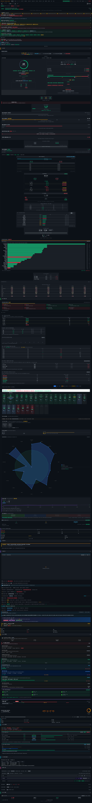
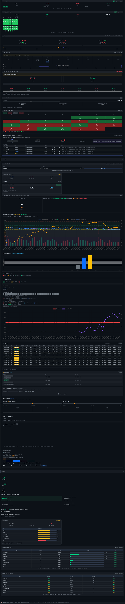
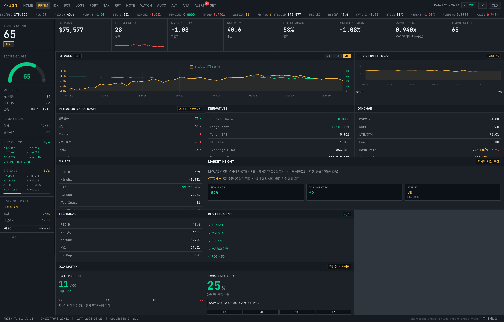
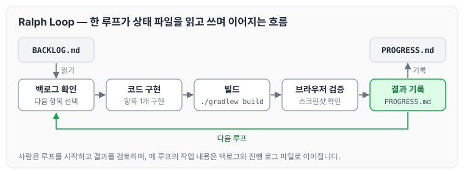
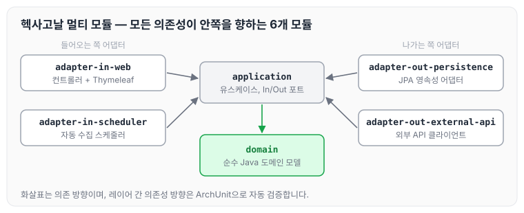
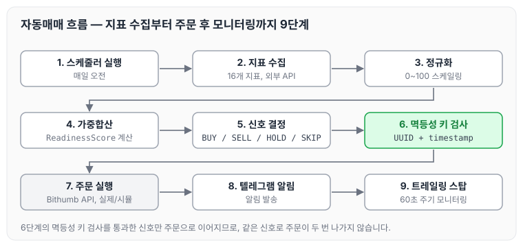

혼자서 진행하면 수개월이 걸릴 규모의 프로젝트를 AI 주도 반복 개발 방식으로 구현하였습니다. 총 1,208번의 루프를 돌렸고, 200개 이상의 도메인 클래스와 20개 이상의 Thymeleaf 페이지, 실거래와 연동되는 자동매매 시스템까지 포함됩니다. 오늘은 Claude Code로 암호화폐 투자 대시보드를 만든 과정과 프로젝트 구조, 그리고 AI와 협업하면서 중요했던 점을 정리하도록 하겠습니다.

## 프로젝트 소개

invest-view는 BTC 온체인 지표를 수집·분석해 투자 타이밍을 판단하는 Spring Boot 기반 웹 애플리케이션입니다. 주요 기능은 아래와 같습니다.

- 투자 대시보드: MVRV, NUPL, SOPR, Fear & Greed 등 16종 지표 실시간 수집 및 준비도 점수(0~100) 산출
- 자동매매: Bithumb 연동 BUY/SELL/HOLD/SKIP 신호 생성 + 텔레그램 알림
- 분석 페이지: 점수 히스토리 기반 수백 개 파생 통계 지표
- 포트폴리오 관리: 수익률 추적, 몬테카를로 시뮬레이션
- 세금 계산기: 국내 암호화폐 과세 기준 자동 계산

실제 대시보드 화면은 아래와 같습니다.







### 기술 스택

- Spring Boot 4.x / Java 25
- 헥사고날(Ports & Adapters) 멀티 모듈 Gradle 구조
- Thymeleaf + HTMX
- JPA + MySQL / Redis
- Resilience4j (Circuit Breaker, Retry)

## Claude Code란

Claude Code는 Anthropic이 만든 CLI 기반 AI 코딩 도구입니다. 코드를 제안하는 데 그치지 않고 파일 읽기/쓰기/편집, 터미널 명령 실행, 빌드 확인, 브라우저 스크린샷까지 직접 수행합니다.

일반적인 AI 코드 어시스턴트와 다른 점은 **도구 실행 권한**입니다. 제안한 코드를 사람이 옮겨 적는 방식이 아니라, Claude Code가 실제로 파일을 수정하고 빌드를 돌린 뒤 결과를 확인합니다.

## Ralph Loop란

Ralph Loop는 Claude Code를 자율 반복 루프로 구동하는 워크플로입니다. 매 루프마다 Claude가 아래 작업을 스스로 수행합니다.

1. 백로그에서 다음 구현 항목 선택
2. 코드 작성 및 빌드 실행
3. 브라우저 스크린샷으로 결과 검증
4. 진행 로그(`PROGRESS.md`)에 결과 기록
5. 다음 루프 준비

사람은 루프를 시작하고, 결과를 검토하는 역할만 합니다. 한 루프의 흐름을 정리하면 아래와 같습니다.

```text
루프 시작 → 백로그 확인 → 코드 구현 → ./gradlew build
→ 브라우저 검증 → PROGRESS.md 업데이트 → 다음 루프
```

위 흐름을 그림으로 나타내면 아래와 같습니다. 백로그와 진행 로그는 루프 바깥에 파일로 남아 있고, 매 루프가 이 파일을 읽고 쓰면서 이어집니다.



## 아키텍처 구조

프로젝트는 헥사고날 아키텍처를 기반으로 6개 모듈로 분리하였습니다. 헥사고날 아키텍처의 의존성 규칙은 [의존성 역전하기](../clean-arch-02-dependency-inversion/)에 정리해 두었습니다.

```text
domain/                  ← 순수 Java 도메인 모델 (외부 의존 없음)

application/             ← 유스케이스, In/Out 포트 인터페이스

adapter-in-web/          ← Spring MVC 컨트롤러 + Thymeleaf 템플릿

adapter-in-scheduler/    ← 자동 수집 스케줄러

adapter-out-persistence/ ← JPA 영속성 어댑터

adapter-out-external-api/← 외부 API 클라이언트
```

6개 모듈의 의존 방향을 그림으로 나타내면 아래와 같습니다. 들어오는 쪽 어댑터(웹, 스케줄러)와 나가는 쪽 어댑터(영속성, 외부 API)가 모두 `application`을 향하고, `application`은 `domain`만 의존합니다.



레이어 간 의존성 방향은 ArchUnit으로 자동 검증합니다. 이 구조는 Claude가 처음부터 설계하였고, 모든 모듈의 `build.gradle.kts`도 Claude가 작성하였습니다.

## 도메인 모델 (TDD)

`domain` 모듈에는 200개 이상의 도메인 클래스가 있습니다. 각 클래스는 Red → Green → Refactor TDD 사이클로 작성하였습니다. Claude는 테스트를 먼저 작성하고, 구현한 뒤 리팩터링까지 마치고 나서 다음 루프로 넘어갑니다.

```java
public record ReadinessScore(BigDecimal value, SignalLabel label) {

    public static ReadinessScore of(BigDecimal value) {
        return new ReadinessScore(value, SignalLabel.from(value));
    }

    public boolean isBuySignal() {
        return label.isBuy();
    }

}
```

`BigDecimal` 사용, [정적 팩토리 메소드 패턴](../static-factory-method/), 불변 값 객체 원칙은 모든 루프에서 일관되게 지켜졌습니다.

## 자동매매 흐름

자동매매는 아래 순서로 동작합니다.

1. 매일 오전 스케줄러 실행
2. 16개 지표 수집 (외부 API)
3. 정규화 (0~100 스케일링)
4. 가중합산 → ReadinessScore 계산
5. 임계값 비교 → BUY / SELL / HOLD / SKIP 결정
6. 멱등성 키(UUID + timestamp) 검사로 중복 방지
7. Bithumb API로 실제/시뮬 주문 실행
8. 텔레그램 알림 발송
9. 트레일링 스탑 모니터링 (60초 주기)

위 순서를 그림으로 나타내면 아래와 같습니다. 점수를 계산하는 단계와 주문을 실행하는 단계 사이에 멱등성 키 검사가 있어, 같은 신호로 주문이 두 번 나가지 않습니다.



이 밖에도 시뮬레이션 모드 잠금, 100건 이상 시뮬레이션을 거친 뒤에만 실거래를 허용하는 가드 등 운영 안전장치를 포함하였습니다.

## AI 협업에서 중요한 것들

### 상태 파일로 컨텍스트 유지

AI는 세션이 끊기면 이전 결정을 잊습니다. 이 문제를 해결하기 위해 아래와 같은 상태 파일을 운영하였습니다.

- `BACKLOG.md`: 구현할 기능 목록 (P0/P1/P2 우선순위)
- `PROGRESS.md`: 완료 이력 (빌드 결과, 검증 결과 포함)
- `MEMORY/*.md`: 세션 간 유지할 피드백, 프로젝트 맥락

루프가 새로 시작되어도 Claude는 이 파일들을 읽고 현재 상태를 바로 파악합니다.

### CLAUDE.md에 규칙 명문화

프로젝트 루트의 `CLAUDE.md`에 코딩 규칙을 문서화해 두면, Claude는 매 루프마다 이 규칙을 일관되게 따릅니다. 이 프로젝트에서 정해 둔 규칙은 아래와 같습니다.

- `Double` 대신 `BigDecimal` 사용
- 생성자 대신 정적 팩터리 메서드
- `set` 대신 `changeXxx()` 메서드
- 주석은 한글, 로그는 영어
- Early return, 중첩 if 금지

### 브라우저 검증

매 루프 끝에는 Playwright로 실제 브라우저 스크린샷을 찍어 확인하였습니다. 빌드 성공 여부뿐 아니라 화면 렌더링과 JS 에러 여부까지 자동으로 검증합니다.

```text
JS errors=0  ← 각 루프의 최종 검증 결과
```

## 결과

프로젝트를 마친 시점의 수치는 아래와 같습니다.

| 항목 | 수치 |
| --- | --- |
| 총 루프 이터레이션 | 1,208회 |
| 도메인 클래스 수 | 200+ |
| Thymeleaf 템플릿 | 20+ |
| 외부 API 엔드포인트 | 50+ |
| 분석 페이지 파생 지표 | 300+ |
| 개발 기간 | 약 3주 |

모든 루프에서 `✅ BUILD OK`가 이어졌습니다. AI 없이 혼자 진행했다면 시작하기도 어려운 규모였던 것 같습니다.

## 마무리

오늘은 Claude Code와 Ralph Loop로 암호화폐 투자 대시보드를 만든 과정과 헥사고날 멀티 모듈 구조, TDD로 작성한 도메인 모델, 자동매매 흐름, 그리고 상태 파일·`CLAUDE.md`·브라우저 검증으로 AI와 협업한 방식에 대해 정리하였습니다. 다음 글에서는 [Ralph Loop 설계하기 — BACKLOG.md와 상태 파일 운영법](../ralph-loop-backlog/)에 대해 정리하도록 하겠습니다.
