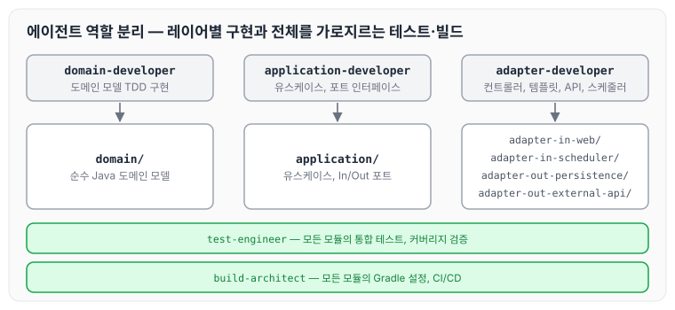
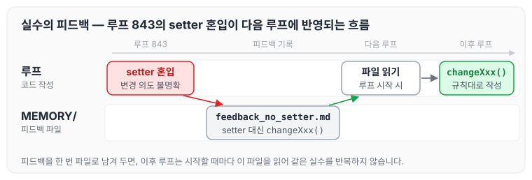

이전에 [Ralph Loop 설계하기 — BACKLOG.md와 상태 파일 운영법](../ralph-loop-backlog/)에 대해 작성하였습니다. 이번에는 Claude Code를 실제 개발에서 어떻게 활용했는지를 다룹니다. 어떻게 지시했는지, 실수가 발생했을 때 어떻게 대응했는지, 그리고 1,200번 이상의 루프 동안 품질을 유지한 방법을 정리하도록 하겠습니다.

## 역할 분리 — 에이전트 전문화

Claude Code에게 한 번에 모든 작업을 맡기면 일관성이 떨어집니다. 그래서 이 프로젝트에서는 작업 종류에 따라 전문 에이전트를 분리하였습니다. 각 에이전트는 자신이 담당하는 레이어만 구현합니다.

| 에이전트 | 담당 |
| --- | --- |
| `domain-developer` | 도메인 모델 TDD 구현 |
| `application-developer` | 유스케이스, 포트 인터페이스 |
| `adapter-developer` | 컨트롤러, 템플릿, API 클라이언트, 스케줄러 |
| `test-engineer` | 통합 테스트, 커버리지 검증 |
| `build-architect` | Gradle 설정, CI/CD |

각 에이전트가 맡은 범위를 [Claude Code로 만든 암호화폐 투자 대시보드](../claude-code-crypto-dashboard/)에서 정리한 모듈 구조에 맞춰 그림으로 나타내면 아래와 같습니다.



구현을 맡은 세 에이전트는 레이어별로 범위가 나뉘고, `test-engineer`와 `build-architect`는 레이어를 가로질러 테스트와 빌드 설정을 담당합니다. 이 역할은 `CLAUDE.md`의 하네스 섹션에 정의해 두고, Claude가 작업 전에 참고하도록 하였습니다.

## CLAUDE.md — AI에게 주는 일관된 지침

`CLAUDE.md`는 프로젝트 루트에 두는 파일입니다. Claude Code는 작업을 시작하기 전에 이 파일을 자동으로 읽습니다. 핵심 규칙을 여기에 적어 두면 매 루프마다 같은 스타일로 코드를 작성합니다.

```markdown
## 개발 규칙

- Double 대신 BigDecimal 사용
- 생성자 대신 정적 팩터리 메서드 (of, from, create)
- set 금지 → 변경은 changeXxx() 메서드
- 주석은 한글, 로그는 영어
- Early return 선호, 중첩 if 금지
- 미사용 import/메서드 주기적으로 제거
```

1,208번의 루프 동안 이 규칙이 지켜진 것은 사람이 매번 검토했기 때문이 아니라, Claude가 매 루프를 시작할 때 이 파일을 읽었기 때문입니다.

## 백로그 항목을 어떻게 작성했나

백로그 항목을 어떻게 쓰느냐에 따라 구현 품질이 달라집니다. 항목을 모호하게 쓰면 Claude도 모호하게 구현합니다.

좋지 않은 예시는 아래와 같습니다.

```markdown
- [ ] 분석 페이지 지표 추가
```

잘 작성된 예시는 아래와 같습니다.

```markdown
- [ ] [BATCH-ANALYSIS-SCORE-RSI] loadScoreScoreStochasticRsi 구현
  — 14D RSI에 14D 스토캐스틱 적용, %K/%D 골든/데드크로스 신호 반환
  — analysis.html 패널 1개 추가
  — 예상 0.5루프
```

항목에는 식별자 태그, 구체적인 동작 설명, 영향 범위, 예상 루프 수를 포함하였습니다. Claude는 이 정보를 바탕으로 어디에 무엇을 어떻게 구현할지 스스로 판단하였습니다.

## 컨텍스트 유지 — 세션이 끊겨도 이어가기

Claude Code는 대화 세션이 끊기면 이전 내용을 기억하지 못합니다. 1,200번이 넘는 루프를 진행하면서 이 문제는 **상태 파일**로 해결하였습니다.

### PROGRESS.md

완료된 루프를 매번 기록합니다.

| 루프# | 날짜 | 완료 항목 | 빌드 | 검증 |
| --- | --- | --- | --- | --- |
| 1208 | 2026-05-22 | [SEASON-SCORE-ENHANCE] 시즌별 점수 개선 | ✅ | curl OK |
| 1207 | 2026-05-22 | [SEASON-SCORE-FIX] 시즌별 점수 로직 재설계 | ✅ | curl OK |

새 루프를 시작할 때 Claude는 이 파일을 읽고 "1208번까지 완료되었으니 1209번을 시작한다"는 것을 스스로 파악합니다.

### MEMORY/ 폴더

세션 간 유지해야 할 결정 사항을 개별 파일로 저장합니다.

```markdown
# feedback_db_data.md
DB 데이터는 절대 초기화하지 않는다.
Why: 실데이터가 쌓인 운영 DB를 초기화한 적이 있어 복구 불가 손실 발생.
```

Claude가 실수를 반복하거나, 잊으면 안 되는 결정이 생길 때마다 이 폴더에 파일을 추가하였습니다.

## AI가 실수했을 때

Claude Code도 실수를 합니다. 주로 발생한 패턴과 대응 방법은 아래와 같습니다.

### 빌드 실패

빌드가 실패하면 Claude는 에러 로그를 읽고 스스로 수정합니다. 대부분 한두 번의 시도로 해결되었고, 이 과정도 자동으로 진행되어 사람이 개입할 필요가 없었습니다.

### 이미 있는 기능을 다시 구현

간혹 이미 구현된 기능을 중복으로 만드는 경우가 있었습니다. 이때는 백로그에 `SKIP` 태그를 추가해 명시적으로 건너뛰도록 하였습니다.

```markdown
- [x] [BATCH-ANALYSIS-SCORE-TREND-CONSISTENCY](SKIP 이미구현)
  → 다음 배치로 이동
```

### 규칙을 어긴 코드 작성

`BigDecimal` 대신 `double`을 쓰거나, setter를 사용한 경우가 드물게 있었습니다. 이때는 `MEMORY/` 폴더에 해당 피드백을 기록하였습니다.

```markdown
# feedback_no_setter.md
setter 대신 changeXxx() 메서드를 사용한다.
Why: 루프 843에서 setter가 혼입되어 값 변경 의도가 불명확해진 사례 발생.
```

다음 루프부터 Claude는 이 파일을 읽고 같은 실수를 반복하지 않았습니다. 실수가 피드백 파일로 남고 다음 루프에 반영되는 흐름을 그림으로 나타내면 아래와 같습니다.



피드백을 한 번 파일로 남겨 두면, 그 뒤의 루프는 시작할 때마다 이 파일을 읽기 때문에 같은 지적을 반복할 필요가 없었습니다.

## 브라우저 검증으로 품질 확보

빌드가 성공했다고 해서 완성된 것은 아닙니다. 화면이 제대로 렌더링되는지, JS 에러가 없는지도 확인해야 합니다. 그래서 매 루프 끝에 Playwright로 스크린샷을 찍고 JS 에러를 확인하였습니다.

```text
JS errors=0   # 루프 합격 기준
```

이 검증 덕분에 수백 개의 지표를 추가하면서도 눈에 띄지 않게 깨진 화면이 쌓이지 않았습니다.

## 배치 처리로 효율 높이기

비슷한 성격의 항목은 2개씩 묶어서 처리하였습니다.

```markdown
[BATCH-ANALYSIS-SCORE-1208a] 시장 심리 게이지
[BATCH-ANALYSIS-SCORE-1208b] 신호 신뢰도 지수
→ 두 항목을 하나의 루프에서 처리
```

루프 횟수를 절반으로 줄이면서도 빌드 단위를 유지할 수 있었습니다. 분석 페이지에 300개 이상의 파생 지표를 추가할 수 있었던 것도 이 방식 덕분입니다.

## 마무리

오늘은 Claude Code를 실제 개발에서 사용하면서 정립한 에이전트 역할 분리, `CLAUDE.md` 규칙, 백로그 항목 작성법, 상태 파일을 통한 컨텍스트 유지, 그리고 AI가 실수했을 때의 대응 방법에 대해 정리하였습니다. 정리하자면 아래 세 가지가 중요했던 것 같습니다.

- `CLAUDE.md`로 코딩 규칙을 고정한다
- 상태 파일로 세션이 끊겨도 컨텍스트가 유지되게 한다
- 백로그 항목을 구체적으로 작성한다

AI에게 모호한 지시를 주면 결과도 모호하게 나오지만, 규칙과 상태를 잘 정의해 두면 AI는 그것을 일관되게 따르는 것 같습니다. 다음 글에서는 [AI와 함께 자동매매 시스템을 설계한 과정](../ai-trading-system/)에 대해 정리하도록 하겠습니다.
