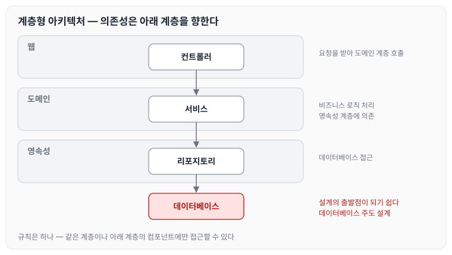
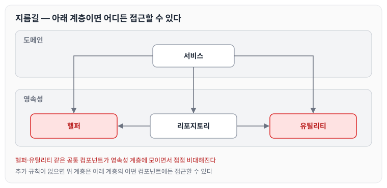
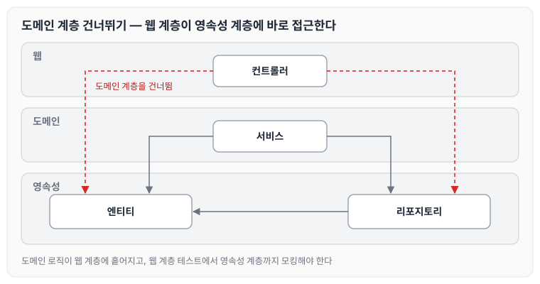
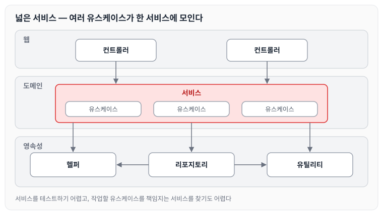

지금까지 프로젝트를 진행하면서 여러 코드를 보았는데, 진행하면 할수록 코드가 복잡해지고 수정하는 데 어려움을 느꼈습니다. 어떻게 하면 좀 더 유연하고 원활한 서비스를 만들 수 있을지 고민하게 되었고, 그래서 '만들면서 배우는 클린 아키텍처'라는 책을 읽게 되었습니다. 오늘은 그 첫 장인 계층형 아키텍처의 문제점에 대해 정리하도록 하겠습니다.

## 계층형 아키텍처의 문제는 무엇일까?

계층형 아키텍처는 코드에 나쁜 습관이 스며들기 쉽게 만들고, 시간이 지날수록 소프트웨어를 점점 더 변경하기 어렵게 만드는 허점을 많이 가지고 있습니다. 계층형 아키텍처는 아래와 같이 웹, 도메인, 영속성 계층으로 나뉘고, 계층 간 의존성은 아래 계층을 향합니다.

의존성을 따라 내려가면 맨 아래에 데이터베이스가 있기 때문에, 설계를 데이터베이스에서부터 시작하기 쉽습니다. 아래에서 이 구조가 어떤 문제를 만드는지 하나씩 정리하겠습니다.

## 계층형 아키텍처는 데이터베이스 주도 설계를 유도합니다

보통 비즈니스를 관장하는 규칙이나 정책을 반영한 모델을 만들어서, 사용자가 이러한 규칙과 정책을 더욱 편리하게 활용할 수 있게 합니다. 이때 **상태가 아니라 행동을 중심으로 모델링**합니다. 어떤 애플리케이션이든 상태가 중요한 요소이긴 하지만, 행동이 상태를 바꾸는 주체이기 때문에 행동이 비즈니스를 이끌어 갑니다.

그런데 계층형 아키텍처에서는 데이터베이스 구조를 먼저 생각하고, 이를 토대로 도메인 로직을 구현하게 됩니다. 이는 전통적인 계층형 아키텍처에서는 합리적인 방법입니다. 의존성의 방향에 따라 자연스럽게 구현한 것이기 때문입니다. 하지만 비즈니스 관점에서는 전혀 맞지 않는 방법입니다. 다른 무엇보다도 도메인 로직을 먼저 만들어야 하기 때문입니다.

## 지름길을 택하기 쉬워집니다

전통적인 계층형 아키텍처에서 전체적으로 적용되는 유일한 규칙은, 특정한 계층에서는 같은 계층에 있는 컴포넌트나 아래에 있는 계층에만 접근할 수 있다는 것입니다. 이 규칙 외에 다른 규칙은 강제하지 않습니다.

이 때문에 위 계층의 컴포넌트에 접근해야 할 때는 그 컴포넌트를 아래 계층으로 내려 버리면 됩니다. 이런 일이 반복되면 아래 그림처럼 헬퍼나 유틸리티 같은 컴포넌트가 영속성 계층에 모이고, 영속성 계층은 시간이 지나면서 점점 비대해집니다.

그러니 아키텍처의 '지름길 모드'를 끄고 싶다면, 적어도 추가적인 아키텍처 규칙을 강제하지 않는 한 계층은 최선의 선택이 아닙니다. 여기서 추가적인 아키텍처 규칙이란 해당 규칙이 깨졌을 때 빌드가 실패하도록 만드는 규칙을 의미합니다.

## 테스트하기 어려워집니다

계층형 아키텍처에서는 아래 그림처럼 웹 계층의 컨트롤러가 도메인 계층을 건너뛰고 영속성 계층에 바로 접근하는 경우가 생깁니다.

이렇게 도메인 계층을 건너뛰면 두 가지 문제가 생깁니다.

1. 첫 번째 문제는 단 하나의 필드를 조작하는 것에 불과하더라도 도메인 로직을 웹 계층에 구현하게 된다는 것입니다.
2. 두 번째 문제는 웹 계층 테스트에서 도메인 계층뿐만 아니라 영속성 계층도 모킹해야 한다는 것입니다. 이렇게 되면 단위 테스트의 복잡도가 올라갑니다.

시간이 흘러 웹 컴포넌트의 규모가 커지면 다양한 영속성 컴포넌트에 대한 의존성이 많이 쌓이면서 테스트의 복잡도가 더 높아집니다.

## 유스케이스를 숨깁니다

계층형 아키텍처는 도메인 서비스의 '너비'에 관한 규칙을 강제하지 않습니다. 그렇기 때문에 시간이 지나면 아래와 같이 여러 개의 유스케이스를 담당하는 아주 넓은 서비스가 만들어집니다.

넓은 서비스는 영속성 계층에 많은 의존성을 갖게 되고, 다시 웹 계층의 많은 컴포넌트가 이 서비스에 의존하게 됩니다. 그러면 서비스를 테스트하기도 어려워지고, 작업해야 할 유스케이스를 책임지는 서비스를 찾기도 어려워집니다.

## 동시 작업이 어려워집니다

> "지연되는 소프트웨어 프로젝트에 인력을 더하는 것은 개발을 늦출 뿐이다."
> 《맨먼스 미신: 소프트웨어 공학에 관한 에세이》, 프레더릭 P. 브룩스

계층형 아키텍처에서 동시 작업이 어려운 이유는, 데이터베이스 주도 설계에서는 영속성 로직이 도메인 로직과 너무 뒤섞여서 각 측면을 개별적으로 작업할 수 없기 때문입니다.

## 유지보수 가능한 소프트웨어를 만드는 데 어떻게 도움이 될까?

계층형 아키텍처는 많은 것들이 잘못된 방향으로 흘러가도록 용인합니다. 아주 엄격한 자기 훈련 없이는 시간이 지날수록 품질이 저하되고 유지보수하기가 어려워지기 쉽습니다.

## 마무리

오늘은 '만들면서 배우는 클린 아키텍처' 1장을 읽고 계층형 아키텍처가 데이터베이스 주도 설계를 유도하고, 지름길을 허용해 테스트와 동시 작업, 유지보수를 어렵게 만드는 이유에 대해 정리하였습니다. 그동안 해 왔던 프로젝트들은 모두 계층형 아키텍처였고, 잘못된 방향으로 흘러가도록 용인한다는 말이 와닿았습니다. 잘못 사용한 사람에게도 책임이 있지만, 만들고 설계한 저에게도 책임이 있다는 것을 다시 한번 깨달았습니다. 책을 읽으면서 이런 문제를 어떻게 막고 제안할지 배우고, 습관으로 만들어 보려고 합니다.

다음 글에서는 [의존성 역전하기](../clean-arch-02-dependency-inversion/)에 대해 정리하도록 하겠습니다.

참조 : [만들면서 배우는 클린 아키텍처 - YES24](http://www.yes24.com/Product/Goods/105138479)
