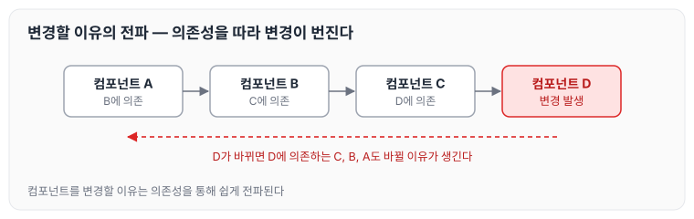
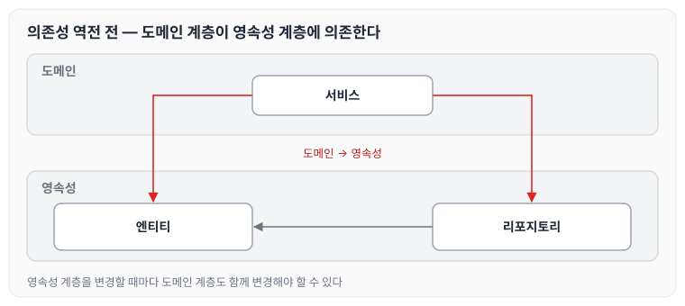
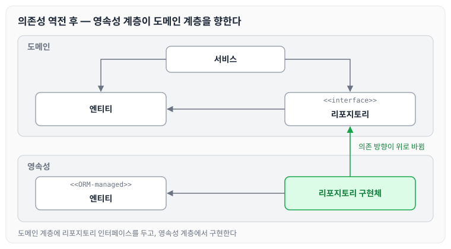
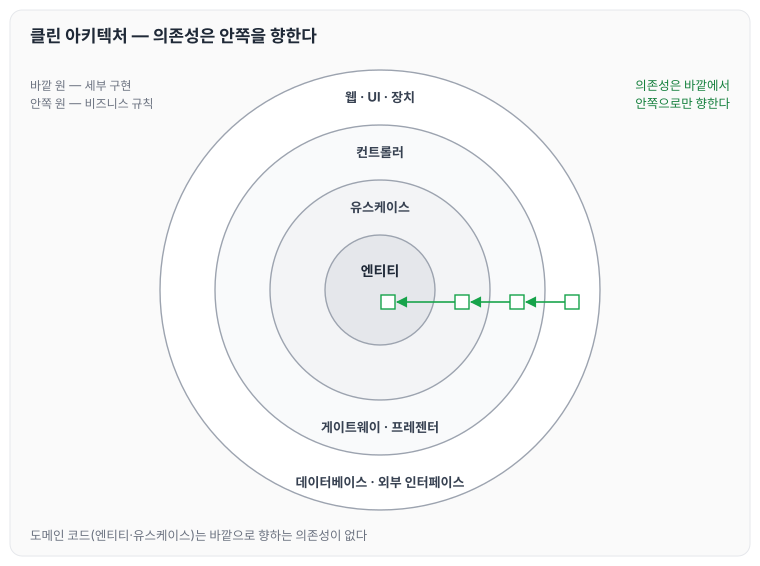
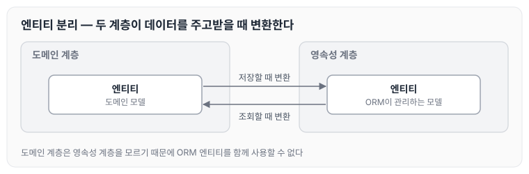

이전에 [계층형 아키텍처의 문제는 무엇일까?](../clean-arch-01-layered-problems/)에 대해 작성하였습니다. 이번에는 2장 '의존성 역전하기'를 읽고, 단일 책임 원칙과 의존성 역전 원칙, 그리고 이 원칙을 바탕으로 한 클린 아키텍처와 육각형 아키텍처에 대해 정리하도록 하겠습니다.

## 단일 책임 원칙 (SRP)

> 컴포넌트를 변경하는 이유는 오직 하나뿐이어야 합니다.

단일 책임 원칙은 이름만 보면 컴포넌트가 한 가지 일만 해야 한다는 뜻으로 읽히지만, 위 정의처럼 실제로는 변경할 이유에 관한 원칙입니다. 그래서 단일 책임 원칙을 '단일 변경 이유 원칙'으로 바꿔 부르는 편이 더 정확할지도 모르겠습니다.

컴포넌트를 변경할 이유가 한 가지라면, 어떤 다른 이유로 소프트웨어를 변경하더라도 이 컴포넌트에 대해서는 신경 쓸 필요가 없습니다. 다만 변경할 이유는 컴포넌트 간의 의존성을 통해 너무도 쉽게 전파됩니다.

그림처럼 D가 바뀌면 D에 의존하는 컴포넌트에도 변경할 이유가 생깁니다. 많은 코드가 단일 책임 원칙을 위반하기 때문에 시간이 갈수록 변경하기가 더 어려워지고, 그로 인해 변경 비용도 증가합니다.

## 의존성 역전 원칙 (DIP)

계층형 아키텍처에서 계층 간 의존성은 항상 다음 계층인 아래 방향을 가리킵니다. 아래 그림처럼 도메인 계층의 서비스는 영속성 계층의 엔티티와 리포지토리에 의존합니다.

이처럼 도메인 계층이 영속성 계층에 의존하기 때문에, 영속성 계층을 변경할 때마다 잠재적으로 도메인 계층도 변경해야 합니다. 그러나 도메인 코드는 애플리케이션에서 가장 중요한 코드입니다. 영속성 코드가 바뀐다고 해서 **도메인 코드까지 바꾸고 싶지는 않습니다.**

해결 방법은 도메인 계층에 리포지토리에 대한 인터페이스를 만들고, 실제 리포지토리는 영속성 계층에서 구현하게 하는 것입니다. 결과는 아래와 같습니다.

영속성 계층의 리포지토리 구현체가 도메인 계층의 인터페이스를 향하게 되면서, 두 계층 사이의 의존성 방향이 역전되었습니다. 이렇게 해서 영속성 계층에 대한 의존성으로부터 도메인 로직을 분리할 수 있습니다.

## 클린 아키텍처

로버트 C. 마틴은 클린 아키텍처에서 설계가 비즈니스 규칙의 테스트를 용이하게 하고, 비즈니스 규칙은 프레임워크, 데이터베이스, UI 기술, 그 밖의 외부 애플리케이션이나 인터페이스로부터 독립적일 수 있다고 이야기합니다.

이는 도메인 코드가 바깥으로 향하는 어떤 의존성도 없어야 함을 의미합니다. 대신 의존성 역전 원칙의 도움으로 **모든 의존성이 도메인 코드를 향하고 있습니다.**

그림에서 가장 안쪽의 엔티티와 유스케이스가 도메인 코드이고, 바깥 원으로 갈수록 컨트롤러, 게이트웨이, 웹, 데이터베이스 같은 세부 구현이 놓입니다. 의존성은 항상 바깥 원에서 안쪽 원으로만 향합니다.

이 구조에는 대가도 있습니다. 가령 영속성 계층에서 ORM 프레임워크를 사용한다고 해 보겠습니다. 도메인 계층은 영속성 계층을 모르기 때문에 도메인 계층에서 사용한 엔티티 클래스를 영속성 계층에서 함께 사용할 수 없고, 두 계층에서 각각 엔티티를 만들어야 합니다. 즉, **도메인 계층과 영속성 계층이 데이터를 주고받을 때 두 엔티티를 서로 변환해야 합니다.**

## 육각형 아키텍처(헥사고날 아키텍처)

육각형 아키텍처는 아래와 같이 엔티티와 유스케이스를 육각형 안의 코어에 두고, 바깥에 웹·영속성·외부 시스템과 연결되는 어댑터를 둡니다. 코어와 어댑터는 포트를 통해 연결됩니다.

왼쪽의 웹 어댑터와 외부 시스템 어댑터는 유스케이스가 구현한 입력 포트를 호출하고, 오른쪽의 영속성 어댑터와 외부 시스템 어댑터는 유스케이스가 호출하는 출력 포트를 구현합니다. 육각형에서 외부로 향하는 의존성이 없기 때문에 마틴이 클린 아키텍처에서 제시한 의존성 규칙이 그대로 적용된다는 점에 주목해야 합니다. 모든 의존성은 코어를 향합니다.

## 유지보수 가능한 소프트웨어를 만드는 데 어떻게 도움이 될까?

의존성을 역전시켜 도메인 코드가 다른 바깥쪽 코드에 의존하지 않게 함으로써, 영속성과 UI에 특화된 모든 문제로부터 도메인 로직의 결합을 제거하고 코드를 변경할 이유의 수를 줄일 수 있습니다.

## 마무리

오늘은 2장 '의존성 역전하기'를 읽고 단일 책임 원칙과 의존성 역전 원칙, 그리고 클린 아키텍처와 육각형 아키텍처의 의존성 규칙에 대해 정리하였습니다. 의존성을 코어 방향으로만 두고 영속성과 분리함으로써 코드를 유연하게 변경할 수 있다는 것을 알 수 있었습니다. 아직은 글만 읽었기 때문에 자세하게 와닿지는 않지만, 뒤에서 작성하는 코드를 통해 자세하게 적어 보려고 합니다.

다음 글에서는 [코드 구성하기](../clean-arch-03-code-organization/)에 대해 정리하도록 하겠습니다.

참조 : [만들면서 배우는 클린 아키텍처 - YES24](http://www.yes24.com/Product/Goods/105138479)
