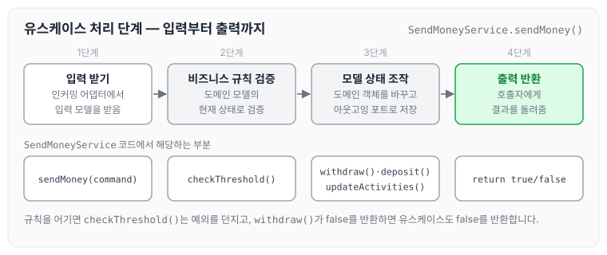
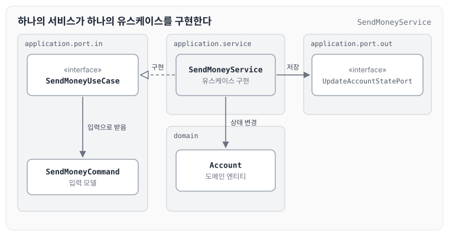
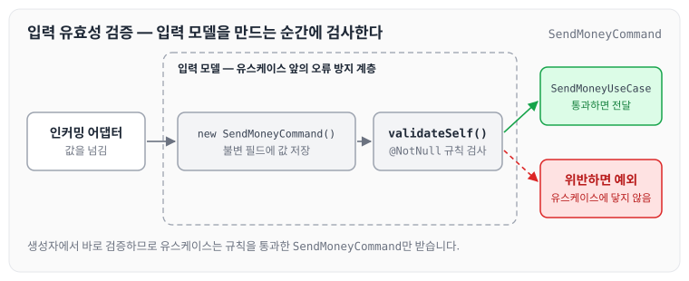
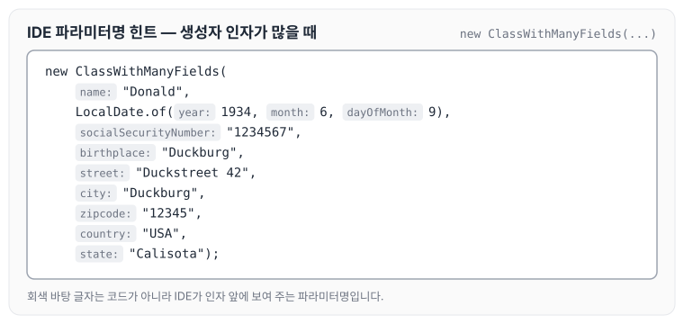
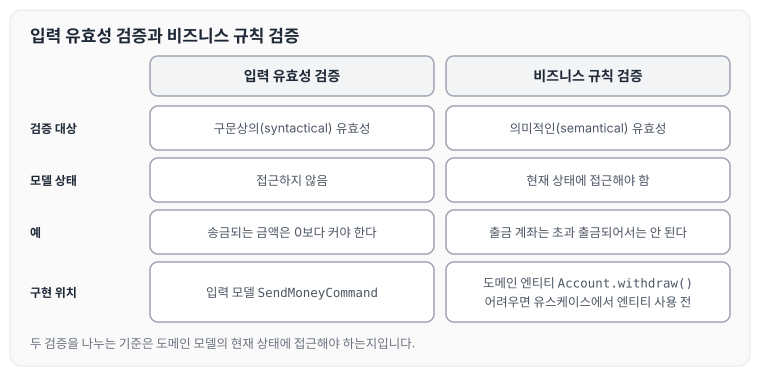
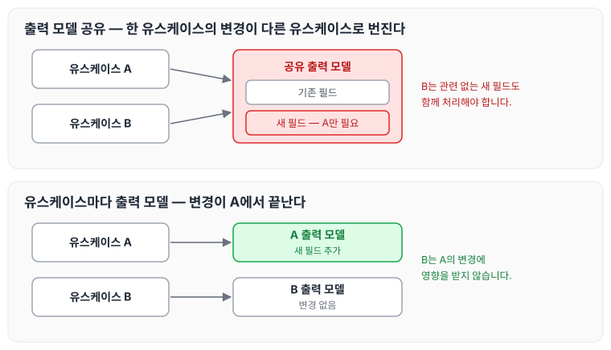

이전에 [코드 구성하기](../clean-arch-03-code-organization/)에 대해 작성하였습니다. 이번에는 만들면서 배우는 클린 아키텍처 4장을 읽고, 송금하기 예제로 도메인 모델과 유스케이스를 구현하는 방법, 입력 유효성 검증과 비즈니스 규칙 검증의 구분, 유스케이스마다 입출력 모델을 분리하는 이유에 대해 정리하도록 하겠습니다.

## 도메인 모델 구현하기

먼저 송금의 중심이 되는 `Account` 엔티티는 아래와 같습니다.

```java
package io.reflectoring.buckpal.account.domain;

import java.time.LocalDateTime;
import java.util.Optional;

import lombok.AccessLevel;
import lombok.AllArgsConstructor;
import lombok.Getter;
import lombok.Value;

@AllArgsConstructor(access = AccessLevel.PRIVATE)
public class Account {


	@Getter private final AccountId id;

	@Getter private final Money baselineBalance;

	@Getter private final ActivityWindow activityWindow;

	public static Account withoutId(
					Money baselineBalance,
					ActivityWindow activityWindow) {
		return new Account(null, baselineBalance, activityWindow);
	}

	public static Account withId(
					AccountId accountId,
					Money baselineBalance,
					ActivityWindow activityWindow) {
		return new Account(accountId, baselineBalance, activityWindow);
	}

	public Optional<AccountId> getId(){
		return Optional.ofNullable(this.id);
	}

	public Money calculateBalance() {
		return Money.add(
				this.baselineBalance,
				this.activityWindow.calculateBalance(this.id));
	}

	public boolean withdraw(Money money, AccountId targetAccountId) {

		if (!mayWithdraw(money)) {
			return false;
		}

		Activity withdrawal = new Activity(
				this.id,
				this.id,
				targetAccountId,
				LocalDateTime.now(),
				money);
		this.activityWindow.addActivity(withdrawal);
		return true;
	}

	private boolean mayWithdraw(Money money) {
		return Money.add(
				this.calculateBalance(),
				money.negate())
				.isPositiveOrZero();
	}

	public boolean deposit(Money money, AccountId sourceAccountId) {
		Activity deposit = new Activity(
				this.id,
				sourceAccountId,
				this.id,
				LocalDateTime.now(),
				money);
		this.activityWindow.addActivity(deposit);
		return true;
	}

	@Value
	public static class AccountId {
		private Long value;
	}

}
```

`Account` 엔티티는 실제 계좌의 현재 스냅숏을 제공합니다. 계좌에 대한 모든 입금과 출금은 `Activity` 엔티티로 기록됩니다. 다만 한 계좌의 모든 활동을 항상 메모리에 올리는 것은 좋은 방법이 아니기 때문에, `Account` 엔티티는 `ActivityWindow` 값 객체에 지난 며칠 혹은 몇 주간의 활동만 보관합니다.

계좌의 잔고를 계산하기 위해 `Account` 엔티티는 활동창(`ActivityWindow`)의 첫 번째 활동 바로 전의 잔고를 나타내는 `baselineBalance` 속성을 가지고 있습니다. 따라서 총 잔고는 기준 잔고에 활동창의 모든 활동 잔고를 더한 값이 됩니다.

이 모델 덕분에 입금과 출금은 `withdraw()`와 `deposit()` 메서드에서 새로운 활동을 활동창에 추가하는 것에 불과합니다.

이제 입금과 출금을 할 수 있는 `Account` 엔티티가 있으므로, 이를 중심으로 유스케이스를 구현하기 위해 바깥 방향으로 나아가 보겠습니다.

## 유스케이스 둘러보기

일반적으로 유스케이스는 다음과 같은 단계를 따릅니다.

1. 입력을 받습니다.
2. 비즈니스 규칙을 검증합니다.
3. 모델 상태를 조작합니다.
4. 출력을 반환합니다.

유스케이스는 인커밍 어댑터로부터 입력을 받고, 비즈니스 규칙(business rule)을 검증할 책임이 있습니다. 비즈니스 규칙을 충족하면 유스케이스는 입력을 기반으로 어떤 방법으로든 모델의 상태를 변경합니다. 일반적으로 도메인 객체의 상태를 바꾸고, 영속성 어댑터가 구현한 포트로 이 상태를 전달해서 저장될 수 있게 합니다.

네 단계를 송금하기 유스케이스에 맞춰 보면 아래와 같습니다.



그림 아래 줄에는 각 단계가 뒤에 나오는 `SendMoneyService` 코드의 어느 부분에 해당하는지 적어 두었습니다.

이제 송금하기 유스케이스를 구현하는 방법을 보겠습니다. 넓은 서비스 문제를 피하기 위해 모든 유스케이스를 한 서비스 클래스에 넣지 않고, **유스케이스별로 분리된 서비스**로 만들겠습니다.

```java
package io.reflectoring.buckpal.account.application.service;

import io.reflectoring.buckpal.account.application.port.in.SendMoneyCommand;
import io.reflectoring.buckpal.account.application.port.in.SendMoneyUseCase;
import io.reflectoring.buckpal.account.application.port.out.AccountLock;
import io.reflectoring.buckpal.account.application.port.out.LoadAccountPort;
import io.reflectoring.buckpal.account.application.port.out.UpdateAccountStatePort;
import io.reflectoring.buckpal.common.UseCase;
import io.reflectoring.buckpal.account.domain.Account;
import io.reflectoring.buckpal.account.domain.Account.AccountId;
import lombok.RequiredArgsConstructor;

import javax.transaction.Transactional;
import java.time.LocalDateTime;

@RequiredArgsConstructor
@UseCase
@Transactional
public class SendMoneyService implements SendMoneyUseCase {

	private final LoadAccountPort loadAccountPort;
	private final AccountLock accountLock;
	private final UpdateAccountStatePort updateAccountStatePort;
	private final MoneyTransferProperties moneyTransferProperties;

	@Override
	public boolean sendMoney(SendMoneyCommand command) {

		checkThreshold(command);

		LocalDateTime baselineDate = LocalDateTime.now().minusDays(10);

		Account sourceAccount = loadAccountPort.loadAccount(
				command.getSourceAccountId(),
				baselineDate);

		Account targetAccount = loadAccountPort.loadAccount(
				command.getTargetAccountId(),
				baselineDate);

		AccountId sourceAccountId = sourceAccount.getId()
				.orElseThrow(() -> new IllegalStateException("expected source account ID not to be empty"));
		AccountId targetAccountId = targetAccount.getId()
				.orElseThrow(() -> new IllegalStateException("expected target account ID not to be empty"));

		accountLock.lockAccount(sourceAccountId);
		if (!sourceAccount.withdraw(command.getMoney(), targetAccountId)) {
			accountLock.releaseAccount(sourceAccountId);
			return false;
		}

		accountLock.lockAccount(targetAccountId);
		if (!targetAccount.deposit(command.getMoney(), sourceAccountId)) {
			accountLock.releaseAccount(sourceAccountId);
			accountLock.releaseAccount(targetAccountId);
			return false;
		}

		updateAccountStatePort.updateActivities(sourceAccount);
		updateAccountStatePort.updateActivities(targetAccount);

		accountLock.releaseAccount(sourceAccountId);
		accountLock.releaseAccount(targetAccountId);
		return true;
	}

	private void checkThreshold(SendMoneyCommand command) {
		if(command.getMoney().isGreaterThan(moneyTransferProperties.getMaximumTransferThreshold())){
			throw new ThresholdExceededException(moneyTransferProperties.getMaximumTransferThreshold(), command.getMoney());
		}
	}

}
```

1. 서비스는 인커밍 포트 인터페이스인 `SendMoneyUseCase`를 구현합니다.
2. 계좌를 불러오기 위해 아웃고잉 포트 인터페이스 `LoadAccountPort`를 호출합니다.
3. 데이터베이스의 계좌 상태를 변경하기 위해 `UpdateAccountStatePort`를 호출합니다.

서비스와 포트, 도메인 엔티티의 관계를 그리면 아래와 같습니다.



하나의 서비스가 하나의 유스케이스를 구현하고, 도메인 모델을 변경하고, 변경된 상태를 저장하기 위해 아웃고잉 포트를 호출합니다.

## 입력 유효성 검증

입력 유효성 검증을 호출하는 어댑터에서 하고 유스케이스에 넘기는 방법도 생각할 수 있습니다. 하지만 유스케이스에서 필요로 하는 것을 호출자가 모두 검증했다고 믿기는 어렵습니다.

애플리케이션 계층에서 입력 유효성을 검증하는 이유는, 그렇게 하지 않으면 코어의 바깥쪽에서 유효하지 않은 입력값을 받게 되고 이 값이 모델의 상태를 해칠 수 있기 때문입니다.

이 문제는 입력 모델(input model)이 다루도록 하겠습니다. 송금하기 유스케이스에서 입력 모델은 `SendMoneyCommand` 클래스이고, 필드에 `final`을 지정해 불변 필드로 만들었습니다.

`SendMoneyCommand`는 유스케이스 API의 일부이기 때문에 인커밍 포트 패키지에 위치합니다. 자바에서는 Bean Validation API가 이러한 작업을 위한 사실상의 표준 라이브러리이며, 필요한 유효성 규칙을 필드의 애너테이션으로 표현할 수 있습니다.

```java
package io.reflectoring.buckpal.account.application.port.in;

import io.reflectoring.buckpal.account.domain.Account.AccountId;
import io.reflectoring.buckpal.account.domain.Money;
import io.reflectoring.buckpal.common.SelfValidating;
import lombok.EqualsAndHashCode;
import lombok.Value;

import javax.validation.constraints.NotNull;

@Value
@EqualsAndHashCode(callSuper = false)
public
class SendMoneyCommand extends SelfValidating<SendMoneyCommand> {

    @NotNull
    private final AccountId sourceAccountId;

    @NotNull
    private final AccountId targetAccountId;

    @NotNull
    private final Money money;

    public SendMoneyCommand(
            AccountId sourceAccountId,
            AccountId targetAccountId,
            Money money) {
        this.sourceAccountId = sourceAccountId;
        this.targetAccountId = targetAccountId;
        this.money = money;
        this.validateSelf();
    }
}
```

생성자 마지막에서 `validateSelf()`를 호출해 필드에 붙은 유효성 규칙을 검사합니다. 입력 모델이 만들어지는 시점에 검증이 일어나는 흐름은 아래와 같습니다.



이처럼 입력 모델에 있는 유효성 검증 코드로 유스케이스 구현체 주위에 사실상 오류 방지 계층을 만들 수 있습니다.

## 생성자의 힘

예제 코드의 생성자에는 파라미터가 3개뿐입니다. 파라미터가 더 많아지면 빌더(Builder) 패턴을 떠올릴 수 있습니다. 긴 파라미터 리스트를 받는 생성자를 private으로 만들고, 빌더의 `build()` 메서드 내부에 생성자 호출을 숨기는 방식입니다. 하지만 이 방식은 **유효하지 않은 상태의 불변 객체를 만들려는 시도에 대해 경고해 주지 못합니다.**

생성자를 직접 사용했다면 새로운 필드를 추가하거나 필드를 삭제할 때마다 컴파일 에러를 따라 나머지 코드에 변경 사항을 반영할 수 있습니다.

파라미터가 많아도 IDE가 파라미터명 힌트를 보여 주기 때문에 헷갈리지 않게 작성할 수 있습니다.



## 비즈니스 규칙 검증하기

비즈니스 규칙은 애플리케이션의 핵심이기 때문에 적절하게 잘 다뤄야 합니다. 그렇다면 입력 유효성 검증과 비즈니스 규칙 검증은 어떻게 구분할 수 있을지 정리해 보겠습니다.

둘 사이의 실용적인 구분점은 **비즈니스 규칙 검증은 도메인 모델의 현재 상태에 접근해야 하는 반면, 입력 유효성 검증은 그럴 필요가 없다**는 것입니다.

- 입력 유효성 검증: 구문상의(syntactical) 유효성을 검증합니다.
- 비즈니스 규칙 검증: 유스케이스의 맥락 속에서 의미적인(semantical) 유효성을 검증합니다.

예를 들면 아래와 같습니다.

- "출금 계좌는 초과 출금되어서는 안 된다." 정의에 따르면 이 규칙은 출금 계좌와 입금 계좌가 존재하는지 확인하기 위해 모델의 현재 상태에 접근해야 합니다. → 비즈니스 규칙
- "송금되는 금액은 0보다 커야 한다." 모델에 접근하지 않습니다. → 입력 유효성 검증

두 검증을 나란히 놓으면 아래와 같습니다.



비즈니스 규칙 검증을 구현하는 가장 좋은 방법은 앞의 "출금 계좌는 초과 출금되어서는 안 된다." 규칙처럼 **비즈니스 규칙을 도메인 엔티티 안에 넣는 것**입니다.

```java
package io.reflectoring.buckpal.account.domain;

import java.time.LocalDateTime;
import java.util.Optional;

import lombok.AccessLevel;
import lombok.AllArgsConstructor;
import lombok.Getter;
import lombok.Value;

@AllArgsConstructor(access = AccessLevel.PRIVATE)
public class Account {

	// ..

	public boolean withdraw(Money money, AccountId targetAccountId) {

		if (!mayWithdraw(money)) {
			return false;
		}

		Activity withdrawal = new Activity(
				this.id,
				this.id,
				targetAccountId,
				LocalDateTime.now(),
				money);
		this.activityWindow.addActivity(withdrawal);
		return true;
	}

	private boolean mayWithdraw(Money money) {
		return Money.add(
				this.calculateBalance(),
				money.negate())
				.isPositiveOrZero();
	}

	// ..

}
```

만약 도메인 엔티티에서 비즈니스 규칙을 검증하기가 여의치 않다면, 유스케이스 코드에서 도메인 엔티티를 사용하기 전에 검증해도 됩니다.

```java
package io.reflectoring.buckpal.account.application.service;

import io.reflectoring.buckpal.account.application.port.in.SendMoneyCommand;
import io.reflectoring.buckpal.account.application.port.in.SendMoneyUseCase;
import io.reflectoring.buckpal.account.application.port.out.AccountLock;
import io.reflectoring.buckpal.account.application.port.out.LoadAccountPort;
import io.reflectoring.buckpal.account.application.port.out.UpdateAccountStatePort;
import io.reflectoring.buckpal.common.UseCase;
import io.reflectoring.buckpal.account.domain.Account;
import io.reflectoring.buckpal.account.domain.Account.AccountId;
import lombok.RequiredArgsConstructor;

import javax.transaction.Transactional;
import java.time.LocalDateTime;

@RequiredArgsConstructor
@Transactional
public class SendMoneyService implements SendMoneyUseCase {

	//..

	@Override
	public boolean sendMoney(SendMoneyCommand command) {
		requireAccountExists(command.getSourceAccountId());
		requireAccountExists(command.getTargetAccountId());
	}

}
```

유효성을 검증하는 코드를 호출하고, 검증이 실패하면 유효성 검증 전용 예외를 던집니다.

다만 도메인 모델을 로드해야 한다면 앞의 "출금 계좌는 초과 출금되어서는 안 된다." 규칙처럼 도메인 엔티티 내에 비즈니스 규칙을 구현해야 합니다.

## 유스케이스마다 다른 출력 모델

입력과 비슷하게 출력도 가능하면 각 유스케이스에 맞게 구체적일수록 좋습니다. 출력은 **호출자에게 꼭 필요한 데이터만** 들고 있어야 합니다. 유스케이스를 가능한 한 구체적으로 유지하려면 무엇을 반환할지 계속 질문해야 하고, 확실하지 않다면 가능한 한 적게 반환하는 편이 좋습니다.

유스케이스들 간에 같은 출력 모델을 공유하게 되면 유스케이스들도 강하게 결합됩니다. 한 유스케이스에서 출력 모델에 새로운 필드가 필요해지면, 이 값과 관련이 없는 다른 유스케이스에서도 이 필드를 처리해야 합니다. 출력 모델을 공유할 때와 나눌 때를 비교하면 아래와 같습니다.



그래서 단일 책임 원칙을 적용하고 모델을 분리해서 유지하는 것이 유스케이스의 결합을 제거하는 데 도움이 됩니다.

## 읽기 전용 유스케이스

UI에서 계좌의 잔액을 표시해야 하는 경우를 예로 들어 보겠습니다. 이를 위해 새로운 유스케이스를 구현해야 하는지 생각해 볼 수 있습니다.

프로젝트 맥락에서 유스케이스로 간주되지 않는다면, 실제 유스케이스와 구분하기 위해 쿼리로 구현할 수 있습니다. 이 책의 아키텍처 스타일에서 이를 구현하는 한 가지 방법은 쿼리를 위한 인커밍 전용 포트를 만들고, 이를 쿼리 서비스에 구현하는 것입니다.

```java
package io.reflectoring.buckpal.account.application.service;

import java.time.LocalDateTime;

import io.reflectoring.buckpal.account.application.port.in.GetAccountBalanceQuery;
import io.reflectoring.buckpal.account.application.port.out.LoadAccountPort;
import io.reflectoring.buckpal.account.domain.Account.AccountId;
import io.reflectoring.buckpal.account.domain.Money;
import lombok.RequiredArgsConstructor;

@RequiredArgsConstructor
class GetAccountBalanceService implements GetAccountBalanceQuery {

	private final LoadAccountPort loadAccountPort;

	@Override
	public Money getAccountBalance(AccountId accountId) {
		return loadAccountPort.loadAccount(accountId, LocalDateTime.now())
				.calculateBalance();
	}
}
```

서비스는 아웃고잉 포트로 쿼리를 전달하는 것 외에 다른 일을 하지 않습니다. 여러 계층에 걸쳐 같은 모델을 사용한다면 지름길을 써서 클라이언트가 아웃고잉 포트를 직접 호출하게 할 수도 있으며, 이 부분은 책의 11장에서 자세하게 다룹니다.

## 유지보수 가능한 소프트웨어를 만드는 데 어떻게 도움이 될까

이 책의 아키텍처에서는 도메인 로직을 원하는 대로 구현할 수 있도록 허용하지만, 입출력 모델을 독립적으로 모델링하면 원치 않는 부수 효과를 피할 수 있습니다. 물론 유스케이스 간에 모델을 공유하는 것보다는 더 많은 작업이 필요합니다. 유스케이스별로 별도의 모델을 만들어야 하고, 이 모델과 엔티티를 매핑해야 합니다.

그러나 유스케이스별로 모델을 만들면 유스케이스를 명확하게 이해할 수 있고, 장기적으로 유지보수하기도 더 쉽습니다. 꼼꼼한 입력 유효성 검증과 유스케이스별 입출력 모델은 지속 가능한 코드를 만드는 데 큰 도움이 됩니다.

## 마무리

오늘은 송금하기 예제로 도메인 모델과 유스케이스를 구현하는 방법, 입력 유효성 검증과 비즈니스 규칙 검증의 구분, 유스케이스마다 입출력 모델을 분리하는 이유에 대해 정리하였습니다. 특히 유스케이스마다 별도의 모델을 만들고 매핑해야 한다는 부분이 기억에 남았습니다. 클래스는 더 많이 만들어야 하지만, 유스케이스 하나를 명확하게 이해하기 좋고 다른 사람이 보기에도 편할 것 같습니다. 책을 다 읽고 나면 이런 형식으로 코드를 직접 작성해 보려고 합니다. 다음 글에서는 [웹 어댑터 구현하기](../clean-arch-05-web-adapter/)에 대해 정리하도록 하겠습니다.

참조 : [만들면서 배우는 클린 아키텍처 - YES24](http://www.yes24.com/Product/Goods/105138479)
