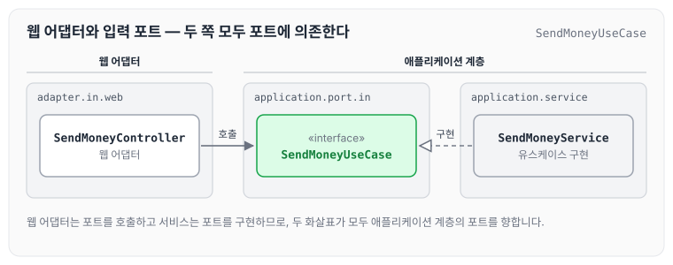
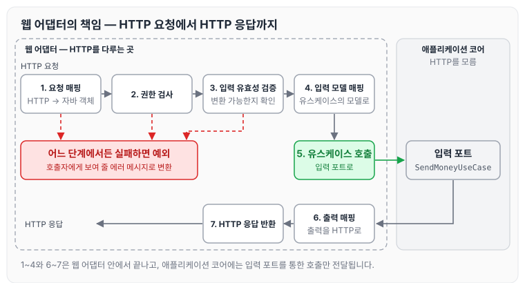
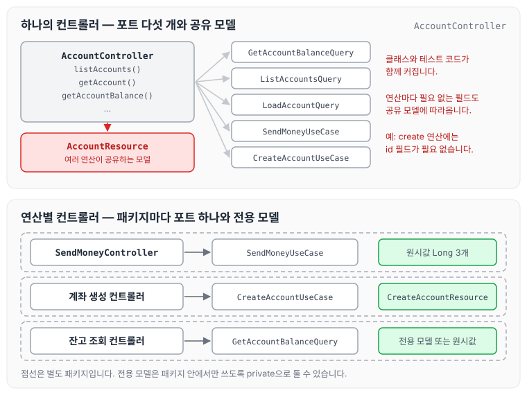
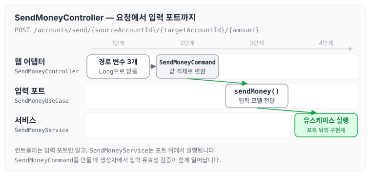

이전에 [유스케이스 구현하기](../clean-arch-04-usecase/)에 대해 작성하였습니다. 이번에는 만들면서 배우는 클린 아키텍처 5장을 읽고, 웹 어댑터가 입력 포트를 통해 애플리케이션 코어와 통신하는 구조와 웹 어댑터의 책임, 컨트롤러를 연산별로 나누는 방법에 대해 정리하도록 하겠습니다.

## 의존성 역전

애플리케이션 계층은 웹 어댑터가 통신할 수 있는 특정 포트를 제공합니다. 서비스는 이 포트를 구현하고, 웹 어댑터는 이 포트를 호출합니다. 송금하기 예제로 보면 아래와 같습니다.



자세히 살펴보면 **의존성 역전 원칙**이 적용된 것을 확인할 수 있습니다. 웹 어댑터와 서비스가 모두 애플리케이션 계층에 있는 포트를 바라봅니다.

어댑터와 유스케이스 사이에 또 다른 간접 계층을 넣는 이유는, 포트가 애플리케이션 코어가 외부 세계와 통신할 수 있는 곳에 대한 명세이기 때문입니다. 포트를 적절한 곳에 위치시키면 외부와 어떤 통신이 일어나고 있는지 정확히 알 수 있고, 이는 레거시 코드를 다루는 유지보수 엔지니어에게 무척 소중한 정보입니다.

## 웹 어댑터의 책임

웹 어댑터는 일반적으로 다음과 같은 일을 합니다.

1. HTTP 요청을 자바 객체로 매핑
2. 권한 검사
3. 입력 유효성 검증
4. 입력을 유스케이스의 입력 모델로 매핑
5. 유스케이스 호출
6. 유스케이스의 출력을 HTTP로 매핑
7. HTTP 응답을 반환

일곱 단계를 요청이 들어와서 응답이 나갈 때까지의 흐름으로 그리면 아래와 같습니다.



우선 웹 어댑터는 URL, 경로, HTTP 메서드, 콘텐츠 타입처럼 특정 기준을 만족하는 HTTP 요청을 수신해야 합니다. 그리고 HTTP 요청의 파라미터와 콘텐츠를 객체로 역직렬화해야 합니다.

다음으로 웹 어댑터의 입력 모델을 유스케이스의 입력 모델로 변환할 수 있는지 검증해야 합니다. 이 변환을 방해하는 모든 것이 유효성 검증 에러입니다. 검증을 통과하면 변환된 입력 모델로 특정 유스케이스를 호출하는 다음 책임으로 이어집니다.

이 과정에서 한 군데서라도 문제가 생기면 예외를 던지고, 웹 어댑터는 이 에러를 호출자에게 보여 줄 메시지로 변환해야 합니다.

이때 **HTTP와 관련된 것은 애플리케이션 계층으로 침투해서는 안 됩니다.** 바깥 계층에서 HTTP를 다루고 있다는 것을 애플리케이션 코어가 알게 되면, HTTP를 사용하지 않는 다른 인커밍 어댑터의 요청에 대해 같은 도메인 로직을 수행할 수 있는 선택지를 잃게 됩니다.

특정 인커밍 어댑터를 생각하지 않고 유스케이스를 먼저 구현하면, 이런 경계를 흐리게 만들 유혹에 빠지지 않을 수 있습니다.

## 컨트롤러 나누기

계좌와 관련된 연산을 하나의 컨트롤러에 모으면 아래와 같습니다.

```java
@RestController
@RequiredArgsConstructor
class AccountController {
	private final GetAccountBalanceQuery getAccountBalanceQuery;
	private final ListAccountsQuery listAccountsQuery;
	private final LoadAccountQuery loadAccountQuery;

	private final SendMoneyUseCase sendMoneyUseCase;
	private final CreateAccountUseCase createAccountUseCase;

	@GetMapping("/accounts")
	List<AccountResource> listAccounts() {
		...
	}

	@GetMapping("/accounts/{accountId}")
	AccountResource getAccount(@PathVariable("accountId") Long accountId) {
		...
	}

	@GetMapping("/accounts/{accountId}/balance")
	long getAccountBalance(@PathVariable("accountId") Long accountId) {
		...
	}
	...
}
```

계좌 리소스와 관련된 모든 것이 하나의 클래스에 모여 있어 괜찮아 보이지만, 이 방식에는 아래와 같은 단점이 있습니다.

1. 클래스는 시간이 지나면서 커지기 쉽습니다. 가장 큰 클래스가 30,000줄까지 될 수도 있지만, 그 정도가 아니어도 컨트롤러가 200줄만 되면 50줄짜리 컨트롤러를 파악하는 것보다 어렵습니다.
2. 컨트롤러에 코드가 많으면 그에 해당하는 테스트 코드도 많아지고, 특정 프로덕션 코드에 해당하는 테스트 코드를 찾기 어렵습니다.
3. 모든 연산을 하나의 컨트롤러에 넣으면 데이터 구조의 재활용을 촉진합니다. 앞의 예제 코드에서는 많은 연산이 `AccountResource` 모델 클래스를 공유합니다. `AccountResource`에는 아마 id 필드가 있을 텐데, id는 create 연산에서는 필요 없기 때문에 도움이 되기보다는 헷갈릴 수 있습니다.

그래서 책에서는 각 연산에 대해 가급적 별도의 패키지 안에 별도의 컨트롤러를 만드는 방식을 선호합니다. 두 방식을 비교하면 아래와 같습니다.



송금하기 연산만 맡는 컨트롤러는 아래와 같습니다.

```java
package io.reflectoring.buckpal.account.adapter.in.web;

import io.reflectoring.buckpal.account.application.port.in.SendMoneyUseCase;
import io.reflectoring.buckpal.account.application.port.in.SendMoneyCommand;
import io.reflectoring.buckpal.common.WebAdapter;
import io.reflectoring.buckpal.account.domain.Account.AccountId;
import io.reflectoring.buckpal.account.domain.Money;
import lombok.RequiredArgsConstructor;
import org.springframework.web.bind.annotation.PathVariable;
import org.springframework.web.bind.annotation.PostMapping;
import org.springframework.web.bind.annotation.RestController;

@WebAdapter
@RestController
@RequiredArgsConstructor
class SendMoneyController {

	private final SendMoneyUseCase sendMoneyUseCase;

	@PostMapping(path = "/accounts/send/{sourceAccountId}/{targetAccountId}/{amount}")
	void sendMoney(
			@PathVariable("sourceAccountId") Long sourceAccountId,
			@PathVariable("targetAccountId") Long targetAccountId,
			@PathVariable("amount") Long amount) {

		SendMoneyCommand command = new SendMoneyCommand(
				new AccountId(sourceAccountId),
				new AccountId(targetAccountId),
				Money.of(amount));

		sendMoneyUseCase.sendMoney(command);
	}

}
```

이 컨트롤러가 요청을 받아 입력 포트를 호출하기까지의 흐름은 아래와 같습니다.



컨트롤러는 HTTP 요청의 값을 유스케이스의 입력 모델인 `SendMoneyCommand`로 바꾸고, 입력 포트만 호출합니다. 서비스 구현체는 컨트롤러가 직접 알지 못합니다.

각 컨트롤러는 `CreateAccountResource`나 `UpdateAccountResource`처럼 컨트롤러 자체의 모델을 가지고 있거나, 앞의 예제 코드처럼 원시값을 받아도 됩니다. 이러한 전용 모델 클래스들은 컨트롤러의 패키지에 대해 private으로 선언할 수 있기 때문에 실수로 다른 곳에서 재사용될 일이 없습니다.

또한 컨트롤러명과 서비스명도 잘 생각해 봐야 합니다. 예를 들어 `CreateAccount`보다는 `RegisterAccount`가 더 나은 이름일 수 있습니다.

이렇게 나누는 방식의 또 다른 장점은 서로 다른 연산에 대해 동시 작업이 쉬워진다는 것입니다. 두 명의 개발자가 서로 다른 연산에 대한 코드를 작성하고 있다면 병합 충돌이 일어나지 않습니다.

## 유지보수 가능한 소프트웨어를 만드는 데 어떻게 도움이 될까

웹 컨트롤러를 나눌 때는 모델을 공유하지 않는 여러 작은 클래스를 만드는 것을 두려워해서는 안 됩니다. 작은 클래스들은 더 파악하기 쉽고, 더 테스트하기 쉬우며, 동시 작업을 지원합니다.

## 마무리

오늘은 웹 어댑터와 입력 포트의 관계, 웹 어댑터의 책임, 그리고 컨트롤러를 연산별로 나누는 방법에 대해 정리하였습니다. 어댑터와 서비스 사이에 포트 계층을 두면 유지보수하는 사람이 외부와 어떤 데이터를 주고받는지 한눈에 볼 수 있고, 적절한 유효성 검증으로 잘못된 입력이 애플리케이션 코어에 들어오는 것을 막는 것도 중요하다는 것을 알 수 있었습니다. 또한 컨트롤러를 작은 클래스로 나누는 것이 테스트 코드와 유지보수 측면에서 장점이 크다는 것도 알 수 있었습니다. 책을 다 읽고 빨리 코드를 작성해 보고 싶습니다. 다음 글에서는 [영속성 어댑터 구현하기](../clean-arch-06-persistence-adapter/)에 대해 정리하도록 하겠습니다.

참조 : [만들면서 배우는 클린 아키텍처 - YES24](http://www.yes24.com/Product/Goods/105138479)
