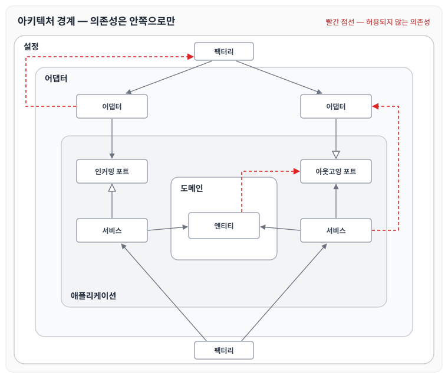
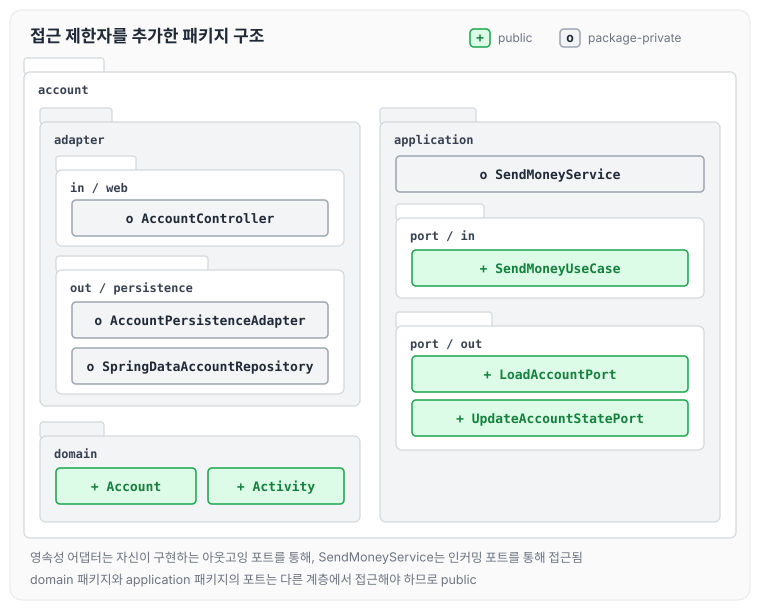

이전에 [경계 간 매핑하기](../clean-arch-08-boundary-mapping/)에 대해 작성하였습니다. 이번에는 만들면서 배우는 클린 아키텍처의 10장 내용을 읽고, 계층 사이의 경계가 무엇인지와 접근 제한자, 빌드 아티팩트로 그 경계를 강제하는 방법에 대해 정리하도록 하겠습니다.

## 경계와 의존성

아키텍처 경계를 강제한다는 것은 의존성이 올바른 방향을 향하도록 강제하는 것을 의미합니다. 계층과 의존성의 방향을 그림으로 나타내면 아래와 같습니다. 빨간 점선은 아키텍처에서 허용되지 않는 의존성입니다.

각 계층이 하는 일은 아래와 같습니다.

- 도메인 엔티티
    - 가장 안쪽에 있는 엔티티
- 애플리케이션
    - 애플리케이션 서비스 안에서 유스케이스를 구현하기 위해 도메인 엔티티에 접근
- 어댑터
    - 인커밍 포트를 통해 서비스에 접근하며, 반대로 서비스는 아웃고잉 포트를 통해 어댑터에 접근
- 설정
    - 어댑터와 서비스 객체를 생성할 팩터리를 포함하고 있고, 의존성 주입 메커니즘을 제공

각 계층 사이, 즉 안쪽 인접 계층과 바깥쪽 인접 계층 사이에는 경계가 있습니다. 의존성 규칙에 따르면 계층 경계를 넘는 의존성은 항상 안쪽 방향으로 향해야 합니다. 그림에서 어댑터가 팩터리를, 엔티티가 아웃고잉 포트를, 서비스가 어댑터를 가리키는 의존성은 모두 바깥쪽을 향하기 때문에 허용되지 않습니다.

## 접근 제한자

경계를 강제하기 위해 자바에서 제공하는 가장 기본적인 도구인 접근 제한자부터 정리하겠습니다.

- package-private(혹은 'default')
    - 자바 패키지를 통해 클래스들을 응집적인 '모듈'로 만들어 주기 때문에, 이러한 모듈 내에 있는 클래스들은 서로 접근할 수 있지만 패키지 바깥에서는 접근할 수 없습니다. 모듈의 진입점으로 활용될 클래스들만 골라서 public으로 만들면 됩니다. 이렇게 하면 의존성이 잘못된 방향을 가리켜서 의존성 규칙을 위반할 위험이 줄어듭니다.

접근 제한자를 염두에 두고 [코드 구성하기](../clean-arch-03-code-organization/)에서 본 패키지 구조를 다시 보면 아래와 같습니다. public은 '+', package-private은 'o'로 표시합니다.

- persistence 패키지에 있는 클래스들은 외부에서 접근할 필요가 없기 때문에 package-private('o')로 표시합니다.
    - 영속성 어댑터는 자신이 구현하는 아웃고잉 포트를 통해 접근됩니다.
    - 같은 이유로 SendMoneyService도 package-private으로 만듭니다.
    - 이 방법을 사용하려면 클래스패스 스캐닝을 이용해야만 합니다.
- 나머지 클래스는 public('+')으로 둡니다.
    - domain 패키지는 다른 계층에서 접근할 수 있어야 합니다.
    - application 패키지의 포트는 web 어댑터와 persistence 어댑터에서 접근할 수 있어야 합니다.

## 빌드 아티팩트

빌드 아티팩트로 경계를 나누는 방식은 아래 두 가지 순서로 설명되어 있습니다.

1. 기본적인 3개의 모듈 빌드 방식
2. 애플리케이션 모듈로 나누기

아래는 그중 1번, 설정·어댑터·애플리케이션 세 모듈로 나눈 기본 빌드입니다.

핵심은 모듈을 더 세분화할수록 모듈 간 의존성을 더 잘 제어할 수 있게 된다는 것입니다. 하지만 더 작게 분리할수록 모듈 간에 매핑을 더 많이 수행해야 하므로, [경계 간 매핑하기](../clean-arch-08-boundary-mapping/)에서 소개한 매핑 전략들 중 하나를 선택해야 합니다.

## 유지보수 가능한 소프트웨어를 만드는 데 어떻게 도움이 될까

기본적으로 소프트웨어 아키텍처는 아키텍처 요소 간의 의존성을 관리하는 게 전부입니다. 때문에 아키텍처를 잘 유지해 나가고 싶다면 의존성이 올바른 방향을 가리키고 있는지 확인해야 합니다.

## 마무리

오늘은 계층 사이의 경계와 의존성 규칙, 그리고 접근 제한자와 빌드 아티팩트로 아키텍처 경계를 강제하는 방법에 대해 정리하였습니다. 패키지 구조와 접근 제한자만으로도 잘못된 방향의 의존성을 상당 부분 막을 수 있고, 더 확실하게 막으려면 모듈을 나누되 그만큼 늘어나는 매핑 비용을 함께 고려해야 할 것 같습니다.

참조 : [만들면서 배우는 클린 아키텍처 - YES24](http://www.yes24.com/Product/Goods/105138479)
