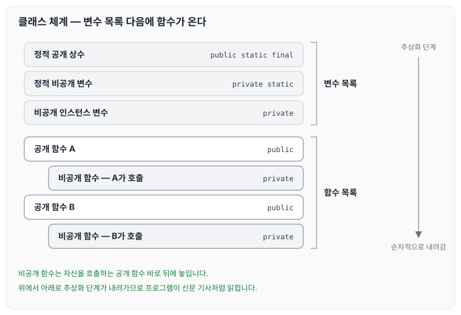
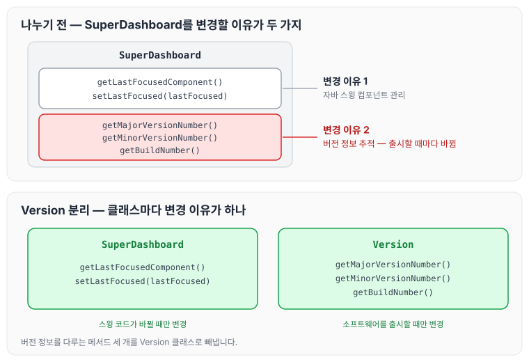
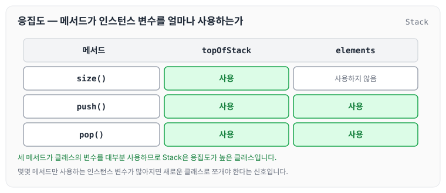
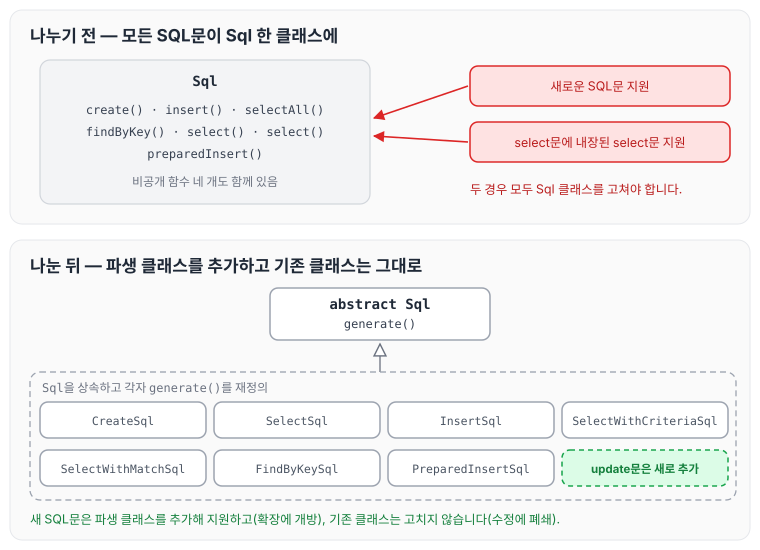
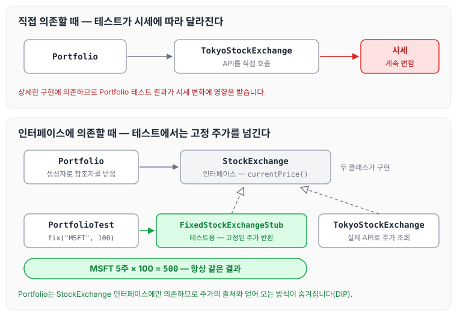

이전에 [8장 경계](../clean-code-ch8-boundaries/)에 대해 작성하였습니다. 이번 글에서는 클린 코드 10장 클래스를 읽고, 클래스 체계와 클래스를 작게 유지해야 하는 이유, 단일 책임 원칙, 응집도, 변경하기 쉬운 클래스와 변경으로부터 격리하는 방법에 대해 정리하도록 하겠습니다.

## 클래스 체계

클래스를 정의하는 표준 자바 관례는 아래와 같습니다. 먼저 변수 목록이 나오고, 그다음 함수가 나옵니다.

1. 정적(static) 공개(public) 상수가 있다면 맨 처음 나옵니다.
2. 다음으로 정적(static) 비공개(private) 변수가 나옵니다.
3. 이어서 비공개 인스턴스 변수가 나옵니다.
4. 변수 목록 다음에는 공개 함수가 나옵니다.
5. 비공개 함수는 자신을 호출하는 공개 함수 직후에 넣습니다.

이렇게 두면 추상화 단계가 순차적으로 내려가기 때문에 프로그램이 신문 기사처럼 읽힙니다. 순서를 그림으로 보면 아래와 같습니다.



비공개 함수가 함수 목록의 맨 끝으로 모이지 않고, 자신을 호출하는 공개 함수 바로 아래에 놓인다는 점을 확인할 수 있습니다.

여기서 정적 변수와 인스턴스 변수라는 말이 어떤 부분을 말하는지 잘 와닿지 않아 따로 정리해 보았습니다.

## 정적 변수와 인스턴스 변수

### 정적 변수

- 클래스 내에 static 키워드로 선언된 변수는 static 영역에 생성되며, 모든 객체가 공유할 수 있습니다.
- 처음 JVM이 실행되어 클래스가 메모리에 할당될 때부터 프로그램이 종료될 때까지 메모리가 할당된 채 존재합니다.
- 클래스가 여러 번 생성되어도 static 변수는 한 번만 생성되고, 생성된 변수의 값만 수정됩니다.

### 인스턴스 변수

- 클래스 내에 선언된 변수입니다.
- heap 영역에 생성되며, GC(Garbage Collector)의 관리를 받습니다.
- 정적 변수와 달리 객체 간에 공유되지 않습니다.

### 정리

- 정적 변수는 JVM이 실행되면 프로그램이 종료될 때까지 메모리를 할당받아 모든 영역에서 공유되는 변수
- 인스턴스 변수는 흔하게 사용하는 변수로, static이 붙지 않은 변수

## 클래스는 작아야 한다

클래스를 만들 때 첫 번째 규칙은 크기입니다. 클래스는 작아야 합니다. 두 번째 규칙도 크기입니다. 더 작아야 합니다. 클래스도 함수와 마찬가지로 '작게'가 기본 규칙이라는 의미입니다.

아래 예를 보겠습니다.

```java
public class SuperDashboard extends JFrame implements MetaDataUser {
    public String getCustomizerLanguagePath()
    public void setSystemConfigPath(String systemConfigPath)
    public String getSystemConfigDocument()
    public void setSystemConfigDocument(String systemConfigDocument)
    public boolean getGuruState()
    public boolean getNoviceState()
    public boolean getOpenSourceState()
    public void showObject(MetaObject object)
    public void showProgress(String s)
    public boolean isMetadataDirty()
    ...
    public void runProject()
    public void setAçowDragging(boolean allowDragging)
    public boolean allowDragging()
    public boolean isCustomizing()
    public void setTitle(String title)
    public IdeMenuBar getIdeMenuBar()
    public void showHelper(MetaObject metaObject, String propertyName)
}
```

대다수 개발자는 이 클래스가 엄청나게 크다는 사실에 동의할 것입니다. SuperDashboard 클래스를 '만능 클래스'라 부르는 개발자도 있을 수 있습니다.

아래는 SuperDashboard가 메서드 몇 개만 포함하는 경우입니다.

```java
public class SuperDashboard extends JFrame implements MetaDataUser {
    public Component getLastFocusedComponent()
    public void setLastFocused(Component lastFocused)
    public int getMajorVersionNumber()
    public int getMinorVersionNumber()
    public int getBuildNumber()
}
```

메서드 다섯 개 정도면 괜찮아 보이지만, 이 경우도 그렇지 않습니다. SuperDashboard는 메서드 수가 적음에도 불구하고 책임이 너무 많습니다.

책에서는 클래스의 책임에 대해 아래 두 가지를 이야기합니다.

1. 클래스 이름은 해당 클래스의 책임을 기술해야 합니다. 예를 들어 Processor, Manager, Super 등과 같이 모호한 단어가 있다면 클래스에 여러 책임을 떠안겼다는 증거입니다.
2. 클래스 설명은 만일("if"), 그리고("and"), ~하며("or"), 하지만("but")을 사용하지 않고 25단어 내외로 가능해야 합니다.

SuperDashboard를 설명하면 "SuperDashboard는 마지막으로 포커스를 얻었던 컴포넌트에 접근하는 방법을 제공하며, 버전과 빌드 번호를 추적하는 메커니즘을 제공한다."가 됩니다. 이 설명은 책임이 많다는 증거입니다.

## 단일 책임 원칙

단일 책임 원칙(Single Responsibility Principle, SRP)은 클래스나 모듈을 변경할 이유가 하나, 단 하나뿐이어야 한다는 원칙입니다.

SuperDashboard는 변경할 이유가 두 가지입니다.

- SuperDashboard는 소프트웨어 버전 정보를 추적합니다. 그런데 이 정보는 소프트웨어를 출시할 때마다 달라집니다.
- SuperDashboard는 자바 스윙 컴포넌트를 관리합니다. 즉, 스윙 코드를 변경할 때마다 버전 번호가 달라집니다.

이처럼 변경할 이유를 파악하려고 애쓰다 보면 코드를 추상화하기도 쉬워집니다. SuperDashboard에서 버전 정보를 다루는 메서드 세 개를 따로 빼내 아래와 같이 독자적인 클래스를 만듭니다.

```java
public class Version {
	public int getMajorVersionNumber()
	public int getMinorVersionNumber()
	public int getBuildNumber()
}
```

SuperDashboard를 변경할 이유별로 나누면 아래 그림과 같습니다.



버전 정보를 다루는 세 메서드는 소프트웨어를 출시할 때 바뀌고, 나머지 두 메서드는 스윙 코드가 바뀔 때 바뀝니다. 변경할 이유가 다른 메서드를 Version으로 옮기면 각 클래스의 변경 이유가 하나씩 남습니다.

'소프트웨어를 돌아가게 만드는 활동'과 '소프트웨어를 깨끗하게 만드는 활동'은 별개의 활동입니다. 문제는 우리들 대다수가 프로그램이 돌아가면 일이 끝났다고 여기는 데 있습니다.

- '깨끗하고 체계적인 소프트웨어'라는 다음 관심사로 전환하지 않습니다.
- 프로그램으로 되돌아가 만능 클래스를 단일 책임 클래스 여럿으로 분리하는 대신 다음 문제로 넘어갑니다.

많은 개발자는 자잘한 단일 책임 클래스가 많아지면 큰 그림을 이해하기 어려워진다고 우려합니다. 하지만 작은 클래스가 많은 시스템이든 큰 클래스가 몇 개뿐인 시스템이든 돌아가는 부품의 수는 비슷합니다.

> 도구 상자를 어떻게 관리하고 싶은가?
>
> 작은 서랍을 많이 두고 기능과 이름이 명확한 컴포넌트를 나눠 넣고 싶은가?
>
> 아니면 큰 서랍 몇 개를 두고 모두를 던져 놓고 싶은가?

큼직한 다목적 클래스 몇 개로 이뤄진 시스템은 당장 알 필요가 없는 사실까지 들이밀어 독자를 방해합니다. 책에서도 다시 한번 강조하듯이, 큰 클래스 몇 개가 아니라 작은 클래스 여럿으로 이뤄진 시스템이 더 바람직합니다.

## 응집도

일반적으로 메서드가 변수를 더 많이 사용할수록 메서드와 클래스는 응집도가 더 높습니다. 우리는 응집도가 높은 클래스를 선호합니다.

```java
public class Stack {
    private int topOfStack = 0;
    List<Integer> elements = new LinkedList<Integer>();

    public int size() {
        return topOfStack;
    }

    public void push(int element) {
        topOfStack++;
        elements.add(element);
    }

    public int pop() throws PoppedWhenEmpty {
        if (topOfStack == 0)
            throw new PoppedWhenEmpty();
        int element = elements.get(--topOfStack);
        elements.remove(topOfStack);
        return element;
    }
}
```

Stack의 메서드가 어떤 인스턴스 변수를 사용하는지 표시하면 아래와 같습니다.



`size()`는 `topOfStack`만 사용하고, `push()`와 `pop()`은 두 변수를 모두 사용합니다. 세 메서드가 클래스의 변수를 대부분 사용하므로 Stack은 응집도가 높은 클래스입니다.

'함수를 작게, 매개변수 목록을 짧게'라는 전략을 따르다 보면 때때로 몇몇 메서드만이 사용하는 인스턴스 변수가 아주 많아집니다. 이는 십중팔구 새로운 클래스로 쪼개야 한다는 신호입니다.

## 변경하기 쉬운 클래스

대다수 시스템은 지속적으로 변경됩니다. 깨끗한 시스템은 클래스를 체계적으로 정리해 변경에 수반하는 위험을 낮춥니다.

아래 예시를 보겠습니다.

```java
public class Sql {
    public Sql(String table, Column[] columns)
    public String create()
    public String insert(Object[] fields)
    public String selectAll()
    public String findByKey(String keyColumn, String keyValue)
    public String select(Column column, String pattern)
    public String select(Criteria criteria)
    public String preparedInsert()
    private String columnList(Column[] columns)
    private String valuesList(Object[] fields, final Column[] columns)
	private String selectWithCriteria(String criteria)
    private String placeholderList(Column[] columns)
}
```

이 클래스에는 아래와 같은 문제가 있습니다.

- 새로운 SQL문을 지원하려면 반드시 Sql 클래스에 손대야 합니다.
- select문에 내장된 select문을 지원하려면 Sql 클래스를 고쳐야 합니다.

이렇듯 변경할 이유가 두 가지이므로 Sql 클래스는 SRP를 위반합니다.

아래는 Sql 클래스를 나눈 예시입니다.

```java
abstract public class Sql {
	public Sql(String table, Column[] columns)
	abstract public String generate();
}
public class CreateSql extends Sql {
	public CreateSql(String table, Column[] columns)
	@Override public String generate()
}

public class SelectSql extends Sql {
	public SelectSql(String table, Column[] columns)
	@Override public String generate()
}

public class InsertSql extends Sql {
	public InsertSql(String table, Column[] columns, Object[] fields)
	@Override public String generate()
	private String valuesList(Object[] fields, final Column[] columns)
}

public class SelectWithCriteriaSql extends Sql {
	public SelectWithCriteriaSql(
	String table, Column[] columns, Criteria criteria)
	@Override public String generate()
}

public class SelectWithMatchSql extends Sql {
	public SelectWithMatchSql(String table, Column[] columns, Column column, String pattern)
	@Override public String generate()
}

public class FindByKeySql extends Sql {
	public FindByKeySql(
	String table, Column[] columns, String keyColumn, String keyValue)
	@Override public String generate()
}

public class PreparedInsertSql extends Sql {
	public PreparedInsertSql(String table, Column[] columns)
	@Override public String generate()
	private String placeholderList(Column[] columns)
}

public class Where {
	public Where(String criteria)
	public String generate()
}

public class ColumnList {
	public ColumnList(Column[] columns)
	public String generate()
}
```

각 클래스는 극도로 단순합니다.

- 함수 하나를 수정했다고 다른 함수가 망가질 위험이 없습니다.
- 테스트 관점에서 모든 논리를 구석구석 증명하기 쉽습니다.
- update문을 추가할 때 기존 클래스를 변경할 필요가 전혀 없습니다.
- SRP를 지원합니다.
- OCP(Open-Closed Principle)도 지원합니다. OCP는 클래스가 확장에 개방적이고 수정에 폐쇄적이어야 한다는 원칙입니다.
- 파생 클래스를 생성하는 방식으로 새 기능에 개방적인 동시에, 다른 클래스를 닫아 놓는 방식으로 수정에 폐쇄적입니다.

나누기 전과 후를 비교하면 아래 그림과 같습니다.



나누기 전에는 새 SQL문을 지원할 때마다 Sql 클래스를 고쳐야 하지만, 나눈 뒤에는 Sql을 상속한 파생 클래스를 하나 더 만들면 되고 기존 클래스는 그대로 둡니다.

## 변경으로부터 격리

요구사항은 변하기 마련입니다. 따라서 코드도 변하기 마련입니다.

- 상세한 구현에 의존하는 클라이언트 클래스는 구현이 바뀌면 위험에 빠집니다.
- 상세한 구현에 의존하는 코드는 테스트가 어렵습니다.

책의 예제는 TokyoStockExchange API를 사용해 포트폴리오 값을 계산합니다. 따라서 테스트 코드가 시세 변화에 영향을 받습니다.

- Portfolio 클래스에서 TokyoStockExchange API를 직접 호출하는 대신 StockExchange라는 인터페이스를 생성한 후 메서드 하나를 선언합니다.

```java
public interface StockExchange {
    Money currentPrice(String symbol);
}
```

- 다음으로 StockExchange 인터페이스를 구현하는 TokyoStockExchange 클래스를 구현합니다.
- Portfolio 생성자를 수정해 StockExchange 참조자를 인수로 받습니다.

여기서 빠진 부분이 있는 것 같아 부연 설명을 덧붙여 보았습니다. TokyoStockExchange는 StockExchange 인터페이스를 구현합니다.

```java
public class TokyoStockExchange implements StockExchange {

	@Override public Money currentPrice(String symbol) {
        ....구현
    }
}
```

그리고 TokyoStockExchange 클래스를 흉내 내는 테스트용 클래스를 만들 수 있습니다. 여기서도 FixedStockExchangeStub 클래스를 어떻게 구현하는지는 나와 있지 않았습니다.

```java
public class FixedStockExchangeStub implements StockExchange {

	@Override public Money currentPrice(String symbol) {
        ....구현
    }
}
```

FixedStockExchangeStub은 고정된 주가를 반환하기 때문에, 테스트 코드에서는 FixedStockExchangeStub 클래스를 사용하면 됩니다.

```java
public class PortfolioTest {
	private FixedStockExchangeStub exchange;
	private Portfolio portfolio;

	@Before
	protected void setUp() throws Exception {
		exchange = new FixedStockExchangeStub();
		exchange.fix("MSFT", 100);
		portfolio = new Portfolio(exchange);
	}

	@Test
	public void GivenFiveMSFTTotalShouldBe500() throws Exception {
		portfolio.add(5, "MSFT");
		Assert.assertEquals(500, portfolio.value());
	}
}
```

Portfolio가 실제 거래소 대신 인터페이스에 의존하는 구조를 그림으로 보면 아래와 같습니다.



테스트에서는 MSFT 주가를 100으로 고정한 FixedStockExchangeStub을 넘기므로, MSFT 5주의 값은 시세와 상관없이 항상 500으로 계산됩니다.

이처럼 테스트가 가능할 정도로 시스템의 결합도를 낮추면 유연성과 재사용성도 더욱 높아집니다. 결합도가 낮다는 것은 아래와 같은 의미입니다.

- 각 시스템 요소가 다른 요소로부터, 그리고 변경으로부터 잘 격리되어 있다는 의미입니다.
- 각 시스템 요소가 서로 잘 격리되어 있으면 각 요소를 이해하기도 더 쉬워집니다.
- 결합도를 최소로 줄이면 다른 클래스 설계 원칙인 DIP(Dependency Inversion Principle)를 따르는 클래스가 나옵니다.

개선한 Portfolio 클래스는 TokyoStockExchange라는 상세한 구현 클래스가 아니라 StockExchange 인터페이스에 의존합니다. 이와 같은 추상화로 실제로 주가를 얻어 오는 출처나 얻어 오는 방식 등과 같은 구체적인 사실을 모두 숨깁니다.

## 마무리

오늘은 클래스 체계와 클래스를 작게 유지해야 하는 이유, 단일 책임 원칙, 응집도, 변경하기 쉬운 클래스와 변경으로부터 격리하는 방법에 대해 정리하였습니다. 변수 선언부터 함수 선언까지 순서대로 이뤄져야 깨끗한 코드라 할 수 있으며, 추상 클래스나 인터페이스를 적절하게 이용해 변경으로부터 격리되게 설계해야 한다는 것을 알 수 있었습니다. 위에서 언급한 '소프트웨어를 돌아가게 만드는 활동'과 '소프트웨어를 깨끗하게 만드는 활동'을 함께 해야 한다는 점은 마음에 새기겠지만, 현실에서 가능할지는 고민이 많이 되는 부분이었습니다. 다시 한번 깨끗한 코드를 위해 마음을 다잡아야겠습니다. 다음 글에서는 [11장 시스템 (1)](../clean-code-ch11-systems-1/)에 대해 정리하도록 하겠습니다.
