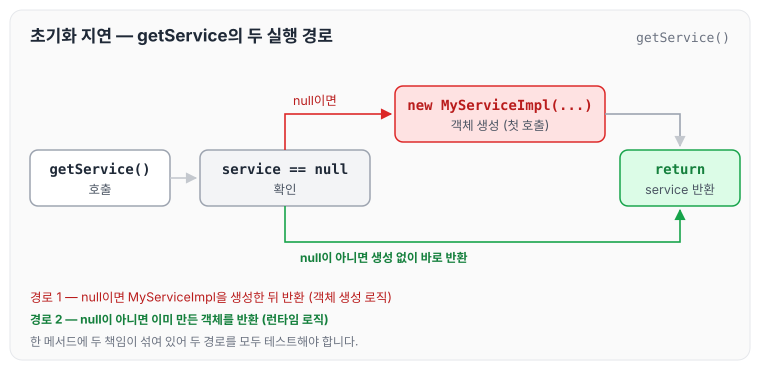
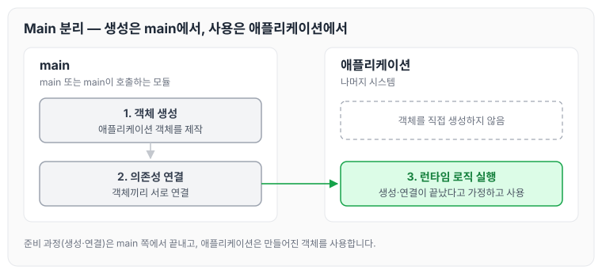
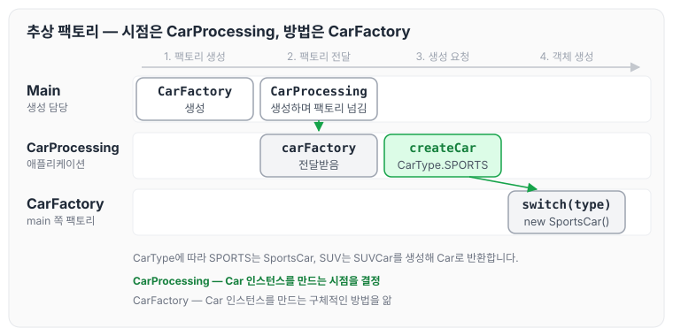
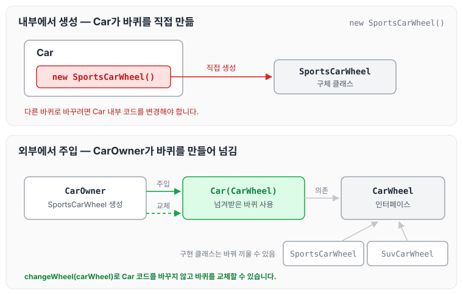

이전에 [10장 클래스](../clean-code-ch10-classes/)에 대해 작성하였습니다. 이번에는 클린 코드 11장 시스템의 앞부분을 읽고, 시스템 제작과 시스템 사용의 분리, Main 분리, 팩토리, 의존성 주입에 대해 정리하도록 하겠습니다.

## 도시가 잘 돌아가는 이유

책은 시스템 이야기를 도시에 빗대어 시작합니다.

- 도시에는 수도권 관리 팀, 전력 관리 팀, 교통 관리 팀, 치안 관리 팀, 건축물 관리 팀 등 각 분야를 관리하는 팀이 있습니다.
- 도시가 잘 돌아가는 것은 적절한 추상화와 모듈 덕분입니다. 그래서 큰 그림을 이해하지 못하더라도 개인과 개인이 관리하는 구성요소는 효율적으로 돌아갑니다.

소프트웨어 팀도 흔히 도시처럼 구성합니다. 깨끗한 코드를 구현하면 낮은 추상화 수준에서 관심사를 분리하기 쉬워집니다. 이번 장에서는 높은 추상화 수준, 즉 시스템 수준에서도 깨끗함을 유지하는 방법을 다룹니다.

## 시스템 제작과 시스템 사용 분리

제작은 사용과 아주 다릅니다. 책에서는 이를 아래와 같이 설명합니다.

> 소프트웨어 시스템은 (애플리케이션 객체를 제작하고 의존성을 서로 '연결' 하는) 준비 과정과 (준비 과정 이후에 이어지는) 런타임 로직을 분리해야 합니다.

대다수의 애플리케이션은 시작 단계라는 관심사를 분리하지 않습니다. 준비 과정 코드를 주먹구구식으로 구현할 뿐만 아니라 런타임 로직과 마구 뒤섞습니다. 예제는 아래와 같습니다.

```java
public Service getService() {
      if (service == null)
          service = new MyServiceImpl(...);// 모든 상황에 적합한 기본값일까?
      return service;
  }
```

이 코드에서 사용한 방식을 초기화 지연 혹은 계산 지연 기법이라고 합니다. `getService`를 호출했을 때 실행되는 경로를 그림으로 보면 아래와 같습니다.



한 메서드 안에 객체를 생성하는 경로와 이미 만든 객체를 돌려주는 경로가 함께 들어 있습니다. 이 기법의 장점은 아래와 같습니다.

- 실제로 필요할 때까지 객체를 생성하지 않으므로 불필요한 부하가 걸리지 않습니다.
- 어떠한 경우에도 null 포인터를 반환하지 않습니다.

반면 단점은 아래와 같습니다.

- `getService` 메서드가 `MyServiceImpl`과 생성자 인수에 명시적으로 의존합니다.
- 런타임 로직에서 `MyServiceImpl` 객체를 전혀 사용하지 않더라도 의존성을 해결하지 않으면 컴파일이 되지 않습니다.
- `MyServiceImpl`이 무거운 객체라면 단위 테스트에서 `getService` 메서드를 호출하기 전에 적절한 테스트 전용 객체를 `service` 필드에 할당해야 합니다.
- 일반 런타임 로직에 객체 생성 로직을 섞어 놓은 탓에 (`service`가 null인 경로와 null이 아닌 경로 등) 모든 실행 경로를 테스트해야 합니다. 책임이 둘이라는 말은 메서드가 작업을 두 가지 이상 수행한다는 의미이므로, 단일 책임 원칙을 위배합니다.
- 무엇보다 `MyServiceImpl`이 모든 상황에 적합한 객체인지 알 수 없습니다.

초기화 지연 기법을 한 번 정도 사용한다면 별로 심각한 문제가 아닙니다. 하지만 많은 애플리케이션이 이처럼 좀스러운 설정 기법을 수시로 사용합니다.

## Main 분리

시스템 생성과 시스템 사용을 분리하는 한 가지 방법은 생성과 관련한 코드를 모두 main이나 main이 호출하는 모듈로 옮기는 것입니다. 나머지 시스템은 모든 객체가 생성되었고 모든 의존성이 연결되었다고 가정합니다.



그림에서 확인할 점은 애플리케이션 쪽에는 생성 코드가 없고, main 쪽에서 만들어 연결해 둔 객체를 사용하기만 한다는 것입니다.

## 팩토리

때로는 객체가 생성되는 시점을 애플리케이션이 결정해야 할 때도 있습니다. 예를 들어 주문처리 시스템에서 애플리케이션은 `LineItem` 인스턴스를 생성해 `Order`에 추가합니다. 이때는 ABSTRACT FACTORY 패턴을 사용합니다.

다만 ABSTRACT FACTORY 패턴이 이 부분에서 잘 와닿지 않았고, 책에서도 코드 없이 설명이 진행되는 부분이 있어서 따로 찾아서 이해해 보았습니다.

### 추상 팩토리 패턴

추상 팩토리 패턴은 아래와 같이 정의할 수 있습니다.

> 서로 관련이 있는 객체들을 통째로 묶어서 팩토리 클래스로 만들고, 이들 팩토리를 조건에 따라 생성하도록 다시 팩토리를 만들어서 객체를 생성하는 패턴

자동차 관련 클래스로 예를 들어 정의해 보았습니다.

```java
public enum CarType {
	SPORTS, SUV, ...
}

// 메인클레스 구현
public class Main {
	public static void main(String [] args) {
        CarFactory carFactory = new CarFactory();
    	CarProcessing carProcessing = CarProcessing(carFactory);

    }
}

// 자동차 프로세싱 클래스 구현
public class CarProcessing {
	public void createCarProcessing(CarFactory carFactory) {
   		carFactory.createCar(CarType.SPORTS);
        ...// 추가적인 다른 로직들
    }

}

// 추상 클래스 팩토리 구성
public class CarFactory {
	public Car createCar(CarType type) {
    	Car car = null;
        switch (type) {
        	case SPORTS :
            	car = new SportsCar();
            	break;
            case SUV :
            	car = new SUVCar();
            	break;
               	 .
               	 .
               	 .
        }
        return car;
    }
}

// 추상 클래스 구성
public interface Car {

}

// 스포츠카 클래스 구성
public class SportsCar implements Car {
    public SportsCar() {
        System.out.println("슈퍼카 생성");
    }
}

// SUV카 클래스 구성
public class SUVCar implements Car {
    public SUVCar() {
        System.out.println("슈퍼카 생성");
    }
}
```

`Main`, `CarFactory`, `CarProcessing`의 관계를 그림으로 보면 아래와 같습니다.



의존성은 main에서 `CarProcessing` 애플리케이션으로 향합니다. 즉, `CarProcessing` 애플리케이션은 `Car` 인스턴스가 생성되는 구체적인 방법을 모릅니다. 그 방법은 main 쪽에 있는 `CarFactory`가 알고 있습니다.

그럼에도 `CarProcessing` 애플리케이션은 `Car` 인스턴스가 생성되는 시점을 완벽하게 통제하며, 필요하다면 `CarProcessing` 애플리케이션에서만 사용하는 생성자 인수도 넘길 수 있습니다.

## 의존성 주입

사용과 제작을 분리하는 강력한 메커니즘 하나가 의존성 주입 DI(Dependency Injection)입니다.

- 의존성 주입은 제어 역전 기법을 의존성 관리에 적용한 메커니즘입니다. 제어의 역전에서는 한 객체가 맡은 보조 책임을 새로운 객체에게 전적으로 떠넘깁니다.
- 의존성 관리 맥락에서 객체는 의존성 자체를 인스턴스로 만드는 책임을 지지 않습니다. 대신 다른 전담 메커니즘에게 제어를 역전합니다.

의존성 주입에 대해 알고는 있었지만, 위와 같이 설명만으로 진행하면 이해하기 어렵다고 느꼈습니다. 그래서 코드로 부연 설명을 정리해 보았습니다.

### 의존성 주입 코드 부연 설명

자동차는 자동차 바퀴에 의존해서 달립니다. 자동차 바퀴가 변경되면 자동차는 바퀴의 모양과 버전에 맞춰 내부를 변경해야 합니다. 바퀴의 변경이 자동차의 행위에 영향을 미쳤기 때문이며, 이때 "자동차는 자동차 바퀴에 의존한다"라고 말할 수 있습니다.

이를 코드로 구현하면 아래와 같습니다.

```java
// 자동차 클레스
class Car {
	private CarWheel carWheel;

    public Car() {
    	carWheel = new CarWheel();
    }
}
```

다양한 바퀴에 의존할 수 있도록 수정하면 아래와 같습니다.

```java
// 자동차 클레스
class Car {
	private CarWheel carWheel;

    public Car() {
    	carWheel = new SportsCarWheel();
//carWheel = new SuvCarWheel();
    }
}

// 자동차 바퀴 인터페이스 클레스
public interface CarWheel {

}

// 스포츠자동차 바퀴 클레스
class SportsCarWheel implements CarWheel {
    public SportsCarWheel() {
        System.out.println("스포츠카 바퀴 생성");
    };
}

// SUV자동차 바퀴 클레스
class SuvCarWheel implements CarWheel {
    public SuvCarWheel() {
        System.out.println("SUV카 바퀴 생성");
    };
}
```

이렇게 의존관계를 인터페이스로 추상화하면 다형성을 활용해 다양한 관계를 맺을 수 있고, 결합도가 낮아져 관계가 느슨해집니다.

위 코드는 클래스 내부에서 의존관계를 만든 것이고, DI는 외부에서 의존관계를 주입해 준다는 점이 다릅니다. 외부에서 주입하는 코드는 아래와 같습니다.

```java
//자동차 소유자
class CarOwner {
    private Car car = new Car(new SportsCarWheel());

    public void changeWheel(CarWheel carWheel) {
        car.changeWheel(carWheel);
    }
}

// 자동차 클레스
class Car {
    private CarWheel carWheel;

    public Car(CarWheel carWheel) {
    	this.carWheel = carWheel;
    }

    public void changeWheel(CarWheel carWheel) {
        this.carWheel = carWheel;
    }
}

// 자동차 바퀴 인터페이스 클레스
public interface CarWheel {

}

// 스포츠자동차 바퀴 클레스
class SportsCarWheel implements CarWheel {
    public SportsCarWheel() {
        System.out.println("스포츠카 바퀴 생성");
    };
}

// SUV자동차 바퀴 클레스
class SuvCarWheel implements CarWheel {
    public SuvCarWheel() {
        System.out.println("SUV카 바퀴 생성");
    };
}
```

내부에서 바퀴를 만드는 경우와 외부에서 주입하는 경우를 비교하면 아래와 같습니다.



위와 같이 필요한 클래스를 직접 생성하지 않고 외부에서 주입해 주면, 객체 간의 결합도를 낮추고 확장성을 높이는 코드를 구현할 수 있습니다.

## 마무리

오늘은 클린 코드 11장 시스템의 앞부분인 시스템 제작과 사용의 분리, Main 분리, 팩토리, 의존성 주입에 대해 정리하였습니다. 책에 코드가 적혀 있지 않은 부분이 많고 어려운 단어로 작성되어 있어서, 단어 하나하나 생각하면서 읽었습니다.

블로그에 정리하면서 완전히 이해하지 못했던 다형성, 의존성 주입, 추상 팩토리를 이해할 수 있어서 좋았고 개발에 대한 자신감도 좀 더 생겼습니다. 무엇보다 높은 응집도와 낮은 결합도에 대해 좀 더 깊이 생각해 볼 수 있었던 것 같습니다. 다음 글에서는 [11장 시스템 (2)](../clean-code-ch12-systems-2/)에서 11장의 나머지 내용을 이어서 정리하도록 하겠습니다.
