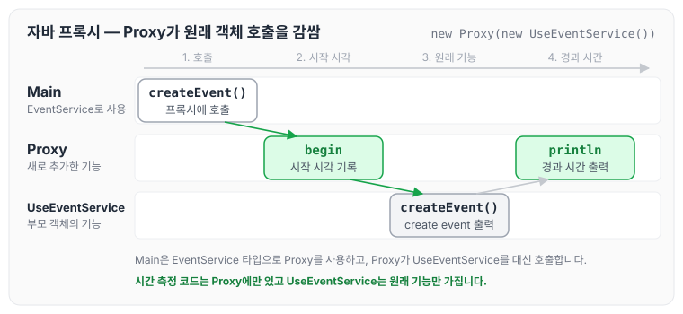
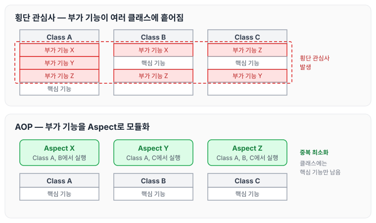
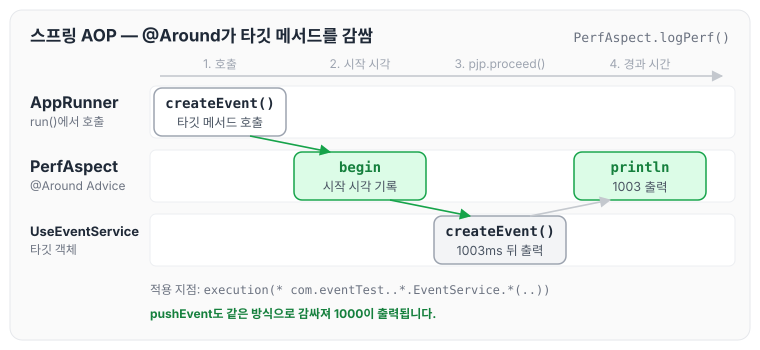
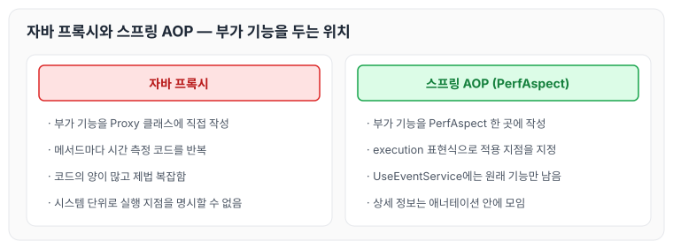

이전에 [11장 시스템 (1)](../clean-code-ch11-systems-1/)에 대해 작성하였습니다. 이번에는 11장 시스템의 나머지 부분을 읽고, 시스템 확장과 횡단 관심사, 자바 프록시와 순수 자바 AOP 프레임워크, 의사 결정 최적화에 대해 정리하도록 하겠습니다.

## 확장

'처음부터 올바르게' 시스템을 만들 수 있다는 믿음은 미신입니다. 깨끗한 코드는 코드 수준에서 시스템을 조정하고 확장하기 쉽게 만듭니다.

> 소프트웨어 시스템은 물리적인 시스템과 다릅니다. 관심사를 적절히 분리해 관리한다면 소프트웨어 아키텍처는 점진적으로 발전할 수 있습니다.

## 횡단 관심사

- 원론적으로는 모듈화되고 캡슐화된 방식으로 영속성 방식을 구상할 수 있습니다. 하지만 현실적으로는 영속성 방식을 구현한 코드가 온갖 객체로 흩어집니다. 여기서 횡단 관심사라는 용어가 나옵니다. 사실 EJB 아키텍처가 영속성, 보안, 트랜잭션을 처리하는 방식은 관점 지향 프로그래밍 AOP(Aspect-Oriented Programming)를 예견했다고 볼 수 있습니다.
- AOP에서 관점(Aspect)이라는 모듈 구성 개념은 "특정 관심사를 지원하려면 시스템에서 특정 지점들이 동작하는 방식을 일관성 있게 바꿔야 한다"라고 명시합니다.

이 부분을 읽으면서 영속성이 무엇을 뜻하는지 잘 와닿지 않았고, 무엇보다 관련 글들이 어렵게 느껴졌습니다. 그래서 영속성과 AOP를 따로 찾아보았습니다.

### 영속성의 뜻

네이버 영한사전에서 persistence를 찾아보면 "1. 고집 2. (없어지지 않고 오래 동안) 지속됨"으로 나옵니다. 즉, 영속성은 없어지지 않고 오랫동안 지속됨을 뜻합니다.

일단 '영속성'은 일련의 과정이 없어지지 않고 오랫동안 지속되는 것이라고 생각하고, 책에서 말하는 '자바에서 사용하는 관점 혹은 관점과 유사한 메커니즘 세 가지'를 살펴보겠습니다.

1. 자바 프록시
2. 순수 자바 AOP 프레임워크
3. AspectJ 관점

## 자바 프록시

프록시는 '대리'라는 의미로, 프록시에게 어떤 일을 대신시키는 것을 뜻합니다. 개별 객체나 클래스에서 메서드 호출을 감싸는 경우가 좋은 예입니다.

프록시 패턴은 접근을 제어하고 싶거나 부가 기능을 추가하고 싶을 때 사용합니다. 책의 예제는 다소 어렵다고 생각해서, 아래 예제를 먼저 보고 책의 예제를 살펴보겠습니다.

```java
package com.programmers.java.proxyPattern;

public interface EventService {
    void createEvent();

    void pushEvent();
}
```

```java
package com.programmers.java.proxyPattern;

public class UseEventService implements EventService {

    @Override
    public void createEvent() {
        System.out.println("create event");
    }

    @Override
    public void pushEvent() {
        System.out.println("push event");
    }
}
```

```java
package com.programmers.java.proxyPattern;

public class Proxy implements EventService {
    private UseEventService useEventService;

    public Proxy(UseEventService useEventService) {
        this.useEventService = useEventService;
    }

    @Override
    public void createEvent() {
        long begin = getSystemTimeMills();// 새로 추가한 기능
        useEventService.createEvent();// 부모 객체의 기능
        System.out.println(endSystemTimeMills(begin));// 새로 추가한 기능
    }

    @Override
    public void pushEvent() {
        long begin = getSystemTimeMills();// 새로 추가한 기능
        System.out.println("push event");// 부모 객체의 기능
        System.out.println(endSystemTimeMills(begin));// 새로 추가한 기능
    }

    long getSystemTimeMills() {
    	return System.currentTimeMillis();
    }

    long endSystemTimeMills(long begin) {
    	return System.currentTimeMillis()-begin;
    }

}
```

```java
package com.programmers.java.proxyPattern;

public class Main {

    public static void main(String[] args) {
// UseEventService 클래스의 메소드를 호출하는것이아닌 프록시클래스의 메소드를 호출한다.
        EventService eventProxyHandler = new Proxy(new UseEventService());
        eventProxyHandler.createEvent();// 내부적으로 createEvent 메소드를 호출한다.

    }
}
```

`Main`에서 `createEvent`를 호출했을 때 프록시가 원래 객체의 호출을 감싸는 흐름은 아래와 같습니다.



시간을 재는 코드는 `Proxy`에만 있고, `UseEventService`는 "create event"를 출력하는 원래 기능만 가지고 있습니다.

### 장점

위 코드를 보면 알 수 있듯이, 기존 service에 직접 추가 기능을 적용하지 않습니다. 부수적인 기능(보안, 트랜잭션 등)은 프록시를 통해 작업하기 때문에, 클래스의 근본이 되는 기능은 내부에 설계하고 부수적인 기능은 프록시로 적용하면 깨끗한 코드를 작성할 수 있습니다.

### 단점

다만 코드를 작성해 보면 코드가 상당히 많고 제법 복잡합니다. 코드의 '양'과 크기는 프록시의 두 가지 단점입니다.

다시 말해 프록시를 사용하면 깨끗한 코드를 작성하기 어렵습니다. 또한 프록시는 시스템 단위로 실행 '지점'을 명시하는 메커니즘도 제공하지 않습니다.

## 순수 자바 AOP 프레임워크

AOP는 Aspect Oriented Programming의 약자로, 관점 지향 프로그래밍이라고 부릅니다. 여러 클래스에 흩어진 부가 기능을 Aspect로 모으는 모습은 아래와 같습니다.



위 그림을 보면 횡단 관심사의 기능을 모듈화해 중복을 최소화하면서 핵심 기능에 집중하도록 한다는 것을 알 수 있습니다. 다만 그림만 봐서는 이해가 잘 안 될 수 있고, 저 역시 그랬습니다. 그래서 스프링 어노테이션 기반의 AOP 코드 예제를 살펴보겠습니다.

```java
@Component
@Aspect
public class PerfAspect {

    @Around("execution(* com.eventTest..*.EventService.*(..))")
    public Object logPerf(ProceedingJoinPoint pjp) throws Throwable {
        long begin = System.currentTimeMillis();
        Object resultValue = pjp.proceed();
        System.out.println(System.currentTimeMillis() - begin);
        return resultValue;
    }

}
```

각 요소의 의미는 아래와 같습니다.

- `@Component` : 스프링 빈으로 등록합니다.
- `@Aspect` : 위에서 설명한 흩어진 관심사를 모듈화한 것입니다.
- `@Around` : 타깃 메서드를 감싸서 특정 Advice를 실행한다는 의미입니다.
- `execution` : `execution(* com.eventTest..*.EventService.*(..))`은 com.eventTest 아래의 패키지 경로에 있는 EventService의 모든 메서드에 Aspect를 적용한다는 의미입니다.
- Advice : 실질적으로 어떤 일을 해야 할지에 대한 것입니다. 여기서는 메서드가 실행된 시간을 측정하기 위해 사용합니다.

```java
package com.programmers.java.proxyPattern;

public interface EventService {
    void createEvent();

    void pushEvent();
}
```

```java
public class UseEventService implements EventService {

    @Override
    public void createEvent() {
        try {
            Thread.sleep(1003);
        } catch(InterruptedException e) {
            e.printStackTrace();
        }
        System.out.println("create event");
    }

    @Override
    public void pushEvent() {
     try {
            Thread.sleep(1000);
        } catch(InterruptedException e) {
            e.printStackTrace();
        }
        System.out.println("push event");
    }
}
```

코드를 실행하는 부분은 아래와 같습니다.

```java
@Component
public class AppRunner implements ApplicationRunner {

    @Autowired
    UseEventService useEventService;

    @Override
    public void run(ApplicationArguments args) throws Exception {
        useEventService.createEvent();
        useEventService.pushEvent();
    }

}
```

`createEvent`를 호출했을 때 `@Around`가 타깃 메서드를 감싸 실행 시간을 출력하는 흐름은 아래와 같습니다.



위 코드는 자바에서 프록시로 구현할 때보다 훨씬 깨끗합니다. 일부 상세 정보는 애너테이션에 포함되어 그대로 남아 있지만, 모든 정보가 애너테이션 안에 있으므로 코드 자체는 깔끔하고 깨끗합니다. 실행 결과는 아래와 같습니다.

```text
create event
1003
push event
1000
```

두 방식을 비교하면 아래와 같습니다.



## 의사 결정 최적화

도시든 소프트웨어 프로젝트든, 아주 큰 시스템에서는 한 사람이 모든 결정을 내리기 어렵습니다. 가장 적합한 사람에게 책임을 맡기는 것이 가장 좋습니다.

> 관심사를 모듈로 분리한 POJO 시스템은 기민함을 제공합니다. 이런 기민함 덕분에 최신 정보에 기반해 최선의 시점에 최적의 결정을 내리기 쉬워집니다. 또한 결정의 복잡성도 줄어듭니다.

## 마무리

오늘은 클린 코드 11장 시스템의 나머지 부분인 시스템 확장과 횡단 관심사, 자바 프록시와 순수 자바 AOP 프레임워크, 의사 결정 최적화에 대해 정리하였습니다. 11장의 결론은 아래와 같습니다.

- 시스템 역시 깨끗해야 합니다. 깨끗하지 못한 아키텍처는 도메인 논리를 흐리며 기민성을 떨어뜨립니다. 도메인 논리가 흐려지면 제품 품질도 떨어집니다.
- 모든 추상화 단계에서 의도는 명확히 표현해야 합니다. 그러려면 POJO를 작성하고 관점 혹은 관점과 유사한 메커니즘을 사용해 각 구현 관심사를 분리해야 합니다.
- 시스템을 설계하든 개별 모듈을 설계하든, 실제로 동작하는 가장 단순한 수단을 사용해야 한다는 사실을 명심해야 합니다.

다음 글에서는 [클린 코드 11장까지의 리뷰와 앞으로의 진행 방향](../clean-code-review-progress/)을 정리하도록 하겠습니다.

참조 : [https://yadon079.github.io/2021/spring/spring-aop-core](https://yadon079.github.io/2021/spring/spring-aop-core)

참조 : [https://engkimbs.tistory.com/746](https://engkimbs.tistory.com/746)
