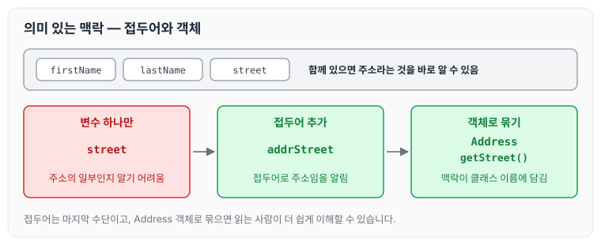

개발 일을 하다 보면 제가 작성한 코드도 시간이 지나 다시 보았을 때 이해되지 않았던 적이 많았습니다. 클린 코드는 이러한 습관에서 벗어날 수 있는 방법을 제시해 주었고, 계속 상기하기 위해 정리를 하게 되었습니다.

책의 내용이 많아서 챕터별로 나누어 정리하려고 합니다. 오늘은 그 첫 번째로 2장 의미 있는 이름에 대해 정리하도록 하겠습니다.

## 의도를 분명히 밝히는 이름

책에서는 이름에 대해 아래와 같이 이야기합니다.

> '좋은 이름을 지으려면 시간이 걸리지만 좋은 이름으로 절약하는 시간이 훨씬 더 많다.'

예를 들어 아래와 같은 코드가 있다고 가정해 보겠습니다.

```java
public List<int[]> getThem() {
	List<int[]> list1 = new ArrayList<int[]>();
    for (int[] x : theList)
    	if (x[0] == 4)
        	list1.add(x);
        return list1;
}
```

이 코드만 보고는 코드가 하는 일을 짐작하기 어렵습니다. 읽는 사람은 아래와 같은 질문을 하게 됩니다.

1. `theList`에 무엇이 들었는가?
2. `theList`에서 0번째 값이 어째서 중요한가?
3. 값 4는 무슨 의미인가?
4. 함수가 반환하는 리스트 `list1`을 어떻게 사용하는가?

이처럼 의도가 분명하지 않은 이름은 프로그래머가 무엇을 말하고, 어떤 프로그램을 짜는지 알 수 없게 만듭니다. 같은 코드의 이름을 바꾸면 아래와 같습니다.

```java
public List<Cell> getThem() {
	List<Cell> flaggedCells = new ArrayList<Cell>();
    for (Cell cell : gameBoard)
    	if (cell.isFlagged())
        	flaggedCells.add(cell);
        return flaggedCells;
}
```

- `theList` → `gameBoard`로 변경
- `list1` → `flaggedCells`로 변경
- `x[0] == 4` → `cell.isFlagged()`로 변경

이름을 바꾼 것만으로 게임판을 다루는 코드라는 것을 추측할 수 있고, 셀의 상태 값에 따라 깃발이 꽂힌 셀을 모은다는 것도 이해할 수 있습니다. 변경 전과 후의 이름을 나란히 놓으면 아래와 같습니다.

![변경 전 theList, x[0] == 4, list1이 변경 후 gameBoard, cell.isFlagged(), flaggedCells로 바뀌며 의도가 드러나는 비교](images/01_intent-revealing-names.svg)

변경 전 이름은 읽는 사람에게 질문을 남기지만, 변경 후 이름은 그 질문에 대한 답을 이름 자체에 담고 있습니다.

## 그릇된 정보 피하기

### 그릇된 단서

예를 들어 여러 계정을 그룹으로 묶을 때, 실제 `List`가 아니라면 `accountList`라고 이름 짓지 않습니다. 프로그래머에게 `List`라는 단어는 특수한 의미를 가지기 때문에, 계정을 담는 컨테이너가 실제 `List`가 아니라면 프로그래머에게 그릇된 정보를 제공하는 셈입니다. 그러므로 이런 경우에는 `accountGroup` 또는 단순히 `Accounts`라고 이름 짓습니다.

### 서로 흡사한 이름

최신 자바 환경은 코드 자동 완성 기능을 제공하기 때문에 이름을 몇 자만 입력해도 사용할 수 있습니다. 그러므로 서로 흡사한 이름을 사용해 헷갈리게 만들지 않도록 합니다.

### 읽는 사람이 차이를 알 수 있는 이름

이름에 정보와 목적을 담으면 코드를 읽기가 쉬워집니다. 예를 들어 `Product`라는 클래스가 있다고 가정해 보겠습니다. 다른 클래스를 `ProductInfo` 혹은 `ProductData`라고 부른다면, 개념을 구분하지 않은 채 이름만 다르게 붙인 경우입니다. 이와 마찬가지로 의미가 불분명한 불용어를 사용하지 않습니다.

즉, 읽는 사람이 차이를 알 수 있도록 이름을 지어야 합니다.

## 클래스 이름

클래스 이름과 객체 이름은 명사나 명사구가 적합합니다.

## 메서드 이름

메서드 이름은 동사나 동사구가 적합합니다.

## 해법 영역에서 가져온 이름

코드를 읽는 사람도 프로그래머라는 사실을 명심해야 합니다. 그러므로 프로그래머 용어를 사용해도 괜찮습니다. `MAP`, `LIST`, `QUEUE`는 프로그래머라면 대부분 알고 있는 용어이고, 기술 개념에는 기술 이름을 붙이는 것이 가장 적합합니다.

## 문제 영역에서 가져온 이름

적절한 프로그래머 용어가 없다면 문제 영역에서 이름을 가져옵니다. 그래야 코드를 유지보수하는 프로그래머가 분야 전문가에게 의미를 물어 파악할 수 있기 때문입니다.

## 의미 있는 맥락 추가

모든 방법이 실패하면 마지막 수단으로 접두어를 붙입니다.

예를 들어 `firstName`, `lastName`, `street`라는 변수가 함께 있다면, 변수를 훑어보는 것만으로 주소라는 사실을 금방 알 수 있습니다. 하지만 `street` 변수 하나만 사용한다면 주소의 일부라는 것을 추측하기 어렵습니다. 이럴 때 `addrStreet`처럼 접두어를 붙입니다.

더 나아가 `Address` 객체를 만들고, 그 객체의 `getStreet()`로 값을 꺼내 쓰면 읽는 사람이 더 쉽게 이해할 수 있습니다. 세 가지 경우를 비교하면 아래와 같습니다.



접두어는 맥락을 드러내는 마지막 수단이고, 객체로 묶으면 맥락이 클래스 이름에 담기게 됩니다.

## 마무리

오늘은 클린 코드 2장 의미 있는 이름에 대해 정리하였습니다. 객체와 함수의 이름을 어떻게 지으면 좋을지, 그리고 이름을 지을 때 어떤 순서로 생각하면 좋을지 파악할 수 있었습니다. 앞으로 제가 작성하는 프로그램도 최대한 다른 사람이 읽기 쉽게 구현되었으면 좋겠습니다.

다음 글에서는 [3장 함수](../clean-code-ch3-functions/)에 대해 정리하도록 하겠습니다.
