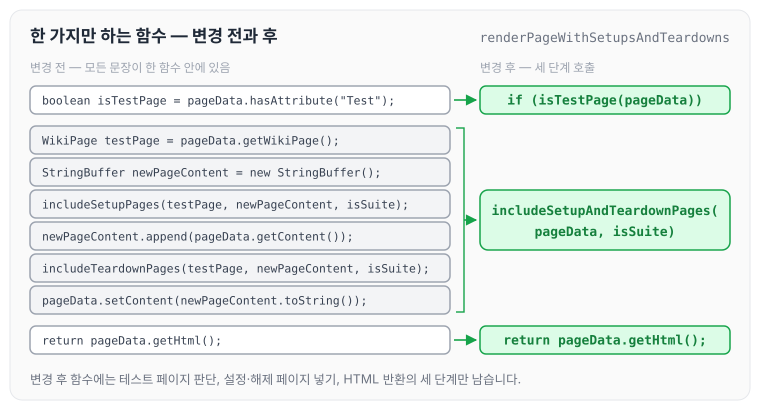
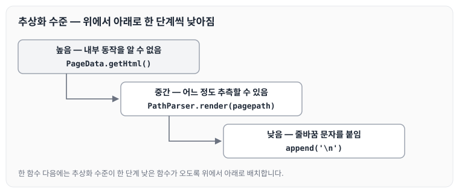
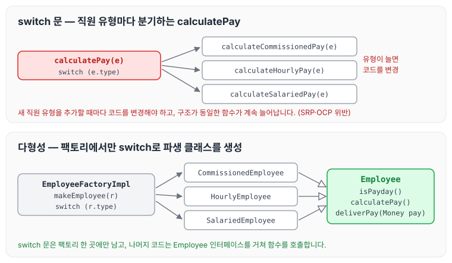
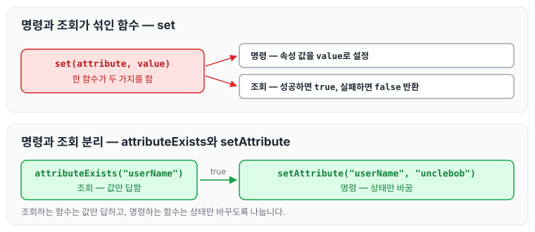

이전에 [2장 의미있는 이름](../clean-code-ch2-names/)에 대해 작성하였습니다. 이번에는 3장 함수를 읽고, 함수를 작게 만들어 한 가지만 하게 하는 방법과 함수 인수, 부수 효과, 명령과 조회 분리, try/catch 블록을 뽑아내는 방법에 대해 정리하도록 하겠습니다.

## 작게 만들기

함수는 작게 만들어야 하며, 명백한 함수는 2줄에서 4줄 정도가 적당합니다.

- 각 함수가 명백하게 하나만 표현하도록 만들면, 그 함수가 다음 함수로 이어지는 무대를 준비하는 셈입니다.
- 블록과 들여쓰기
    - `if` 문, `else` 문, `while` 문 등에 들어가는 블록은 한 줄이어야 합니다. 대개 그 한 줄에서 함수를 호출합니다.

## 한 가지만 하는 함수

함수는 한 가지를 해야 합니다. 그 한 가지를 잘해야 하고, 그 한 가지만 해야 합니다. 아래 코드를 보겠습니다.

```java
public static String renderPageWithSetupsAndTeardowns(PageData pageData, boolean isSuite) throws Exception {

	boolean isTestPage = pageData.hasAttribute("Test");

	if (isTestPage) {
	WikiPage testPage = pageData.getWikiPage();
	StringBuffer newPageContent = new StringBuffer();
	includeSetupPages(testPage, newPageContent, isSuite);
	newPageContent.append(pageData.getContent());
	includeTeardownPages(testPage, newPageContent, isSuite);
	pageData.setContent(newPageContent.toString());

}
 return pageData.getHtml();
}
```

명백한 함수는 2줄에서 4줄이 적당하므로, 위 함수는 아래와 같이 변경해 주어야 합니다.

```java
public static String renderPageWithSetupsAndTeardowns(
	PageData pageData, boolean isSuite
) throws Exception {
 if (isTestPage(pageData)) {
  includeSetupAndTeardownPages(pageData, isSuite);
 }
 return pageData.getHtml();
}
```

변경 전 함수의 문장들이 변경 후 함수에서 어떤 호출로 묶였는지 나란히 놓으면 아래와 같습니다.



변경 후 함수는 테스트 페이지인지 판단하고, 설정·해제 페이지를 넣고, HTML을 반환하는 세 단계만 남습니다.

함수를 이렇게 간단하게 변경하는 기준에 대해 저자는 아래와 같이 이야기합니다.

> '지정된 함수 이름 아래에서 추상화 수준이 하나인 단계만 수행한다면 그 함수는 한 가지 작업만 하는 것입니다. 의미 있는 이름으로 다른 함수를 추출할 수 있다면 그 함수는 여러 작업을 하는 셈입니다.'

다만 변경한 함수도 세 가지를 한다고 주장할 수 있습니다.

1. 페이지가 테스트 페이지인지 판단합니다.
2. 테스트 페이지라면 설정 페이지와 해제 페이지를 넣습니다.
3. 페이지를 HTML로 렌더링합니다.

하지만 세 단계는 지정된 함수 이름 아래에서 추상화 수준이 하나입니다. 이 부분을 읽으면서 어려움을 겪었는데, 추상화 수준이 하나인 단계가 무슨 뜻인지 처음에는 잘 이해되지 않았습니다.

## 함수당 추상화 수준은 하나로

함수의 추상화 수준은 아래 예시로 구분할 수 있습니다.

- `PageData.getHtml()`은 함수명만 보고는 내부에서 어떤 로직이 동작하는지 알 수 없습니다. 이는 추상화 수준이 높은 단계라고 설명할 수 있습니다.
- `PathParser.render(pagepath)`는 추상화 수준이 중간입니다. 페이지 경로를 넘기고 렌더링해서 해당하는 값을 가져온다고 어느 정도 추측할 수 있기 때문입니다.
- `append('\n')`과 같은 코드는 추상화 수준이 아주 낮습니다. 누가 봐도 줄바꿈 문자를 붙인다고 설명할 수 있기 때문입니다.

한 함수 안에서 추상화 수준을 섞으면 코드를 읽는 사람이 헷갈립니다. 그래서 함수당 추상화 수준은 하나로 맞춥니다.

### 위에서 아래로 코드 읽기: 내려가기 규칙

코드는 위에서 아래로 이야기처럼 읽혀야 좋습니다. 한 함수 다음에는 추상화 수준이 한 단계 낮은 함수가 옵니다. 위의 세 예시를 추상화 수준 순서로 놓으면 아래와 같습니다.



위에서 아래로 읽어 내려갈수록 추상화 수준이 한 단계씩 낮아지도록 함수를 배치합니다.

## Switch 문

switch 문은 작게 만들기 어렵습니다. 하지만 각 switch 문을 저차원 클래스에 숨기고 절대로 반복하지 않는 방법은 있는데, 바로 다형성을 이용하는 것입니다.

```java
public Money calculatePay(Employee e) throws InvalidEmployeeType {
	switch (e.type) {
    	case COMMISSIONED:
        	return calculateCommissionedPay(e);
        case HOURLY:
        	return calculateHourlyPay(e);
        case SALARIED:
        	return calculateSalariedPay(e);
        default:
        	throw new InvalidEmployeeType(e.type);
    }
}
```

위 함수에는 몇 가지 문제가 있습니다.

1. 함수가 깁니다.
2. '한 가지' 작업만 수행하지 않습니다.
3. SRP(단일 책임 원칙)를 위반합니다.
    - '클래스는 단 하나의 책임을 가져야 합니다. 클래스를 변경하는 이유는 단 하나여야 합니다.'
    - 위 코드는 변경할 이유가 여럿 있습니다.
4. OCP를 위반합니다.
    - 새 직원 유형을 추가할 때마다 코드를 변경해야 합니다.
    - 가장 심각한 문제는 구조가 동일한 함수가 무한정 존재한다는 사실입니다.

이 문제는 아래와 같이 해결할 수 있습니다.

```java
public abstract class Employee {
    public abstract boolean isPayday();
    public abstract Money calculatePay();
    public abstract void deliverPay(Money pay);
}

public interface EmployeeFactory {
	public Employee makeEmployee(EmployeeRecord r) throws InvalidEmployeeType;
}

public class EmployeeFactoryImpl implements EmployeeFactory {
	public Employee makeEmployee(EmployeeRecord r) throws InvalidEmployeeType {
    	switch (r.type) {
            case COMMISSIONED:
                return new CommissionedEmployee(r);
            case HOURLY:
                return new HourlyEmployee(r);
            case SALARIED:
                return new SalariedEmployee(r);
            default:
                throw new InvalidEmployeeType(r.type);
        }
    }
}
```

팩토리는 switch 문을 사용해 적절한 `Employee` 파생 클래스의 인스턴스를 생성하고, 필요한 함수는 `Employee` 인터페이스를 거쳐 호출합니다. 두 코드의 구조를 비교하면 아래와 같습니다.



switch 문은 팩토리 한 곳에만 남고, 나머지 코드는 직원 유형을 몰라도 `Employee`의 함수를 호출하면 됩니다. 저자는 이에 대해 아래와 같이 이야기합니다.

> '일반적으로 나는 switch 문을 단 한 번만 참아줍니다. 다형적 객체를 생성하는 코드 안에서입니다.'

## 서술적인 이름

함수가 작고 단순할수록 서술적인 이름을 고르기 쉬워집니다.

이름을 붙일 때는 일관성이 있어야 합니다. 모듈 내에서 함수 이름은 같은 문구, 명사, 동사를 사용합니다. 예를 들면 `includeSetupAndTeardownPages`, `includeSetupPages`, `includeSuiteSetupPage` 등이 좋은 예입니다.

## 함수 인수

함수에서 이상적인 인수 개수는 0개입니다.

인수는 개념을 이해하기 어렵게 만듭니다. 코드를 읽는 사람에게는 `includeSetupPageInto(newPageContent)`보다 `includeSetupPage()`가 이해하기 쉽습니다. 최선은 입력 인수가 없는 경우이며, 차선은 입력 인수가 1개뿐인 경우입니다.

### 인수를 사용하는 경우

인수는 아래와 같은 경우에 사용합니다.

1. 인수에 질문을 던지는 경우입니다. `boolean fileExists("MyFile")`
2. 인수를 뭔가로 변환해 결과를 반환하는 경우입니다. `InputStream fileOpen("MyFile")`
3. 단항 함수 형식의 이벤트입니다.
    - `passwordAttemptFailedNtimes(int attempts)`와 같은 이벤트는 이벤트라는 사실이 코드에 명확하게 드러나야 합니다. 그러므로 이름과 문맥을 주의해서 선택합니다.
4. 입력 인수를 변환하는 함수라면 변환 결과는 반환 값으로 돌려줍니다.

### 플래그 인수

플래그 인수는 추합니다. 함수가 한꺼번에 여러 가지를 처리한다고 대놓고 공표하는 셈이기 때문입니다.

### 이항 함수

이항 함수가 무조건 나쁘다는 뜻은 아닙니다. 프로그램을 하다 보면 불가피한 경우도 생깁니다. 하지만 그만큼 위험이 따른다는 사실을 이해하고, 가능하다면 단항 함수로 바꾸도록 애써야 합니다.

예를 들어 `writeField(outputStream, name)`이라는 함수가 있다면, 아래와 같은 방법으로 단항 함수로 바꿀 수 있습니다.

1. 함수를 `outputStream.writeField(name)`으로 변경하는 방법
2. `outputStream`을 현재 클래스의 구성원 변수로 만드는 방법
3. `FieldWriter`라는 새 클래스를 만들어 구성자에서 `outputStream`을 받고 `write` 메서드를 구현하는 방법

위 예제처럼 인수는 최대한 줄이는 것이 좋습니다.

### 동사와 키워드

함수의 의도나 인수의 순서와 의도를 제대로 표현하려면 좋은 함수 이름이 필수입니다.

1. 단항 함수는 함수와 인수가 동사/명사 쌍을 이뤄야 합니다. 예를 들어 `writeField(name)`은 '이름'이 '필드'라는 사실이 분명히 드러납니다.
2. 함수 이름에 키워드를 추가하는 형식입니다. 즉, 함수 이름에 인수 이름을 넣습니다. 예를 들어 `assertEquals`보다 `assertExpectedEqualsActual(expected, actual)`이 더 좋습니다. 이렇게 하면 인수의 순서를 기억할 필요가 없어집니다.

## 부수 효과

부수 효과를 일으키지 않아야 합니다. 부수 효과는 함수에서 한 가지를 하겠다고 약속하고서는 남몰래 다른 일도 하는 것이기 때문입니다. 아래 코드를 보겠습니다.

```java
public class UserValidator {
	private Cryptographer cryptographer;

    public boolean checkPassword(String userName, String password) {
    	User user = UserGateway.findByName(userName);
        if (user != user.NULL) {
        	String codedPhrase = user.getPhraseEncodedByPassword();
            String phrase = cryptographer.decrypt(codedPhrase, password);
            if ("Valid password".equals(phrase)) {
            	Session.initialize();//숨은 부수효과
            	return true;
            }
        }
        return false;
    }
}
```

`checkPassword` 함수는 이름 그대로 암호를 확인합니다. 하지만 이름만 봐서는 세션을 초기화한다는 사실이 드러나지 않습니다. 그래서 함수 이름만 보고 함수를 호출하는 사용자는 인증 과정에서 기존 세션 정보를 지워 버릴 위험이 있습니다.

### 출력 인수

일반적으로 인수는 함수의 입력으로 해석합니다. 아래 함수를 보겠습니다.

```java
appendFooter(s);
```

이 함수는 무언가에 `s`를 바닥글로 첨부하는 것인지, 아니면 `s`에 바닥글을 첨부하는 것인지 알 수 없습니다. 함수 선언부를 보면 분명해집니다.

```java
public void appendFooter(StringBuffer report)
```

인수 `s`가 출력 인수라는 사실은 분명해졌지만, 함수 선언부를 찾아보고 나서야 알 수 있었습니다. 함수 선언부를 찾아보는 행위는 코드를 읽다가 주춤하게 만듭니다. 그래서 아래와 같이 바꾸는 것이 좋습니다.

```java
report.appendFooter();
```

일반적으로 출력 인수는 피해야 합니다. 함수에서 상태를 변경해야 한다면 함수가 속한 객체의 상태를 변경하는 방식을 택합니다.

## 명령과 조회 분리

함수는 뭔가를 수행하거나 뭔가에 답하거나 둘 중 하나만 해야 하고, 둘 다 해서는 안 됩니다. 즉, 객체 상태를 변경하거나 객체 정보를 반환하거나 둘 중 하나여야 합니다. 아래 예제를 보겠습니다.

```java
public boolean set(String attribute, String value)
```

이 함수는 이름이 `attribute`인 속성을 찾아 값을 `value`로 설정한 후, 성공하면 `true`, 실패하면 `false`를 반환합니다. 상태를 변경하면서 결과까지 답하는 괴상한 코드이므로 아래처럼 변경해야 합니다.

```java
if (attributeExists("userName")) {
    setAttribute("userName", "unclebob");
    ...
}
```

변경 전과 후를 비교하면 아래와 같습니다.



조회하는 `attributeExists`는 값만 답하고, 명령하는 `setAttribute`는 상태만 바꾸도록 나뉘었습니다.

## Try/Catch 블록 뽑아내기

try/catch 블록은 원래 추합니다. 코드 구조에 혼란을 일으키며 정상 동작과 오류 처리 동작을 뒤섞습니다. 그러므로 try/catch 블록을 별도 함수로 뽑아내는 편이 좋습니다. 아래 예제 코드를 보겠습니다.

```java
try {
    deletePage(page);
    registry.deleteReference(page.name);
    configkeys.deleteKey(page.name.makeKey());
} catch (Exception e) {
	logger.log(e.getMessage());
}
```

위 코드의 try/catch 블록을 별도 함수로 뽑아내면 아래와 같습니다.

```java
//try/catch블록을 별도 함수로 뽑아내보자.
public void delete (Page page) {
    try{
    	deletePageAndAllReference(page);
    } catch (Exception e) {
    	logError(e);
    }
}

private void deletePageAndAllReference(Page page) throws Exception {
	deletePage(page);
    registry.deleteReference(page.name);
    configkeys.deleteKey(page.name.makeKey());
}

private void logError(Exception e) {
	logger.log(e.getMessage());
}
```

이처럼 정상 동작과 오류 처리 동작을 분리하면 코드를 이해하고 수정하기 쉬워집니다.

## 저자가 함수를 짜는 방법

저자는 장의 마지막에 함수를 짜는 방법에 대해 아래와 같이 이야기합니다.

> '처음 함수를 짤 때는 길고 복잡합니다. 하지만 그 서투른 코드를 빠짐없이 테스트하는 단위 테스트 케이스도 만듭니다. 그런 다음 코드를 다듬고, 함수를 만들고, 이름을 바꾸고, 중복을 제거합니다. 메서드를 줄이고 순서를 바꿉니다. 전체 클래스를 쪼개기도 합니다. 이 와중에 코드는 항상 단위 테스트를 통과합니다.'

## 마무리

오늘은 클린 코드 3장 함수에 대해 정리하였습니다. 함수를 짜는 방식과, 함수를 잘못 짰을 때의 위험성을 절실히 느낀 장이었습니다. 현업에 있다 보면 일정에 쫓기는 경우가 많은데, 위와 같은 방식으로 깔끔하게 수정해 둔다면 문제가 발생했을 때 언제든지 대처할 수 있지 않을까 싶습니다.

다음 글에서는 [4장 주석](../clean-code-ch4-comments/)에 대해 정리하도록 하겠습니다.
