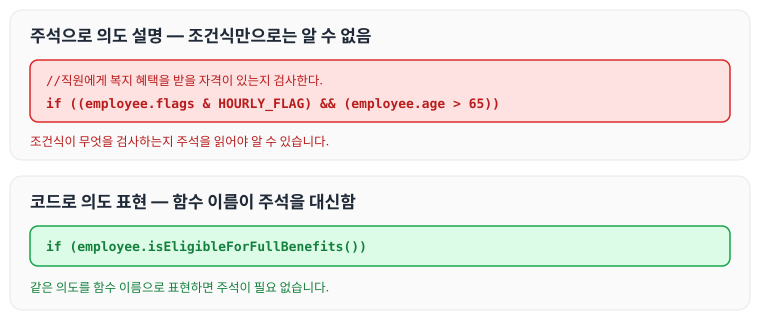
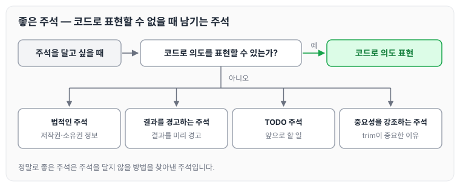

이전에 [3장 함수](../clean-code-ch3-functions/)에 대해 작성하였습니다. 이번에는 4장 주석을 읽고, 주석이 나쁜 코드를 보완하지 못하는 이유와 코드로 의도를 표현하는 방법, 그리고 남겨 둘 만한 좋은 주석에 대해 정리하도록 하겠습니다.

## 주석은 필요악

4장은 아래 문장으로 시작합니다.

> 나쁜 코드에 주석을 달지 마라. 새로 짜라

잘 달린 주석은 그 어떤 정보보다 유용합니다. 반면 경솔하고 근거 없는 주석은 코드를 이해하기 어렵게 만듭니다. 사실상 주석은 기껏해야 필요악입니다.

저자가 이렇게 주석을 무시하는 이유는 주석이 거짓말을 하기 때문입니다. 항상 그런 것도 아니고 고의도 아니지만, 너무 자주 거짓말을 한다고 이야기합니다.

## 나쁜 코드를 보완하지 못하는 주석

주석은 나쁜 코드를 보완하지 못합니다.

코드에 주석을 추가하는 일반적인 이유는 코드 품질이 나쁘기 때문입니다. 모듈을 짜고 보니 짜임새가 엉망이고 알아먹기 어렵습니다. 지저분한 모듈이라는 사실을 자각하고, 그래서 자신에게 "이런! 주석을 달아야겠다!"라고 말하게 됩니다.

## 코드로 의도 표현하기

확실히 코드만으로 의도를 설명하기 어려운 경우가 존재합니다. 불행히도 많은 개발자가 이를 코드는 훌륭한 수단이 아니라는 의미로 해석합니다. 다음 예제를 살펴보겠습니다.

```java
//직원에게 복지 혜택을 받을 자격이 있는지 검사한다.
if ((employee.flags & HOURLY_FLAG) && (employee.age > 65))
```

같은 의도를 함수 이름으로 표현하면 아래와 같습니다.

```java
if (employee.isEligibleForFullBenefits())
```

두 코드를 나란히 놓으면 아래와 같습니다.



몇 초만 더 생각하면 코드로 대다수 의도를 표현할 수 있습니다.

## 좋은 주석

책에서는 밥값을 한다고 생각되는 주석을 몇 가지 소개합니다. 다만 정말로 좋은 주석은 주석을 달지 않을 방법을 찾아낸 주석이라는 사실을 명심해야 합니다. 주석을 달기 전에 판단하는 순서와, 아래에서 정리할 좋은 주석의 종류를 그리면 아래와 같습니다.



### 법적인 주석

회사가 정립한 구현 표준에 맞춰 법적인 이유로 특정 주석을 넣으라고 명시하는 경우가 있습니다. 예를 들어 각 소스 파일 첫머리에 주석으로 들어가는 저작권 정보, 소유권 정보 정도입니다.

### 결과를 경고하는 주석

때로는 다른 프로그래머에게 결과를 경고할 목적으로 주석을 사용합니다.

```java
// 여유 시간이 충분하지 않다면 실행하지 마십시오.
public void _testWithReallyBigFile()
{
	writeLinesToFile(1000000);

    response.setBody(testFile);
    response.readyToSend(testFile);
    String responseString = output.toString();
    assertSubString("Content-Length: 1000000", responseString);
    assertTrue(bytesSent > 1000000);

}
```

### TODO 주석

때로는 '앞으로 할 일'을 `//TODO` 주석으로 남겨 두면 편합니다.

```java
// TODO-MdM 현재 필요하지 않다.
// 체크아웃 모델을 도입하면 함수가 필요 없다.
protected VersionInfo makeVersion() throws Exception
{
	return null;
}
```

### 중요성을 강조하는 주석

자칫 대수롭지 않다고 여겨질 뭔가의 중요성을 강조하기 위해서도 주석을 사용합니다.

```java
String listItemContent = match.group(3).trim();
// 여기서 trim은 정말 중요하다. trim 함수는 문자열에서 시작 공백을 제거한다.
// 문자열에 시작 공백이 있으면 다른 문자열로 인식되기 때문이다.
new ListItemWidget(this, listItemContent, this.level + 1);
return buildList(text.substring(match.end()));
```

## 마무리

오늘은 클린 코드 4장 주석에 대해 정리하였습니다. 3장 함수의 내용보다는 읽기가 쉬웠고, 특히 주의 깊게 본 부분은 '주석은 거짓말을 많이 하고, 주석을 최대한 달지 않고 코드로 의도를 표현한다'는 대목이었습니다. 앞으로 코드를 변경할 때 주석이 달려 있으면 주석도 같이 수정하고, 의도를 분명하게 표현하도록 노력하려고 합니다.

다음 글에서는 [5장 형식맞추기](../clean-code-ch5-formatting/)에 대해 정리하도록 하겠습니다.
