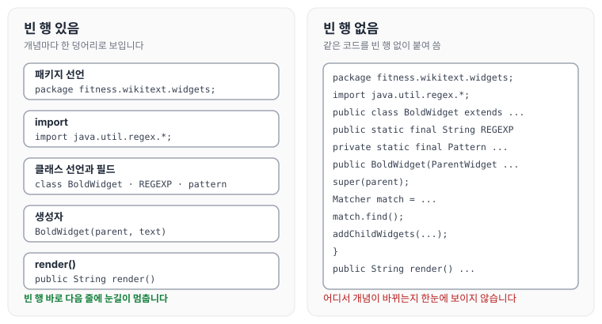
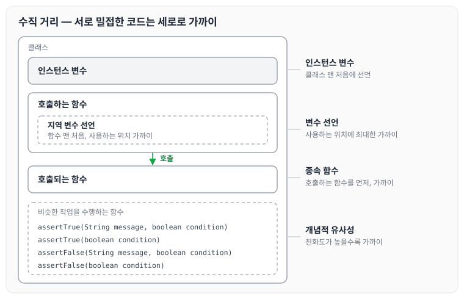
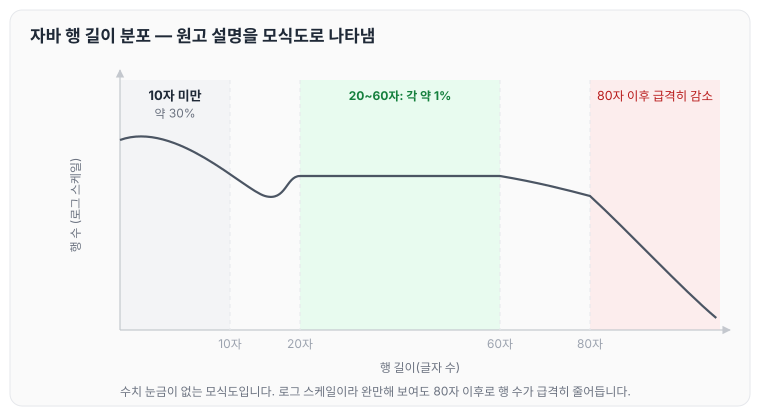

이전에 [4장 주석](../clean-code-ch4-comments/)에 대해 작성하였습니다. 이번에는 클린 코드 5장 형식 맞추기를 읽고, 코드 형식이 왜 중요한지와 세로·가로 형식을 맞추는 기준, 그리고 팀 규칙에 대해 정리하도록 하겠습니다.

## 형식을 맞추는 목적

코드 형식은 중요합니다. 너무 중요해서 무시하기 어렵지만, 그렇다고 융통성 없이 맹목적으로 따라서도 안 됩니다. 코드 형식은 의사소통의 일환입니다.

오늘 구현한 기능이 다음 버전에서 바뀔 확률은 아주 높습니다. 그런데 **오늘 구현한 코드의 가독성은 앞으로 바뀔 코드의 품질에 지대한 영향을 미칩니다.**

오랜 시간이 지나 원래 코드의 흔적을 더 이상 찾아보기 어려울 정도로 코드가 바뀌어도, 맨 처음 잡아 놓은 구현 스타일과 가독성 수준은 유지보수 용이성과 확장성에 계속 영향을 미칩니다. 아래에서는 원활한 소통을 돕는 코드 형식이 어떤 것인지 차례로 정리하겠습니다.

## 적절한 행 길이 유지

여기서 말하는 행 길이는 소스 파일 하나의 길이(행 수)입니다. JUnit, FitNesse, Time and Money는 상대적으로 파일 크기가 작습니다. 500줄이 넘어가는 파일이 없으며 대다수가 200줄 미만입니다.

반면 Tomcat과 Ant는 절반 이상이 200줄을 넘어서고, 수천 줄이 넘어가는 파일도 있습니다.

이 비교에서 알 수 있는 것은 **500줄을 넘기지 않고 대부분 200줄 정도인 파일로도 커다란 시스템을 구축할 수 있다는 사실**입니다.

## 신문 기사처럼 작성하기

이름은 간단하면서도 설명이 가능하도록 짓습니다. 이름만 보고 올바른 모듈을 살펴보고 있는지 아닌지 판단할 수 있을 정도로 신경 써서 짓습니다.

소스 파일 첫 부분은 고차원 개념과 알고리즘을 설명합니다. 아래로 내려갈수록 의도를 세세하게 묘사하고, 마지막에는 가장 저차원 함수와 세부 내역이 나옵니다. 위에서 아래로 읽어 내려가는 순서를 그림으로 나타내면 아래와 같습니다.


그림처럼 위쪽에는 고차원 개념이, 아래로 갈수록 저차원 세부 내역이 놓이도록 배치합니다.

## 빈 행으로 개념 분리

빈 행은 새로운 개념을 시작한다는 시각적 단서입니다. 코드를 읽어 내려가다 보면 빈 행 바로 다음 줄에 눈길이 멈춥니다.

```java
package fitness.wikitext.widgets;

import java.util.regex.*;

public class BoldWidget extends ParentWidget {
	public static final String REGEXP = "'''.+?'''";
    private static final Pattern pattern = Pattern.compile("'''(.+?)'''", Pattern.MULTILINE + Pattern.DOTALL);

    public BoldWidget(ParentWidget parent, String text) throws Exception {
    	super(parent);
        Matcher match = pattern.matcher(text);
        match.find();
        addChildWidgets(match.group(1));
    }

    public String render() throws Exception {
    	...
    }
}
```

아래는 같은 코드에서 빈 행을 빼 버린 코드입니다. 코드 가독성이 현저하게 떨어져 암호처럼 보입니다.

```java
package fitness.wikitext.widgets;
import java.util.regex.*;
public class BoldWidget extends ParentWidget {
	public static final String REGEXP = "'''.+?'''";
    private static final Pattern pattern = Pattern.compile("'''(.+?)'''", Pattern.MULTILINE + Pattern.DOTALL);
    public BoldWidget(ParentWidget parent, String text) throws Exception {
    	super(parent);
        Matcher match = pattern.matcher(text);
        match.find();
        addChildWidgets(match.group(1));
    }
    public String render() throws Exception {
    	...
    }
}
```

두 코드를 개념 단위로 나누어 비교하면 아래와 같습니다.



빈 행이 있는 코드는 패키지 선언, import, 필드, 생성자, `render()`가 각각 한 덩어리로 보이지만, 빈 행을 빼면 어디서 개념이 바뀌는지 한눈에 알기 어렵습니다.

## 세로 밀집도

줄바꿈이 개념을 분리한다면, 세로 밀집도는 연관성을 의미합니다. 즉, **서로 밀접한 코드 행은 세로로 가까이 놓여야 한다**는 뜻입니다.

## 수직 거리

함수나 변수가 정의된 코드를 찾으려고 상속 관계를 줄줄이 거슬러 올라가는 일은 결코 달갑지 않습니다. 시스템이 무엇을 하는지 이해하고 싶은데, 이 조각 저 조각이 어디에 있는지 찾고 기억하느라 시간과 노력을 소모하기 때문입니다.

서로 밀접한 개념은 세로로 가까이 둬야 합니다. 물론 두 개념이 서로 다른 파일에 속한다면 이 규칙이 통하지 않습니다.

### 변수 선언

변수는 사용하는 위치에 최대한 가까이 선언합니다. 책에서 만드는 함수는 매우 짧으므로 지역 변수는 각 함수 맨 처음에 선언합니다.

### 인스턴스 변수

반면 인스턴스 변수(클래스의 멤버 변수)는 클래스 맨 처음에 선언합니다.

### 종속 함수

한 함수가 다른 함수를 호출한다면 두 함수는 세로로 가까이 배치합니다. 또한 가능하다면 호출하는 함수를 호출되는 함수보다 먼저 배치합니다.

### 개념적 유사성

어떤 코드는 서로 끌어당깁니다. 개념적인 친화도가 높기 때문입니다. 친화도가 높을수록 코드를 가까이 배치합니다.

친화도가 높은 요인은 여러 가지입니다.

1. 한 함수가 다른 함수를 호출해 생기는 직접적인 종속
2. 변수와 그 변수를 사용하는 함수
3. 비슷한 작업을 수행하는 일군의 함수

다음은 JUnit 4.3.1에서 가져온 코드입니다.

```java
public class Assert {
	static public void assertTrue(String message, boolean condition) {
    	if (!condition) fail(message);
    }

    static public void assertTrue(boolean condition) {
    	assertTrue(null, condition);
    }

    static public void assertFalse(String message, boolean condition) {
    	assertTrue(message, !condition);
    }

    static public void assertFalse(boolean condition) {
    	assertFalse(null, condition);
    }
}
```

위 함수들은 비슷한 작업을 수행하고 서로를 호출하기도 하므로 친화도가 높아 가까이 배치되어 있습니다. 앞에서 정리한 수직 거리 규칙을 한 클래스 안에서 나타내면 아래와 같습니다.



## 가로 형식 맞추기

책에서는 자바 행 길이 분포를 로그 스케일 그래프로 보여 줍니다. 아래는 그 설명을 수치 눈금 없이 모식도로 나타낸 것입니다. 가로축은 한 행의 길이(글자 수), 세로축은 그 길이인 행의 수입니다.



20자에서 60자 사이는 각 값이 총 행 수의 1% 정도입니다. 그러니까 20자에서 60자 사이인 행이 총 행 수의 40%에 달한다는 말입니다. 10자 미만은 30% 정도로 보입니다.

그래프는 로그 스케일입니다. 즉, 선형 반비례 그래프로 보이지만 사실은 80자 이후부터 행 수가 급격하게 감소합니다. **프로그래머는 명백하게 짧은 행을 선호합니다.**

## 가로 공백과 밀집도

가로로는 공백을 사용해 밀접한 개념과 느슨한 개념을 표현합니다. 다음 함수를 살펴보겠습니다.

```java
private void measureLine(String line) {
	lineCount++;
    int lineSize = line.length();
    totalChars += lineSize;
    lineWidthHistogram.addLine(lineSize, lineCount);
    recordWidestLine(lineSize);
}
```

- 할당 연산자를 강조하려고 앞뒤에 공백을 주었습니다. 할당문은 왼쪽 요소와 오른쪽 요소가 분명히 나뉘는데, 공백을 넣으면 두 요소가 나뉜다는 사실이 더욱 분명해집니다.
- 반면 함수 이름과 이어지는 괄호 사이에는 공백을 넣지 않았습니다. 함수와 인수는 서로 밀접하기 때문입니다. 공백을 넣으면 한 개념이 아니라 별개로 보입니다.
- 함수를 호출하는 코드에서 괄호 안 인수는 공백으로 분리했습니다. 쉼표를 강조해 인수가 별개라는 사실을 보여 주기 위해서입니다.

## 팀 규칙

팀 규칙이라는 제목은 말장난입니다. 프로그래머라면 각자 선호하는 규칙이 있습니다. 하지만 **팀에 속한다면 자신이 선호해야 할 규칙은 바로 팀 규칙**입니다.

## 마무리

오늘은 클린 코드 5장 형식 맞추기에 대해 정리하였습니다. 형식 맞추기에서 가장 중요한 점은 신문처럼 위에서 아래로 잘 정리되어 읽혀야 한다는 것인 듯합니다. 예제들을 보면서 어떤 형식을 어떤 기준으로 묶는지 알 수 있었고, 저도 잘 익혀 두어야겠다고 생각했습니다.

그리고 무엇보다 중요한 것은 팀 규칙인 것 같습니다. 팀에 속한다면 제가 선호하는 스타일은 과감히 내려놓고, 팀 규칙에 잘 맞추도록 노력하려고 합니다. 다음 글에서는 [6장 객체와 자료구조](../clean-code-ch6-objects/)에 대해 정리하도록 하겠습니다.
