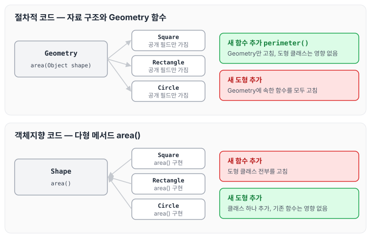
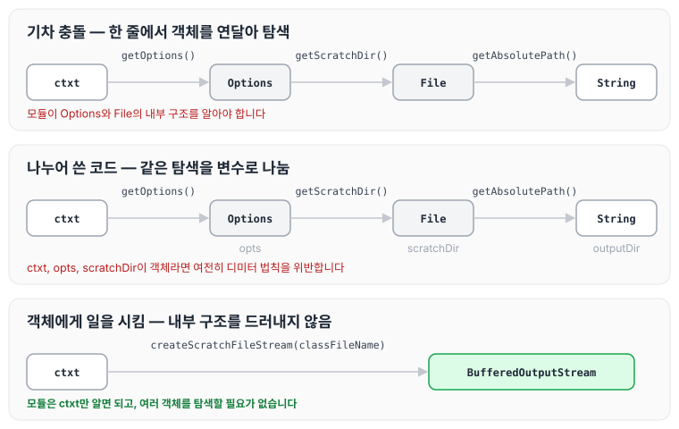

이전에 [5장 형식맞추기](../clean-code-ch5-formatting/)에 대해 작성하였습니다. 이번에는 클린 코드 6장 객체와 자료구조를 읽고, 자료 추상화와 자료/객체 비대칭, 그리고 디미터 법칙에 대해 정리하도록 하겠습니다.

## 변수를 비공개로 두는 이유

변수를 비공개(private)로 정의하는 데는 이유가 있습니다. 남들이 변수에 의존하지 않게 만들고 싶기 때문입니다.

그런데도 수많은 프로그래머가 조회 함수(get)와 설정 함수(set)를 당연하게 공개해 비공개 변수를 외부에 노출합니다.

## 자료 추상화

```java
//목록6-1 구체적인 Point 클래스
public class Point {
    public double x;
    public double y;
}

//목록6-2 추상적인 Point 클래스
public interface Point {
    double getX();
    double getY();
    void setCartesian(double x, double y);
    double getR();
    double getTheta();
    void setPolar(double r, double theta);
}
```

구현을 감추려면 추상화가 필요합니다. 그저 조회 함수와 설정 함수로 변수를 다룬다고 클래스가 되지는 않습니다. 그보다는 **추상 인터페이스를 제공해 사용자가 구현을 모른 채 핵심을 조작할 수 있어야 진정한 의미의 클래스**입니다.

```java
// 구체적인 Vehicle
public interface Vehicle {
    double getFuelTankCapacityIngallons();
    double ettGallonsOfGasoline();
}

// 추상적인 Vehicle
public interface Vehicle {
    double getPercentFuelRemaining();
}
```

자료를 세세하게 공개하기보다는 추상적인 개념으로 표현하는 편이 좋습니다.

인터페이스나 조회/설정 함수만으로는 추상화가 이뤄지지 않습니다. 개발자는 객체가 포함하는 자료를 표현할 가장 좋은 방법을 심각하게 고민해야 합니다. 아무 생각 없이 조회/설정 함수를 추가하는 방법이 가장 나쁩니다.

## 자료/객체 비대칭

객체와 자료 구조는 아래와 같이 구분합니다.

- 객체는 추상화 뒤로 자료를 숨긴 채, 자료를 다루는 함수만 공개합니다.
- 자료 구조는 자료를 그대로 공개하며 별다른 함수는 제공하지 않습니다.

먼저 절차적인 도형 코드입니다.

```java
public class Square {
	public Point topLeft;
    public double side;
}

public class Rectangle {
	public Point topLeft;
    public double height;
    public double width;
}

public class Circle {
	public Point center;
    public double radius;
}

public class Geometry {
	public final double PI = 3.141592653589793;

    public double area(Object shape) throws NoSuchShapeException {
		if (shape instanceof Square){
        	Square s = (Square)shape;
            return s.side * s.side;
        } else if (shape instanceof Rectangle){
        	Rectangle r = (Rectangle)shape;
            return r.height * r.width;
        } else if (shape instanceof Circle){
        	Circle c = (Circle)shape;
            return PI * c.radius * c.radius;
        }

        throw new NoSuchShapeException();
    }
}
```

객체 지향 프로그래머가 위 코드를 본다면 코웃음을 칠지도 모릅니다. 클래스가 절차적이라고 비판한다면 맞는 말입니다.

다만 Geometry 클래스에 둘레 길이를 구하는 `perimeter()` 함수를 추가한다면, 도형 클래스는 아무 영향도 받지 않습니다. 도형 클래스에 의존하는 다른 클래스도 마찬가지입니다. 반대로 새 도형을 추가한다면 Geometry 클래스에 속한 함수를 모두 고쳐야 합니다. 두 조건은 완전히 정반대입니다.

다음은 객체 지향적인 도형 클래스입니다.

```java
public class Square implements Shape {
	private Point topLeft;
    private double side;

    public double area() {
    	return side*side;
    }
}

public class Rectangle implements Shape {
	private Point topLeft;
    private double height;
    private double width;

    public double area() {
    	return height*width;
    }
}

public class Circle implements Shape {
	private Point center;
    private double radius;
    public final double PI = 3.141592653589793;

    public double area() {
    	return PI*radius*radius;
    }
}
```

여기서 `area()`는 다형 메서드입니다. Geometry 클래스는 필요 없습니다. 그러므로 새 도형을 추가해도 기존 함수에 아무런 영향을 미치지 않습니다. 반면 새 함수를 추가하고 싶다면 도형 클래스 전부를 고쳐야 합니다.

두 코드에 새 함수와 새 도형을 추가할 때 어디를 고쳐야 하는지 비교하면 아래와 같습니다.



절차적인 코드는 함수를 추가하기 쉽고, 객체 지향 코드는 도형(자료 타입)을 추가하기 쉽습니다. 한쪽에서 쉬운 변경이 다른 쪽에서는 어렵습니다.

## 자료 추상화 결론

복잡한 시스템을 짜다 보면 새로운 함수가 아니라 **새로운 자료 타입이 필요한 경우**가 생깁니다. 이때는 클래스와 객체 지향 기법이 가장 적합합니다.

반대로 **새로운 함수가 필요한 경우**도 생깁니다. 이때는 절차적인 코드와 자료 구조가 좀 더 적합합니다.

분별 있는 프로그래머는 모든 것이 객체라는 생각이 미신임을 잘 압니다. 때로는 단순한 자료 구조와 절차적인 코드가 가장 적합한 상황도 있습니다.

## 디미터 법칙

디미터 법칙은 잘 알려진 휴리스틱으로, 모듈은 자신이 조작하는 객체의 속사정을 몰라야 한다는 법칙입니다.

### 기차 충돌

```java
final String outputDir = ctxt.getOptions().getScratchDir().getAbsolutePath();
```

흔히 위와 같은 코드를 기차 충돌이라 부릅니다. 일반적으로 조잡하다고 여겨지는 방식이므로 피하는 편이 좋습니다. 위와 같은 코드는 다음과 같이 나누는 편이 좋습니다.

```java
Options opts = ctxt.getOptions();
File scratchDir = opts.getScratchDir();
final String outputDir = scratchDir.getAbsolutePath();
```

다만 ctxt, opts, scratchDir이 객체라면 내부 구조를 숨겨야 하므로, 위 코드는 나누어 썼더라도 확실히 디미터 법칙을 위반합니다.

ctxt, opts, scratchDir이 진짜 객체라면 아래와 같이 객체에게 일을 시키는 편이 좋습니다.

```java
BufferedOutputStream bos = ctxt.createScratchFileStream(classFileName);
```

이렇게 하면 내부 구조를 드러내지 않으며, 모듈에서 해당 함수는 자신이 몰라야 하는 여러 객체를 탐색할 필요가 없습니다. 세 코드가 어떤 객체를 거쳐 가는지 비교하면 아래와 같습니다.



앞의 두 코드는 모듈이 Options와 File의 구조를 알아야 하지만, 마지막 코드는 ctxt만 알면 됩니다.

## 결론

객체는 동작을 공개하고 자료를 숨깁니다. 그래서 기존 동작을 변경하지 않으면서 새 객체 타입을 추가하기는 쉬운 반면, 기존 객체에 새 동작을 추가하기는 어렵습니다.

자료 구조는 별다른 동작 없이 자료를 노출합니다. 그래서 기존 자료 구조에 새 동작을 추가하기는 쉬우나, 기존 함수에 새 자료 구조를 추가하기는 어렵습니다.

시스템을 구현할 때 새로운 자료 타입을 추가하는 유연성이 필요하면 객체가 적합합니다. 새로운 동작을 추가하는 유연성이 필요하면 자료 구조와 절차적인 코드가 더 적합합니다.

## 마무리

오늘은 클린 코드 6장 객체와 자료구조에 대해 정리하였습니다. 객체와 자료구조의 사용법을 명확하게 구분할 수 있는 개념을 갖추고, 상황에 맞는 방법으로 대응해야 할 것 같습니다. 특히 새로운 타입을 추가하는 것은 객체, 새 동작을 추가하는 것은 자료 구조와 절차라는 점을 잊지 않으려고 합니다. 다음 글에서는 [7장 오류처리](../clean-code-ch7-errors/)에 대해 정리하도록 하겠습니다.
