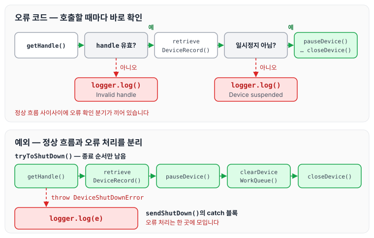
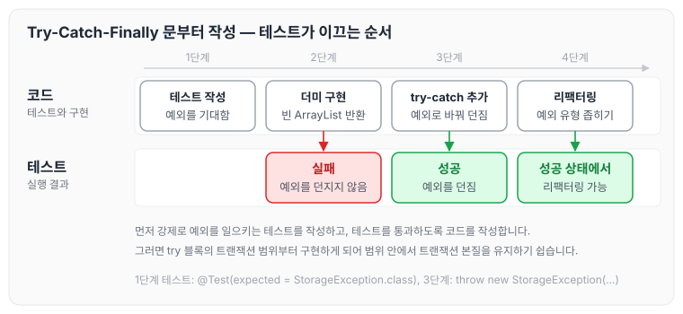
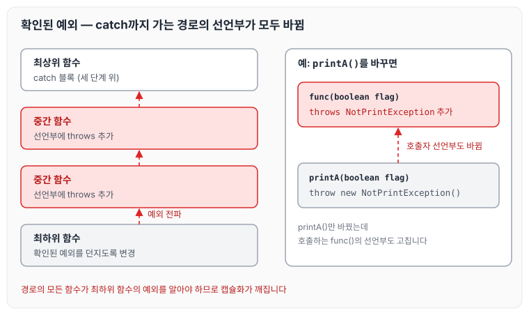
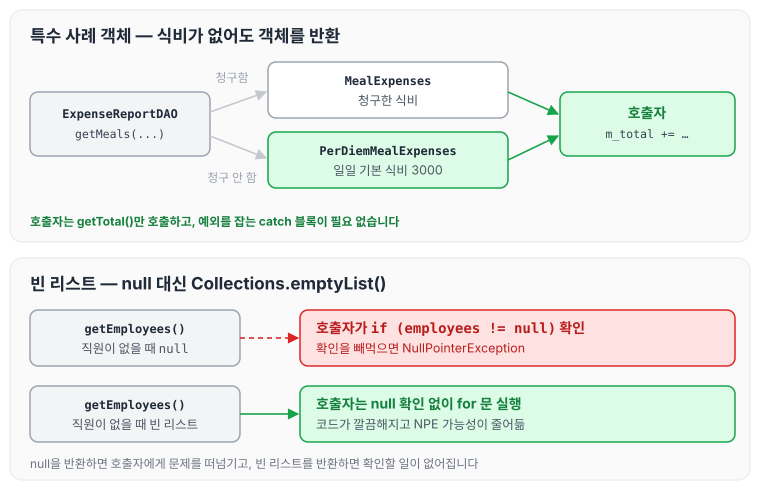

이전에 [6장 객체와 자료구조](../clean-code-ch6-objects/)에 대해 작성하였습니다. 이번에는 클린 코드 7장 오류 처리를 읽고, 오류 코드 대신 예외를 사용하는 방법과 미확인 예외, 예외 클래스 정의, 정상 흐름 정의, 그리고 null을 반환하지 않는 방법에 대해 정리하도록 하겠습니다.

## 깨끗한 코드와 오류 처리

깨끗한 코드와 오류 처리는 확실히 연관성이 있습니다. **상당수 코드 기반은 전적으로 오류 처리 코드에 좌우됩니다.** 여기저기 흩어진 오류 처리 코드 때문에 실제 코드가 하는 일을 파악하기가 거의 불가능하다는 의미입니다.

책에서는 깨끗하고 튼튼한 코드에 한 걸음 더 다가가는 단계로, 오류를 처리하는 기법과 고려 사항 몇 가지를 소개합니다.

## 오류 코드보다 예외 사용

```java
public class DeviceController {
  ...
  public void sendShutDown() {
  	  DeviceHandle handle = getHandle(DEV1);
// 디바이스 상태를 점검한다.
if (handle != DeviceHandle.INVALID) {
// 레코드 필드에 디바이스 상태를 저장한다.
      retrieveDeviceRecord(handle);
// 디바이스가 일시정지 상태가 아니라면 종료한다.
if (record.getStatus() != DEVICE_SUSPENDED) {
		     pauseDevice(handle);
		     clearDeviceWorkQueue(handle);
		     closeDevice(handle);
		  } else {
		     logger.log("Deivce suspended. Unalbe to shut down");
		  }
    } else {
        logger.log("Invlid handle for:" + DEV1.toString());
    }
  }
}
```

위와 같은 방법을 사용하면 호출자 코드가 복잡해집니다. 함수를 호출한 즉시 오류를 확인해야 하기 때문입니다. 오류가 발생하면 예외를 던지는 편이 낫습니다.

```java
public class DeviceController {
    ...

    public void sendShutDown() {
    	try {
        	tryToShutDown();
        } catch (DeviceShutDownError e) {
        	logger.log(e);
        }
    }

    private void tryToShutDown() throws DeviceShutDownError {
    	DeviceHandle handle = getHandle(DEV1);
        DeviceRecord record = retrieveDeviceRecord(handle);

        pauseDevice(handle);
        clearDeviceWorkQueue(handle);
        closeDevice(handle);
    }

    private DeviceHandle getHandle(DeviceID id) {
    	...
        throw new DeviceShutDownError("Invalid handle for :" + id.toString());
        ...
    }

    ...
}
```

코드가 확실히 깨끗해졌습니다. 단순히 보기만 좋아진 것이 아니라 코드 품질도 나아졌습니다. 디바이스를 종료하는 알고리즘과 오류를 처리하는 알고리즘을 분리했기 때문입니다. 두 코드의 흐름을 비교하면 아래와 같습니다.



오류 코드 방식에서는 정상 흐름 사이사이에 확인 분기가 끼어 있지만, 예외 방식에서는 `tryToShutDown()`에 종료 순서만 남고 오류 처리는 `catch` 블록 한 곳에 모입니다.

## Try-Catch-Finally 문부터 작성

어떤 면에서 try 블록은 트랜잭션과 비슷합니다. try 블록에서 무슨 일이 생기든지 catch 블록은 프로그램 상태를 일관성 있게 유지해야 합니다.

다음은 파일이 없으면 예외를 던지는지 알아보는 단위 테스트와, 테스트에 맞춰 구현을 바꿔 가는 과정입니다.

```java
@Test(expected = StorageException.class)
public void retrieveSetctionShouldThrowOnInvalidFileName() {
	sectionStore.retrieveSection("invlid - file");
}

// 단위 테스트에 맞춰 다음 코드를 구현했다.
public List<RecordedGrip> retrieveSection(String sectionName) {
	// 실제로 구현할 때까지 비어 있는 더미를 반환한다;
	return new ArrayList<RecordedGrip>();
}

// 그런데 코드가 예외를 던지지 않으므로 단위 테스트 실패// 변경해보자
public List<RecordedGrip> retrieveSection (String sectionName) {
	try {
    	FileInputStream stream = new FileInputStream(sectionName);
    } catch (Exception e) {
    	throw new StorageException("retrieval error", e);
    }
    return new ArrayList<RecordedGrip>();
}

// 코드가 예외를 던지므로 이제는 테스트가 성공한다. 이 시점에서 리팩터링이 가능하다. catch 블록에서// 예외 유형을 좁혀 실제로 FileInputStream 생성자가 던지는지 FileNotFoundException을 잡아낸다.
public List<RecordedGrip> retrieveSection (String sectionName) {
	try {
    	FileInputStream stream = new FileInputStream(sectionName);
        stream.close();
    } catch (Exception e) {
    	throw new StorageException("retrieval error", e);
    }
    return new ArrayList<RecordedGrip>();
}
```

위 과정을 단계별로 나타내면 아래와 같습니다.



**먼저 강제로 예외를 일으키는 테스트 케이스를 작성한 후, 테스트를 통과하게 코드를 작성하는 방법을 권장합니다.** 그러면 자연스럽게 try 블록의 트랜잭션 범위부터 구현하게 되므로 범위 내에서 트랜잭션 본질을 유지하기 쉽습니다.

## 미확인(unchecked) 예외 사용

처음에는 미확인 예외가 무엇인지 정확히 와닿지 않아 아래 글을 찾아보았습니다.

[만렙 개발자 키우기 — 개발 경험치를 쌓아가며 성장하는 개발자의 기록 일지입니다. (www.nowwatersblog.com)](https://www.nowwatersblog.com/cs/Exception)

checked Exception과 unchecked Exception의 차이점은 RuntimeException을 상속하는지 아닌지에 있습니다. 그리고 컴파일 시 예외 처리를 확인하는지에도 차이가 있습니다.

| 속성 | checked Exception | unchecked Exception |
| --- | --- | --- |
| 종류 | IOException, SQLException | NullPointerException, IndexOutOfBoundsException |
| 예외 처리 여부 | 반드시 예외 처리가 있어야 합니다. | 런타임 중 예외가 확인됩니다. |
| 예외 확인 시점 | 컴파일 중 | 런타임 중 |
| 트랜잭션 처리 | 기본적으로 roll-back하지 않습니다. | 기본적으로 roll-back합니다. |

확인된(checked) 예외는 OCP를 위반합니다. 메서드에서 확인된 예외를 던졌는데 catch 블록이 세 단계 위에 있다면, 그 사이 메서드 모두가 선언부에 해당 예외를 정의해야 합니다. 즉, 하위 단계에서 코드를 변경하면 상위 단계 메서드 선언부를 전부 고쳐야 한다는 말입니다.

아래 코드는 출력하는 메서드입니다.

```java
 public void printA(boolean flag) {
     if (flag)
         System.out.println("called");
 }

 public void func(boolean flag) {
     printA(flag);
 }
```

출력하지 않을 때 NotPrintException을 던지도록 구현을 변경하면 다음과 같습니다.

```java
 public void printA(boolean flag) throws NotPrintException {
     if (flag){
     	System.out.println("called");
     } else {
     	throw new NotPrintException();
     }
 }

 public void func(boolean flag) throws NotPrintException {
     printA(flag);
 }
```

`printA()`만 바꿨는데 이를 호출하는 `func()`의 선언부에도 `throws NotPrintException`이 붙었습니다.

대규모 시스템에서는 최상위 함수가 아래 함수를 호출하고, 아래 함수는 다시 그 아래 함수를 호출합니다. 단계를 내려갈수록 호출하는 함수 수는 늘어납니다. 최하위 함수에서 확인된 예외를 던지기 시작하면 아래와 같이 catch 블록까지 가는 경로의 선언부가 모두 바뀝니다.



이처럼 **throws 경로에 위치하는 모든 함수가 최하위 함수에서 던지는 예외를 알아야 하므로 캡슐화가 깨집니다.**

## 예외에 의미 제공

1. 오류 메시지에 정보를 담아 예외와 함께 던집니다.
2. 실패한 연산 이름과 실패 유형도 언급합니다.

## 호출자를 고려해 예외 클래스 정의

애플리케이션에서 오류를 정의할 때 프로그래머에게 가장 중요한 관심사는 오류를 잡아내는 방법이 되어야 합니다.

다음은 오류를 형편없이 분류한 사례입니다.

```java
ACMEPort port = new ACMEPort(12);

try {
    port.open();
} catch (DeviceResponseException e) {
    reportPortError(e);
    logger.log("Device response exception", e);
} catch (ATM1212UnlocakedException e) {
    reportPortError(e);
    logger.log("Unlocaked exception", e);
} catch (GMXError e) {
    reportPortError(e);
    logger.log("Device response exception", e);
} finally {
     ....
}
```

위 코드는 중복이 심하지만 그리 놀랍지 않습니다. 대다수 상황에서 오류를 처리하는 방식은 아래와 같이 비교적 일정하기 때문입니다.

1. 오류를 기록합니다.
2. 프로그램을 계속 수행해도 좋은지 확인합니다.

위 경우는 예외에 대응하는 방식이 예외 유형과 무관하게 거의 동일합니다. 그래서 코드를 간결하게 고치기가 아주 쉽습니다. 호출하는 라이브러리 API를 감싸면서 예외 유형 하나를 반환하면 됩니다.

```java
LocalPort port = new LocalPort (12);

try {
    port.open();
} catch (PortDeviceFailure e) {
    reportPortError(e);
    logger.log("Device response exception", e);
} finally {
    ...
}
```

```java
public class LocalPort {
    private ACMEPort innerPort;

    public LocalPort(int number) {
        innerPort = new ACMEPort(number);
    }

    public void open() {
        try {
          innerPort. open();
        } catch (DeviceResponseException e) {
            throw new PortDeviceFailure(e);
        } catch (ATM1212UnlocakedException e) {
            throw new PortDeviceFailure(e);
        } catch (GMXError e) {
            throw new PortDeviceFailure(e);
        }
    }
}
```

LocalPort 클래스처럼 ACMEPort를 감싸는 클래스는 매우 유용합니다. **실제로 외부 API를 사용할 때는 감싸기 기법이 최선입니다.** 이유는 아래와 같습니다.

1. 외부 API를 감싸면 외부 라이브러리와 프로그램 사이의 의존성이 크게 줄어듭니다.
2. 나중에 다른 라이브러리로 갈아타도 비용이 적습니다.
3. 외부 API를 호출하는 대신 테스트 코드를 넣어 주는 방법으로 테스트하기도 쉽습니다.
4. 특정 업체가 API를 설계한 방식에 발목 잡히지 않습니다.
5. 프로그램이 훨씬 깨끗해집니다.

## 정상 흐름 정의

다음은 비용 청구 애플리케이션에서 총계를 계산하는 허술한 코드입니다.

```java
try {
    MealExpenses expenses = expenseReportDAO.getMeals(meployee.getId());
    m_total += expenses.getTotal();
} catch (MealExpensesNotFound e) {
    m_total += getMealPPerDiem();
}
```

위에서 식비를 비용으로 청구했다면 직원이 청구한 식비를 총계에 더합니다. 식비를 비용으로 청구하지 않았다면 일일 기본 식비를 총계에 더합니다. 그런데 예외가 논리를 따라가기 어렵게 만듭니다.

특수 상황을 처리할 필요가 없다면 코드는 아래와 같이 더 간결해집니다.

```java
MealExpenses expenses = expenseReportDAO.getMeals(meployee.getId());
m_total += expenses.getTotal();
```

이를 위해 ExpenseReportDAO를 고쳐 언제나 MealExpense 객체를 반환하도록 합니다. 청구한 식비가 없다면 일일 기본 식비를 반환하는 MealExpense 객체를 반환합니다.

```java
public class PerDiemMealExpenses implements MealExpense {
    public int getTotal() {
    	return 3000;// 기본값
    }
}
```

여기서 ExpenseReportDAO를 어떻게 설계해야 하는지가 잘 이해되지 않아, 아래와 같이 설계해 보았습니다.

```java
public class ExpenseReportDAO {
    ...
    MealExpense getTotal(String employeeId) {
    	if (isEmployeeIdNull(employeeId)) {
        	return new PerDiemMealExpenses();
        } else {
        	return new MealExpenses();
        }
    }
}
```

이와 같이 설계하면 되지 않을까 생각했습니다. 그러면 클라이언트 코드가 예외적인 상황을 처리할 필요가 없어집니다. 클래스나 객체가 예외적인 상황을 캡슐화해서 처리하기 때문입니다.

## null 반환 금지

한 줄 건너 하나씩 null을 확인하는 코드로 가득한 애플리케이션을 책의 저자는 수도 없이 봤다고 합니다. 다음이 한 예입니다.

```java
public void registerItem(Item item) {
    if (item != null) {
        ItemRegistry registry = peristentStore.getItemRegisrty();
        if (registry != null) {
            Item existing = registry.getItem(item.getId());
            if (existing.getBillingPeriod().hasRetailOwner()) {
                existing.register(item);
            }
        }
    }
}
```

이런 코드 기반에서 코드를 짜 왔다면 나쁘다고 느끼지 않을지도 모릅니다. 하지만 위 코드는 나쁜 코드입니다.

1. null을 반환하는 코드는 일거리를 늘릴 뿐만 아니라 호출자에게 문제를 떠넘깁니다.
2. 누구 하나라도 null 확인을 빼먹는다면 애플리케이션이 통제 불능에 빠질지도 모릅니다.

실제로 위 코드의 둘째 행에는 null 확인이 빠져 있습니다. 차라리 예외를 던지거나 특수 사례 객체를 반환하는 것이 좋습니다.

```java
List<Employee> employees = getEmployees();
if(employees != null) {
	for(Employee e : employees) {
		totalPay += e.getPay();
	}
}
```

위에서 `getEmployees()`는 null도 반환합니다. 하지만 반드시 null을 반환할 필요는 없습니다. `getEmployees()`를 변경해 빈 리스트를 반환한다면 코드가 훨씬 깔끔해집니다.

```java
List<Employee> employees = getEmployees();
for(Employee e : employees) {
	totalPay += e.getPay();
}

public List<Employee> getEmployees() {
	if (..직원이 없다면..)
		return Collections.emptyList();
}
```

이렇게 코드를 변경하면 코드도 깔끔해질뿐더러 NullPointerException이 발생할 가능성도 줄어듭니다. 앞의 특수 사례 객체와 빈 리스트를 반환하는 방식을 함께 비교하면 아래와 같습니다.



두 경우 모두 호출자는 `getTotal()`이나 for 문을 그대로 실행하면 되고, 예외 처리나 null 확인 분기를 둘 필요가 없습니다.

## 결론

깨끗한 코드는 읽기도 좋아야 하지만 안정성도 높아야 합니다. 이 둘은 상충하는 목표가 아닙니다.

## 마무리

오늘은 클린 코드 7장 오류 처리에 대해 정리하였습니다. 이번 장은 이해하는 데 시간이 조금 걸렸습니다. 많은 개념을 알고 있어야 좀 더 명확하게 이해할 수 있을 것 같으며, 특히 null의 위험성을 강조한다는 생각이 들었습니다. null을 주의 깊게, 가능하면 사용하지 않는다는 생각으로 코딩하려고 합니다. 다음 글에서는 [8장 경계](../clean-code-ch8-boundaries/)에 대해 정리하도록 하겠습니다.
