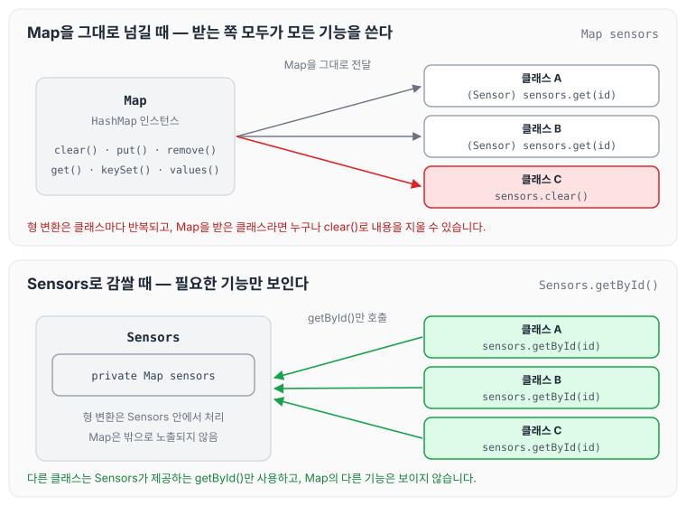
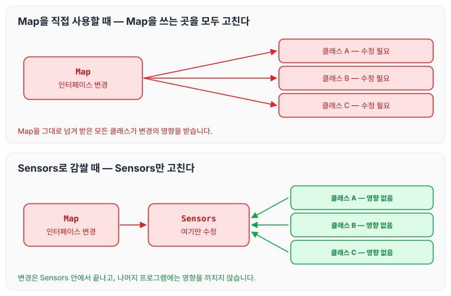

이전에 [7장 오류처리](../clean-code-ch7-errors/)에 대해 작성하였습니다. 이번 글에서는 클린 코드 8장 경계를 읽고, 외부 코드를 우리 코드에 깔끔하게 통합하는 방법을 `java.util.Map` 예제로 정리하도록 하겠습니다.

## 외부 코드와 경계

시스템에 들어가는 모든 소프트웨어를 직접 개발하는 경우는 드뭅니다. 때로는 패키지를 사고, 때로는 오픈 소스를 이용합니다. 어떤 식으로든 이 외부 코드를 우리 코드에 **깔끔하게 통합**해야 합니다.

## 외부 코드 사용하기

패키지 제공자나 프레임워크 제공자는 적용성을 최대한 넓히려 애씁니다. 더 많은 환경에서 돌아가야 더 많은 고객이 구매하기 때문입니다. 반면 사용자는 자신의 요구에 집중하는 인터페이스를 바랍니다. 이런 차이 때문에 시스템 경계에서 문제가 생길 소지가 많습니다.

책에서는 `java.util.Map`을 예로 듭니다.

- Map은 굉장히 다양한 인터페이스로 수많은 기능을 제공합니다.
- Map이 제공하는 기능성과 유연성은 확실히 유용하지만 그만큼 위험도 큽니다.
- Map을 만들어 여기저기 넘긴다고 가정해 보겠습니다. 넘기는 쪽에서는 아무도 Map의 내용을 삭제하지 않으리라 믿을지도 모릅니다. 하지만 아래 목록의 첫 번째가 `clear()` 메서드입니다. 즉, Map 사용자라면 누구나 Map 내용을 지울 권한이 있다는 뜻입니다.

Map이 제공하는 메서드 목록은 아래와 같습니다.

```text
clear() void – Map
containsKey(Object key) boolean – Map
containsValue(Object value) boolean – Map
entrySet() Set – Map
equals(Object o) boolean – Map
get(Object key) Object – Map
getClass() Class<? extends Object> – Object
hashCode() int – Map
isEmpty() boolean – Map
keySet() Set – Map
notify() void – Object
notifyAll() void – Object
put(Object key, Object value) Object – Map
putAll(Map t) void – Map
remove(Object key) Object – Map
size() int – Map
toString() String – Object
values() Collection – Map
wait() void – Object
wait(long timeout) void – Object
wait(long timeout, int nanos) void – Object
```

## Map을 그대로 사용할 때의 문제

Sensor라는 객체를 담는 Map을 만들려면 아래와 같이 Map을 생성합니다.

```java
Map sensors = new HashMap();
```

Sensor 객체가 필요한 코드는 아래와 같이 Sensor 객체를 가져옵니다.

```java
Sensor s = (Sensor)sensors.get(sensorId);
```

이런 코드가 한 번이 아니라 여러 차례 나옵니다. 즉, Map이 반환하는 Object를 올바른 유형으로 변환할 책임은 Map을 사용하는 클라이언트에 있습니다.

아래와 같이 제네릭을 사용하면 코드 가독성이 크게 높아집니다.

```java
Map<String, Sensor> sensors = new HashMap<String, Sensor>();
...
Sensor s = sensors.get(sensorId);
```

그렇지만 이 방법도 `Map<String, Sensor>`가 사용자에게 필요하지 않은 기능까지 제공한다는 문제는 해결하지 못합니다.

아래 그림은 Map을 그대로 여러 클래스에 넘길 때와, Map을 Sensors 클래스 안에 숨길 때를 비교한 것입니다.



위쪽은 Map을 받은 클래스마다 `clear()` 같은 메서드를 호출할 수 있고, 형 변환도 각자 해야 합니다. 아래쪽은 Map이 Sensors 안에만 있고, 다른 클래스는 Sensors가 제공하는 `getById()`만 사용합니다.

## 경계 인터페이스를 클래스 안에 숨기기

아래는 Map을 좀 더 깔끔하게 사용한 코드입니다. Sensors 사용자는 제네릭이 사용되었는지 여부에 신경 쓸 필요가 없습니다. 제네릭 사용 여부는 Sensors 안에서 결정합니다.

```java
public class Sensors {
	private Map sensors = new HashMap();

    public Sensor getById(String id) {
    	return (Sensor) sensors.get(id);
    }

// 이하 생략
}
```

이렇게 감싸면 아래와 같은 점이 달라집니다.

1. 경계 인터페이스인 Map을 Sensors 안에 숨깁니다.
    - Map 인터페이스가 변하더라도 나머지 프로그램에는 영향을 끼치지 않습니다.
    - 제네릭을 사용하든 하지 않든 더 이상 문제가 되지 않습니다. Sensors 클래스 안에서 객체 유형을 관리하고 변환하기 때문입니다.
2. Sensors 클래스는 프로그램에 필요한 인터페이스만 제공합니다.
    - 클래스 설계자가 제공한 함수만 사용할 수 있기 때문에, 필요한 함수만 사용하게 됩니다.
3. Map 클래스를 사용할 때마다 위와 같이 캡슐화하라는 뜻은 아닙니다.
    - Map과 같은 경계 인터페이스를 이용할 때 이를 이용하는 클래스나 클래스 계열 밖으로 노출되지 않도록 주의합니다.
    - Map 인스턴스를 공개 API의 인수로 넘기거나 반환 값으로 사용하지 않습니다.

Map 인터페이스가 바뀌었을 때 영향이 어디까지 퍼지는지는 아래 그림과 같습니다.



Map을 직접 사용한 경우에는 Map을 쓰는 모든 클래스를 고쳐야 하지만, Sensors로 감싼 경우에는 Sensors 한 곳만 고치면 됩니다.

책에서는 이어서 테스트 케이스를 통한 log4j 예제가 나옵니다. 이 부분은 공부한 뒤 이해한 내용을 바탕으로 추후에 작성하도록 하겠습니다.

## 마무리

오늘은 외부 코드를 사용할 때 생기는 경계 문제와, Map 같은 경계 인터페이스를 클래스 안에 숨기는 방법에 대해 정리하였습니다. 경계 인터페이스를 이용할 때는 클래스나 클래스 계열 밖으로 노출되지 않게 하고, 사용자가 원하는 기능만 사용할 수 있게 설계해야 할 것 같습니다. 너무 많은 기능을 제공하면 원하지 않는 값까지 삭제하거나 삭제할 수 있는 상황이 생길 수 있기 때문입니다. 다음 글에서는 [10장 클래스](../clean-code-ch10-classes/)에 대해 정리하도록 하겠습니다.
