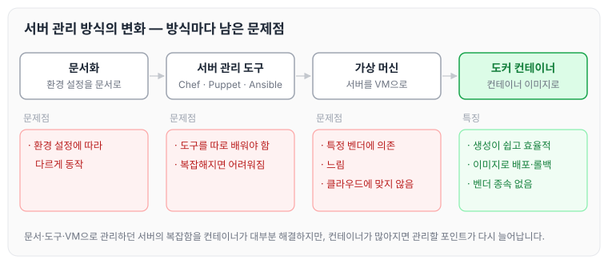
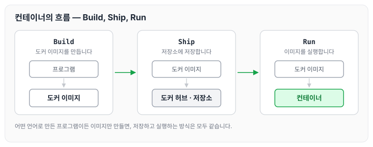
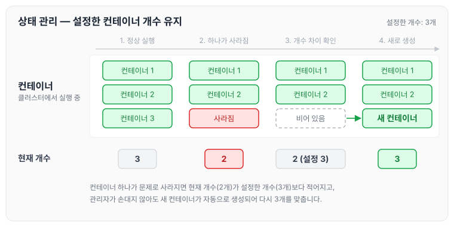

오늘은 컨테이너 오케스트레이션에 대해 정리하도록 하겠습니다. 서버를 관리하는 방식이 어떻게 바뀌어 왔는지부터 살펴보고, 도커 컨테이너가 등장한 뒤 컨테이너가 많아지면서 생긴 문제와 이를 해결하기 위한 컨테이너 오케스트레이션, 그리고 쿠버네티스를 사용하는 이유를 순서대로 정리하겠습니다.

## 서버를 관리한다는 것

서버를 관리하는 방식은 아래와 같이 바뀌어 왔고, 방식마다 문제점이 있었습니다.

1. 문서화
    - 문제점: 환경 설정에 따라 다르게 동작하기 때문에 문서만으로 관리하기에는 어려움이 많았습니다.
2. 서버 관리 도구(Chef, Puppet, Ansible)
    - 문제점
        1. 설정 관리 도구를 따로 배워야 합니다.
        2. 서버가 복잡해지면 도구 자체의 사용법도 어려워집니다.
3. 가상 머신
    - 문제점
        1. 특정 벤더에 의존적이게 됩니다.
        2. 느립니다.
        3. 클라우드 환경에 맞지 않습니다.

여기에 도커 컨테이너가 등장하면서 관리 방식이 한 번 더 바뀌었습니다. 흐름을 그림으로 정리하면 아래와 같습니다.

## 도커 컨테이너의 등장

도커 컨테이너는 서버 관리자가 겪던 복잡함의 대부분을 해결해 줍니다. 컨테이너의 특징은 아래와 같습니다.

- 가상 머신과 비교하여 컨테이너 생성이 쉽고 효율적입니다.
- 컨테이너 이미지를 이용한 배포와 롤백이 간단합니다.
- 언어나 프레임워크에 상관없이 애플리케이션을 동일한 방식으로 관리합니다.
- 개발, 테스팅, 운영 환경은 물론 로컬 PC와 클라우드까지 동일한 환경을 구축합니다.
- 특정 클라우드 벤더에 종속적이지 않습니다.

각각의 프로그램을 컨테이너 단위로 실행하고, 해당 프로그램들을 컨테이너로 만드는 것을 Containerization이라고 합니다.

## 컨테이너의 흐름

컨테이너는 아래 세 단계로 사용합니다.

- Build: 도커 이미지를 만듭니다.
- Ship: 만든 이미지를 도커 허브나 저장소에 저장합니다.
- Run: 도커 이미지를 실행합니다.

예전에는 프로그램이 어떤 언어를 사용하는지에 따라 처리 방식이 달랐지만, 도커를 사용하면 이미지만 만들면 저장하고 실행하는 방식이 모두 표준화됩니다.

## 컨테이너의 문제점

컨테이너가 편리하다 보니 모든 프로그램을 컨테이너로 만들게 됩니다. 그러면서 점점 복잡해지고, 관리해야 할 포인트가 많이 생깁니다. 대표적으로 배포, 서비스 검색, 서비스 이상과 부하 모니터링에서 문제가 생깁니다.

## 컨테이너 배포의 문제점

컨테이너를 배포할 때는 아래와 같은 문제가 있습니다.

1. 배포할 때 서버마다 한 개씩 SSH로 접속해서 배포를 진행해야 합니다.
2. 여유 있는 컨테이너가 어디에 있는지 모니터링해야 합니다.
3. 프로그램 버전을 올릴 때 서버에 전부 접속해서 처리해야 합니다.

## 서비스 검색의 문제점

웹으로 접근하면 로드밸런서를 통해서 여러 IP 주소로 접근하게 됩니다. 이때 아래와 같은 문제가 있습니다.

1. 최근에는 마이크로서비스 아키텍처(MSA)로 많은 서비스가 API 통신을 합니다. 서비스가 늘어날 때마다 로드밸런서에 신규 IP 주소를 부여하고 프록시에도 작성해야 하는 관리 포인트가 생깁니다.

## 서비스 이상과 부하 모니터링의 문제점

서비스에 이상이 생기거나 부하가 몰렸을 때는 아래와 같은 문제가 있습니다.

1. 서버에 문제가 생기면 서버 관리자는 새벽에도 일어나서 조치해야 합니다.
2. 퇴근 전에는 새벽에 장애가 발생하지 않기를 바랄 수밖에 없습니다.

컨테이너 자체는 좋은 기술이지만, 이렇게 많이 생성된 컨테이너를 관리하기 위한 기술이 따로 필요합니다. 이 기술이 컨테이너 오케스트레이션입니다.

Container Orchestration은 복잡한 컨테이너 환경을 효과적으로 관리하기 위한 도구입니다.

## 컨테이너 오케스트레이션

컨테이너 오케스트레이션이 제공하는 기능은 아래와 같습니다.

### 1. CLUSTER

- 기존에는 서버 관리자가 노드에 대한 자원을 모두 알고 있어야 했습니다.
- 도커가 많아지면서 노드 단위가 아닌 클러스터 단위로 관리해야 합니다.
- 관리자가 마스터 서버에 명령을 내리면 클러스터 간의 통신으로 명령어가 실행됩니다.
- 그래서 클러스터 안의 컨테이너들은 서로 잘 연결되어 있어야 합니다.

### 2. STATE(상태 관리)

- 컨테이너 개수를 설정해 놓으면 자동으로 컨테이너 개수를 유지해 줍니다.
- 컨테이너 하나가 문제로 사라지면 자동으로 새로 생성되어 설정한 개수(예: 3개)를 맞춰 줍니다.

컨테이너 개수를 3개로 설정해 둔 상태에서 컨테이너 하나가 사라졌을 때의 흐름은 아래와 같습니다.

현재 개수가 설정한 개수와 달라지면 관리자가 직접 손대지 않아도 설정한 개수로 다시 맞춰집니다.

### 3. SCHEDULING(배포 관리)

- 서버를 배포할 때는 어떤 서버에 여유가 있는지 서버 관리자가 알아야 배포를 진행할 수 있습니다.
- 하지만 컨테이너 오케스트레이션을 사용하면 자동으로 여유 공간에 앱을 배치합니다.
- 여유 공간이 없을 때는 신규 서버를 만든 후 컨테이너를 만들어 줍니다.

### 4. ROLLOUT/ROLLBACK(버전 관리)

- 서버별로 개별 관리하는 것이 아니라 하나의 명령어로 관리합니다.

### 5. SERVICE DISCOVERY(서비스 등록 및 조회)

- 도커 웹 서버를 사용하는 프록시 서버가 저장소를 관찰하다가, 바뀔 때마다 설정을 변경하고 프로세스를 재시작합니다.
- 관리자가 IP 설정을 일일이 변경할 필요 없이 프로그램이 재설정해 줍니다.

### 6. VOLUME(볼륨)

- 볼륨 3개를 마운트해야 할 수도 있습니다.
    - 첫 번째 서버에서는 NFS를 마운트합니다.
    - 두 번째 서버에서는 AWS를 마운트합니다.
    - 세 번째 서버에서는 GCE를 마운트합니다.
- 각 서버를 직접 연결할 수도 있지만, 추상적인 설정으로 변경하는 편이 좋습니다.

## 쿠버네티스를 사용하는 이유

쿠버네티스는 컨테이너를 쉽고 빠르게 배포·확장하고 관리를 자동화해 주는 오픈소스 플랫폼입니다. 컨테이너 오케스트레이션 도구 중에서 쿠버네티스를 사용하는 이유는 아래와 같습니다.

1. 다양한 요구사항을 만족시킬 수 있는 유연함이 있습니다.
2. 어디서나 동작합니다(오픈소스, 리눅스 기반).
3. 커뮤니티 활동이 활발합니다.
4. 많은 인기 운영 환경에서 사용하는 비율이 85%입니다.
5. 2019년 카카오, 라인에 적용되었습니다(국내 기업에서도 사용 중).
6. 확장성이 뛰어납니다(Kubeflow, Tekton, 서비스 메시, 서버리스).
7. 사실상의 표준이 되었습니다.
8. 도커에서도 쿠버네티스를 지원하기 시작했습니다.
9. Amazon, Azure, Google도 쿠버네티스를 사용하기 시작했습니다.
10. 인프라를 운영하기 위한 라이브러리 구성이 잘 되어 있습니다.

## 마무리

오늘은 서버 관리 방식이 도커 컨테이너로 바뀌어 온 흐름과, 컨테이너가 많아지면서 생기는 배포·서비스 검색·모니터링 문제를 해결하는 컨테이너 오케스트레이션의 기능, 그리고 쿠버네티스를 사용하는 이유에 대해 정리하였습니다. 컨테이너를 사용하는 것만큼 많아진 컨테이너를 어떻게 관리할지가 중요하다는 것을 알 수 있었습니다.

> 이 글은 인프런의 [초보를 위한 쿠버네티스 안내서](https://www.inflearn.com/course/쿠버네티스-입문)을 들으며 정리한 노트입니다.
