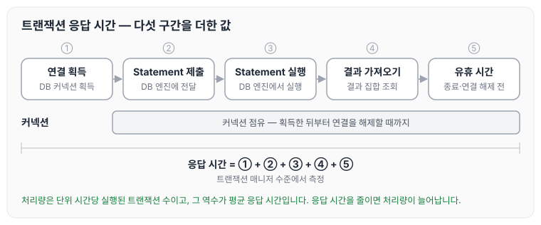
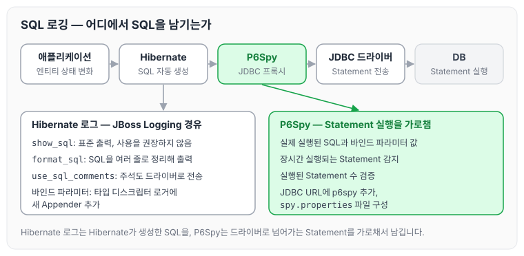
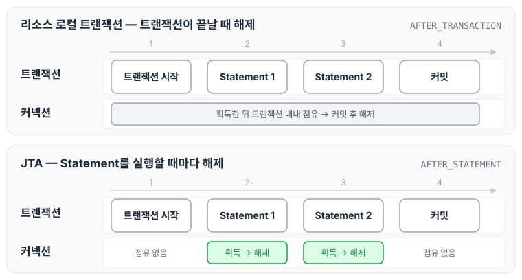
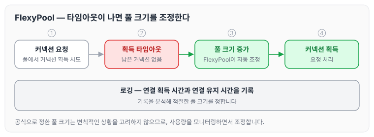

오늘은 Vlad Mihalcea의 고성능 JPA & Hibernate 강의를 들으며 정리한 내용 중, 데이터 액세스 스택에 대해 정리하도록 하겠습니다.

애플리케이션이 데이터베이스에 접근할 때는 JPA, Hibernate, JDBC 드라이버, 커넥션 풀 같은 여러 계층을 거칩니다. 성능을 측정하는 단위부터 시작해서 SQL 로깅, 스키마 관리, 통합 테스트, 커넥션 관리와 모니터링, Hibernate 통계, 타입 순서로 정리하겠습니다.

## 데이터 액세스 스택 (Data Access Stack)

### 성능 측정 단위

데이터 액세스 계층의 성능은 응답 시간과 처리량으로 측정합니다.

- 응답 시간(Latency)은 트랜잭션 매니저 수준에서 측정합니다.
- 트랜잭션 하나의 응답 시간은 아래 다섯 구간으로 이루어집니다.
    1. DB 연결 획득 시간
    2. Statement가 DB 엔진에 제출되는 시간
    3. Statement 실행 시간
    4. 결과 집합을 가져오는 시간
    5. 트랜잭션 종료 및 DB 연결 해제 전 애플리케이션 유휴 시간
- 처리량(Throughput)은 확장성을 측정하는 단위입니다.
    - 단위 시간당 실행된 트랜잭션 수를 말합니다.
    - 처리량의 역수가 평균 응답 시간입니다.
    - 따라서 응답 시간을 줄이면 성능과 확장성이 함께 향상됩니다.

트랜잭션 하나가 거치는 다섯 구간을 순서대로 그리면 다음과 같습니다.

응답 시간은 다섯 구간을 더한 값이므로, 어느 한 구간만 줄여도 전체 응답 시간이 줄어듭니다. 또한 연결을 획득한 뒤부터 해제할 때까지 커넥션을 점유하므로, 유휴 시간이 길어지면 그만큼 커넥션도 오래 묶이게 됩니다.

### 설계 고려사항

성능을 고려해 설계하려면 데이터 처리와 관련된 모든 계층을 이해해야 합니다.

- 객체-관계 불일치(Object-Relational Impedance Mismatch)
    - 객체 지향 도메인 모델과 관계형 DB 사이에는 불일치가 있습니다.
    - 이 불일치를 변환하는 책임은 데이터 액세스 계층에 있습니다.
- JPA 명세
    - JPA는 명세일 뿐이고, 성능은 구현체의 세부 사항에 따라 달라집니다.
    - JPQL은 데이터를 조회하기 위한 것이며, 네이티브 SQL을 대체하지 않습니다. JPQL 문법은 [JPQL 기본 문법](../jpa-jpql-basics/)에서 정리하였습니다.

## SQL Statement 로깅 (Logging SQL Statement)

### 필요성

JPA와 Hibernate는 persist, merge, remove 같은 엔티티 상태 변화에 따라 SQL을 자동으로 생성합니다. 그래서 로깅을 하지 않으면 실제로 어떤 SQL이 생성되었는지 확인할 수 없고, 이 때문에 성능 문제가 생길 수 있습니다. 반면 일반 JDBC를 사용하면 전송되는 Statement를 개발자가 완전히 제어할 수 있습니다.

### Hibernate 로그 설정

Hibernate에서 SQL 출력과 관련된 설정 옵션은 아래와 같습니다.

- `show_sql`: SQL을 표준 출력으로 내보냅니다. 사용을 권장하지 않으며, 로깅 프레임워크를 사용하는 것이 좋습니다.
- `format_sql`: SQL을 여러 줄로 정리해서 출력합니다. `show_sql`의 표준 출력뿐 아니라 로깅 프레임워크로 남기는 SQL에도 같은 형식이 적용됩니다.
- `use_sql_comments`
    - 엔티티 상태 전환, 조인 이유, 명시적 잠금 메커니즘 등을 설명하는 주석을 SQL에 추가합니다.
    - 이 주석은 SQL과 함께 JDBC 드라이버로 전송되므로 네트워크 I/O 오버헤드가 발생합니다.

Hibernate는 내부에서 JBoss Logging이라는 로깅 프레임워크를 사용하고, JBoss Logging이 외부 로깅 프레임워크와 연결하는 역할을 합니다. Prepared Statement의 바인드 파라미터 값까지 로그로 확인하려면 Hibernate SQL 타입 디스크립터 로거에 새로운 Appender를 추가해야 합니다.

### P6Spy

P6Spy는 외부 JDBC Statement 프록시입니다. JDBC 드라이버 또는 DataSource를 프록시로 감싸서 Statement 실행을 가로채고, 바인드 파라미터 값까지 로그로 남깁니다.

- 장시간 실행되는 Statement를 감지할 수 있습니다.
- 실행된 Statement 수를 검증할 수 있습니다.
- 이처럼 횡단 관심사(Cross-Cutting Concerns)를 제공합니다.

P6Spy 설정을 통해 실제로 실행되는 정확한 SQL 쿼리를 확인할 수 있습니다. 설정은 JDBC URL에 p6spy를 추가하고, spy.properties 파일을 구성하는 방식입니다.

Hibernate 로그와 P6Spy가 각각 어느 지점에서 SQL을 남기는지 그리면 다음과 같습니다.

Hibernate 로그는 Hibernate가 생성한 SQL을 남기고, P6Spy는 드라이버로 넘어가는 Statement를 가로채서 남깁니다.

## 스키마 관리 (Schema Management)

### 스키마 변경 원칙

스키마 변경은 데이터베이스가 주도해야 합니다. 권장사항은 아래와 같습니다.

1. 스키마 마이그레이션을 수동으로 실행하지 않습니다.
2. 운영 환경에서는 Hibernate HBM2DDL auto를 사용하지 않습니다.
3. HBM2DDL은 아래 용도로만 사용합니다.
    - DB 스키마 프로토타입이나 초기 스크립트를 생성하는 용도로 사용합니다.
    - 프로덕션 환경에서 사용하기에는 적합하지 않습니다.

스키마 자동 생성 옵션을 환경별로 어떻게 두는지는 [엔티티 매핑](../jpa-entity-mapping/)에서 정리하였습니다.

### Flyway

Flyway는 DDL을 형상 관리하고 자동으로 적용해 주는 도구입니다.

- 장점
    - 애플리케이션에서 스키마를 자동으로 적용할 수 있어 편리합니다.
    - 자동화 툴과 통합하면 이점이 큽니다.
- 주의점
    - 실서버나 베타서버에 설정하는 것은 위험합니다.
    - 신중한 테스트와 롤백 전략이 필요합니다.

## 통합 테스트 (Integration Test)

통합 테스트에서는 도커와 TempFS를 활용해 인메모리 DB 테스트로 속도를 높일 수 있습니다. 예를 들면 H2나 Testcontainers를 활용하는 방식입니다.

## 연결 관리 및 제공자 (Connection Management / Connection Provider)

### 연결 풀 사용

연결 수는 특정 임계값을 넘어서면 늘어날수록 오히려 성능을 악화시킵니다. 그래서 Connection Pool을 사용하는 것을 권장합니다. 커넥션 풀이 필요한 이유와 HikariCP 설정은 [커넥션 풀과 데이터소스 이해하기](../spring-db-connection-pool/), [DBCP](../dbcp/)에서 정리하였습니다.

### Hibernate 연결 제공자

Hibernate가 제공하는 연결 제공자는 아래와 같습니다.

- `DriverManagerConnectionProviderImpl`: 테스트용입니다.
- `C3P0ConnectionProvider`: 안정적입니다.
- `HikariCPConnectionProvider`: 빠르지만, Hibernate 전용 속성을 지원하지 않습니다.
- `DatasourceConnectionProviderImpl`: 가장 유연합니다.

### Hibernate 연결 생명주기

Hibernate는 트랜잭션 종류에 따라 연결을 해제하는 시점이 다릅니다.

- 리소스 로컬 트랜잭션: 트랜잭션이 종료될 때 연결을 해제합니다.
- JTA: 각 Statement를 실행한 뒤 연결을 해제합니다.
- 연결 획득 지연: 연결을 획득하는 시점을 늦추면 그만큼 더 많은 연결 요청을 처리할 수 있습니다.

두 방식에서 커넥션을 점유하는 구간을 비교하면 다음과 같습니다.

리소스 로컬 트랜잭션은 커밋할 때까지 커넥션을 쥐고 있고, JTA는 Statement가 끝날 때마다 커넥션을 해제합니다.

## 연결 모니터링 (Connection Monitoring)

### 풀 크기의 중요성

풀 크기를 정하는 공식은 강의 PDF를 참고하면 되지만, 이 공식은 변칙적인 상황을 고려하지 않습니다. 그래서 실용적으로는 아래와 같이 접근합니다.

1. 연결 사용량을 모니터링합니다.
    - 연결 획득 시간과 연결 유지 시간을 분석합니다.
2. 풀 크기 조정을 자동화합니다.
    - 연결 획득 타임아웃이 감지되면 풀 크기를 자동으로 조정합니다.

### FlexyPool

FlexyPool은 DB Connection Pool을 동적으로 관리하는 도구입니다.

- 로깅을 지원하므로, 로그를 보고 적절한 풀 크기를 설정할 수 있습니다.
- FlexyPool을 구성하면 풀 크기를 동적으로 조정하고 모니터링할 수 있습니다.

연결 획득 타임아웃이 났을 때 FlexyPool이 풀 크기를 조정하는 흐름은 다음과 같습니다.

공식으로 정한 풀 크기를 그대로 쓰기보다, 사용량을 모니터링하면서 풀 크기를 조정하는 방식입니다.

## Hibernate 통계 (Hibernate Statistic)

Hibernate는 내부 통계를 수집할 수 있고, 이 통계로 성능 병목 지점을 파악할 수 있습니다. 쿼리 실행 시간, 캐시 히트율, 연결 사용량 등을 분석하는 데 활용합니다.

## JPA 및 Hibernate 타입 (JPA and Hibernate Types)

### Enum vs String

Enum을 저장하는 방식은 두 가지입니다.

- Ordinal: Enum 값을 숫자로 저장합니다.
- String: Enum 값을 문자열로 저장합니다.

개인적으로는 Enum 때문에 조인할 필요가 없고, String을 사용하는 편이 더 안전하고 간단하다고 생각합니다. ORDINAL을 쓸 때 생기는 문제는 [엔티티 매핑](../jpa-entity-mapping/)의 `@Enumerated`에서 정리하였습니다.

## 추가 참고사항

- 고성능 JPA & Hibernate 강의는 성능 최적화에 초점을 맞추고 있습니다.
- 함께 보면 좋은 자료는 아래와 같습니다.
    - 강의 PDF 및 예제 코드
    - Hibernate 공식 문서
    - P6Spy, Flyway, FlexyPool 문서

## 마무리

오늘은 데이터 액세스 스택에서 성능을 측정하는 단위와 SQL 로깅, 스키마 관리, 커넥션 관리와 모니터링, Hibernate 통계, Enum 타입에 대해 정리하였습니다. 정리하면서 따로 메모해 둔 내용은 아래와 같습니다.

- P6Spy: 정확한 쿼리를 확인하는 도구입니다.
- Flyway: DDL 형상 관리 도구로, 자동화 툴과 통합하면 이점이 있지만 운영 환경에 설정할 때는 주의해야 합니다.
- FlexyPool: Connection Pool을 동적으로 관리하고 로깅해 줍니다.
- Enum vs String: 간단하고 안전한 String을 선호합니다.

참조 : [세계 자바 챔피언, Vlad Mihalcea 강의 로드맵 - 인프런](https://www.inflearn.com/roadmaps/9183)
