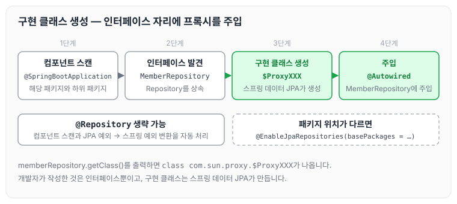
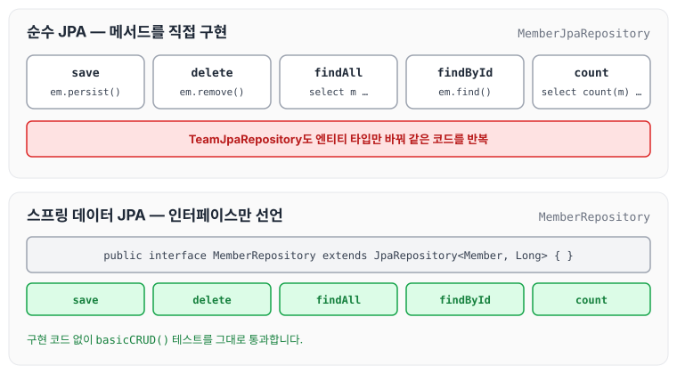
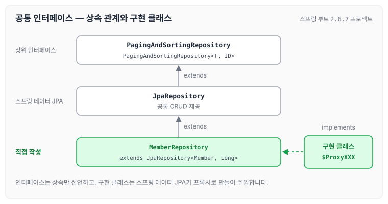

이전에 [예제 도메인 모델과 동작 확인](../data-jpa-domain-model/)에 대해 작성하였습니다. 오늘은 스프링 데이터 JPA의 공통 인터페이스 기능에 대해 정리하도록 하겠습니다. 다루는 내용은 아래와 같습니다.

- 순수 JPA 기반 리포지토리 만들기
- 스프링 데이터 JPA 공통 인터페이스 소개
- 스프링 데이터 JPA 공통 인터페이스 활용

## 순수 JPA 기반 리포지토리 만들기

먼저 순수한 JPA 기반 리포지토리를 만듭니다. 구현할 기본 CRUD는 아래와 같습니다.

- 저장
- 변경 → 변경감지 사용
- 삭제
- 전체 조회
- 단건 조회
- 카운트

> 참고: JPA에서 수정은 변경감지 기능을 사용하면 됩니다.
>
> 트랜잭션 안에서 엔티티를 조회한 다음에 데이터를 변경하면, 트랜잭션 종료 시점에 변경감지 기능이 작동해서 변경된 엔티티를 감지하고 UPDATE SQL을 실행합니다.

변경감지가 동작하는 방식은 [영속성 컨텍스트](../jpa-persistence-context/)에 정리하였습니다.

### 회원 리포지토리

순수 JPA 기반 회원 리포지토리는 아래와 같습니다.

```java
package study.datajpa.repository;

import org.springframework.stereotype.Repository;
import study.datajpa.Entity.Member;

import javax.persistence.EntityManager;
import javax.persistence.PersistenceContext;
import java.util.List;
import java.util.Optional;

@Repository
public class MemberJpaRepository {
    @PersistenceContext
    private EntityManager em;

    public Member save(Member member) {
        em.persist(member);
        return member;
    }

    public void delete(Member member) {
        em.remove(member);
    }

    public List<Member> findAll() {
        return em.createQuery("Select m from Member m" , Member.class)
                .getResultList();
    }

    public Optional<Member> findById (Long memberId) {
        Member member = em.find(Member.class, memberId);
        return Optional.ofNullable(member);
    }

    public long count() {
        return em.createQuery("Select count(m) from Member m", Long.class)
                .getSingleResult();
    }

    public Member find(Long id) {
        return em.find(Member.class, id);
    }
}
```

### 팀 리포지토리

순수 JPA 기반 팀 리포지토리는 아래와 같습니다.

```java
package study.datajpa.repository;

import org.springframework.stereotype.Repository;
import study.datajpa.Entity.Member;
import study.datajpa.Entity.Team;

import javax.persistence.EntityManager;
import javax.persistence.PersistenceContext;
import java.util.List;

@Repository
public class TeamJpaRepository {

    @PersistenceContext
    private EntityManager em;

    public Team save(Team team) {
        em.persist(team);
        return team;
    }

    public void delete(Team team) {
        em.remove(team);
    }

    public List<Team> findAll() {
        return em.createQuery("select t from Team t", Team.class)
                .getResultList();
    }

    public long count() {
        return em.createQuery("select count(t) from Team t", Long.class)
                .getSingleResult();
    }

}
```

팀 리포지토리는 회원 리포지토리와 거의 동일합니다. 엔티티 타입만 다르고 `EntityManager`로 저장, 삭제, 조회, 카운트를 구현하는 코드가 반복됩니다.

### 순수 JPA 기반 리포지토리 테스트

순수 JPA 기반 리포지토리 테스트는 아래와 같습니다.

```java
package study.datajpa.repository;

import org.junit.jupiter.api.Test;
import org.springframework.beans.factory.annotation.Autowired;
import org.springframework.boot.test.context.SpringBootTest;
import org.springframework.test.annotation.Rollback;
import org.springframework.transaction.annotation.Transactional;
import study.datajpa.Entity.Member;

import java.util.List;

import static org.assertj.core.api.Assertions.*;

@SpringBootTest
@Transactional
@Rollback(false)
class MemberJpaRepositoryTest {

    @Autowired
    MemberJpaRepository jpaRepository;

    @Test
    public void testMember() {
        Member member = new Member("memberA");
        Member saveMember = jpaRepository.save(member);
        Member findMember = jpaRepository.find(saveMember.getId());

        assertThat(findMember.getId()).isEqualTo(member.getId());
        assertThat(findMember.getUserName()).isEqualTo(member.getUserName());

        assertThat(findMember).isEqualTo(member);
    }

    @Test
    public void basicCRUD() {
        Member member1 = new Member("member1");
        Member member2 = new Member("member2");
        jpaRepository.save(member1);
        jpaRepository.save(member2);

        //단건 조회 검증
        Member findMember1 = jpaRepository.findById(member1.getId()).get();
        Member findMember2 = jpaRepository.findById(member2.getId()).get();
        assertThat(findMember1).isEqualTo(member1);
        assertThat(findMember2).isEqualTo(member2);

        //리스트 조회 검증
        List<Member> all = jpaRepository.findAll();
        assertThat(all.size()).isEqualTo(2);

        //카운트 검증
        long count = jpaRepository.count();
        assertThat(count).isEqualTo(2);

        //삭제 검증
        jpaRepository.delete(member1);
        jpaRepository.delete(member2);
        long deletedCount = jpaRepository.count();
        assertThat(deletedCount).isEqualTo(0);
    }
}
```

`basicCRUD()`에서 저장, 단건 조회, 리스트 조회, 카운트, 삭제를 차례로 검증합니다.

## 공통 인터페이스 설정

JavaConfig로 설정하는 방법은 아래와 같습니다. 스프링 부트를 사용하면 생략할 수 있습니다.

```java
@Configuration
@EnableJpaRepositories(basePackages = "jpabook.jpashop.repository")
public class AppConfig {}
```

- 스프링 부트를 사용하면 @SpringBootApplication 위치를 기준으로 해당 패키지와 하위 패키지를 인식합니다.
- 만약 위치가 달라지면 `@EnableJpaRepositories`가 필요합니다.

인터페이스만 만들었는데 동작하는 이유는 스프링 데이터 JPA가 구현 클래스를 대신 생성하기 때문입니다.

- `org.springframework.data.repository.Repository`를 상속한 인터페이스는 스캔 대상입니다.
    - MemberRepository 인터페이스가 동작한 이유입니다.
    - 실제로 출력해 보면 Proxy가 노출됩니다.
    - memberRepository.getClass() → class com.sun.proxy.$ProxyXXX
- `@Repository` 애노테이션을 생략할 수 있습니다.
    - 컴포넌트 스캔을 스프링 데이터 JPA가 자동으로 처리합니다.
    - JPA 예외를 스프링 예외로 변환하는 과정도 자동으로 처리합니다.

스프링 데이터 JPA가 구현 클래스를 만들어 주입하는 흐름을 그림으로 보면 아래와 같습니다.



개발자는 인터페이스만 작성하고, 실제로 주입되는 객체는 스프링 데이터 JPA가 만든 프록시입니다.

## 공통 인터페이스 적용

순수 JPA로 구현한 `MemberJpaRepository` 대신에 스프링 데이터 JPA가 제공하는 공통 인터페이스를 사용합니다.

### 스프링 데이터 JPA 기반 MemberRepository

```java
public interface MemberRepository extends JpaRepository<Member, Long> {
}
```

### MemberRepository 테스트

```java
package study.datajpa.repository;

import org.junit.jupiter.api.Test;
import org.springframework.beans.factory.annotation.Autowired;
import org.springframework.boot.test.context.SpringBootTest;
import org.springframework.test.annotation.Rollback;
import org.springframework.transaction.annotation.Transactional;
import study.datajpa.Entity.Member;

import java.util.List;

import static org.assertj.core.api.Assertions.*;

@SpringBootTest
@Transactional
@Rollback(value = false)

class MemberRepositoryTest {

    @Autowired
    MemberRepository memberRepository;

    @Test
    public void testMember() {
        Member member = new Member("memberA");
        Member saveMember = memberRepository.save(member);

        Member findMember = memberRepository.findById(member.getId()).get();

        assertThat(findMember.getId()).isEqualTo(member.getId());
        assertThat(findMember.getUserName()).isEqualTo(member.getUserName());

        assertThat(findMember).isEqualTo(member);
    }

    @Test
    public void basicCRUD() {
        Member member1 = new Member("member1");
        Member member2 = new Member("member2");
        memberRepository.save(member1);
        memberRepository.save(member2);

        //단건 조회 검증
        Member findMember1 = memberRepository.findById(member1.getId()).get();
        Member findMember2 = memberRepository.findById(member2.getId()).get();
        assertThat(findMember1).isEqualTo(member1);
        assertThat(findMember2).isEqualTo(member2);

        //리스트 조회 검증
        List<Member> all = memberRepository.findAll();
        assertThat(all.size()).isEqualTo(2);

        //카운트 검증
        long count = memberRepository.count();
        assertThat(count).isEqualTo(2);

        //삭제 검증
        memberRepository.delete(member1);
        memberRepository.delete(member2);
        long deletedCount = memberRepository.count();
        assertThat(deletedCount).isEqualTo(0);
    }

}
```

기존 순수 JPA 기반 테스트에서 사용했던 코드를 그대로 스프링 데이터 JPA 리포지토리 기반 테스트로 변경해도 동일한 방식으로 동작합니다.

두 방식을 비교하면 아래와 같습니다.



순수 JPA 리포지토리에서 직접 작성한 메서드를 스프링 데이터 JPA 리포지토리에서는 작성하지 않아도 같은 테스트가 통과합니다.

### TeamRepository 생성

```java
package study.datajpa.repository;

import org.springframework.data.jpa.repository.JpaRepository;
import study.datajpa.Entity.Team;

public interface TeamRepository extends JpaRepository<Team, Long> {
}
```

- TeamRepository는 테스트를 생략합니다.
- Generic
    - T: 엔티티 타입
    - ID: 식별자 타입(PK)

## 공통 인터페이스 분석

- JpaRepository 인터페이스: 공통 CRUD를 제공합니다.
- 제네릭은 `<엔티티 타입, 식별자 타입>`으로 설정합니다.

`JpaRepository` 공통 기능 인터페이스는 아래와 같습니다.

```java
public interface JpaRepository<T, ID extends Serializable>
	extends PagingAndSortingRepository<T, ID>
	{
		...
	}
```

`JpaRepository`를 사용하는 인터페이스는 아래와 같습니다.

```java
public interface MemberRepository extends JpaRepository<Member, Long> {
}
```

`MemberRepository`는 `JpaRepository`를 상속하고, `JpaRepository`는 `PagingAndSortingRepository`를 상속합니다. 구현 클래스는 스프링 데이터 JPA가 프록시로 만들어 줍니다. 이 관계를 그리면 아래와 같습니다.



주의할 점으로, 이전에 사용하던 `T findOne(ID)`는 `Optional<T> findById(ID)`로 변경되었습니다.

제네릭 타입은 아래와 같습니다.

- `T`: 엔티티
- `ID`: 엔티티의 식별자 타입
- `S`: 엔티티와 그 자식 타입

주요 메서드는 아래와 같습니다.

- `save(S)`: 새로운 엔티티는 저장하고 이미 있는 엔티티는 병합합니다.
- `delete(T)`: 엔티티 하나를 삭제합니다. 내부에서 `EntityManager.remove()`를 호출합니다.
- `findById(ID)`: 엔티티 하나를 조회합니다. 내부에서 `EntityManager.find()`를 호출합니다.
- `getOne(ID)`: 엔티티를 프록시로 조회합니다. 내부에서 `EntityManager.getReference()`를 호출합니다.
- `findAll(...)`: 모든 엔티티를 조회합니다. 정렬(`Sort`)이나 페이징(`Pageable`) 조건을 파라미터로 제공할 수 있습니다.

`EntityManager.getReference()`가 돌려주는 프록시는 [프록시의 동작 원리](../jpa-proxy/)에 정리하였습니다.

> 참고: `JpaRepository`는 대부분의 공통 메서드를 제공합니다.

## 마무리

오늘은 순수 JPA로 기본 CRUD 리포지토리를 만들어 본 뒤, 스프링 데이터 JPA의 공통 인터페이스 `JpaRepository`로 대체하는 과정과 공통 인터페이스의 구성, 주요 메서드에 대해 정리하였습니다. 엔티티마다 반복되던 CRUD 코드를 인터페이스 선언만으로 대신할 수 있다는 점이 스프링 데이터 JPA를 사용하는 가장 큰 이유인 것 같습니다.

다음 글에서는 [쿼리 메소드 기능](../data-jpa-query-methods/)에 대해 정리하도록 하겠습니다.

> 이 글은 인프런 김영한 님의 [실전! 스프링 데이터 JPA](https://www.inflearn.com/course/스프링-데이터-JPA-실전)을 들으며 정리한 노트입니다.
