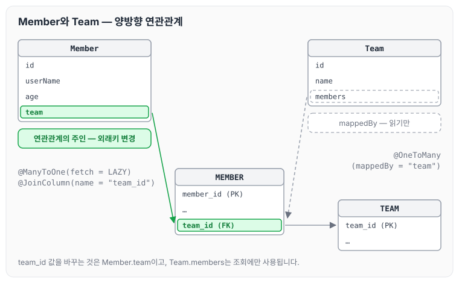
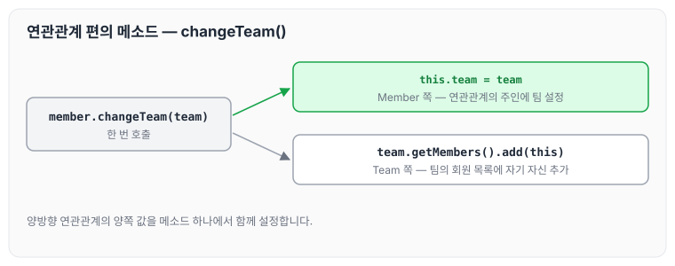
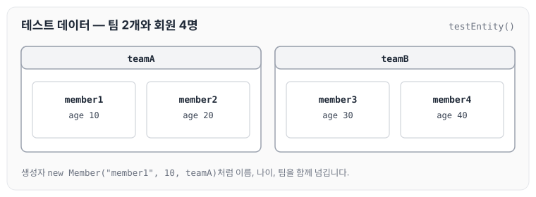
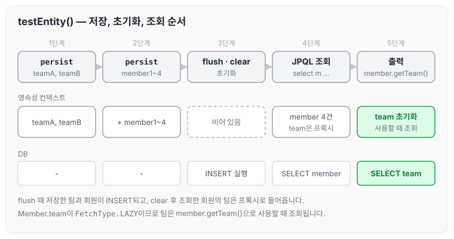

이전에 [프로젝트 환경설정](../data-jpa-setup/)에 대해 작성하였습니다. 오늘은 스프링 데이터 JPA 실습에 사용할 예제 도메인 모델인 회원(Member)과 팀(Team) 엔티티를 정의하고, 순수 JPA로 동작을 확인하는 과정을 정리하도록 하겠습니다.

## 예제 도메인 모델

회원은 하나의 팀에 소속되고, 팀에는 여러 회원이 소속됩니다. 두 엔티티와 테이블의 관계를 먼저 그림으로 보면 아래와 같습니다.



외래키 `team_id`는 MEMBER 테이블에 있고, 이 값을 관리하는 쪽은 `Member.team`입니다. 자세한 내용은 아래 엔티티 코드와 함께 정리합니다.

## Member 엔티티

Member 엔티티는 아래와 같습니다.

```java
package study.datajpa.Entity;

import lombok.AccessLevel;
import lombok.Getter;
import lombok.NoArgsConstructor;
import lombok.ToString;

import javax.persistence.*;

@Entity
@Getter
@NoArgsConstructor(access = AccessLevel.PROTECTED)
@ToString(of = {"id", "userName", "age"})
public class Member {

    @Id @GeneratedValue
    @Column(name = "member_id")
    private Long id;
    private String userName;
    private int age;

    @ManyToOne(fetch = FetchType.LAZY)
    @JoinColumn(name = "team_id")
    private Team team;

    public Member(String userName) {
        this.userName = userName;
    }

    public Member(String userName, int age, Team team) {
        this.userName = userName;
        this.age = age;
        if (team != null) {
            this.team = team;
        }
    }

    public void changeTeam(Team team) {
        this.team = team;
        team.getMembers().add(this);
    }
}
```

롬복을 사용할 때 주의할 점은 아래와 같습니다.

- @Setter: 실무에서는 가급적 Setter를 사용하지 않습니다.
- @NoArgsConstructor AccessLevel.PROTECTED: 기본 생성자를 막고 싶지만, JPA 스펙상 PROTECTED로 열어두어야 합니다.
- @ToString은 가급적 내부 필드만(연관관계가 없는 필드만) 대상으로 합니다.

`changeTeam()`은 양방향 연관관계를 한 번에 처리하는 연관관계 편의 메소드입니다. 회원의 팀을 바꾸면서 팀의 회원 목록에도 자기 자신을 추가합니다.



연관관계 편의 메서드는 [연관관계 매핑 기초](../jpa-association-basics/)에서도 정리하였습니다.

## Team 엔티티

Team 엔티티는 아래와 같습니다.

```java
package study.datajpa.Entity;

import lombok.AccessLevel;
import lombok.Getter;
import lombok.NoArgsConstructor;
import lombok.Setter;

import javax.persistence.*;
import java.util.ArrayList;
import java.util.List;

@Entity
@Getter @Setter
@NoArgsConstructor(access = AccessLevel.PROTECTED)
public class Team {
    @Id @GeneratedValue
    @Column(name = "team_id")
    private Long id;
    private String name;

    @OneToMany(mappedBy = "team")
    private List<Member> members = new ArrayList<>();

    public Team(String name) {
        this.name = name;
    }
}
```

Member와 Team은 양방향 연관관계이며, `Member.team`이 연관관계의 주인입니다. `Team.members`는 연관관계의 주인이 아니므로, `Member.team`이 데이터베이스 외래키 값을 변경하고 반대편은 읽기만 가능합니다. 연관관계의 주인을 정하는 기준은 [연관관계 매핑 기초](../jpa-association-basics/)에 정리하였습니다.

## 데이터 확인 테스트

엔티티가 잘 동작하는지 확인하는 테스트는 아래와 같습니다.

```java
package study.datajpa.Entity;

import org.junit.jupiter.api.Test;
import org.springframework.boot.test.context.SpringBootTest;
import org.springframework.test.annotation.Rollback;
import org.springframework.transaction.annotation.Transactional;

import javax.persistence.EntityManager;
import javax.persistence.PersistenceContext;

import java.util.List;

@SpringBootTest
@Transactional
@Rollback(false)
class MemberTest {

    @PersistenceContext
    EntityManager em;

    @Test
    public void testEntity() {
        Team teamA = new Team("teamA");
        Team teamB = new Team("teamB");
        em.persist(teamA);
        em.persist(teamB);

        Member member1 = new Member("member1", 10, teamA);
        Member member2 = new Member("member2", 20, teamA);
        Member member3 = new Member("member3", 30, teamB);
        Member member4 = new Member("member4", 40, teamB);
        em.persist(member1);
        em.persist(member2);
        em.persist(member3);
        em.persist(member4);

        //초기화
        em.flush();
        em.clear();

        //확인
        List<Member> members = em.createQuery("select m from Member m", Member.class)
                .getResultList();
        for (Member member : members) {
            System.out.println("member = "+ member);
            System.out.println("--> member.team = "+ member.getTeam());
        }
    }

}
```

테스트에서 저장하는 데이터는 아래와 같습니다. teamA에 member1, member2가 소속되고, teamB에 member3, member4가 소속됩니다.



테스트는 팀과 회원을 저장한 뒤 `em.flush()`, `em.clear()`로 영속성 컨텍스트를 비우고, JPQL로 회원을 다시 조회합니다. 진행 순서는 아래와 같습니다.



`Member.team`은 `FetchType.LAZY`이므로 회원을 조회할 때 팀은 함께 조회되지 않고, `member.getTeam()`으로 팀을 사용할 때 조회됩니다. 지연 로딩이 동작하는 방식은 [즉시 로딩과 지연 로딩](../jpa-lazy-eager-loading/)에 정리하였습니다.

이 테스트로 아래 내용을 확인합니다.

- 가급적 순수 JPA로 동작을 확인합니다.
- db 테이블 결과 확인
- 지연 로딩 동작 확인

## 마무리

오늘은 실습에 사용할 Member, Team 엔티티와 양방향 연관관계, 연관관계 편의 메소드를 정의하고, 순수 JPA로 저장과 조회, 지연 로딩 동작을 확인하는 과정을 정리하였습니다. 스프링 데이터 JPA를 사용하기 전에 순수 JPA로 먼저 동작을 확인해 두면, 이후 스프링 데이터 JPA가 대신해 주는 부분을 비교하기 쉬울 것 같습니다.

다음 글에서는 [공통 인터페이스 기능](../data-jpa-common-interface/)에 대해 정리하도록 하겠습니다.

> 이 글은 인프런 김영한 님의 [실전! 스프링 데이터 JPA](https://www.inflearn.com/course/스프링-데이터-JPA-실전)을 들으며 정리한 노트입니다.
