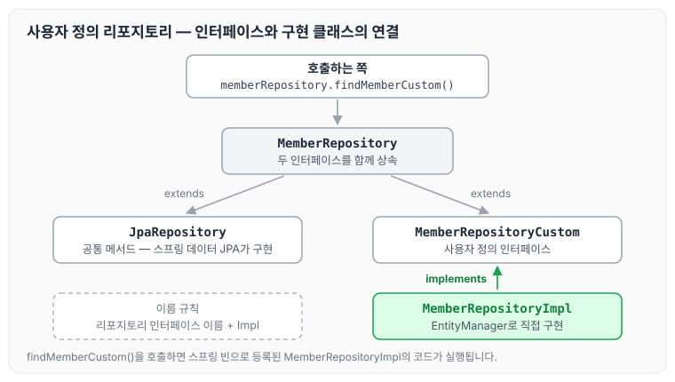
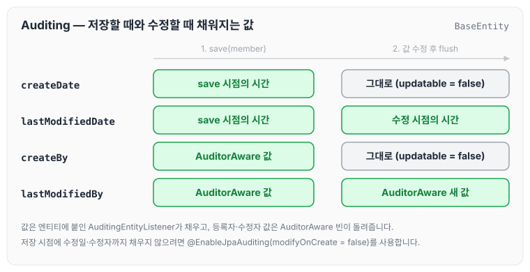
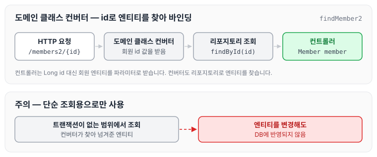
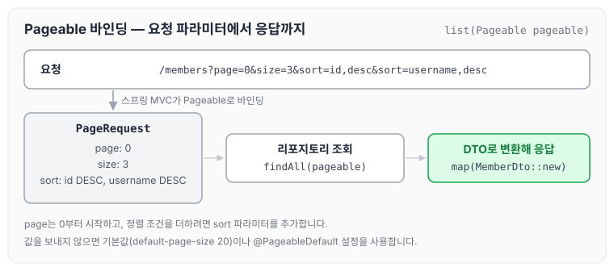
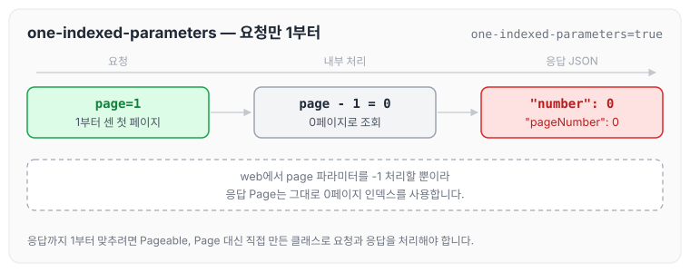

이전에 [쿼리 메소드 기능](../data-jpa-query-methods/)에 대해 작성하였습니다. 이번에는 사용자 정의 리포지토리, Auditing, 도메인 클래스 컨버터, 웹 페이징과 정렬처럼 스프링 데이터 JPA가 제공하는 확장 기능에 대해 정리하도록 하겠습니다.

## 사용자 정의 리포지토리 구현

- 스프링 데이터 JPA 리포지토리는 인터페이스만 정의하고 구현체는 스프링이 자동 생성합니다.
- 스프링 데이터 JPA가 제공하는 인터페이스를 직접 구현하면 구현해야 하는 기능이 너무 많습니다.
- 다양한 이유로 인터페이스의 메서드를 직접 구현하고 싶을 때가 있습니다.
    - JPA 직접 사용 (EntityManager)
    - 스프링 JDBC Template 사용
    - MyBatis 사용
    - 데이터베이스 커넥션 직접 사용 등등..
    - Querydsl 사용

이럴 때는 사용자 정의 인터페이스를 만들고 구현 클래스를 따로 작성합니다.

### 사용자 정의 인터페이스

```java
public interface MemberRepositoryCustom {
    List<Member> findMemberCustom();
}
```

### 사용자 정의 인터페이스 구현 클래스

```java
@RequiredArgsConstructor
public class MemberRepositoryImpl implements MemberRepositoryCustom {

    private final EntityManager em;

    @Override
    public List<Member> findMemberCustom() {
        return em.createQuery("select m from Member m")
                .getResultList();
    }
}
```

### 사용자 정의 인터페이스 상속

```java
public interface MemberRepository extends JpaRepository<Member, Long>, MemberRepositoryCustom {

}
```

### 사용자 정의 메서드 호출 코드

```java
List<Member> result = memberRepository.findMemberCustom();
```

### 사용자 정의 구현 클래스 규칙

- 규칙: 리포지토리 인터페이스 이름 + `Impl`
- 스프링 데이터 JPA가 인식해서 스프링 빈으로 등록합니다.

위 코드에서 인터페이스와 구현 클래스가 어떻게 연결되는지 그리면 아래와 같습니다.



`memberRepository.findMemberCustom()`을 호출하면 스프링 데이터 JPA가 `MemberRepositoryImpl`의 메서드를 실행합니다. 나머지 공통 메서드는 그대로 스프링 데이터 JPA가 제공합니다.

> 참고: 실무에서는 주로 QueryDSL이나 SpringJdbcTemplate을 함께 사용할 때 사용자 정의 리포지토리 기능을 자주 사용합니다.

Querydsl과 함께 사용하는 사용자 정의 리포지토리는 [스프링 데이터 JPA와 함께 쓰기](../querydsl-spring-data/)에 정리하였습니다.

> 참고: 항상 사용자 정의 리포지토리가 필요한 것은 아닙니다. 그냥 임의의 리포지토리를 만들어도 됩니다. 예를 들어 MemberQueryRepository를 인터페이스가 아닌 클래스로 만들고 스프링 빈으로 등록해서 그냥 직접 사용해도 됩니다. 물론 이 경우 스프링 데이터 JPA와는 아무런 관계 없이 별도로 동작합니다.

## Auditing

엔티티를 생성, 변경할 때 변경한 사람과 시간을 추적하고 싶을 때가 있습니다.

- 등록일
- 수정일
- 등록자
- 수정자

### 순수 JPA 사용

우선 등록일, 수정일을 적용합니다.

```java
package study.datajpa.entity;
@MappedSuperclass
@Getter
public class JpaBaseEntity {

	 @Column(updatable = false)
	 private LocalDateTime createdDate;
	 private LocalDateTime updatedDate;

	 @PrePersist
	 public void prePersist() {
		 LocalDateTime now = LocalDateTime.now();
		 createdDate = now;
		 updatedDate = now;
	 }

	 @PreUpdate
		 public void preUpdate() {
		 updatedDate = LocalDateTime.now();
	 }
}
```

엔티티에서 BaseEntity를 상속합니다. `@MappedSuperclass`는 [상속관계 매핑과 @MappedSuperclass](../jpa-advanced-mapping/)에 정리하였습니다.

```java
public class Member extends JpaBaseEntity {}
```

확인 코드는 아래와 같습니다.

```java
@Test
    public void JpaEventBaseEntity() throws Exception {
        //given
        Member member = new Member("member1");
        memberRepository.save(member); //@PrePersist

        Thread.sleep(100);
        member.setUserName("member2");

        em.flush();
        em.clear();

        //when
        Member findMember = memberRepository.findById(member.getId()).get();

        //then
        System.out.println("findMember.createdDate = " + findMember.getCreatedDate());
        System.out.println("findMember.updateDate = " + findMember.getUpdatedDate());

    }
```

### 스프링 데이터 JPA 사용

설정은 아래와 같습니다.

- `@EnableJpaAuditing` → 스프링 부트 설정 클래스에 적용해야 합니다.
- `@EntityListeners(AuditingEntityListener.class)` → 엔티티에 적용합니다.

사용하는 어노테이션은 아래와 같습니다.

- `@CreatedDate`
- `@LastModifiedDate`
- `@CreatedBy`
- `@LastModifiedBy`

### 스프링 데이터 Auditing 적용 - 등록일, 수정일

```java

package study.datajpa.Entity;

import lombok.Getter;
import org.springframework.data.annotation.CreatedBy;
import org.springframework.data.annotation.CreatedDate;
import org.springframework.data.annotation.LastModifiedBy;
import org.springframework.data.annotation.LastModifiedDate;
import org.springframework.data.jpa.domain.support.AuditingEntityListener;

import javax.persistence.Column;
import javax.persistence.EntityListeners;
import javax.persistence.MappedSuperclass;
import java.time.LocalDateTime;

@EntityListeners(AuditingEntityListener.class)
@MappedSuperclass
@Getter
public class BaseTimeEntity {

    @CreatedDate
    @Column(updatable = false)
    private LocalDateTime createDate;

    @LastModifiedDate
    private LocalDateTime lastModifiedDate;
}
```

### 스프링 데이터 Auditing 적용 - 등록자, 수정자

```java
import javax.persistence.Column;
import javax.persistence.EntityListeners;
import javax.persistence.MappedSuperclass;

@EntityListeners(AuditingEntityListener.class)
@MappedSuperclass
@Getter
public class BaseEntity extends BaseTimeEntity {

    @CreatedBy
    @Column(updatable = false)
    private String createBy;

    @LastModifiedBy
    private String lastModifiedBy;
}
```

등록자, 수정자를 처리해 주는 `AuditorAware`를 스프링 빈으로 등록합니다.

```java
@Bean
public AuditorAware<String> auditorProvider() {
	return () -> Optional.of(UUID.randomUUID().toString());
}
```

> 참고: 실무에서 대부분의 엔티티는 등록시간, 수정시간이 필요하지만, 등록자, 수정자는 없을 수도 있습니다. 그래서 앞의 코드처럼 Base 타입을 BaseTimeEntity와 BaseEntity로 분리하고, 원하는 타입을 선택해서 상속합니다.

> 참고: 저장시점에 등록일, 등록자는 물론이고, 수정일, 수정자도 같은 데이터가 저장됩니다. 데이터가 중복 저장되는 것 같지만, 이렇게 해두면 컬럼만 확인해도 마지막에 업데이트한 유저를 확인할 수 있으므로 유지보수 관점에서 편리합니다. 이렇게 하지 않으면 변경 컬럼이 `null`일 때 등록 컬럼을 또 찾아야 합니다. 참고로 저장시점에 저장 데이터만 입력하고 싶으면 `@EnableJpaAuditing(modifyOnCreate = false)` 옵션을 사용하면 됩니다.

BaseEntity를 상속한 엔티티를 저장하고 수정할 때 네 컬럼이 어떻게 채워지는지 그리면 아래와 같습니다.



저장할 때는 네 컬럼이 모두 채워지고, 수정할 때는 `lastModifiedDate`와 `lastModifiedBy`만 바뀝니다. 등록자, 수정자 값은 `AuditorAware` 빈이 돌려준 값입니다.

### 전체 적용

`@EntityListeners(AuditingEntityListener.class)`를 생략하고 스프링 데이터 JPA가 제공하는 이벤트를 엔티티 전체에 적용하려면 orm.xml에 아래와 같이 등록하면 됩니다.

`META-INF/orm.xml`

```xml
<?xml version="1.0" encoding="UTF-8"?>
<entity-mappings xmlns="http://xmlns.jcp.org/xml/ns/persistence/orm"
		 xmlns:xsi="http://www.w3.org/2001/XMLSchema-instance"
		 xsi:schemaLocation="http://xmlns.jcp.org/xml/ns/persistence/orm
		 http://xmlns.jcp.org/xml/ns/persistence/orm_2_2.xsd"
		 version="2.2">
	<persistence-unit-metadata>
	 <persistence-unit-defaults>
		 <entity-listeners>
			 <entity-listener
					class="org.springframework.data.jpa.domain.support.AuditingEntityListener"/>
			 </entity-listeners>
		 </persistence-unit-defaults>
	</persistence-unit-metadata>
</entity-mappings>
```

## Web 확장 - 도메인 클래스 컨버터

도메인 클래스 컨버터는 HTTP 파라미터로 넘어온 엔티티의 아이디로 엔티티 객체를 찾아서 바인딩합니다.

### 도메인 클래스 컨버터 사용 전

```java
package study.datajpa.Controller;

import lombok.RequiredArgsConstructor;
import org.springframework.stereotype.Controller;
import org.springframework.web.bind.annotation.GetMapping;
import org.springframework.web.bind.annotation.PathVariable;
import study.datajpa.Entity.Member;
import study.datajpa.repository.MemberRepository;

@Controller
@RequiredArgsConstructor
public class MemberController {

    private final MemberRepository memberRepository;

    @GetMapping("/members/{id}")
    public String findMember(@PathVariable("id") Long id) {
        Member member = memberRepository.findById(id).get();
        return member.getUserName();
    }
}
```

### 도메인 클래스 컨버터 사용 후

```java
package study.datajpa.Controller;

import lombok.RequiredArgsConstructor;
import org.springframework.stereotype.Controller;
import org.springframework.web.bind.annotation.GetMapping;
import org.springframework.web.bind.annotation.PathVariable;
import study.datajpa.Entity.Member;
import study.datajpa.repository.MemberRepository;

@Controller
@RequiredArgsConstructor
public class MemberController {

    private final MemberRepository memberRepository;

    @GetMapping("/members2/{id}")
    public String findMember2(@PathVariable("id") Member member) {
        Member findMember = memberRepository.findById(member.getId()).get();
        return findMember.getUserName();
    }
}

```

- HTTP 요청은 회원 `id`를 받지만 도메인 클래스 컨버터가 중간에 동작해서 회원 엔티티 객체를 반환합니다.
- 도메인 클래스 컨버터도 리포지토리를 사용해서 엔티티를 찾습니다.

`/members2/{id}` 요청이 컨트롤러에 도착하기까지의 흐름은 아래와 같습니다.



> 주의: 도메인 클래스 컨버터로 엔티티를 파라미터로 받으면, 이 엔티티는 단순 조회용으로만 사용해야 합니다. (트랜잭션이 없는 범위에서 엔티티를 조회했으므로, 엔티티를 변경해도 DB에 반영되지 않습니다.)

## Web 확장 - 페이징과 정렬

스프링 데이터가 제공하는 페이징과 정렬 기능을 스프링 MVC에서 편리하게 사용할 수 있습니다. 페이징과 정렬 자체는 [쿼리 메소드 기능](../data-jpa-query-methods/)에 정리하였습니다.

### 페이징과 정렬 예제

```java
@GetMapping("/members")
    public Page<MemberDto> list(Pageable pageable) {
        //PageRequest pageRequest = PageRequest.of(0,3, Sort.by(Sort.Direction.DESC, "userName"));
        return  memberRepository.findAll(pageable).map(m->new MemberDto(m));
    }
```

- 파라미터로 `Pageable`을 받을 수 있습니다.
- `Pageable`은 인터페이스이며, 실제로는 `org.springframework.data.domain.PageRequest` 객체가 생성됩니다.

### 요청 파라미터

- 예) `/members?page=0&size=3&sort=id,desc&sort=username,desc`
- page: 현재 페이지, 0부터 시작합니다.
- size: 한 페이지에 노출할 데이터 건수
- sort: 정렬 조건을 정의합니다. 예) 정렬 속성, 정렬 속성..(ASC|DESC), 정렬 방향을 변경하고 싶으면 `sort` 파라미터 추가 (`asc` 생략 가능)

예시 요청이 `Pageable`로 바뀌어 응답까지 가는 흐름을 그리면 아래와 같습니다.



### 기본값

글로벌 설정은 스프링 부트 설정 파일에 적습니다.

```properties
# 기본 페이지 사이즈
spring.data.web.pageable.default-page-size=20
# 최대 페이지 사이즈
spring.data.web.pageable.max-page-size=2000
```

개별 설정은 `@PageableDefault` 어노테이션을 사용합니다.

```java
@RequestMapping(value = "/members_page", method = RequestMethod.GET)
public String list(@PageableDefault(size = 12, sort = "username",
	direction = Sort.Direction.DESC) Pageable pageable) {
	...
}
```

### 접두사

- 페이징 정보가 둘 이상이면 접두사로 구분합니다.
- `@Qualifier`에 접두사명 추가 "{접두사명}_xxx"
- 예제: `/members?member_page=0&order_page=1`

### Page 내용을 DTO로 변환하기

- 엔티티를 API로 노출하면 다양한 문제가 발생합니다. 그래서 엔티티를 꼭 DTO로 변환해서 반환해야 합니다.
- Page는 map()을 지원해서 내부 데이터를 다른 것으로 변경할 수 있습니다.

MemberDto는 아래와 같습니다.

```java
package study.datajpa.dto;

import lombok.Data;
import study.datajpa.Entity.Member;

@Data
public class MemberDto {
    private Long id;
    private String userName;
    private String teamName;

    public MemberDto(Long id, String userName, String teamName) {
        this.id = id;
        this.userName = userName;
        this.teamName = teamName;
    }
    public MemberDto(Member m) {
        id = m.getId();
        userName = m.getUserName();
    }
}
```

`Page.map()`을 사용하면 아래와 같습니다.

```java
@GetMapping("/members")
public Page<MemberDto> list(Pageable pageable) {
	Page<Member> page = memberRepository.findAll(pageable);
	Page<MemberDto> pageDto = page.map(MemberDto::new);
	return pageDto;
}
```

`page.map()` 코드를 줄이면 아래와 같습니다.

```java
@GetMapping("/members")
public Page<MemberDto> list(Pageable pageable) {
	return memberRepository.findAll(pageable).map(MemberDto::new);
}
```

### Page를 1부터 시작하기

스프링 데이터 Page는 0부터 시작합니다. 1부터 시작하려면 아래 두 가지 방법이 있습니다.

1. Pageable, Page를 파라미터와 응답 값으로 사용하지 않고, 직접 클래스를 만들어서 처리합니다. 그리고 직접 PageRequest(Pageable 구현체)를 생성해서 리포지토리에 넘깁니다. 물론 응답값도 Page 대신에 직접 만들어서 제공해야 합니다.
2. `spring.data.web.pageable.one-indexed-parameters`를 `true`로 설정합니다. 다만 이 방법은 web에서 page 파라미터를 -1 처리할 뿐입니다. 따라서 응답값인 `Page`에는 모두 0페이지 인덱스를 사용하는 한계가 있습니다.

`one-indexed-parameters`를 설정하고 Page 1을 요청(`http://localhost:8080/members?page=1`)한 응답은 아래와 같습니다.

```json
{
  "content": [
    {
      "id": 1,
      "userName": "userA"
    },
    {
      "id": 2,
      "userName": "userB"
    },
    {
      "id": 3,
      "userName": "userC"
    },
    {
      "id": 4,
      "userName": "userD"
    }
  ],
  "pageable": {
    "sort": {
      "empty": true,
      "sorted": false,
      "unsorted": true
    },
    "offset": 0,
    "pageSize": 10,
    "pageNumber": 0,
    "unpaged": false,
    "paged": true
  },
  "last": true,
  "totalElements": 4,
  "totalPages": 1,
  "size": 10,
  "number": 0,
  "sort": {
    "empty": true,
    "sorted": false,
    "unsorted": true
  },
  "first": true,
  "numberOfElements": 4,
  "empty": false
}
```

요청은 `page=1`로 보냈지만 응답의 `pageable.pageNumber`와 `number`는 0으로 나옵니다. 이 차이를 그림으로 나타내면 아래와 같습니다.



## 마무리

오늘은 스프링 데이터 JPA의 확장 기능으로 사용자 정의 리포지토리 구현, Auditing, 도메인 클래스 컨버터, 웹에서 사용하는 페이징과 정렬에 대해 정리하였습니다.

Auditing은 대부분의 엔티티에 필요한 등록일, 수정일을 공통으로 처리할 수 있어서 유용하고, 도메인 클래스 컨버터와 `one-indexed-parameters`는 한계를 알고 사용해야 할 것 같습니다.

다음 글에서는 [스프링 데이터 JPA는 어떻게 동작하는가](../data-jpa-internals/)에 대해 정리하도록 하겠습니다.

> 이 글은 인프런 김영한 님의 [실전! 스프링 데이터 JPA](https://www.inflearn.com/course/스프링-데이터-JPA-실전)을 들으며 정리한 노트입니다.
