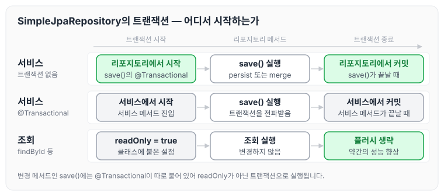
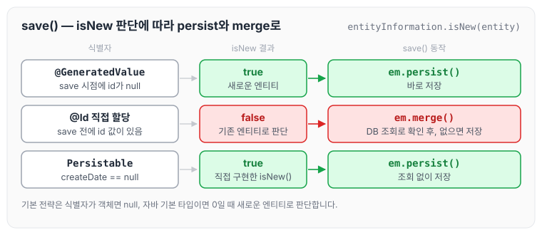

이전에 [확장 기능](../data-jpa-extensions/)에 대해 작성하였습니다. 이번에는 지금까지 사용한 공통 인터페이스의 구현체가 실제로 어떻게 동작하는지, `SimpleJpaRepository`의 코드를 보면서 정리하도록 하겠습니다.

## 스프링 데이터 JPA 구현체 분석

- 스프링 데이터 JPA가 제공하는 공통 인터페이스의 구현체입니다.
- `org.springframework.data.jpa.repository.support.SimpleJpaRepository`

`SimpleJpaRepository`의 코드를 줄여 보면 아래와 같습니다(JPA 책 리스트 12.31).

```java
@Repository
@Transactional(readOnly = true)
public class SimpleJpaRepository<T, ID> ...{

	@Transactional
		public <S extends T> S save(S entity) {
			if (entityInformation.isNew(entity)) {
				em.persist(entity);
				return entity;
			} else {
				return em.merge(entity);
			}
		}
	...
}
```

- `@Repository` 적용: JPA 예외를 스프링이 추상화한 예외로 변환합니다.
- `@Transactional` 트랜잭션 적용
    - JPA의 모든 변경은 트랜잭션 안에서 동작합니다.
    - 스프링 데이터 JPA는 변경(등록, 수정, 삭제) 메서드를 트랜잭션 처리합니다.
    - 서비스 계층에서 트랜잭션을 시작하지 않으면 리포지토리에서 트랜잭션을 시작합니다.
    - 서비스 계층에서 트랜잭션을 시작하면 리포지토리는 해당 트랜잭션을 전파받아서 사용합니다.
    - 그래서 스프링 데이터 JPA를 사용할 때 트랜잭션이 없어도 데이터 등록, 변경이 가능했던 것입니다(사실은 트랜잭션이 리포지토리 계층에 걸려 있는 것입니다).
- `@Transactional(readOnly = true)`
    - 데이터를 단순히 조회만 하고 변경하지 않는 트랜잭션에서 `readOnly = true` 옵션을 사용하면 플러시를 생략해서 약간의 성능 향상을 얻을 수 있습니다.
    - 자세한 내용은 JPA 책 15.4.2 읽기 전용 쿼리의 성능 최적화를 참고합니다. 플러시는 [영속성 컨텍스트](../jpa-persistence-context/)에 정리하였습니다.

서비스 계층의 트랜잭션 유무에 따라 `save()`의 트랜잭션이 어떻게 정해지는지 그리면 아래와 같습니다.



트랜잭션이 없는 곳에서 `save()`를 호출해도 등록이 되는 이유는 리포지토리 계층에 트랜잭션이 걸려 있기 때문입니다.

## save() 메서드

이 부분이 매우 중요합니다.

- `save()` 메서드
    - 새로운 엔티티면 저장(`persist`)합니다.
    - 새로운 엔티티가 아니면 병합(`merge`)합니다.

> 참고: 업데이트는 merge를 쓰는 게 아니라, 영속성 컨텍스트의 상태 관리를 사용해야 합니다. 머지는 영속성 컨텍스트의 관리를 받지 않을 때 관리해주기 위해 사용하는 것입니다.

영속성 컨텍스트의 관리를 받지 않는 준영속 상태는 [영속성 컨텍스트](../jpa-persistence-context/)에 정리하였습니다.

## 새로운 엔티티를 판단하는 기본 전략

- 식별자가 객체일 때 null로 판단합니다.
- 식별자가 자바 기본 타입일 때 0으로 판단합니다.
- Persistable 인터페이스를 구현해서 판단 로직을 변경할 수 있습니다.

```java
package org.springframework.data.domain;
public interface Persistable<ID> {
	ID getId();
	boolean isNew();
}
```

> 참고: JPA 식별자 생성 전략이 `@GeneratedValue`면 `save()` 호출 시점에 식별자가 없으므로 새로운 엔티티로 인식해서 정상 동작합니다. 그런데 JPA 식별자 생성 전략이 `@Id`만 사용해서 직접 할당이면 이미 식별자 값이 있는 상태로 `save()`를 호출합니다. 따라서 이 경우 `merge()`가 호출됩니다. `merge()`는 우선 DB를 호출해서 값을 확인하고, DB에 값이 없으면 새로운 엔티티로 인지하므로 매우 비효율적입니다. 따라서 `Persistable`을 사용해서 새로운 엔티티 확인 여부를 직접 구현하는 것이 효과적입니다.
>
> 참고로 등록 시간(`@CreatedDate`)을 조합해서 사용하면 이 필드로 새로운 엔티티 여부를 편리하게 확인할 수 있습니다. (`@CreatedDate`에 값이 없으면 새로운 엔티티로 판단합니다.)

식별자를 만드는 방식에 따라 `save()`가 어느 쪽으로 가는지 그리면 아래와 같습니다.



직접 할당한 식별자는 기본 전략으로는 새로운 엔티티로 보지 않기 때문에 `merge()`의 조회 쿼리가 한 번 더 나갑니다. `Persistable`을 구현해서 `createDate`로 판단하면 이 조회 없이 `persist()`로 저장할 수 있습니다. `@CreatedDate`는 [확장 기능](../data-jpa-extensions/)의 Auditing에서 다루었습니다.

### Persistable 구현

```java
package study.datajpa.Entity;

import lombok.AccessLevel;
import lombok.Getter;
import lombok.NoArgsConstructor;
import org.springframework.data.annotation.CreatedDate;
import org.springframework.data.domain.Persistable;
import org.springframework.data.jpa.domain.support.AuditingEntityListener;

import javax.persistence.Entity;
import javax.persistence.EntityListeners;
import javax.persistence.GeneratedValue;
import javax.persistence.Id;
import java.time.LocalDateTime;

@Entity
@Getter
@EntityListeners(AuditingEntityListener.class)
@NoArgsConstructor(access = AccessLevel.PROTECTED)
public class Item implements Persistable<String> {

    @Id @GeneratedValue
    private String id;

    public Item(String id) {
        this.id = id;
    }

    @CreatedDate
    private LocalDateTime createDate;

    @Override
    public boolean isNew() {
        return createDate == null;
    }
}
```

## 마무리

오늘은 스프링 데이터 JPA 공통 인터페이스의 구현체인 `SimpleJpaRepository`에 `@Repository`와 `@Transactional`이 어떻게 적용되어 있는지, 그리고 `save()`가 새로운 엔티티를 판단해서 `persist`와 `merge`로 나뉘는 기준에 대해 정리하였습니다.

식별자를 직접 할당하는 엔티티는 `save()`를 호출할 때 `merge()`로 가서 조회 쿼리가 한 번 더 나갈 수 있으므로, `Persistable`로 새로운 엔티티 여부를 직접 판단하도록 구현하는 것이 좋을 것 같습니다.

> 이 글은 인프런 김영한 님의 [실전! 스프링 데이터 JPA](https://www.inflearn.com/course/스프링-데이터-JPA-실전)을 들으며 정리한 노트입니다.
