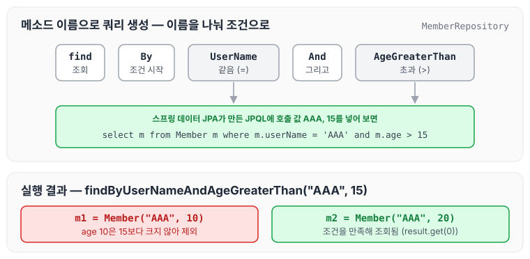
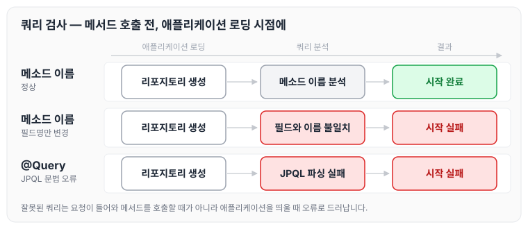
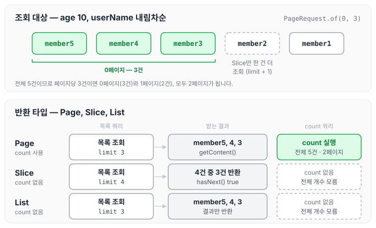
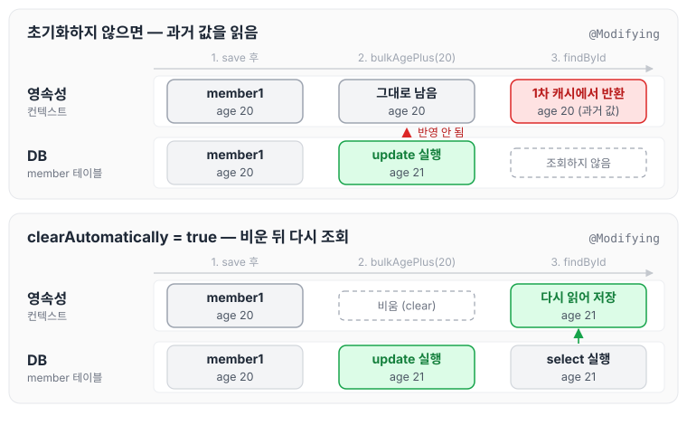
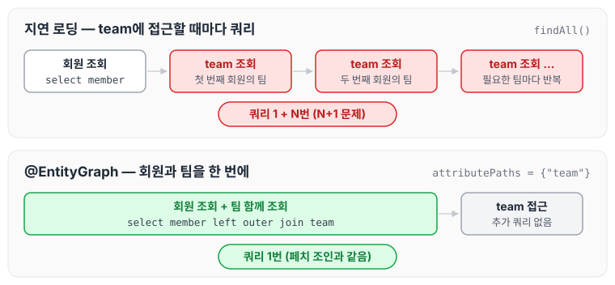

이전에 [공통 인터페이스 기능](../data-jpa-common-interface/)에 대해 작성하였습니다. 이번에는 리포지토리 인터페이스에 메소드만 선언해도 쿼리를 만들어 실행해 주는 스프링 데이터 JPA의 쿼리 메소드 기능에 대해 정리하도록 하겠습니다.

이번 글에서 다룰 내용은 아래와 같습니다.

- 메소드 이름으로 쿼리 생성
- NamedQuery
- @Query - 리포지토리 메소드에 쿼리 정의
- 파라미터 바인딩
- 반환 타입
- 페이징과 정렬
- 벌크성 수정 쿼리
- @EntityGraph

## 쿼리 메소드 기능 3가지

스프링 데이터 JPA가 제공하는 쿼리 메소드 기능은 아래 세 가지입니다.

- 메소드 이름으로 쿼리 생성
- 메소드 이름으로 JPA NamedQuery 호출
- @Query 어노테이션을 사용해서 리포지토리 인터페이스에 쿼리 직접 정의

## 메소드 이름으로 쿼리 생성

스프링 데이터 JPA는 메소드 이름을 분석해 JPQL 쿼리를 만들고 실행합니다. 이름과 나이를 기준으로 회원을 조회하는 경우를 순수 JPA와 스프링 데이터 JPA로 각각 작성해 보겠습니다.

순수 JPA 리포지토리는 아래와 같이 JPQL을 직접 작성합니다.

```java
public List<Member> findByUserNameAndAgeGreaterThan(String userName, int age) {
        return em.createQuery("Select m from Member m where m.userName = :userName and m.age > :age")
                .setParameter("userName", userName)
                .setParameter("age", age)
                .getResultList();
    }
```

순수 JPA 테스트 코드는 아래와 같습니다.

```java
@Test
    public void findByUserNameAndGreaterThen() {
        Member m1 = new Member("AAA", 10);
        Member m2 = new Member("AAA", 20);
        jpaRepository.save(m1);
        jpaRepository.save(m2);

        List<Member> result = jpaRepository.findByUserNameAndAgeGreaterThan("AAA", 15);
        assertThat(result.get(0).getUserName()).isEqualTo("AAA");
        assertThat(result.get(0).getAge()).isEqualTo(20);
        assertThat(result.get(0)).isEqualTo(m2);
    }
```

스프링 데이터 JPA에서는 인터페이스에 메소드를 선언하기만 하면 됩니다.

```java
package study.datajpa.repository;

import org.springframework.data.jpa.repository.JpaRepository;
import study.datajpa.Entity.Member;

import java.util.List;

public interface MemberRepository extends JpaRepository<Member, Long> {
    public List<Member> findByUserNameAndAgeGreaterThan(String userName, int age);
}
```

스프링 데이터 JPA는 메소드 이름을 분석해서 JPQL을 생성하고 실행합니다. 위 테스트의 `findByUserNameAndAgeGreaterThan("AAA", 15)` 호출이 어떻게 쿼리로 바뀌는지 그려 보면 아래와 같습니다.



`UserName`은 같음(`=`) 조건이 되고, `AgeGreaterThan`은 초과(`>`) 조건이 되어 `And`로 묶입니다. 그래서 나이가 10인 m1은 빠지고 m2만 조회됩니다.

### 쿼리 메소드 필터 조건

필터 조건은 스프링 데이터 JPA 공식 문서를 참고합니다: [https://docs.spring.io/spring-data/jpa/docs/current/reference/html/#jpa.query-methods.query-creation](https://docs.spring.io/spring-data/jpa/docs/current/reference/html/#jpa.query-methods.query-creation)

### 스프링 데이터 JPA가 제공하는 쿼리 메소드 기능

- 조회: find...By, read...By, query...By, get...By
    - [https://docs.spring.io/spring-data/jpa/docs/current/reference/html/#repositories.query-methods.query-creation](https://docs.spring.io/spring-data/jpa/docs/current/reference/html/#repositories.query-methods.query-creation)
    - 예: findHelloBy처럼 식별하기 위한 내용(설명)이 들어가도 됩니다.
- COUNT: count...By, 반환타입 `long`
- EXISTS: exists...By, 반환타입 `boolean`
- 삭제: delete...By, remove...By, 반환타입 `long`
- DISTINCT: findDistinct, findMemberDistinctBy
- LIMIT: findFirst3, findFirst, findTop, findTop3
    - [https://docs.spring.io/spring-data/jpa/docs/current/reference/html/#repositories.limit-query-result](https://docs.spring.io/spring-data/jpa/docs/current/reference/html/#repositories.limit-query-result)

> 참고: 이 기능은 엔티티의 필드명이 변경되면 인터페이스에 정의한 메서드 이름도 꼭 함께 변경해야 합니다. 그렇지 않으면 애플리케이션을 시작하는 시점에 오류가 발생합니다.

이처럼 애플리케이션 로딩 시점에 오류를 알 수 있다는 것이 스프링 데이터 JPA의 큰 장점입니다.

## @Query, 리포지토리 메소드에 쿼리 정의하기

메서드에 JPQL 쿼리를 직접 작성할 수도 있습니다.

```java
public interface MemberRepository extends JpaRepository<Member, Long> {
    public List<Member> findByUserNameAndAgeGreaterThan(String userName, int age);

    @Query("select m from Member m where m.userName = :userName and m.age = :age")
    List<Member> findUser(@Param("userName") String userName, @Param("age") int age);
}
```

- `@org.springframework.data.jpa.repository.Query` 어노테이션을 사용합니다.
- 실행할 메서드에 정적 쿼리를 직접 작성하므로 이름 없는 Named 쿼리라고 할 수 있습니다.
- JPA Named 쿼리처럼 애플리케이션 실행 시점에 문법 오류를 발견할 수 있습니다. 이 점이 큰 장점입니다.

메소드 이름으로 만든 쿼리와 `@Query`로 정의한 쿼리가 모두 애플리케이션 로딩 시점에 검사된다는 점을 그림으로 나타내면 아래와 같습니다.



요청이 들어와 메서드를 호출할 때가 아니라 애플리케이션을 띄울 때 오류가 나기 때문에, 잘못된 쿼리를 배포 전에 발견할 수 있습니다.

> 참고: 실무에서는 메소드 이름으로 쿼리 생성 기능은 파라미터가 증가하면 메서드 이름이 매우 지저분해집니다. 따라서 @Query 기능을 자주 사용하게 됩니다.

## @Query, 값과 DTO 조회하기

### 단순히 값 하나를 조회

```java
@Query("select m.userName from Member m")
    List<String> findUserNameList();
```

JPA 값 타입(`@Embedded`)도 이 방식으로 조회할 수 있습니다.

### DTO로 직접 조회

```java
@Query("select new study.datajpa.dto.MemberDto(m.id, m.userName, t.name) from Member m join m.team t")
    List<MemberDto> findMemberDto();
```

DTO로 직접 조회하려면 JPA의 `new` 명령어를 사용해야 합니다. 그리고 아래와 같이 생성자가 맞는 DTO가 필요합니다. JPA에서 사용하는 방식과 동일하며, JPA의 `new` 명령어는 [JPQL 기본 문법](../jpa-jpql-basics/)의 프로젝션에 정리하였습니다.

```java
package study.datajpa.dto;

import lombok.Data;

@Data
public class MemberDto {
    private Long id;
    private String userName;
    private String TeamName;

    public MemberDto(Long id, String userName, String teamName) {
        this.id = id;
        this.userName = userName;
        TeamName = teamName;
    }
}
```

## 파라미터 바인딩

컬렉션 파라미터를 바인딩할 때는 Collection 타입으로 in절을 지원합니다.

```java
@Query("select m from Member m where m.userName in :names")
    List<Member> findByNames(@Param("names") Collection<String> names);
```

## 반환 타입

스프링 데이터 JPA는 아래와 같이 유연한 반환 타입을 지원합니다.

```java
//컬렌션 조회
List<Member> findMemberListByUserName(String name);

//단건 조회
Member findMemberByUserName(String name);

//단건 Optional 조회
Optional<Member> findOptionalMemberByUserName(String name);
```

스프링 데이터 JPA 공식 문서: [https://docs.spring.io/spring-data/jpa/docs/current/reference/html/#repository-query-return-types](https://docs.spring.io/spring-data/jpa/docs/current/reference/html/#repository-query-return-types)

조회 결과가 많거나 없을 때는 아래와 같이 동작합니다.

- 컬렉션
    - 결과 없음: 빈 컬렉션 반환
- 단건 조회
    - 결과 없음: `null` 반환
    - 결과가 2건 이상: `javax.persistence.NonUniqueResultException` 예외 발생

> 참고: 단건으로 지정한 메서드를 호출하면 스프링 데이터 JPA는 내부에서 JPQL의 Query.getSingleResult() 메서드를 호출합니다. 이 메서드를 호출했을 때 조회 결과값이 없으면
>
> javax.persistence.NoResultException 예외가 발생하는데 개발자 입장에서 다루기가 상당히 불편합니다. 스프링 데이터 JPA는 단건을 조회할 때 이 예외가 발생하면 예외를 무시하고 대신에 null을 반환합니다.

## 순수 JPA 페이징과 정렬

먼저 순수 JPA로 페이징을 처리하는 방법입니다. 아래 조건으로 페이징과 정렬을 사용하는 예제 코드를 살펴보겠습니다. JPA의 페이징 API는 [JPQL 기본 문법](../jpa-jpql-basics/)에도 정리하였습니다.

- 검색 조건: 나이가 10살
- 정렬 조건: 이름으로 내림차순
- 페이징 조건: 첫 번째 페이지, 페이지당 보여줄 데이터는 3건

JPA 페이징 리포지토리 코드는 아래와 같습니다.

```java
//순수 jpa 페이징
    public List<Member> findByPage(int age, int offset, int limit) {
        return em.createQuery("select m from Member m where m.age = :age order by m.userName desc")
                .setParameter("age", age)
                .setFirstResult(offset)
                .setMaxResults(limit)
                .getResultList();
    }

    // 총 카운트
    public long totalCount(int age) {
        return  em.createQuery("select count(m) from Member m where m.age = :age ", Long.class)
                .setParameter("age", age)
                .getSingleResult();
    }
```

JPA 페이징 테스트 코드는 아래와 같습니다.

```java
@Test
    public void 페이징확인() throws Exception {

        //given
        jpaRepository.save(new Member("member1", 10));
        jpaRepository.save(new Member("member2", 10));
        jpaRepository.save(new Member("member3", 10));
        jpaRepository.save(new Member("member4", 10));
        jpaRepository.save(new Member("member5", 10));

        int age = 10;
        int offset = 0;
        int limit = 3;

        //when
        List<Member> members = jpaRepository.findByPage(age, offset, limit);
        long totalCount = jpaRepository.totalCount(age);

        //then
        assertThat(members.size()).isEqualTo(3);
    }
```

순수 JPA에서는 페이지 데이터를 가져오는 쿼리와 전체 개수를 구하는 쿼리를 각각 작성하고 호출해야 합니다.

## 스프링 데이터 JPA 페이징과 정렬

실무에서 페이징을 처리할 때 많이 사용하는 기능입니다.

### 페이징과 정렬 파라미터

- `org.springframework.data.domain.Sort`: 정렬 기능
- `org.springframework.data.domain.Pageable`: 페이징 기능 (내부에 `Sort` 포함)

### 특별한 반환 타입

- `org.springframework.data.domain.Page`: 추가 `count` 쿼리 결과를 포함하는 페이징
- `org.springframework.data.domain.Slice`: 추가 `count` 쿼리 없이 다음 페이지만 확인 가능 (내부적으로 limit + 1 조회)
- `List`(자바 컬렉션): 추가 count 쿼리 없이 결과만 반환

### 페이징과 정렬 사용 예제

```java
//count 쿼리 사용
Page<Member> findMemberPageByUserName(String name, Pageable pageable);

//count 쿼리 사용안함
Slice<Member> findMemberSliceByUserName(String name, Pageable pageable);

//count 쿼리 사용 안함
List<Member> findMemberListByUserName(String name, Pageable pageable);

List<Member> findByUserName(String name, Sort sort);
```

순수 JPA와 같은 조건으로 예제 코드를 살펴보겠습니다.

- 검색 조건: 나이가 10살
- 정렬 조건: 이름으로 내림차순
- 페이징 조건: 첫 번째 페이지, 페이지당 보여줄 데이터는 3건

Page를 사용하는 예제의 정의 코드는 아래와 같습니다.

```java
public interface MemberRepository extends JpaRepository<Member, Long> {
	Page<Member> findByAge(int age, Pageable pageable);
}
```

실행 코드는 아래와 같습니다.

```java
@Test
    public void 페이징확인() throws Exception {

        //given
        memberRepository.save(new Member("member1", 10));
        memberRepository.save(new Member("member2", 10));
        memberRepository.save(new Member("member3", 10));
        memberRepository.save(new Member("member4", 10));
        memberRepository.save(new Member("member5", 10));

        int age = 10;

        //when
        PageRequest pageRequest = PageRequest.of(0, 3, Sort.by(Sort.Direction.DESC, "userName"));
        Page<Member> page = memberRepository.findByAge(age, pageRequest);

        //then
        List<Member> content = page.getContent(); // 조회된 데이터
        assertThat(content.size()).isEqualTo(3); // 조회된 데이터 수
        assertThat(page.getTotalElements()).isEqualTo(5); //전체 데이터 수
        assertThat(page.getNumber()).isEqualTo(0); //페이지 번호
        assertThat(page.getTotalPages()).isEqualTo(2); // 전체 페이지 번호
        assertThat(page.isFirst()).isTrue(); // 첫번째 항목인가?
        assertThat(page.hasNext()).isTrue(); // 다음 페이지가 있는가?
    }
```

- 두 번째 파라미터로 받은 `Pageable`은 인터페이스입니다. 따라서 실제 사용할 때는 해당 인터페이스를 구현한 `org.springframework.data.domain.PageRequest` 객체를 사용합니다.
- `PageRequest` 생성자의 첫 번째 파라미터에는 현재 페이지를, 두 번째 파라미터에는 조회할 데이터 수를 입력합니다. 여기에 추가로 정렬 정보도 파라미터로 사용할 수 있습니다. 참고로 페이지는 0부터 시작합니다.

> 주의: page는 1부터 시작이 아니라 0부터 시작입니다.

위 테스트에서 `PageRequest.of(0, 3, ...)`로 나이가 10인 회원 5명을 조회할 때, 반환 타입에 따라 실행되는 쿼리와 결과를 비교하면 아래와 같습니다.



Page는 count 쿼리를 한 번 더 실행해서 `getTotalElements()`가 5, `getTotalPages()`가 2가 됩니다. Slice는 count 쿼리 대신 한 건을 더 조회해서 다음 페이지가 있는지만 판단합니다.

### Page 인터페이스

```java
public interface Page<T> extends Slice<T> {
	int getTotalPages(); //전체 페이지 수
	long getTotalElements(); //전체 데이터 수
	<U> Page<U> map(Function<? super T, ? extends U> converter); //변환기
}
```

### Slice 인터페이스

```java
public interface Slice<T> extends Streamable<T> {
	int getNumber(); //현재 페이지
	int getSize(); //페이지 크기
	int getNumberOfElements(); //현재 페이지에 나올 데이터 수
	List<T> getContent(); //조회된 데이터
	boolean hasContent(); //조회된 데이터 존재 여부
	Sort getSort(); //정렬 정보
	boolean isFirst(); //현재 페이지가 첫 페이지 인지 여부
	boolean isLast(); //현재 페이지가 마지막 페이지 인지 여부
	boolean hasNext(); //다음 페이지 여부
	boolean hasPrevious(); //이전 페이지 여부
	Pageable getPageable(); //페이지 요청 정보
	Pageable nextPageable(); //다음 페이지 객체
	Pageable previousPageable();//이전 페이지 객체
	<U> Slice<U> map(Function<? super T, ? extends U> converter); //변환기
}
```

### Count 쿼리 분리

Count 쿼리는 아래와 같이 분리할 수 있습니다.

```java
@Query(value = "select m from Member m", countQuery = "select count(m.userName) from Member m")
    Page<Member> findMemberAllCountBy(Pageable pageable);
```

### Top, First 사용

참고: [https://docs.spring.io/spring-data/jpa/docs/current/reference/html/#repositories.limit-query-result](https://docs.spring.io/spring-data/jpa/docs/current/reference/html/#repositories.limit-query-result)

```java
List<Member> findTop3By();
```

### 페이지를 유지하면서 엔티티를 DTO로 변환하기

```java
Page<Member> page = memberRepository.findByAge(age, pageRequest);
page.map(m -> new MemberDto(m.getId(), m.getUserName(), null));
```

### 실습 정리

- Page
- Slice (count X): 추가로 limit + 1을 조회합니다. 그래서 다음 페이지 여부를 확인할 수 있습니다(최근 모바일 리스트를 생각해 보면 됩니다).
- List (count X)
- 카운트 쿼리 분리: 복잡한 SQL에서 사용하며, 데이터는 left join을 하더라도 카운트는 left join을 하지 않아도 됩니다.
    - 실무에서 매우 중요합니다.

> 참고: 전체 count 쿼리는 매우 무겁습니다.

## 벌크성 수정 쿼리

여러 건을 한 번에 수정하는 벌크성 수정 쿼리를 순수 JPA와 스프링 데이터 JPA로 각각 작성해 보겠습니다.

JPA를 사용한 벌크성 수정 쿼리는 아래와 같습니다.

```java
// 벌크성 수정 쿼리
    public int bulkAgePlus(int age) {
        int result = em.createQuery(
                        " update Member m set m.age = m.age + 1 " +
                                " where m.age <= : age")
                .setParameter("age", age)
                .executeUpdate();
        return result;
    }
```

JPA를 사용한 벌크성 수정 쿼리 테스트입니다.

```java
@Test
    public void 벌크업데이트테스트() {
        //given
        memberRepository.save(new Member("member1", 10));
        memberRepository.save(new Member("member1", 19));
        memberRepository.save(new Member("member1", 20));
        memberRepository.save(new Member("member1", 21));
        memberRepository.save(new Member("member1", 40));

        //when
        int resultCount = memberRepository.bulkAgePlus(20);

        //then
        assertThat(resultCount).isEqualTo(3);
    }
```

스프링 데이터 JPA를 사용하면 아래와 같이 작성합니다.

```java
@Modifying
@Query("update Member m set m.age = m.age + 1 where m.age >= :age")
int bulkAgePlus(@Param("age") int age);
```

스프링 데이터 JPA를 사용한 벌크성 수정 쿼리 테스트입니다.

```java
@Test
    public void 벌크업데이트테스트() {
        //given
        memberRepository.save(new Member("member1", 10));
        memberRepository.save(new Member("member1", 19));
        memberRepository.save(new Member("member1", 20));
        memberRepository.save(new Member("member1", 21));
        memberRepository.save(new Member("member1", 40));

        //when
        int resultCount = memberRepository.bulkAgePlus(20);

        //then
        assertThat(resultCount).isEqualTo(3);
    }
```

- 벌크성 수정, 삭제 쿼리는 @Modifying 어노테이션을 사용합니다.
    - 사용하지 않으면 다음 예외가 발생합니다.
    - `org.hibernate.hql.internal.QueryExecutionRequestException: Not supported for DML operations`
- 벌크성 쿼리를 실행하고 나서 영속성 컨텍스트를 초기화하려면 `@Modifying(clearAutomatically = true)`를 사용합니다(이 옵션의 기본값은 false).
    - 이 옵션 없이 회원을 findById로 다시 조회하면 영속성 컨텍스트에 과거 값이 남아서 문제가 될 수 있습니다. 다시 조회해야 한다면 꼭 영속성 컨텍스트를 초기화해야 합니다.

> 참고: 벌크 연산은 영속성 컨텍스트를 무시하고 실행하기 때문에, 영속성 컨텍스트에 있는 엔티티의 상태와 DB에 엔티티 상태가 달라질 수 있습니다.
>
> 권장하는 방안
>
> 1. 영속성 컨텍스트에 엔티티가 없는 상태에서 벌크 연산을 먼저 실행합니다.
> 2. 부득이하게 영속성 컨텍스트에 엔티티가 있으면 벌크 연산 직후 영속성 컨텍스트를 초기화합니다.

테스트에서 나이가 20인 회원이 영속성 컨텍스트에 남아 있는 상태로 `bulkAgePlus(20)`을 실행한 뒤 다시 조회하는 경우를 그리면 아래와 같습니다.



벌크 연산은 DB에 바로 반영되지만 영속성 컨텍스트의 엔티티는 바뀌지 않습니다. 이 때문에 초기화하지 않으면 1차 캐시에 남은 과거 값을 읽게 됩니다. 영속성 컨텍스트와 1차 캐시는 [영속성 컨텍스트](../jpa-persistence-context/)에 정리하였습니다.

## @EntityGraph

@EntityGraph는 연관된 엔티티들을 SQL 한 번에 조회하는 방법입니다.

member → team은 지연 로딩 관계입니다. 따라서 team의 데이터를 조회할 때마다 쿼리가 실행됩니다(N+1 문제 발생). 지연 로딩은 [즉시 로딩과 지연 로딩](../jpa-lazy-eager-loading/)에 정리하였습니다.

연관된 엔티티를 한 번에 조회하려면 페치 조인이 필요합니다. 페치 조인은 [JPQL 경로 표현식과 페치 조인](../jpa-jpql-advanced/)에 정리하였습니다.

JPQL 페치 조인은 아래와 같이 작성합니다.

```java
//JPQL 페치조인
@Query("select m from Member m left join fetch m.team")
List<Member> findMemberFetchJoin();
```

스프링 데이터 JPA는 JPA가 제공하는 엔티티 그래프 기능을 편리하게 사용하도록 도와줍니다. 이 기능을 사용하면 JPQL 없이 페치 조인을 사용할 수 있습니다.

```java
//공통 메서드 오버리아드 EntityGraph
@Override
@EntityGraph(attributePaths = {"team"})
List<Member> findAll();

// JPQL + 엔티티 그래프
@EntityGraph(attributePaths = {"team"})
@Query("select m from Member m")
List<Member> findMemberEntityGraph();

//메서드 이름으로 쿼리에서 특히 편리하다.
@EntityGraph(attributePaths = {"team"})
List<Member> findByUserName(String userName);
```

지연 로딩으로 team을 하나씩 조회할 때와 `@EntityGraph`로 함께 조회할 때를 비교하면 아래와 같습니다.



### EntityGraph 정리

- 사실상 페치 조인(FETCH JOIN)의 간편 버전
- LEFT OUTER JOIN 사용

## 마무리

오늘은 스프링 데이터 JPA의 쿼리 메소드 기능으로 메소드 이름으로 쿼리 생성, @Query, 파라미터 바인딩, 반환 타입, 페이징과 정렬, 벌크성 수정 쿼리, @EntityGraph에 대해 정리하였습니다.

페이징은 반환 타입에 따라 count 쿼리 실행 여부가 달라지고, 벌크 연산은 영속성 컨텍스트와 DB의 값이 달라질 수 있어서 함께 주의해서 사용해야 할 것 같습니다.

다음 글에서는 [확장 기능](../data-jpa-extensions/)에 대해 정리하도록 하겠습니다.

> 이 글은 인프런 김영한 님의 [실전! 스프링 데이터 JPA](https://www.inflearn.com/course/스프링-데이터-JPA-실전)을 들으며 정리한 노트입니다.
