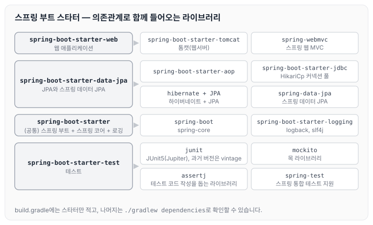
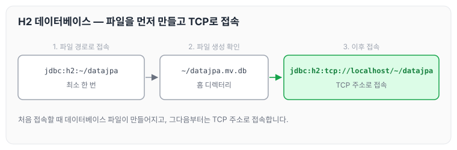
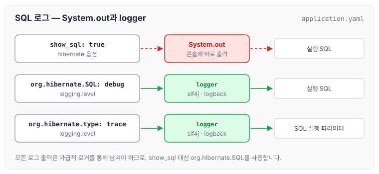

오늘은 스프링 데이터 JPA를 실습하기 위한 프로젝트 환경설정에 대해 정리하도록 하겠습니다. Gradle 설정과 스프링 부트가 함께 가져오는 라이브러리, H2 데이터베이스 설치와 연동, 그리고 회원 엔티티와 리포지토리로 실제 동작을 확인하는 과정까지 다룹니다.

## Gradle 전체 설정

프로젝트에서 사용하는 기능과 기본 정보는 아래와 같습니다.

- 사용 기능: web, jpa, h2, lombok
- SpringBootVersion: 2.6.7
- groupId: study
- artifactId: data-jpa

전체 `build.gradle`은 다음과 같습니다.

```gradle
plugins {
	id 'org.springframework.boot' version '2.6.7'
	id 'io.spring.dependency-management' version '1.0.11.RELEASE'
	id 'java'
}

group = 'study'
version = '0.0.1-SNAPSHOT'
sourceCompatibility = '11'

configurations {
	compileOnly {
		extendsFrom annotationProcessor
	}
}

repositories {
	mavenCentral()
}

dependencies {
	implementation 'org.springframework.boot:spring-boot-starter-data-jpa'
	implementation 'org.springframework.boot:spring-boot-starter-web'
	compileOnly 'org.projectlombok:lombok'
	runtimeOnly 'com.h2database:h2'
	annotationProcessor 'org.projectlombok:lombok'
	testImplementation 'org.springframework.boot:spring-boot-starter-test'
	implementation 'com.github.gavlyukovskiy:p6spy-spring-boot-starter:1.5.7'
}

tasks.named('test') {
	useJUnitPlatform()
}
```

설정을 마친 뒤에는 아래 순서로 동작을 확인합니다.

- 기본 테스트 케이스를 실행합니다.
- 스프링 부트 메인을 실행한 후 에러 페이지로 간단하게 동작을 확인합니다.
- 테스트 컨트롤러를 만들어서 spring web 동작을 확인합니다.

## 테스트 컨트롤러

spring web 동작을 확인하기 위한 컨트롤러는 아래와 같습니다.

```java
package study.datajpa.Controller;

import org.springframework.stereotype.Controller;
import org.springframework.web.bind.annotation.RequestMapping;
import org.springframework.web.bind.annotation.RestController;

@RestController
public class HelloController {

    @RequestMapping("/hello")
    public String hello() {
        return "hello";
    }
}
```

> 참고: 최근 Intellij 버전은 Gradle로 실행하는 것이 기본 설정입니다. 이렇게 하면 실행 속도가 느립니다. 다음과 같이 변경하면 자바로 바로 실행하므로 좀 더 빨라집니다.
>
> Preferences → Build, Execution, Deployment → Build Tools → Gradle
>
> Build and run using: Gradle → IntelliJ IDEA
>
> Run tests using: Gradle → IntelliJ IDEA

## 롬복 적용

롬복은 아래 순서로 적용합니다.

1. Preferences → plugin → lombok 검색 실행(재시작)
2. Preferences → Annotation Processors 검색 → Enable annotation processing 체크
3. 임의의 테스트 클래스를 만들고 @Getter, @Setter 확인

## 라이브러리 살펴보기

### Gradle 의존관계 보기

Gradle 의존관계는 아래 명령어로 확인할 수 있습니다.

`./gradlew dependencies --configuration compileClasspath`

### 스프링 부트 라이브러리

스프링 부트 스타터를 추가하면 아래 라이브러리가 함께 들어옵니다.

- spring-boot-starter-web
    - spring-boot-starter-tomcat: 톰캣(웹서버)
    - spring-webmvc: 스프링 웹 MVC
- spring-boot-starter-data-jpa
    - spring-boot-starter-aop
    - spring-boot-starter-jdbc
        - HikariCp 커넥션 풀
    - hibernate + JPA: 하이버네이트 + JPA
    - spring-data-jpa: 스프링 데이터 JPA
- spring-boot-starter(공통): 스프링 부트 + 스프링 코어 + 로깅
- spring-boot
    - spring-core
- spring-boot-starter-logging
    - logback, slf4j

### 테스트 라이브러리

테스트 라이브러리는 아래와 같습니다.

- spring-boot-starter-test
    - junit: 테스트 프레임워크, 스프링 부트 2.2부터 JUnit5(Jupiter) 사용
        - 과거 버전은 vintage
    - mockito: 목 라이브러리
    - assertj: 테스트 코드를 좀 더 편하게 작성하게 도와주는 라이브러리
    - spring-test: 스프링 통합 테스트 지원

스타터별로 함께 들어오는 라이브러리를 그림으로 정리하면 아래와 같습니다.



`build.gradle`에는 스타터 몇 개만 적었지만, 실제로 사용하는 라이브러리는 스타터가 의존관계로 함께 가져옵니다.

### 핵심 라이브러리와 기타 라이브러리

정리하면 핵심 라이브러리와 기타 라이브러리는 아래와 같습니다.

- 핵심 라이브러리
    - 스프링 MVC
    - 스프링 ORM
    - JPA, 하이버네이트
    - 스프링 데이터 JPA
- 기타 라이브러리
    - H2 데이터베이스 클라이언트
    - 커넥션 풀: 부트 기본은 HikariCp
    - 로깅 SLF4J&LogBack
    - 테스트

## H2 데이터베이스 설치

H2는 개발이나 테스트 용도로 가볍고 편리한 DB이고, 웹 화면을 제공합니다.

- [https://www.h2database.com](https://www.h2database.com)
- 다운로드 및 설치
- h2 데이터베이스 버전은 스프링 부트 버전에 맞춥니다.
- 데이터베이스 파일 생성 방법
    - `jdbc:h2:~/datajpa` (최소 한번)
    - `~/datajpa.mv.db` 파일 생성 확인
    - 이후부터는 `jdbc:h2:tcp://localhost/~/datajpa` 이렇게 접속

데이터베이스 파일을 만들고 접속하는 순서는 아래와 같습니다.



처음 한 번은 파일 경로로 접속해서 데이터베이스 파일을 만들고, 그 뒤로는 TCP 주소로 접속합니다.

## 스프링 데이터 JPA와 DB 설정, 동작 확인

DB 접속 정보와 JPA 설정은 `application.yaml`에 아래와 같이 작성합니다.

```yaml
spring:
  datasource:
    url: jdbc:h2:tcp://localhost/~/jpashop
    username: sa
    password : 1
    driver-class-name: org.h2.Driver

  jpa:
    hibernate:
      ddl-auto: create
    properties:
      hibernate:
#        show_sql: true
        format_sql: true
#        default_batch_fetch_size : 1000

logging:
  level:
    org.hibernate.SQL: debug
#    org.hibernate.type: trace
```

- spring.jpa.hibernate.ddl-auto: create
    - 이 옵션은 애플리케이션 실행 시점에 테이블을 drop 하고, 다시 생성합니다. 옵션별 차이는 [엔티티 매핑](../jpa-entity-mapping/)에 정리하였습니다.

> 참고: **모든 로그 출력은 가급적 로거를 통해 남겨야 합니다.**
>
> `show_sql:` 옵션은 `System.out`에 하이버네이트 실행 SQL을 남깁니다.
>
> `org.hibernate.SQL` 옵션은 logger를 통해 하이버네이트 실행 SQL을 남깁니다.

두 옵션이 SQL을 어디로 남기는지 비교하면 아래와 같습니다. 그림에는 뒤에서 다룰 `org.hibernate.type`도 함께 표시하였습니다.



위 설정에서 `show_sql`을 주석 처리하고 `org.hibernate.SQL: debug`를 사용한 것도 이 때문입니다.

## 실제 동작 확인

회원 엔티티를 만들고, 순수 JPA 리포지토리와 스프링 데이터 JPA 리포지토리로 각각 저장과 조회가 되는지 확인합니다.

회원 엔티티는 아래와 같습니다.

```java
package study.datajpa.Entity;

import lombok.Getter;

import javax.persistence.Entity;
import javax.persistence.GeneratedValue;
import javax.persistence.Id;

@Entity
@Getter
public class Member {

    @Id @GeneratedValue
    private Long id;
    private String name;

    protected Member() {

    }

    public Member(String name) {
        this.name = name;
    }
}
```

회원 JPA 리포지토리는 `EntityManager`를 직접 주입받아 저장과 조회를 구현합니다.

```java
package study.datajpa.repository;

import org.springframework.stereotype.Repository;
import study.datajpa.Entity.Member;

import javax.persistence.EntityManager;
import javax.persistence.PersistenceContext;

@Repository
public class MemberJpaRepository {
    @PersistenceContext
    private EntityManager em;

    public Member save(Member member) {
        em.persist(member);
        return member;
    }

    public Member find(Long id) {
        return em.find(Member.class, id);
    }
}
```

JPA 기반 테스트는 아래와 같습니다.

```java
package study.datajpa.repository;

import org.junit.jupiter.api.Test;
import org.springframework.beans.factory.annotation.Autowired;
import org.springframework.boot.test.context.SpringBootTest;
import org.springframework.test.annotation.Rollback;
import org.springframework.transaction.annotation.Transactional;
import study.datajpa.Entity.Member;

import static org.assertj.core.api.Assertions.*;

@SpringBootTest
@Transactional
@Rollback(false)
class MemberJpaRepositoryTest {

    @Autowired
    MemberJpaRepository jpaRepository;

    @Test
    public void testMember() {
        Member member = new Member("memberA");
        Member saveMember = jpaRepository.save(member);
        Member findMember = jpaRepository.find(saveMember.getId());

        assertThat(findMember.getId()).isEqualTo(member.getId());
        assertThat(findMember.getName()).isEqualTo(member.getName());

        assertThat(findMember).isEqualTo(member);
    }
}
```

스프링 데이터 JPA 리포지토리는 `JpaRepository`를 상속한 인터페이스만 만들면 됩니다.

```java
package study.datajpa.repository;

import org.springframework.data.jpa.repository.JpaRepository;
import study.datajpa.Entity.Member;

public interface MemberRepository extends JpaRepository<Member, Long> {
}
```

스프링 데이터 JPA 기반 테스트는 아래와 같습니다.

```java
package study.datajpa.repository;

import org.junit.jupiter.api.Test;
import org.springframework.beans.factory.annotation.Autowired;
import org.springframework.boot.test.context.SpringBootTest;
import org.springframework.test.annotation.Rollback;
import org.springframework.transaction.annotation.Transactional;
import study.datajpa.Entity.Member;

import static org.assertj.core.api.Assertions.*;

@SpringBootTest
@Transactional
@Rollback(value = false)

class MemberRepositoryTest {

    @Autowired
    MemberRepository memberRepository;

    @Test
    public void testMember() {
        Member member = new Member("memberA");
        Member saveMember = memberRepository.save(member);

        Member findMember = memberRepository.findById(member.getId()).get();

        assertThat(findMember.getId()).isEqualTo(member.getId());
        assertThat(findMember.getName()).isEqualTo(member.getName());

        assertThat(findMember).isEqualTo(member);
    }

}
```

두 테스트로 아래 내용을 확인합니다.

- Entity, Repository 동작 확인
- jar 빌드해서 동작 확인

> 참고: 스프링 부트를 통해 복잡한 설정이 다 자동화되었습니다. persistence.xml 도 없고, LocalContainerEntityManagerFactoryBean 도 없습니다. 스프링 부트를 통한 추가 설정은 스프링 부트 매뉴얼을 참고하세요.

스프링 부트 없이 `persistence.xml`로 JPA를 설정하는 방법은 [JPA 시작하기](../jpa-getting-started/)에 정리하였습니다.

## 쿼리 파라미터 로그 남기기

SQL 실행 파라미터를 로그로 남기는 방법은 아래와 같습니다.

- 로그에 `org.hibernate.type`을 추가하면 SQL 실행 파라미터를 로그로 남길 수 있습니다.
- 외부 라이브러리를 사용할 수도 있습니다.
    - https://github.com/gavlyukovskiy/spring-boot-data-source-decorator
- 스프링 부트를 사용하면 라이브러리만 추가하면 됩니다.

앞의 `build.gradle`에 추가한 `p6spy-spring-boot-starter`가 이 저장소에서 제공하는 라이브러리입니다.

## 마무리

오늘은 스프링 데이터 JPA 실습 프로젝트의 Gradle 설정과 라이브러리 구성, H2 데이터베이스 연동, 그리고 순수 JPA 리포지토리와 스프링 데이터 JPA 리포지토리로 기본 동작을 확인하는 과정을 정리하였습니다. 스프링 부트 덕분에 persistence.xml 없이도 설정 파일 하나로 JPA를 바로 사용할 수 있었습니다.

다음 글에서는 [예제 도메인 모델과 동작 확인](../data-jpa-domain-model/)에 대해 정리하도록 하겠습니다.

> 이 글은 인프런 김영한 님의 [실전! 스프링 데이터 JPA](https://www.inflearn.com/course/스프링-데이터-JPA-실전)을 들으며 정리한 노트입니다.
