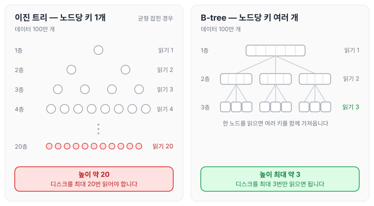
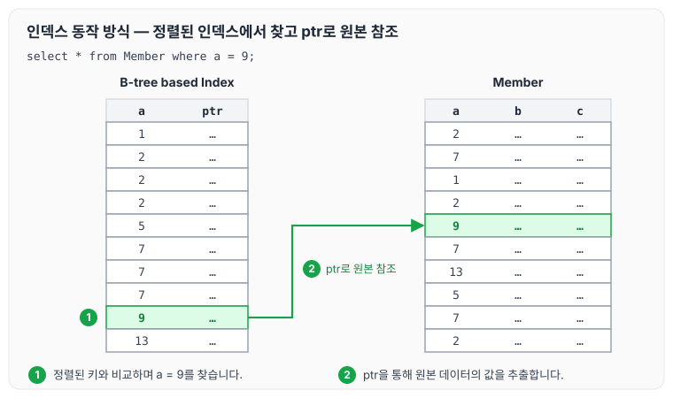
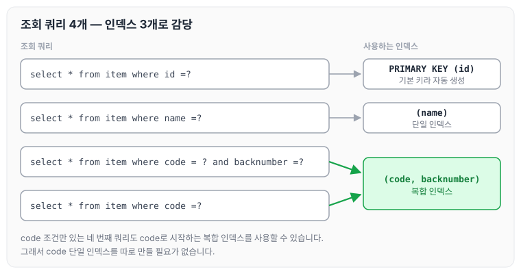
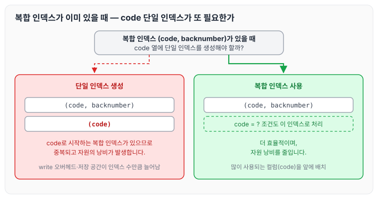

이전에 [B-tree](../b-tree/)에 대해 작성하였습니다. 실무에서 DB 테이블을 요청할 때 인덱스를 추가해 달라는 말을 많이 들었는데, 오늘은 인덱스를 왜 걸어야 하는지, 그리고 어떤 기준으로 어떻게 추가하면 좋은지에 대하여 정리하도록 하겠습니다.

MySQL 기준으로 인덱스는 보통 B-Tree 기반으로 동작하고 있습니다. 이유는 아래와 같습니다.

## 인덱스로 B-Tree를 사용하는 이유

### 1. 트리의 높이가 낮다

B-tree는 한 노드에 여러 키와 자식 노드를 가질 수 있어서, 같은 양의 데이터를 저장할 때 이진 트리보다 트리의 높이가 낮습니다.

예를 들어 100만 개의 데이터를 저장할 때는 아래와 같습니다.

- 이진 트리는 균형이 잡혀 있어도 높이가 20 정도 됩니다(2의 20제곱이 약 100만이기 때문입니다).
- B-tree는 높이가 최대 3 정도밖에 되지 않습니다.

이렇게 높이가 낮으면 데이터를 찾거나 추가하고 삭제하는 데 시간이 덜 걸립니다. 책장 한 칸에 책을 한 권이 아니라 여러 권 꽂으면 전체 구조가 납작해지는 것과 같습니다.

### 2. 디스크 접근 횟수가 줄어든다

B-tree는 디스크 기반 시스템에 적합하게 설계되었습니다. 한 노드에 여러 데이터를 저장하는 구조이기 때문에 디스크를 읽는 횟수가 줄어듭니다.

예를 들어 100만 개의 데이터 중 하나를 찾을 때는 아래와 같습니다.

- 균형 잡힌 이진 트리는 최대 20번 디스크를 읽어야 합니다.
- B-tree는 최대 3번만 읽으면 됩니다.

1번과 2번을 함께 그리면 다음과 같습니다. 트리의 한 층을 내려갈 때마다 노드 하나를 디스크에서 읽는다고 보면, 높이가 곧 디스크를 읽는 횟수가 됩니다.



B-tree는 한 번 읽을 때 여러 키를 함께 가져오기 때문에, 같은 데이터에서도 내려가야 하는 층 수가 훨씬 적습니다.

### 3. 캐시 활용에 유리하다

B-tree는 한 노드에 여러 데이터를 저장하므로, 한 번에 많은 데이터를 메모리로 가져올 수 있습니다. 이렇게 하면 메모리에서 데이터를 빠르게 처리할 수 있어 성능이 좋아집니다.

### 4. 범위 검색에 적합하다

B-tree는 데이터를 항상 정렬된 상태로 유지하기 때문에, 특정 범위 내의 데이터를 찾을 때 빠르게 처리할 수 있습니다. 예를 들어 월급이 50,000에서 70,000 사이인 직원들을 찾는 쿼리를 빠르게 실행할 수 있습니다. 도서관의 책이 번호순으로 정리되어 있으면 특정 번호 구간의 책을 쉽게 찾을 수 있는 것과 같습니다.

### 5. 균형 유지 비용이 적다

이진 트리(특히 AVL 트리나 레드-블랙 트리)는 삽입이나 삭제를 할 때 트리의 균형을 맞추기 위해 많은 작업이 필요하지만, B-tree는 균형을 유지하는 데 더 적은 비용이 듭니다. 노드가 나뉘거나 합쳐지는 일이 자주 발생하지 않기 때문입니다. 이 때문에 정보를 추가하거나 삭제할 때도 전체 구조를 크게 바꾸지 않아도 됩니다.

### 6. 공간을 더 효율적으로 사용한다

B-tree는 한 노드에 여러 개의 키를 저장할 수 있어서, 트리 전체를 관리하는 데 필요한 추가 공간(포인터 등)이 줄어듭니다. 이로 인해 저장 공간을 더 효율적으로 사용할 수 있습니다.

### 7. 삽입/삭제 성능

B-tree는 많은 데이터를 삽입하거나 삭제할 때도 성능이 크게 떨어지지 않습니다. 노드가 분할되거나 병합되더라도 트리 전체 구조를 크게 변경하지 않기 때문입니다.

### 8. 동시 작업에 유리하다

B-tree는 데이터베이스에서 여러 사용자가 동시에 작업할 때도 효율적입니다. 한 번에 큰 단위의 노드를 처리할 수 있기 때문에, 여러 사용자가 데이터를 처리할 때 충돌이 적게 일어납니다.

## B-Tree 설명

B-tree와 바이너리 서치 트리의 구조, 그리고 B-tree에서 삽입·검색·삭제가 진행되는 과정은 [B-tree](../b-tree/) 글에 정리하였습니다.

## 인덱스 동작 방식 예제

아래 표처럼 일반적인 Member 데이터가 쌓여 있다고 가정합니다.

**Member**

| a | b | c |
| --- | --- | --- |
| 2 | … | … |
| 7 | … | … |
| 1 | … | … |
| 2 | … | … |
| 9 | … | … |
| 7 | … | … |
| 13 | … | … |
| 5 | … | … |
| 7 | … | … |
| 2 | … | … |

이 표의 a 컬럼으로 인덱스를 생성하면 아래와 같은 표가 생성됩니다.

**B-tree based Index**

| a | ptr |
| --- | --- |
| 1 | … |
| 2 | … |
| 2 | … |
| 2 | … |
| 5 | … |
| 7 | … |
| 7 | … |
| 7 | … |
| 9 | … |
| 13 | … |

B-tree based Index를 보면 우측에 Pointer(ptr)라는 값이 존재하며, 이 값을 통해서 Member 튜플의 값을 참조할 수 있습니다.

1. `select * from Member where a = 9;`를 실행하면, B-tree based Index의 루트 노드부터 각 노드의 정렬된 키와 9를 비교하며 내려갈 자식 노드를 골라 리프 노드까지 탐색합니다. 한 노드 안에서는 키가 정렬되어 있으므로 바이너리 서치로 위치를 찾을 수 있습니다.
2. 리프 노드에서 일치하는 a의 값을 찾으면, ptr을 통해서 원본 데이터의 값을 추출합니다.

위 두 단계를 그리면 다음과 같습니다.



원본 테이블은 a가 정렬되어 있지 않아 처음부터 확인해야 하지만, 인덱스는 a 순서로 정렬되어 있어 원하는 값을 바로 찾고 ptr로 해당 튜플만 가져옵니다.

## 개발자는 무엇을 잘 해야 하는가

### 1. 인덱스의 동작 방식을 알아야 합니다

추후 DB 옵티마이저를 튜닝해야 할 때 각각의 장단점을 알고 있으면 적재적소에 사용할 수 있을 것입니다.

- B-tree 인덱스
- Hash 인덱스
- Bitmap 인덱스
- 복합 인덱스
- 클러스터드 인덱스
- 커버링 인덱스

### 2. 자원의 낭비 없이 인덱스를 주는 방법을 알아야 합니다

인덱스를 어떻게 주어야 최대한 자원의 낭비 없이 효율적으로 사용할 수 있을지 알아야 합니다.

- B-Tree 인덱스는 table을 write(insert, update, delete)할 때마다 index를 계속 수정해 줘야 합니다. 때문에 **write를 할 때마다 오버헤드가 발생**합니다.
- index마다 각각 저장 공간을 차지하기 때문에 추가적인 저장 공간이 사용됩니다.

그렇다면 인덱스를 선언할 때 어떻게 선언해야 자원의 낭비를 최대한 줄일 수 있는지 아래 예제로 살펴보겠습니다.

| id | name | code | backnumber |
| --- | --- | --- | --- |
| 1 | 콜라 | 0001 | 0001-1 |
| 2 | 사이다 | 0002 | 0001-2 |
| 3 | 환타 | 0003 | 0001-3 |

조회 쿼리는 아래와 같습니다.

```sql
select * from item where id =?
select * from item where name =?
select * from item where code = ? and backnumber =?
select * from item where code =?
```

위와 같이 4개의 조회 쿼리가 존재한다면 3개의 index를 지정할 수 있습니다.

- id: 기본 키(primary key)로 사용되는 경우 자동으로 인덱스가 생성됩니다.
- name: 단일 인덱스를 추가합니다.
- code와 backnumber: 복합 인덱스로 추가합니다.

쿼리마다 어떤 인덱스를 사용하는지 그리면 다음과 같습니다.



그렇다면 code 단일 index가 또 필요한지 살펴보겠습니다.

위 4개의 컬럼에 굳이 인덱스를 전부 넣어 줄 필요는 없습니다. 복합 인덱스가 code로 시작하고 있으므로, (code) 단일 인덱스 대신 복합 인덱스를 사용하면 되기 때문입니다.

이 예제는 제가 실무에서 가장 많이 만나 본 경우입니다. where 조건에 있다면 무조건 인덱스를 단건씩 추가하는 경우를 많이 접해 보았고, 이러한 구조를 알지 못하면 자원의 낭비가 심해집니다.

때문에 복합 인덱스를 사용할 때 **많이 사용되는 컬럼을 앞에 배치하고 함께 사용하는 방법**으로 단일 인덱스의 자원 낭비를 줄일 수 있다는 것을 인지하는 게 중요하다고 생각합니다.



왼쪽처럼 단일 인덱스를 하나 더 만들면 write 때마다 수정할 인덱스와 저장 공간이 늘어나고, 오른쪽처럼 복합 인덱스 하나로 두 조건을 모두 처리할 수 있습니다.

## 마무리

정리하자면 아래와 같습니다.

- 인덱스를 무조건 많이 만든다고 성능이 좋아지는 것이 아닙니다. 적절한 설계가 중요하며, 중복된 인덱스는 오히려 성능을 저하시킬 수 있습니다.
- 인덱스를 설계할 때는 쿼리에서 자주 사용되는 컬럼을 기준으로 복합 인덱스를 생성하고, 불필요한 단일 인덱스를 지양하는 것이 자원 낭비를 막는 방법입니다.

오늘은 B-Tree와 인덱스에 대해 정리하였습니다. 실무에서 가장 많이 보았던 단일 인덱스 선언과 복합 인덱스 선언에 대해 작성하게 되었는데, 저 또한 이러한 특성을 알지 못하고 인덱스를 작성했던 경험이 있어 정리하게 되었습니다.
